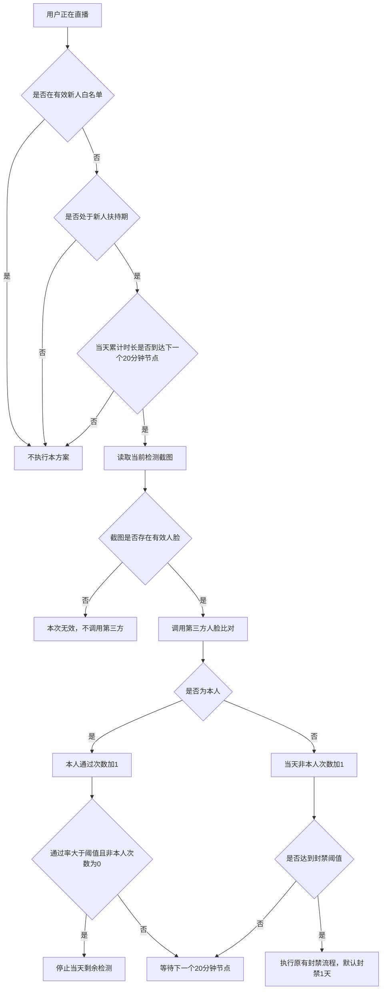

# 新人扶持期直播本人核验优化设计

> 版本：v2.0（简化版）  
> 日期：2026-07-22  
> 适用范围：新人扶持期间的直播本人核验

## 1. 方案说明

本次只优化新人扶持期间的人脸核验调度，不调整现有直播、有效时长和奖励业务。

### 1.1 本次调整内容

- 增加新人检测白名单；有效白名单用户不执行本方案的人脸检测。
- 根据用户注册时选择的国家/地区，判断是否存在新人扶持活动。
- 根据该国家/地区配置的扶持天数，判断用户当前是否仍在扶持期。
- 根据该国家/地区配置的每日扶持时长，计算当天计划检测次数。
- 检测由“单场直播每 6 分钟一次、每场最多 5 次”，调整为“当天累计直播时长每 20 分钟一次”。
- 当天累计直播时长跨直播场次计算，断播、重连、重新开播均不重置。
- 有效检测帧存在人脸时，才调用第三方接口与真人认证照片进行比对。
- 当天本人通过率达到配置阈值、且未出现非本人结果时，可提前停止当天剩余检测。
- 当天累计达到配置的“非本人次数”后，执行原有封禁流程，默认封禁直播 1 天。

### 1.2 明确不调整的内容

- 不调整现有有效直播时长的累计规则。
- 不根据本方案重新计算有效时长。
- 不调整新人扶持奖励的计算、发放、暂停或取消流程。
- 不调整现有直播心跳、截帧和真人认证流程。
- 无人脸截图仍沿用原逻辑：不调用第三方、不计为非本人。
- 本方案产生的本人核验结果，仅用于判断是否进入直播封禁流程。

## 2. 现状与调整方案

### 2.1 当前逻辑

1. 直播过程中每分钟截帧。
2. 每场直播每隔 6 分钟检测一次。
3. 每场最多检测 5 次。
4. 截图存在有效人脸时，调用第三方接口与真人认证照片比对。
5. 截图无人脸时不进行比对。
6. 一场直播累计 3 次非本人后，封禁直播 1 天。

### 2.2 调整后逻辑

1. 用户开始直播时，先判断其是否处于新人扶持期。
2. 不在扶持期，不启动本方案的人脸检测。
3. 在扶持期，读取该用户当天累计直播时长。
4. 当累计时长达到 20、40、60 分钟等检测节点时，执行一次检测。
5. 检测节点跨直播场次累计，同一天内不会因重新开播而重置。
6. 截图存在有效人脸时，调用第三方接口进行本人比对。
7. 比对结果为非本人时，累计当天非本人次数。
8. 达到封禁阈值后，执行原有封禁流程，并停止当天后续本人检测。
9. 达到该地区每日扶持时长对应的最大检测次数后，停止当天后续本人检测。

## 3. 扶持资格判断

### 3.1 国家/地区配置

建议复用或增加以下配置：

| 配置项 | 说明 | 示例 |
|---|---|---|
| `country_code` | 用户注册时选择的国家/地区 | BR |
| `support_enabled` | 是否开启新人扶持 | true |
| `newbie_check_whitelist_enabled` | 是否启用新人检测白名单 | true |
| `support_days` | 扶持天数 | 5、7、9 |
| `daily_support_minutes` | 每日扶持直播时长 | 60、120、180 |
| `check_interval_minutes` | 检测间隔 | 20 |
| `pass_early_stop_enabled` | 是否开启通过率提前结束 | true |
| `pass_rate_threshold` | 提前结束的通过率阈值 | 0.6 |
| `early_stop_require_zero_mismatch` | 提前结束是否要求非本人次数为0 | true |
| `mismatch_threshold` | 非本人封禁阈值 | 3 |
| `ban_hours` | 达到阈值后的封禁时长 | 24 |

### 3.2 是否启动检测

```text
用户不在有效新人检测白名单内
AND 用户注册国家已开启扶持
AND 当前时间在用户扶持开始时间与结束时间之间
AND 当天计划检测次数尚未完成
AND 当天未达到通过率提前结束条件
AND 用户当前未被封禁
= 启动检测
```

扶持期的开始时间和结束时间继续使用现有活动规则，本方案不重新定义。

### 3.3 新人检测白名单

- 白名单按 `user_id` 判断，优先级高于国家、扶持期、检测节点和通过率规则。
- 用户存在有效白名单记录时，直接跳过当天及后续扶持期内的本人检测。
- 白名单只豁免本方案的人脸检测，不改变有效时长、奖励发放及平台其他直播审核。
- 白名单记录建议支持生效时间、失效时间、添加原因和操作人，失效后自动恢复正常检测。
- 用户被移出白名单后，从当时已达到的下一个累计时长节点开始检测，不补调白名单期间已跳过的检测。

最小白名单字段：

| 字段 | 说明 |
|---|---|
| `user_id` | 白名单用户ID |
| `status` | 是否有效 |
| `effective_at` | 生效时间 |
| `expire_at` | 失效时间，可为空 |
| `reason` | 加入原因 |
| `operator` | 操作人 |

## 4. 检测次数计算

### 4.1 计算公式

```text
当天计划检测次数 = ceil(每日扶持时长分钟数 / 20)
```

当前扶持时长均为 20 分钟的整数倍时：

| 每日扶持时长 | 当天检测节点 | 当天最多检测次数 |
|---:|---|---:|
| 1 小时 | 20、40、60 分钟 | 3 次 |
| 2 小时 | 20、40、60、80、100、120 分钟 | 6 次 |
| 3 小时 | 20、40、60、80、100、120、140、160、180 分钟 | 9 次 |

### 4.2 整个扶持周期的理论上限

以下仅为用户每天均达到全部检测节点，且每次截图都存在有效人脸时的理论上限：

| 扶持天数 | 每天 1 小时 | 每天 2 小时 | 每天 3 小时 |
|---:|---:|---:|---:|
| 5 天 | 15 次 | 30 次 | 45 次 |
| 7 天 | 21 次 | 42 次 | 63 次 |
| 9 天 | 27 次 | 54 次 | 81 次 |

无人脸、提前下播、达到非本人阈值或接口异常时，实际调用次数会低于上述数量。

### 4.3 通过率提前结束

可以增加“当天通过率达到阈值后停止剩余检测”的规则，但通过率分母必须使用**当天计划检测总次数**，不能使用已完成检测次数。

```text
当天通过率 = 本人通过次数 / 当天计划检测总次数

提前结束条件：
pass_early_stop_enabled = true
AND 当天通过率 > pass_rate_threshold
AND 当天非本人次数 = 0
```

如果使用“已完成检测次数”作为分母，第一次检测通过后通过率就是 100%，会错误地立即停止当天检测。

阈值为严格大于 `0.6` 时，所需最少通过次数为：

```text
提前结束所需通过次数 = floor(当天计划检测总次数 × 0.6) + 1
```

| 每日扶持时长 | 计划检测次数 | 提前结束所需通过次数 | 正常用户最多可减少 |
|---:|---:|---:|---:|
| 1 小时 | 3 次 | 2 次 | 1 次 |
| 2 小时 | 6 次 | 4 次 | 2 次 |
| 3 小时 | 9 次 | 6 次 | 3 次 |

例如2小时需要计划检测6次，前4个不同检测节点均判定为本人，则 `4 / 6 = 0.667 > 0.6`，当天第5、6个检测节点不再执行。

如果提前结束前出现任何一次“非本人”，即使之后通过率超过0.6，也不提前结束，继续按原计划检测，直到达到最大检测次数或封禁阈值。无人脸、无效人脸和接口异常不算通过，也不算非本人。

## 5. 当天累计直播时长

本方案只读取现有直播时长数据，用于判断是否到达检测节点，不改变原有时长累计逻辑。

示例：

| 开播场次 | 本场直播时长 | 当天累计时长 | 触发检测 |
|---|---:|---:|---|
| 第 1 场 | 12 分钟 | 12 分钟 | 不触发 |
| 第 2 场 | 15 分钟 | 27 分钟 | 跨过 20 分钟，触发第 1 次 |
| 第 3 场 | 18 分钟 | 45 分钟 | 跨过 40 分钟，触发第 2 次 |
| 第 4 场 | 20 分钟 | 65 分钟 | 跨过 60 分钟，触发第 3 次 |

要求：

- 当天累计时长以现有业务口径为准。
- 同一用户同一业务日累计，不能按直播场次重置。
- 每天零点后的重置方式继续使用现有业务时区和日切规则。
- 本方案不判断某一分钟是否属于有效奖励时长。

## 6. 单次检测流程



### 6.1 检测结果

| 检测结果 | 是否调用第三方 | 是否累计非本人次数 | 处理方式 |
|---|---:|---:|---|
| 截图无人脸 | 否 | 否 | 记录无效检测，等待下一检测节点 |
| 截图人脸无效或质量不满足现有标准 | 否 | 否 | 记录无效检测，等待下一检测节点 |
| 第三方判定为本人 | 是 | 否 | 记录检测通过 |
| 第三方判定为非本人 | 是 | 是 | 累计当天非本人次数 |
| 第三方调用失败或超时 | 已发起 | 否 | 记录接口异常，不处罚用户 |

第三方相似度阈值、有效人脸标准和接口失败重试方式继续使用现有配置；如需调整，应作为单独需求处理。

本人通过、非本人、无人脸、接口异常均按不同检测节点去重。只有第三方明确判定为本人的结果才增加 `pass_count`。

## 7. 非本人累计与封禁

### 7.1 累计范围

- 非本人次数按“用户 + 业务日”累计。
- 同一天跨直播场次累计，重新开播不清零。
- 默认每天日切时清零。
- 每次非本人结果必须来自不同的 20 分钟检测节点。
- 接口重试或重复消息不能重复累计非本人次数。

### 7.2 封禁规则

```text
当天非本人次数 >= mismatch_threshold
=> 执行原有封禁流程
=> 默认封禁直播 24 小时
=> 停止当天剩余检测任务
```

默认阈值为 3，支持配置。

本方案只负责产生“达到封禁阈值”的结果，具体关播、封禁记录、通知和解封继续复用原有流程。

## 8. 数据与幂等要求

建议保存以下最小状态：

| 字段 | 说明 |
|---|---|
| `user_id` | 用户ID |
| `business_date` | 业务日期 |
| `country_code` | 注册国家/地区 |
| `support_end_time` | 扶持结束时间 |
| `daily_support_minutes` | 当日扶持时长配置 |
| `next_check_minute` | 下一个检测节点，如 20、40、60 |
| `completed_check_nodes` | 已处理的检测节点 |
| `pass_count` | 当天第三方判定为本人的次数 |
| `mismatch_count` | 当天非本人次数 |
| `status` | 检测中、通过率提前完成、已完成、已封禁 |

每个检测节点使用以下幂等键：

```text
user_id + business_date + check_minute
```

例如同一用户当天 40 分钟节点的消息被重复消费，不得重复调用第三方，也不得重复累计非本人次数。

## 9. 调用量分析

调整后的第三方调用量主要通过以下方式减少：

1. 有效新人白名单用户不检测。
2. 只有注册国家/地区已开启扶持的非白名单用户才检测。
3. 只有处于扶持期限内的用户才检测。
4. 检测间隔由 6 分钟调整为 20 分钟。
5. 从“每场最多 5 次”改成“当天按累计时长固定节点”，频繁断播重连不会重新获得检测次数。
6. 达到非本人阈值后停止剩余检测。
7. 无有效人脸时不调用第三方。
8. 正常用户达到通过率阈值后提前停止剩余检测。

当用户所有已执行检测均通过时，提前结束规则可将每天调用量从 3/6/9 次降至 2/4/6 次，分别减少 1/2/3 次，即约 33.3%。如果当天出现非本人、无人脸或接口异常导致通过次数不足，则继续检测，不一定能够获得该降幅。

需要注意：

- 现有单场长播最多调用 5 次。
- 新方案中，2 小时和 3 小时扶持分别最多调用 6 次和 9 次。
- 因此单看“一场连续长播”，调用次数可能增加。
- 整体是否降本，取决于扶持期外调用量、用户每天开播场次数和断播重连次数。

上线前建议使用近 30 天数据对比：

```text
现有调用量 = 所有直播场次实际人脸比对调用数
新方案模拟调用量 = 扶持期内各用户当天有效检测节点数
节省比例 = (现有调用量 - 新方案模拟调用量) / 现有调用量
```

如果回放结果显示整体调用量没有下降，需要再讨论是否降低 2 小时、3 小时任务的检测节点数量；本次方案不做该调整。

## 10. 异常处理

| 异常场景 | 处理方式 |
|---|---|
| 国家未配置扶持规则 | 不启动检测 |
| 扶持配置读取失败 | 不执行自动封禁，记录告警 |
| 当天累计时长读取失败 | 不执行本次检测，等待数据恢复 |
| 截图获取失败 | 记录无效检测，不计非本人 |
| 第三方接口超时 | 不计非本人，按现有接口策略重试 |
| 重复检测消息 | 根据幂等键忽略 |
| 用户达到封禁阈值 | 执行原有封禁流程，停止后续检测 |
| 用户扶持期结束 | 立即停止本方案检测 |

## 11. 验收测试

| 测试场景 | 预期结果 |
|---|---|
| 用户处于有效新人检测白名单 | 不启动本方案的人脸检测 |
| 白名单已过失效时间 | 恢复正常检测资格判断 |
| 用户从白名单移除 | 从下一个累计时长节点开始检测，不补调已跳过节点 |
| 用户所在国家未开启扶持 | 不启动检测 |
| 用户已超过扶持天数 | 不启动检测 |
| 1 小时扶持用户直播 60 分钟 | 最多触发 3 个检测节点 |
| 2 小时扶持用户直播 120 分钟 | 最多触发 6 个检测节点 |
| 3 小时扶持用户直播 180 分钟 | 最多触发 9 个检测节点 |
| 1 小时用户前2次均通过 | `2/3 > 0.6`，停止第3次检测 |
| 2 小时用户前4次均通过 | `4/6 > 0.6`，停止第5、6次检测 |
| 3 小时用户前6次均通过 | `6/9 > 0.6`，停止第7、8、9次检测 |
| 2 小时用户第一次通过 | `1/6` 未达到阈值，继续检测 |
| 2 小时用户3次通过、1次非本人 | 即使后续通过率超过0.6，也不提前结束 |
| 第一场 12 分钟，第二场再播 10 分钟 | 第二场跨过累计 20 分钟时触发第 1 次检测 |
| 断播重连多次 | 检测节点和非本人次数均不重置 |
| 检测节点截图无人脸 | 不调用第三方，不累计非本人 |
| 第三方返回非本人 2 次 | 不封禁，继续等待后续节点 |
| 第三方返回非本人第 3 次 | 执行原有 1 天封禁流程 |
| 第 3 次非本人后仍有剩余节点 | 不再调用第三方 |
| 同一检测节点消息重复消费 | 只处理一次 |
| 第三方接口超时 | 不累计非本人，不自动封禁 |
| 有效时长或奖励业务运行 | 不受本方案影响，继续按原逻辑处理 |

## 12. 风险边界

本次保持“无人脸不比对、不计非本人”的现有逻辑，因此无法解决始终无人脸的挂播问题；本人播放自己的历史录像，也可能通过普通人脸比对。这两个问题需要无人脸处置、活体检测或视频重复识别能力，超出本次范围。

通过率提前结束会使当天后半段不再核验。例如2小时用户前4次通过后，最后40分钟不再检测，存在前段由本人直播、后段换人挂播的可能。这是降低接口调用与保持全时段覆盖之间的取舍。若后续发现被规避，可改成“达到通过率后跳过中间检测，但保留最后一个检测节点”；本次先按配置开关控制。

第三方人脸比对属于概率判断。AWS 和 Microsoft 的公开文档均建议关注输入图片质量、根据实际业务数据校准阈值，并对影响用户权益的结果保留复核能力：[AWS CompareFaces](https://docs.aws.amazon.com/rekognition/latest/APIReference/API_CompareFaces.html)、[Microsoft Face 特性与限制](https://learn.microsoft.com/en-us/azure/foundry/responsible-ai/face/characteristics-and-limitations)。TikTok 的公开规则也将直播真实性和欺骗行为作为治理目标，但其具体检测算法并未公开：[TikTok LIVE 规则](https://www.tiktok.com/community-guidelines/en/accounts-features?cgversion=2025H2update&lang=en)。

## 13. 最终方案

1. 有效新人检测白名单用户直接跳过本方案检测。
2. 非白名单用户按注册国家/地区判断是否有新人扶持。
3. 只在用户扶持期限内启动本人检测。
4. 读取现有当天累计直播时长，不修改其计算逻辑。
5. 每累计 20 分钟产生一个检测节点。
6. 1、2、3 小时扶持分别最多检测 3、6、9 次。
7. 当通过次数除以计划检测总次数大于0.6，且当天没有非本人结果时，提前停止剩余检测。
8. 有有效人脸才调用第三方；无人脸保持原逻辑。
9. 非本人次数在同一业务日跨直播场次累计。
10. 默认累计 3 次非本人后，复用原有流程封禁直播 1 天。
11. 不调整有效时长、奖励累计和奖励发放流程。
