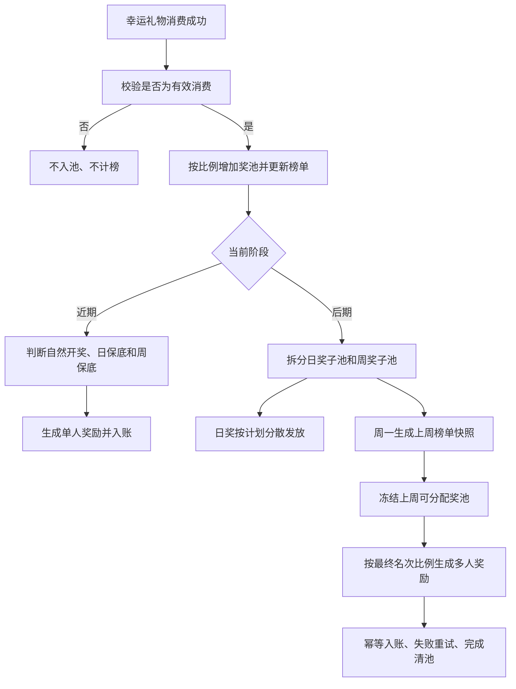

# Jackpot 奖池分阶段改造需求文档

## 1. 文档信息

| 项目 | 内容 |
|---|---|
| 需求名称 | Jackpot 奖池日奖与周奖改造 |
| 文档版本 | V0.1 |
| 文档状态 | 待业务确认 |
| 关联业务 | 幸运礼物、幸运礼物消费周榜、金币账户、运营后台 |

## 2. 背景与现状

Jackpot 奖池资金来源于幸运礼物有效消费金额的一定比例。本文暂按“千分之一（0.1%）”理解；原始描述“千分之亿一”疑似笔误，上线前必须由业务确认。

当前规则：

- 幸运礼物每产生一笔有效消费，按消费金币的 0.1% 计入 Jackpot 奖池。
- 奖池达到 286 万金币时触发开奖。
- 每次开奖发放当时奖池余额的 15%。
- 按 286 万金币计算，单次发放金额为 42.9 万金币。
- 若奖池从 0 开始累积，达到 286 万金币需要约 28.6 亿金币的有效幸运礼物消费。

现有问题：

- 开奖完全依赖流水，无法稳定满足“每天至少一次奖励”。
- “奖励”与“大奖”尚未形成明确分层，无法独立控制日奖频次和周大奖频次。
- 周期、中奖资格、低流水时的资金补足、退款冲正等口径尚未定义。
- 当前单一门槛规则不适合后续“一周清池、多人瓜分”的运营方式。

## 3. 建设目标

### 3.1 近期目标

- 每个自然日至少发放 1 次 Jackpot 奖励。
- 每个自然周至少发放 1 次 Jackpot 大奖。
- 尽量复用当前“消费触发中奖”的交互和结算链路，以较小改造快速上线。

### 3.2 后期目标

- 每天稳定发放多笔小额奖励，形成持续中奖感知。
- 每周固定结算一次剩余奖池，并完成清池。
- 周奖获奖人从幸运礼物消费周榜中产生。
- 周奖支持按榜单名次比例瓜分，并为后续“榜单内加权抽人”保留配置能力。

## 4. 统一规则口径

### 4.1 周期

- 日周期：北京时间每日 `00:00:00—23:59:59`。
- 周周期：北京时间每周一 `00:00:00` 至周日 `23:59:59`。
- 周榜定榜与奖池结算使用同一时区、同一起止时间。
- 建议每周一 `00:05` 生成上周榜单快照，`00:10` 执行上周奖池结算，避免跨周交易仍在处理中。

### 4.2 有效消费

满足以下条件的幸运礼物消费才计入奖池和榜单：

- 支付成功且业务状态为完成。
- 使用真实可消费金币支付。
- 非测试账号、机器人账号、封禁账号或运营排除账号产生。
- 退款、撤销或风控判定无效的订单不计入；已计入的执行冲正。
- 同一业务流水号只允许入池一次。

奖池入池公式：

`入池金额 = 有效幸运礼物消费金币 × 入池比例`

入池比例默认按 `0.1%`，由后台配置。金额取整沿用现有金币系统规则，不允许业务服务自行采用另一套取整方式。

### 4.3 有效参与用户

- 用户在对应日或周周期内至少产生 1 笔有效幸运礼物消费，方可参与该周期奖励。
- 周奖排名与消费金额直接复用幸运礼物消费周榜定榜快照。
- 同分时依次按“先达到该消费额者优先、最早一笔有效消费时间、用户 ID”确定唯一排名。
- 发奖前命中封禁、作弊、测试或运营排除名单的用户失去资格，由下一名递补。

### 4.4 资金账户

系统至少区分以下账务金额：

- 实际奖池余额：真实已入池且尚未发放的金币。
- 冻结金额：已生成奖励批次、尚未完成入账的金币。
- 可用奖池余额：`实际奖池余额 - 冻结金额`。
- 平台补贴金额：为满足保底频次或最低奖金，由平台预算额外承担的金币。

任何奖励均需记录“奖池支出”和“平台补贴”各自金额，不得仅修改前端展示数字。

## 5. 近期需求：日保底 + 周大奖保底

### 5.1 奖励分级

| 奖励类型 | 定义 | 频次要求 | 推荐发放金额 |
|---|---|---|---:|
| 日常奖励 | 用于满足每日中奖感知的小额奖励 | 每日至少 1 次 | 后台配置固定金额或区间随机金额 |
| 大奖 | 当前 15% Jackpot 奖励 | 每周至少 1 次 | `max(可用奖池余额 × 15%, 大奖最低金额)`，但奖池不足部分记平台补贴 |

建议将“大奖最低金额”默认设为 42.9 万金币，即当前奖池达到 286 万时的 15%；最终数值由运营和财务确认。

### 5.2 自然触发

- 保留当前“奖池达到 286 万金币时触发大奖”的规则。
- 用户完成一笔有效幸运礼物消费后，系统先入池，再判断是否触发奖励。
- 自然触发的日常奖励计入当天“已发奖次数”。
- 自然触发的大奖同时计入当天“已发奖次数”和当周“已发大奖次数”。
- 同一笔消费最多触发 1 个奖项；大奖优先于日常奖励。

### 5.3 日常奖励保底

- 后台配置每日保底检查时间，建议默认 `23:00`。
- 到达检查时间时，若当天尚未发放任何 Jackpot 奖励，则开启“日奖强制命中”状态。
- 强制命中开启后，当天下一笔有效幸运礼物消费直接触发日常奖励。
- 若截至 `23:59:59` 仍没有新的有效消费，则从当天幸运礼物消费日榜第 1 名开始筛选首个有效用户，系统自动发放日常奖励。
- 当天没有任何有效参与用户时，不发奖，记录“无有效参与用户”；该情况不计为系统未达标。
- 日常奖励优先从可用奖池扣除；奖池不足时，差额由平台保底预算补足。

### 5.4 周大奖保底

- 后台配置周大奖保底检查时间，建议默认周日 `22:00`。
- 若本周尚未发放大奖，则开启“周大奖强制命中”状态。
- 强制命中开启后，本周下一笔有效幸运礼物消费直接触发大奖。
- 若截至周日 `23:59:59` 仍没有新的有效消费，则从本周幸运礼物消费周榜第 1 名开始筛选首个有效用户，系统自动发放大奖。
- 本周没有任何有效参与用户时，不发奖，记录“无有效参与用户”；该情况不计为系统未达标。
- 已自然触发过至少 1 次大奖的周，不再执行周大奖保底，但不限制继续自然触发大奖。

### 5.5 近期后台配置

- 入池比例，默认 0.1%。
- 大奖自然触发门槛，默认 286 万金币。
- 大奖发放比例，默认 15%。
- 大奖最低金额，建议默认 42.9 万金币。
- 日常奖励固定金额或随机区间。
- 日奖保底检查时间、周大奖保底检查时间。
- 平台日补贴上限、周补贴上限、总补贴预算。
- 排除用户、测试账号及风控名单。
- 规则启停和紧急停止开关。

### 5.6 近期关键约束

- 未配置平台补贴且奖池余额不足时，系统不可能同时保证固定奖金和固定频次；上线前必须确认“降低奖金”或“允许平台补贴”中的一种策略。
- 推荐允许平台补贴并配置硬上限。达到补贴上限时停止保底发奖并告警，不允许奖池出现负余额。
- 客户端展示的奖池余额、中奖金额与账务实际金额必须一致；如业务使用展示池，必须明确标注并与实际池分账管理。

## 6. 后期需求：每日小奖 + 周榜清池

### 6.1 奖池分账

每笔有效入池金额按后台比例拆分：

- 日奖子池：用于当天小额奖励，建议初始比例 20%。
- 周奖子池：用于周榜结算，建议初始比例 80%。

计算公式：

`日奖入池 = 本笔入池金额 × 日奖比例`

`周奖入池 = 本笔入池金额 - 日奖入池`

比例仅为建议初始值，需结合历史流水模拟后确定。日奖子池当日未发完的余额在日结后转入当周周奖子池，不跨周独立保留。

### 6.2 每日小额奖励

- 每日发奖次数、单次金额或金额区间均由后台配置。
- 系统将当日计划发奖时间随机分散到运营配置的有效时段，避免用户精确预测。
- 到达计划时间后，由下一笔有效幸运礼物消费触发；当日最后一次保底仍按第 5.3 节执行。
- 单个用户每日中奖次数可设上限，默认建议 1 次，以扩大中奖覆盖人数。
- 当日日奖实际支出不得超过“日奖子池可用余额 + 当日平台补贴额度”。
- 日奖子池不足最低单笔奖金时，按平台补贴策略执行；无补贴额度时停止后续日奖并告警。

### 6.3 周奖清池范围

周结算金额为：

`周可分配金额 = 周奖子池可用余额 + 当周转入的日奖结余 + 已审批的周奖平台补贴`

- 每周结算时冻结全部周可分配金额。
- 自动入账成功后，相应周奖子池余额清零。
- 因金币最小单位产生的无法分配尾差，统一补给排名第 1 的有效用户。
- 入账失败的金额保持冻结并进入重试，不得滚入下一周或重复瓜分。

### 6.4 周奖推荐方案：按名次固定比例瓜分

默认选取周榜前 20 名有效用户，按以下比例自动瓜分：

| 周榜名次 | 单人比例 | 分组总比例 |
|---|---:|---:|
| 第 1 名 | 20% | 20% |
| 第 2 名 | 15% | 15% |
| 第 3 名 | 10% | 10% |
| 第 4—10 名 | 每人 5% | 35% |
| 第 11—20 名 | 每人 2% | 20% |
| 合计 |  | 100% |

补充规则：

- 名次比例必须后台可配置，发布时校验合计严格等于 100%。
- 有效用户不足 20 人时，空缺名次比例按现有获奖用户的原始权重重新归一化，保证当周奖池全部分完。
- 用户被排除时，后续用户先递补名次，再按最终名次比例结算。
- 周榜快照生成后，新的消费进入下一周，不得回写上周名次。

推荐该方案作为首发方案，原因是规则透明、用户易理解、财务易对账、结算结果可预演；缺点是激励更偏向头部消费用户。

### 6.5 备选方案：榜单内加权抽人

后台保留另一种可切换模式：

- 从周榜前 N 名有效用户中抽取 K 名获奖用户。
- 用户抽中权重可按“消费金额”或“名次权重”配置。
- 单次抽取不放回，同一用户一周最多获得 1 份周奖。
- 奖金可均分，也可按中奖顺序配置比例。
- 必须保存随机种子、候选人快照、权重快照和抽取过程，支持审计复现。

该方案中奖覆盖感更强，但用户预期和财务解释成本更高，不建议作为第一版默认规则。

## 7. 结算流程

## 8. 数据与幂等要求

每次入池和发奖至少记录：

- 业务流水号、奖池批次号、奖励批次号。
- 用户 ID、直播间 ID、幸运礼物 ID。
- 消费金额、入池比例、入池金额。
- 奖励类型、触发方式（自然、日保底、周保底、周榜清池）。
- 奖池支出、平台补贴、发奖前后余额。
- 榜单周期、榜单名次、榜单消费金额、比例快照。
- 配置版本、创建时间、入账状态、重试次数、失败原因。

幂等要求：

- 同一消费流水只能入池一次。
- 同一奖励批次与用户只能入账一次。
- 日保底、周保底和周清池任务重复执行时不得重复生成奖励。
- 发奖结果已确定但入账超时时，只允许重试原金额，不得重新选人或重新计算比例。

## 9. 监控与告警

- 当日 `23:30` 仍未产生任何奖励时告警。
- 周日 `23:30` 仍未产生大奖时告警。
- 平台补贴达到日上限、周上限或总预算的 80%/100% 时分级告警。
- 奖池余额为负、账务余额与业务余额不一致时立即阻断新发奖并告警。
- 周榜快照失败、周结算延迟、入账重试超过阈值时告警。
- 后台报表展示入池金额、奖池支出、补贴金额、中奖人数、日达标率、周达标率和未结算金额。

## 10. 验收标准

| 编号 | 场景 | 预期结果 |
|---|---|---|
| AC-01 | 当天自然产生普通奖励 | 计入当日日奖次数，不重复执行日保底 |
| AC-02 | 当天 `23:00` 前未发奖，之后有有效消费 | 下一笔有效消费触发日常奖励 |
| AC-03 | 当天无后续消费，但日榜有有效用户 | 日终自动向首个有效用户发奖 |
| AC-04 | 当天无任何有效消费 | 不发奖，记录无有效参与用户，不计为系统未达标 |
| AC-05 | 本周已自然产生大奖 | 不执行周大奖保底 |
| AC-06 | 周日仍无大奖且周榜有有效用户 | 触发周大奖保底并足额入账 |
| AC-07 | 奖池不足保底奖金且补贴可用 | 奖池余额扣至 0，差额计入平台补贴 |
| AC-08 | 补贴达到上限 | 不透支、不产生负余额，停止保底并告警 |
| AC-09 | 周榜满 20 个有效用户 | 按 `20%/15%/10%/5%/2%` 分配，总额等于周可分配金额 |
| AC-10 | 周榜不足 20 个有效用户 | 现有用户权重归一化，全部周奖池完成分配 |
| AC-11 | 周榜用户发奖前被排除 | 后一名递补，按递补后的最终名次结算 |
| AC-12 | 周清池任务重复执行 | 不重复生成批次、不重复入账 |
| AC-13 | 部分用户入账失败 | 成功用户不受影响，失败金额冻结并按原结果重试 |
| AC-14 | 消费订单退款 | 按原入池流水冲正，不重复冲正 |

## 11. 上线前必须确认的业务项

1. 原始“千分之亿一”是否确认为“千分之一（0.1%）”。
2. “286W”是否确认为 286 万金币，而非展示值或其他币种。
3. 当前“每次开奖 15%”是按开奖前实际余额计算，还是按固定门槛计算。
4. 日常小额奖励的单次金额/区间、每日目标次数与单用户每日上限。
5. 大奖最低金额是否采用 42.9 万金币。
6. 低流水导致奖池不足时，是否允许平台补贴，以及日/周/总预算上限。
7. 后期周奖默认采用“前 20 名固定比例瓜分”，还是“榜单内加权抽人”。
8. 周榜是否已支持排除账号、榜单快照、同分排序和历史榜查询。
9. 奖励是否自动到账；本文建议自动到账，不设置用户主动领取和过期失效。
10. 是否需要在 APP 展示真实奖池余额、日奖倒计时、周清池倒计时和周榜预计可得奖金。
