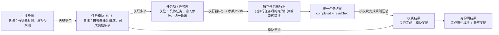
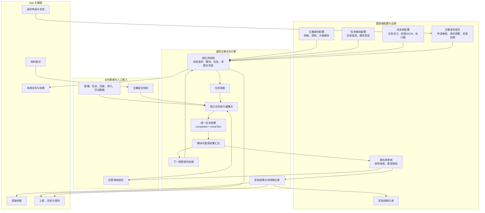
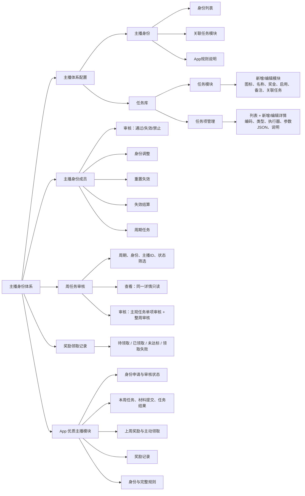
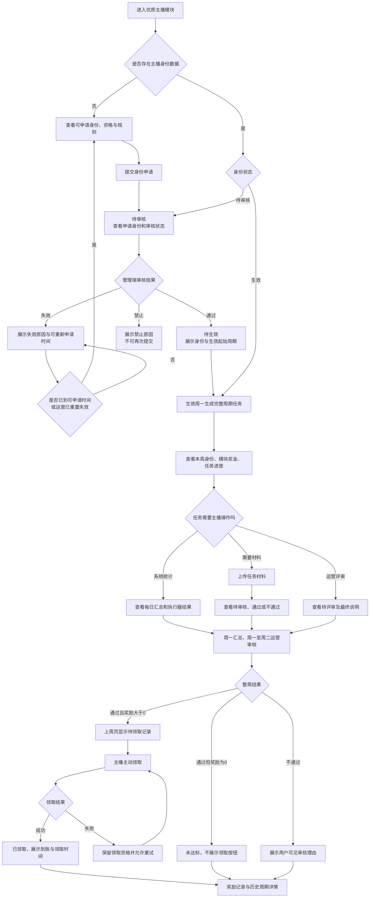
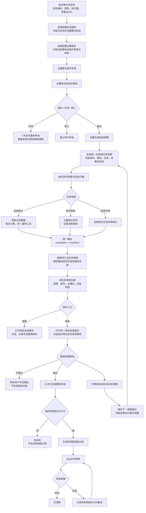

# 优质主播体系迭代产品需求文档

## 1. 文档信息

| 项目 | 内容 |
| --- | --- |
| 需求名称 | 优质主播体系迭代 |
| 文档状态 | 需求讨论稿，待需求评审 |
| 涉及端 | 管理后台、App优质主播模块 |
| 目标使用者 | 主播、运营、审核人员及其他授权人员 |
| 文档范围 | 策略模式、总体架构、主播身份、任务模块、任务项、分项奖励、身份成员、周任务快照、审核结算、身份调整及App闭环 |
| 非本文范围 | 邀请充值提成、数据库表结构、字段类型、索引、接口技术设计及测试用例 |
| 原型基线 | `8月/优质主播迭代`目录内最新18张管理端与App H5原型 |

## 2. 需求背景

现有优质主播功能以主播申请、每日直播总时长、高峰时段时长、周数据审核和单一奖励为主，能够支持基础优质主播的周任务管理，但难以承载普通优质主播、黄金优质主播、外部认证主播等不同身份的差异化任务和奖励。

随着主播运营政策扩展，不同主播身份需要配置不同的直播、互动、内容、拉新、收入和活动任务，并在任务模块完成后发放对应奖励。后续还需要扩展签约主播等其他身份，因此本次不将身份、任务和奖励写死为单一优质主播规则，而是建设一套通用的主播运营体系。

本体系以“主播身份 + 任务模块 + 任务项 + 分项奖励”为核心。系统按主播当周生效的身份生成完整任务快照，自动计算客观指标，由运营审核主观任务及最终奖励，形成配置、执行、审核、发放和身份调整的完整闭环。

## 3. 需求目标

1. 建立可扩展的主播身份体系，支持普通优质主播、黄金优质主播、超级主播、外部认证主播、签约主播等身份独立配置。
2. 建立可复用任务库：任务项对应一个固定系统实现，任务模块关联多个任务项并配置一笔模块奖励，主播身份关联多个任务模块。
3. 除运营主观评判项外，直播、互动、拉新和收入等客观任务全部由系统自动计算完成情况。
4. 每个主播每周生成一份独立任务快照，冻结当周身份、任务参数、模块奖励和展示文案，保证历史可追溯。
5. 支持按任务模块分别核算奖励；整周审核通过后生成奖励结果记录，有奖励时进入“待领取”，由主播在App主动领取。
6. App向主播清晰展示当前身份、本周最高奖励、各模块奖励、任务进度、审核状态和历史结算结果。
7. 支持身份升级、降级、失效、禁止和运营手动调整，非立即失效类变更以下一完整自然周为生效周期。
8. 建立完整规则说明，使主播能够理解准入条件、统计口径、奖励条件、升降级和违规处理规则。

## 4. 核心概念与产品边界

### 4.1 主播身份

主播身份是主播运营体系中直接生效和执行任务的业务单元。首期身份包括普通优质主播、黄金优质主播、超级主播、外部认证主播和签约主播。系统不在首期增加“优质主播计划”“签约主播计划”等额外分组层级；后续确有按地区或运营政策分组的需求时，再增加上层计划能力。

每个主播身份独立配置资格说明、App规则说明、关联任务模块、启用状态和排序。身份每周最高奖励由已关联任务模块的奖励金额自动合计，不单独重复配置。

### 4.2 身份关系与扩展

普通优质主播、黄金优质主播等身份之间可以配置升级或降级关系；外部认证主播、签约主播等身份也可以通过审核或运营调整直接获得。升级、降级仅描述身份之间的变更方向，不形成额外的“计划—层级”页面层级。

### 4.3 任务模块

任务模块是一组具有相同业务目的的任务项集合，并对应一笔模块奖励。任务模块在任务库中统一维护，可被主播身份关联。例如：

- 有效直播。
- 互动质量。
- 拉新与内容。
- 收入与活动。
- 内容与质量。

模块内任务项满足模块完成规则后，该模块才被判定为完成并产生对应奖励。同一任务项可以被多个任务模块复用；同一任务模块可以被多个主播身份关联。若不同身份需要不同模块奖励，应创建不同任务模块，但可以继续复用相同任务项。

### 4.4 任务项

任务项是任务库中的最小基础能力，对应一个明确且固定的系统实现或审核流程，例如“有效直播总时长”“有效直播天数”“黄金时段达标天数”“发布Sano相关外部内容”。任务项不归属于单一主播身份或模块，可被多个任务模块关联复用。

任务项分为：

- 系统自动计算任务：由系统数据按配置口径自动计算，运营不得直接修改计算结果。
- 运营主观评判任务：由运营依据审核标准、主播提交材料或平台记录做出判断。
- 主播提交材料并由运营审核任务：主播在App提交任务材料，运营逐条审核；系统按审核通过数量计算任务进度和最终完成结果。

### 4.5 分项奖励

每个任务模块单独配置奖励。主播完成多少个模块，即核算多少个模块的奖励；未完成模块不产生对应奖励。整周审核通过后，系统汇总当周最终奖励并生成奖励结果记录。最终奖励大于0时记录状态为“待领取”，由主播在App主动领取；最终奖励为0时记录状态为“未达标”，不可领取。

### 4.6 与邀请充值提成的边界

“邀请充值提成｜新用户前30天”不属于本次优质主播周任务体系，后续作为独立的“邀请返佣”模块设计，原因如下：

- 优质主播任务按自然周结算，邀请返佣按每个受邀新用户的独立30天窗口结算。
- 优质主播奖励是固定模块金额，邀请返佣按照有效净充值比例计算。
- 邀请返佣涉及退款、拒付、异常充值、关联账号、有效消费、延迟发放和月度封顶等独立风控口径。
- 邀请返佣未来可能向优质主播以外的用户开放。

优质主播任务中可以保留“邀请有效新用户”“新增付费用户”等固定任务；受邀用户产生充值后的比例提成，由独立邀请返佣模块计算。两者共享邀请关系和有效用户结果，但不共享任务周期、奖励配置和结算记录。

### 4.7 主播任务策略模式

本体系采用“主播身份定义政策、任务模块组织任务和奖励、任务项封装独立实现”的三层策略模式。三层各自只关注一类问题：

| 配置层 | 核心关注点 | 负责内容 | 不负责内容 |
| --- | --- | --- | --- |
| 主播身份 | 主播属于什么身份 | 身份资格、规则说明、需要完成哪些任务模块、模块展示顺序 | 不重复定义任务计算口径，不直接配置每个任务项结果 |
| 任务模块 | 一组任务由什么组成，完成后获得什么奖励 | 模块名称、图标、模块奖金、关联任务项、任务项顺序、模块完成规则 | 不实现具体指标计算，不判断主播属于什么身份 |
| 任务项/任务库 | 具体任务是什么，如何输入和输出 | 任务编码、任务类型、执行器标识、任务参数JSON、展示说明、实现说明 | 不决定模块奖金，不决定任务属于哪个身份 |

综合关系为：某个主播身份关联多个任务模块，表示该身份每周需要完成哪些任务以及各部分可获得多少奖励；每个任务模块关联多个任务项并设置一笔奖金；任务项由对应执行器处理自己的输入，统一输出是否完成和结果文本。系统再按照模块规则汇总任务结果，确定模块是否完成及可得奖励，最终形成该身份当周的任务与奖励结果。



#### 4.7.1 任务执行器职责边界

每个任务项对应一个固定执行器实现。执行器只处理该任务独有的约定，不承担通用编排职责。例如：黄金时段执行器解析黄金时间段、每日累计分钟数和每周达标天数；外部内容执行器读取材料审核结果并计算审核通过条数。执行器不需要知道当前主播是普通优质主播还是签约主播，也不计算模块奖金或整周奖励。

执行器输入由任务自身协议决定，可以包括任务参数JSON、周期范围、主播ID、业务统计数据、主播提交材料或运营审核结论。不同任务的输入结构可以不同，技术实现按照任务编码与执行器协议自行解析。

所有执行器必须转换为统一输出：

- `completed`：布尔值，表示任务最终是否完成，供通用状态和奖励逻辑使用。
- `resultText`：面向运营和主播的结果说明，可以是摘要，也可以是多行日期明细，通用框架只展示、不解析。

通用任务框架负责身份与模块关联、周任务快照生成、执行器调度、结果保存、模块结果汇总、审核状态流转和奖励计算；不得把单个任务的特殊口径写入通用流程。增加一种新任务时，只需要新增任务定义和对应执行器，再将任务项关联到所需模块，不需要修改主播身份、模块汇总和奖励结算框架。

#### 4.7.2 策略核心要点

1. **身份是政策入口。** 产品和运营从身份视角关注当前有哪些主播身份、谁可以获得身份、每个身份需要完成哪些模块，以及完整规则如何向主播说明。
2. **模块是任务组合和奖励单元。** 模块只关心由哪些任务项组成、任务项展示顺序、何时算模块完成，以及完成模块后奖励多少；模块奖励不拆到任务项上。
3. **任务项是技术实现单元。** 任务库只关心一个具体任务是什么、由哪个执行器实现、输入参数如何约定、向运营和主播展示什么说明，以及如何输出统一结果。
4. **执行器彼此隔离。** 每个执行器只解释自己的任务参数和业务数据，不读取身份配置，不感知其他任务，不汇总模块奖金，也不决定主播升级或降级。
5. **通用框架只做编排。** 通用框架不解析任务参数JSON的业务字段，只将冻结参数传给对应执行器，并消费统一的`completed`和`resultText`。
6. **模块完成后才产生分项奖励。** 首期模块内所有任务项均完成时模块完成，获得该模块完整奖金；任一任务未完成则该模块奖金为0，但不影响其他已完成模块参与整周奖励汇总。
7. **周期快照隔离配置变化。** 身份、模块或任务项修改只影响后续完整周期；已经生成的周任务持续使用快照中的任务参数、展示说明和模块奖金。
8. **扩展以组合为主。** 新增主播身份优先复用已有模块；新增政策组合可以新建模块并复用任务项；只有出现新的任务计算口径时才新增任务项和执行器。

组合示例：黄金优质主播可以关联“有效直播15美元”“互动质量5美元”“拉新与内容6美元”“收入与活动4美元”四个模块；“有效直播”模块再关联有效直播总时长、有效直播天数和黄金时段达标天数三个任务项。主播完成前三个有效直播任务后获得该模块15美元；其他模块按照各自任务结果独立判断，整周最终奖励为所有已完成模块奖金之和。

## 5. 全局业务口径

### 5.1 时间与周期口径

- 所有任务统计、周期切换和页面倒计时均使用服务器时间，统一时区为 **UTC+8**。
- 一个任务周期为完整自然周，即周一 `00:00:00` 至周日 `23:59:59`。
- App不得使用主播设备本地时间判断周期、任务状态或奖励状态。
- 跨自然日的直播时长按照UTC+8自然日边界拆分，并归属到对应日期。
- 周内进度数据每天汇总一次；页面明确显示数据更新时间，不将T+1数据展示成实时数据。
- 每周一重新聚合上一完整自然周的所有客观任务指标，周一最终汇总结果作为奖励审核依据。

### 5.2 新主播审核与生效

- 新主播审核集中在每周一完成。
- 审核通过后，主播进入“审核通过，待生效”状态，不参与当前自然周任务。
- 主播从审核通过后的下一个周一 `00:00:00` 正式生效。
- 生效时按照主播身份及其当前关联的任务模块生成完整自然周任务快照。
- 不支持首周按剩余天数折算任务目标。
- 生效前产生的直播、互动、拉新、内容和收入数据不计入任务。
- 审核通过至正式生效期间，App可以展示主播身份、规则和生效日期，但不展示进行中的任务进度和预计奖励。
- 身份审核支持通过、失效和禁止，三种结果均可填写用户可见备注。
- 失效后7天允许主播重新提交；禁止后主播不能再次提交；重置失效可以提前清除7天限制。
- 生效前被运营失效、禁止或调整身份时，不生成原身份任务快照。

### 5.3 金额与奖励口径

- 身份最高奖励等于该身份所有可发放任务模块奖励之和。
- 页面以美元展示政策奖励金额；如实际通过钻石发放，后台需配置固定换算关系，奖励记录同时保存美元政策金额和实际发放钻石数。
- 模块预计奖励仅用于进度展示，不代表最终应发奖励。
- 模块审核奖励以运营审核完成后的模块结果为准。
- 当周最终奖励等于所有审核通过模块的奖励金额之和。
- 整周审核提交前，不生成可领取奖励。
- 整周审核通过后，系统生成一条当周奖励结果记录，并保留各模块奖励明细；整周审核不通过不生成奖励结果记录。
- 最终奖励大于0时状态为“待领取”；主播在App主动领取成功后更新为“已领取”。
- 最终奖励为0时状态为“未达标”，不展示领取按钮。
- 领取失败不重新触发任务审核，奖励记录保留待领取资格并允许主播重试；系统记录失败原因。

### 5.4 客观数据与人工审核边界

- 客观任务由系统自动统计和判断是否达到目标。
- 运营只能查看客观任务的统一结果、结果文本和更新时间，不得直接修改`completed`或`resultText`。
- 发现客观数据异常时，运营可以标记“数据异常”并发起重新计算，不得通过人工补数方式将未完成改为完成。
- 运营评审任务由运营根据明确审核标准判定通过或不通过，并填写用户可见结果说明。
- 所有运营评审任务获得最终结果后，运营统一提交本周整周审核结果。

### 5.5 配置变更与快照口径

- 主播身份、任务模块和任务项均直接维护当前配置，不提供草稿发布、差异比较或独立版本页面。
- 主播身份、任务模块和任务项参数修改后，从下一完整自然周生成的新任务快照开始使用。
- 周任务快照必须复制当时使用的身份名称、任务模块、任务项参数JSON、奖励金额和展示文案。
- 历史任务和奖励查询读取对应快照，不使用当前配置反向计算。
- 已生成快照不得因运营后续修改配置而动态变化。

## 6. 功能整体结构

### 6.1 总体架构图



总体架构将“配置关系”和“任务执行”解耦：身份、模块、任务项负责描述政策；周任务快照把当周政策冻结成主播个人任务；执行器完成各自任务的独有计算；统一结果由通用框架汇总为模块奖励和整周奖励。管理端负责配置、身份审核和周结果审核，App负责申请、查看、提交、领取和历史查询。

### 6.2 功能导图



### 6.3 管理后台结构

```text
主播运营体系
├─ 主播体系配置
│  ├─ 主播身份
│  └─ 任务库
├─ 主播身份成员
├─ 周任务审核
└─ 奖励领取记录
```

管理后台左侧导航仅展示上述主播体系功能，不混入数据总览、内容管理、活动管理、财务管理、系统设置、消息中心等与当前页面无关的全局菜单。“主播身份”和“任务库”是“主播体系配置”下的两个子菜单；任务库内容区使用“任务项列表/任务模块”页签。

不设置独立“主播申请审核”菜单。申请数据、审核通过后的成员数据、失效和禁止数据统一在“主播身份成员”页面管理。主播身份成员页完成审核、身份调整、重置失效、失效结算、删除和周期任务查询，不需要单独的申请审核审计列表，也不设置独立“层级变更记录”页面。

### 6.4 App结构

```text
优质主播
├─ 身份申请与审核状态
├─ 当前主播身份
├─ 本周任务
│  ├─ 任务模块
│  ├─ 任务项进度
│  ├─ 材料提交
│  └─ 每日直播明细
├─ 上周/历史任务与奖励
├─ 奖励领取与奖励记录
├─ 升级进度
├─ 身份与奖励说明
└─ 完整规则
```

## 7. 管理后台详细设计

### 7.1 主播身份配置

**页面对应：** `01-管理端-主播身份列表`、`02-管理端-主播身份-任务模块`、`06-管理端-主播身份-App规则说明`。

“主播体系配置”下设置两个子菜单：

```text
主播身份｜任务库
```

主播身份列表首期展示普通优质主播、黄金优质主播、超级主播、外部认证主播和签约主播。每个身份配置：

- 身份名称、身份编码、简介、启用状态及排序。
- 准入方式：申请审核、升级、邀请、外部认证或签约审核。
- 身份资格和App规则说明。
- 已关联任务模块及App展示顺序。
- 每周最高奖励，只读展示为已关联模块奖励之和。

身份停用后不得新增审核通过关系或生成新周任务快照，但历史成员、历史快照和奖励记录必须保留。

### 7.2 主播身份与任务模块关联

主播身份详情通过“任务模块”页签从公共任务库选择多个任务模块。页面只管理关联、移除和展示顺序，不重复编辑模块金额或任务项参数。

关联规则：

- 一个主播身份可关联多个任务模块。
- 同一个任务模块可以被多个主播身份复用。
- 身份每周最高奖励等于全部已关联且启用模块的奖励金额之和。
- 模块配置修改后，仅后续生成的新周任务快照使用新配置；历史周任务快照不变。

### 7.3 任务模块配置

**页面对应：** `03-管理端-任务库-任务模块`、`04-管理端-新增任务模块`。

任务模块在任务库中统一维护，一个任务模块关联多个任务项并配置一笔模块奖励，再由主播身份关联使用。

配置内容：

- 模块图标、模块名称、模块奖金、启用状态和备注。
- 从任务项列表中关联或移除任务项。
- 调整任务项展示顺序。

首期模块完成规则固定为“模块内任务项全部完成”。模块自身不重复配置目标值、目标单位或比较方式；具体任务口径由任务项实现和任务参数JSON决定。任务模块页面不展示“被哪些身份使用”的反向关联信息。

### 7.4 任务项管理

**页面对应：** `05-管理端-任务项管理`。

任务项列表、新增任务项和编辑任务项合并在同一个页面：左侧为卡片式任务项列表，右侧复用同一套任务项详情表单。

- 点击左侧任务卡片：右侧加载该任务项并进入编辑状态。
- 点击“新增任务项”：右侧清空表单并进入新增状态。
- 保存新增后：新任务项出现在左侧列表。
- 保存编辑后：左侧原任务项和后续新快照使用更新内容。

一个任务项对应一个固定技术实现，任务定义由技术维护，运营账号只读。统一字段包括：

- 任务名称。
- 任务编码，必须唯一。
- 任务类型：系统统计、材料审核、运营评审。
- 执行器标识，一个任务编码对应一个执行器实现。
- 是否启用。
- 任务参数JSON，由技术按照执行器协议维护，通用框架不解析其中字段。
- 展示说明，同时展示给运营和主播。
- 实现说明，用于记录计算口径、数据来源或审核方式。

不单独配置目标值、目标单位和比较方式；如任务需要此类参数，统一在任务参数JSON中由对应执行器约定。三种任务类型只决定执行与审核流程，不产生三套不同详情页面。

任务执行器必须输出统一结果：

| 字段 | 含义 | 用途 |
| --- | --- | --- |
| `completed` | 是否完成 | 通用程序显示任务完成或未完成状态 |
| `resultText` | 结果文本 | 原样展示给运营和主播，通用程序不解析文本内容 |

`resultText`可以是摘要或多行明细，例如：

```text
本周高峰时段达标3/4天
08-17 完成
08-18 完成
08-19 未完成
08-20 完成
```

不同任务类型的处理方式：

- 系统统计：执行器每日计算，周一最终汇总，运营不能修改自动结果。
- 材料审核：主播按任务要求上传材料，运营完成材料审核后，执行器根据审核通过数量生成统一结果。
- 运营评审：运营提交通过或不通过及结果说明，执行器转换为统一结果。

“黄金时段达标天数”的参数JSON至少约定每周要求天数、每日要求分钟数和多个黄金时间段。系统按一天内全部已配置黄金时间段累计有效直播时长判断当日是否完成，再累计一周完成天数。

“发布Sano相关外部内容”的参数JSON仅约定外部平台图标和每周目标总条数。App仅在周任务快照包含该任务项时展示截图上传入口；运营逐条审核后，由执行器计算最终任务结果。

### 7.5 初始主播身份政策配置参考

本节用于说明首期优质主播身份的配置方向，最终数值以运营在后台维护的当前有效配置为准。

#### 7.5.1 普通优质主播｜最高15美元/周

准入条件：

- 通过平台基础优质主播审核。
- 直播稳定，互动表现合格。

任务方向：

- 有效直播：每周有效直播18小时、每周至少直播5天、至少3天完成黄金时段直播。
- 内容与活动：每周发布2条社交媒体内容、参与平台PK或语音房活动、按要求更换活动封面。

普通优质主播各模块奖励如何拆分，当前尚未确定；后台必须支持配置，但不得在开发中写死。各模块奖励之和不超过15美元/周。

#### 7.5.2 黄金优质主播｜最高30美元/周

准入条件：

- 连续2周完成普通优质主播任务。
- 无挂机、代播和严重违规。
- 具备拉新、互动或消费转化能力。

| 任务模块 | 任务方向 | 模块奖励 |
| --- | --- | ---: |
| 有效直播 | 每周有效直播24小时；每周至少直播5天；至少4天完成黄金时段直播 | 15美元 |
| 互动质量 | 独立互动用户、关注、私信、上麦和用户停留达标；禁止长时间静音、挂机和躺播 | 5美元 |
| 拉新与内容 | 每周3名有效新用户；每周发布2条外部短视频；新用户按设备和账号去重 | 6美元 |
| 收入与活动 | 产生幸运礼物或游戏有效收入；完成PK或语音房任务；至少1名新付费用户或达到贡献目标 | 4美元 |

互动人数、停留、收入贡献等尚未明确的口径必须由技术在对应任务项参数JSON和执行器实现中补齐；参数或实现未完成前不得启用对应任务项。

#### 7.5.3 外部认证主播｜最高50美元/周

适用平台：TikTok LIVE、Kwai、BIGO LIVE、MICO及其他经平台认可的平台。

准入条件：

- 外部账号、UID和本人身份一致。
- 审核粉丝、直播天数、直播时长和收入。
- 提交创作者后台连续录屏。
- 通过Sano三场试播。

| 任务模块 | 任务方向 | 模块奖励 |
| --- | --- | ---: |
| 有效直播 | 每周有效直播18小时；每周至少直播5天 | 20美元 |
| 内容与质量 | 每周发布2条Sano相关外部内容；主动互动且无挂机、代播；完成黄金时段或官方活动任务 | 10美元 |
| 收入贡献 | 每周至少3名有效外部新用户；至少1名新付费用户；平台有效贡献毛利达到80美元/周 | 20美元 |

保护期参考：

- 第1周：执行直播及内容质量任务，不要求收入贡献。
- 第2周：增加拉新和首个付费用户任务。
- 第3周起：执行完整任务。

保护期应通过身份任务阶段或独立任务模板实现。系统根据主播获得身份后的连续周期序号生成对应任务快照，不由运营每周手工删除任务。

### 7.6 主播身份成员

**页面对应：** `07-管理端-主播身份成员`、`08-管理端-主播身份审核弹窗`。

主播申请审核与主播身份成员合并为一个功能页面，不设置独立“主播申请审核”菜单。原因是本期仅需要完成身份关系的业务处理，不需要单独提供申请审核日志页面。

列表统一展示待审核、审核通过、待生效、生效、已失效和已禁止的数据。筛选条件包括主播ID或昵称、身份类型和状态。列表至少展示：

- 主播ID、昵称。
- 申请身份或当前身份。
- 生效起始周期。
- 当前周期。
- 当前状态。
- 可用操作。

主播身份成员页必须提供以下操作：

- 审核。
- 身份调整。
- 重置失效。
- 失效结算。
- 删除。
- 周期任务。

审核操作只要身份数据存在就必须展示，不因当前处于审核通过、已失效或已禁止而隐藏。其他操作根据当前状态控制可用性。

### 7.7 主播身份操作规则

#### 7.7.1 审核

点击“审核”打开主播身份审核弹窗，展示主播信息、申请身份、审核结果、生效起始周期和审核备注。

审核结果包括：

| 审核结果 | 处理逻辑 |
| --- | --- |
| 通过 | 必须设置生效起始周期；身份从所选完整自然周开始生效并按身份配置生成周任务快照 |
| 失效 | 确认审核后身份立即进入失效状态；主播在7天后可以重新提交申请 |
| 禁止 | 身份进入禁止状态；主播无法再次提交该身份申请 |

三种审核结果均允许填写备注，备注对主播可见。生效起始周期默认选择审核操作后的下一个完整自然周，不允许选择当前不完整周期。

#### 7.7.2 身份调整

- 仅当前状态为“审核通过”时可以操作。
- 运营选择调整后的主播身份，并设置生效起始周期。
- 非立即失效场景默认从下一完整自然周生效，不修改当前周期任务快照。
- 下一周期按调整后的身份配置生成新任务快照。

#### 7.7.3 重置失效

- 仅已失效且仍处于7天限制期内的数据可操作。
- 操作后清除“7天后可以重新提交”的时间限制，使主播可以立即再次提交。
- 重置失效不自动审核通过，也不直接恢复原身份。

#### 7.7.4 失效结算

- 运营填写结算金额和备注，备注对主播可见。
- 确认后立即执行身份失效逻辑，不等待下一自然周。
- 结算金额大于0：生成一条“待领取”奖励记录，由主播在App主动领取。
- 结算金额等于0：不生成待领取奖励记录。
- 当前周期原任务快照保留，用于历史查询，不再继续产生新的身份任务周期。

#### 7.7.5 删除

- 删除当前身份关系数据前必须校验是否存在不可删除的任务快照或奖励记录。
- 已被任务快照、审核结果或奖励记录引用的数据不得物理删除，只能保留并标记失效或禁止。

#### 7.7.6 周期任务

点击“周期任务”加载该主播当前身份、当前周期的周任务快照和具体任务数据。无当前周期任务时展示空状态，不使用其他历史周期数据替代。

### 7.8 主播周任务快照

**核心说明：** 一个主播按当周生效身份，每个完整自然周生成一份周任务快照。快照是当周进度、审核和奖励结算的唯一业务依据。

快照内容：

- 主播ID。
- 主播身份快照。
- 周期开始时间、周期结束时间。
- 身份最高奖励。
- 保护期阶段。
- 各任务模块快照。
- 各任务项冻结的任务参数JSON、展示说明、过程状态、`completed`和`resultText`。
- 模块预计奖励、审核奖励。
- 当周最终奖励。
- 快照状态和数据更新时间。

快照状态：

- 待开始。
- 统计中。
- 最终汇总中。
- 待审核。
- 审核中。
- 审核通过。
- 审核不通过。
- 待领取。
- 已领取。
- 未达标。
- 领取失败。
- 数据异常。

### 7.9 任务项状态

任务项除保存最终“是否完成”标识外，还需要保存过程状态：

| 状态 | 适用场景 | App展示 |
| --- | --- | --- |
| 未开始 | 周期未开始 | 未开始 |
| 进行中 | 自动任务尚未形成最终结果 | 展示执行器生成的当前结果文本 |
| 已达到目标 | 自动任务当前已达到要求，尚未最终汇总 | 已达标，待结算 |
| 待提交 | 需要主播提交证明 | 待提交 |
| 待审核 | 主观任务或材料已进入审核 | 审核中 |
| 审核通过 | 主观任务审核通过 | 已完成 |
| 审核不通过 | 主观任务审核不通过 | 未完成，并展示原因 |
| 未达标 | 周期结束后自动任务未达到目标 | 未完成 |
| 数据异常 | 计算结果需要重新处理 | 数据核对中 |
| 已结算 | 最终结果已进入奖励结算 | 已完成/未完成 |

自动任务周内达到目标后可以显示“已达标”，但最终完成标识以周一最终汇总结果为准。

### 7.10 周任务审核与奖励结算

**页面对应：** `09-管理端-周任务审核列表`、`10-管理端-周任务结果审核`。

#### 7.10.1 周任务审核列表

周任务审核首页只展示筛选条件和全部主播周任务记录，不在列表底部加载某个主播的任务详情。

筛选条件固定包括：

- 任务周期。
- 身份类型。
- 主播ID。
- 状态。

列表展示所有符合筛选条件的周任务记录，至少包含：

- 主播ID、昵称。
- 身份类型。
- 任务周期。
- 任务项总数。
- 已完成任务数。
- 待运营主观审核任务数。
- 预计奖励。
- 周任务状态。
- 操作：查看、审核。

#### 7.10.2 查看与审核入口

“查看”和“审核”打开同一个周任务结果页面，可以使用新页面或弹窗承载；当前原型采用新页面。两种入口的数据内容、列表结构和结果文本完全一致，仅操作权限不同：

- 查看模式：只读，不显示任务项“审核”操作，不显示整周审核通过或不通过操作，不允许修改任何结果。
- 审核模式：展示运营主观审核任务的单项“审核”操作，并展示整周审核快捷操作。

周任务结果不得继续以内嵌区域形式加载在审核列表底部。

#### 7.10.3 周任务数据列表

周任务结果页顶部展示主播ID、昵称、当前身份、任务周期、周任务状态和预计奖励。具体任务数据列表至少包含：

- 任务模块。
- 任务项。
- 任务类型。
- 是否完成。
- 结果文本。
- 审核结果。
- 操作。

操作规则：

- 系统统计任务：展示系统计算的`completed`与`resultText`，只读，不提供单项审核操作。
- 材料审核任务：展示材料审核后的最终结果和结果文本；本页面不重复提供运营主观任务式的单项审核按钮。
- 运营评审任务：当页面为审核模式时显示“审核”操作；运营提交通过或不通过及用户可见说明后，执行器生成统一任务结果。
- 查看模式下所有任务类型均不显示操作按钮。

#### 7.10.4 整周审核快捷操作

页面提供统一的整周审核区：

- 审核通过并生成待领取记录。
- 审核不通过。
- 审核理由输入框。

审核通过与审核不通过均允许填写审核理由，理由对主播可见。整周审核提交前，所有需要运营主观审核的任务必须已有最终审核结果。

审核通过：

- 根据任务项最终结果计算各模块是否完成。
- 模块内任务项全部完成时，模块奖励等于快照中的模块奖励；否则模块奖励为0。
- 汇总各模块奖励形成最终结算金额。
- 最终结算金额大于0时生成一条“待领取”奖励记录。
- 最终结算金额等于0时不生成待领取记录，周任务结果显示未达标。

审核不通过：

- 保存本次不通过结果和用户可见审核理由。
- 不生成待领取奖励记录。

自动任务结果为只读，运营不得直接修改。周一开始审核，最迟周二完成；周二仍未完成时标记“审核逾期”，不得自动判定通过或不通过。

### 7.11 身份升级、降级与失效

**核心说明：** 常规身份升级、降级和调整以完整自然周为边界，不修改当前周期身份和任务；“失效结算”是立即生效的例外流程。

规则要求：

- 自动升降级依据最终审核和结算结果计算，不依据周内实时进度。
- 达到连续达标或连续未达标周数后，生成下周期身份变更。
- 运营可以通过“身份调整”选择目标身份并填写原因和生效起始周期。
- 当前周期继续按照原身份快照完成审核和结算。
- 常规变更从所选完整自然周生效，下一周期按新身份配置生成任务快照。
- 失效结算确认后立即失效，并按照填写金额决定是否生成待领取记录。
- 配置规则和运营手动操作冲突时，以最终有效的人工确认结果为准，并记录覆盖原因。

初始降级政策参考：

- 外部认证主播连续2周收入贡献不足：调整为黄金优质主播身份。
- 黄金优质主播连续2周直播质量不足：调整为普通优质主播身份。
- 数据造假、代播、刷流水等严重违规的奖励和资格处理方式暂未确定。

### 7.12 奖励领取记录

列表内容：

- 奖励记录号。
- 主播ID、主播身份。
- 任务周期。
- 各模块奖励明细。
- 政策奖励总额。
- 最终奖励金额。
- 实际领取币种和数量。
- 审核人、审核完成时间。
- 领取状态：待领取、已领取、未达标。
- 领取时间。
- 领取失败原因、失败次数及最近失败时间。

奖励记录按任务周期和生成时间倒序排列，支持主播ID、主播身份、周期和领取状态筛选。周任务审核通过且最终奖励大于0时记录初始为“待领取”；周任务审核通过但奖励为0时显示“未达标”；主播领取成功后更新为“已领取”。失效结算金额大于0时同样生成“待领取”记录，并标记记录来源为“身份失效结算”。

## 8. App优质主播模块详细设计

### 8.1 页面定位

现有页面以“本周/上周 + 每日直播总时长 + 高峰时段 + 奖励审核状态”为主。本次升级后，页面需要优先回答：

1. 我当前拥有什么主播身份？
2. 本周最高可以获得多少奖励？
3. 我已经完成了哪些任务模块，预计可以获得多少奖励？
4. 每个未完成模块还差哪些任务？
5. 哪些任务正在等待运营审核？
6. 上周最终获得多少奖励，为什么有模块未获得奖励？
7. 如何升级，什么情况下会降级或失效？

App需要覆盖主播从获得身份前到奖励领取后的完整闭环，而不是只展示一张周任务数据表。无有效身份时引导申请；审核通过后展示生效周期；身份生效后按模块执行任务、提交材料并查看结果；整周审核完成后主动领取奖励；历史页面持续保留对应周期的任务和奖励结果。

### 8.2 App业务闭环



#### 8.2.1 身份申请

- 无有效身份或符合重新申请条件时，App展示当前允许申请的主播身份、身份资格摘要、最高周奖励和规则说明。
- 主播选择目标身份并按照该身份要求提交申请资料；提交成功后进入“待审核”，审核完成前不得重复提交同一身份申请。
- 申请结果为“通过”时展示目标身份和生效起始周期；任务从生效周一开始按完整周期生成，不统计生效前数据。
- 申请结果为“失效”时展示用户可见备注和可重新申请日期，满7天或运营执行重置失效后可重新提交。
- 申请结果为“禁止”时展示用户可见备注，不展示再次申请入口。

#### 8.2.2 任务完成与结果查看

- 系统统计任务无需主播提交，App展示任务说明、每日更新后的`resultText`和完成状态。
- 材料审核任务按任务快照动态显示上传入口；主播提交后可查看每条材料的审核状态和原因。
- 运营评审任务在完成评审前显示待审核，完成后展示统一结果和用户可见说明。
- 模块卡片汇总模块内任务完成情况并展示模块奖金；整周奖励只在管理端完成整周审核后确定。

#### 8.2.3 奖励领取

- 整周审核通过且最终奖励大于0时，上周页面生成并展示“待领取”记录和领取按钮。
- 主播点击领取后执行实际发奖；成功更新为“已领取”，失败保留领取资格并允许重试。
- 最终奖励为0时显示“未达标”，整周审核不通过时显示审核理由，两种情况均不展示领取按钮。
- 更早周期从奖励记录进入，查看当周身份、任务快照、模块结果、最终奖励和领取状态。

### 8.3 页面整体布局

**页面对应：** `12-H5-主播身份申请状态`、`13-H5-本周任务`、`14-H5-高峰时段任务结果详情`、`15-H5-外部内容截图上传`、`16-H5-上周奖励待领取`、`17-H5-奖励记录`、`18-H5-主播身份规则说明`。

```text
┌──────────────────────────────────────┐
│ 返回          优质主播     [规则说明] │
├──────────────────────────────────────┤
│          [ 本周 ]  [ 上周 ]           │
│             08/17—08/23              │
├──────────────────────────────────────┤
│ 当前身份：黄金优质主播               │
│ 最高奖励：30美元  预计奖励：24美元    │
│ 距离本周结束：DD天 HH:MM:SS          │
├──────────────────────────────────────┤
│ 有效直播                    15美元    │
│ 状态：进行中/已完成/未完成            │
│ 直播时长       19/24小时              │
│ 直播天数       5/5天                  │
│ 黄金时段       3/4天                  │
│ 查看每日直播明细                      │
├──────────────────────────────────────┤
│ 互动质量                     5美元    │
│ ……                                   │
├──────────────────────────────────────┤
│ 拉新与内容                   6美元    │
│ ……                                   │
├──────────────────────────────────────┤
│ 收入与活动                   4美元    │
│ ……                                   │
├──────────────────────────────────────┤
│ 本周结算：统计中/审核中/待领取/已领取  │
└──────────────────────────────────────┘
```

本周与上周使用同一组固定位置的分段切换控件，统一放在顶部“规则说明”入口下方：

- 本周页面选中“本周”，展示当前任务周期、任务进度和预计奖励。
- 上周页面选中“上周”，展示上一完整周期的审核结果、分项奖励和领取状态。
- 点击“上周”由本周任务页进入上周奖励页；点击“本周”返回本周任务页。
- 切换时顶部控件和周期日期位置保持不变，只替换下方周期内容，避免页面跳动。
- 当前仅提供本周和上一周快捷切换；更早周期统一从“奖励记录”进入，不在此处扩展横向周期选择。

### 8.4 待生效状态

审核通过但尚未到生效周期时展示：

- 审核通过结果。
- 即将生效的主播身份。
- 生效日期。
- 身份最高奖励。
- 任务和规则预览。
- 文案：“你的优质主播资格将于YYYY-MM-DD生效，生效后按完整自然周统计任务。”

待生效期间不展示任务当前值、预计奖励或领取按钮。

### 8.5 本周概览

展示内容：

- 当前主播身份。
- 当前周期开始和结束日期。
- 本周最高奖励。
- 当前预计奖励。
- 数据更新时间。
- 服务端统一倒计时。
- 当前结算状态。
- 下周期存在升级、降级或失效时，展示对应提示。

预计奖励仅根据当前已达到目标且无需人工审核，或已经人工审核通过的模块计算，并明确标注“预计，以最终审核结果为准”。

### 8.6 任务模块卡片

每个模块展示：

- 模块名称。
- 模块奖励。
- 模块状态。
- 已完成任务数/任务总数。
- 模块说明。
- 任务项列表。
- 未完成原因或待审核提示。

模块状态包括：

- 进行中。
- 已达标，待结算。
- 待提交。
- 审核中。
- 已完成。
- 未完成。
- 数据核对中。
- 已结算。

### 8.7 任务项进度

自动任务直接展示执行器生成的结果文本和任务状态，例如：

- 有效直播时长：`19/24小时`。
- 有效直播天数：`5/5天`。
- 黄金时段直播：`3/4天`。
- 有效新用户：`2/3人`。
- 平台贡献毛利：`56/80美元`。

主观任务展示：

- 任务要求。
- 是否需要提交证明。
- 提交状态。
- 审核状态。
- 审核不通过原因。

材料提交任务展示：

- 审核通过数量/目标数量，例如 `1/2条`。
- “上传内容截图”按钮。
- 每条材料的发布平台、截图、提交时间和审核状态。
- 待上传、待审核、已通过和未通过状态。
- 未通过原因；在周期截止前允许重新提交时展示重新上传入口。

每条外部内容单独提交。提交字段包括外部平台、内容截图和内容说明（可选），提交时间由系统自动记录。周期结束后默认不允许新增或补交材料。

### 8.8 每日直播明细

保留现有页面按日期查看直播总时长和高峰时段时长的能力，作为“有效直播”模块的下钻明细。

展示字段：

- 日期。
- 当日有效直播总时长/当日参考目标。
- 当日黄金时段直播时长/当日参考目标。
- 当日是否计入有效直播天数。
- 当日是否完成黄金时段要求。
- 数据更新时间。

每日参考目标用于帮助主播理解进度；周任务最终以周累计任务配置为准，不得用每日参考目标替代周任务判断。

### 8.9 上周与历史任务

历史列表按自然周展示：

- 周期。
- 当周主播身份。
- 最高奖励。
- 最终奖励。
- 审核状态。
- 领取状态和领取时间。

进入周期详情后展示对应历史快照，包括各模块任务、结果文本、完成结果、用户可见审核理由和模块奖励。历史页面不得使用当前最新身份规则重新解释旧周期。

历史奖励状态至少包括：

- 审核中：尚未生成最终奖励结果。
- 待领取：审核完成且最终奖励大于0，展示“领取奖励”按钮。
- 已领取：主播领取成功，展示领取时间。
- 未达标：最终奖励为0，不展示领取按钮，并可查看未达标模块。

### 8.10 升级与降级提示

展示内容：

- 当前身份。
- 下一身份及准入条件。
- 当前连续达标周数/要求连续达标周数。
- 当前保护期阶段。
- 已确定的下周期身份变更。
- 降级风险和连续未达标情况。

升级、降级和失效只展示已由系统或运营确认的结果，不根据前端实时数据自行推断。

### 8.11 完整规则说明

“规则说明”入口固定放置在页面顶部标题栏右侧，使用带文字的明显按钮，不使用单独问号图标或仅放在页面底部。主播在本周、上周、待生效及历史页面均可从顶部进入当前适用规则。

规则页至少包含：

1. 主播身份和适用对象。
2. 各身份准入条件。
3. 各身份任务模块、任务项和模块奖励。
4. 有效直播、黄金时段、互动用户、有效新用户、新付费用户和平台贡献等统计口径。
5. 周期、每日更新和周一最终汇总说明。
6. 主观任务提交及运营审核说明。
7. 模块奖励计算、待领取记录生成及主播主动领取规则。
8. 新主播审核、生效和待生效规则。
9. 升级、降级、保护期和失效规则。
10. 数据异常、审核逾期和领取失败说明。
11. 违规、作弊、代播和刷流水处理规则。
12. 当前规则适用周期和更新时间。

规则文案由管理端统一维护，App不得单独维护另一套硬编码规则。

## 9. 周任务计算与结算流程

### 9.1 端到端业务流程



该流程中，身份配置决定“该主播要做哪些模块”，模块配置决定“每组包含哪些任务以及完成后奖励多少”，任务执行器决定“某个具体任务如何形成结果”。三个职责通过周任务快照组合，避免执行器感知身份和奖金，也避免身份配置重复实现指标逻辑。

### 9.2 周内每日汇总

- 每天汇总前一自然日的直播、互动、拉新、收入和活动数据。
- 更新当前周任务快照中的实际值和过程状态。
- 自动任务达到目标时标记“已达到目标”，但不生成奖励。
- App显示最新汇总时间。
- 主观任务继续保持待提交或待审核状态。

### 9.3 周一最终汇总

- 每周一重新聚合上一周完整数据，不直接使用每日结果简单相加替代最终计算。
- 对去重人数、跨日直播、退款后有效收入等指标按照各自最终口径重新计算。
- 汇总完成后，客观任务生成最终实际值和完成标识。
- 周任务进入“待审核”。
- 发现数据异常时进入“数据异常”，待重新计算完成后再进入审核。

### 9.4 周一至周二运营审核

- 运营从周任务审核列表按任务周期、身份类型、主播ID和状态筛选周任务记录。
- 点击“查看”进入同一周任务结果页的只读模式；点击“审核”进入可操作模式。
- 运营核对自动任务及异常提示，但不修改系统计算结果。
- 仅运营评审类型的任务项显示单项“审核”操作，运营提交通过或不通过及用户可见说明。
- 系统根据所有任务项最终结果计算模块是否完成及模块奖励。
- 运营通过快捷操作统一提交“审核通过并生成待领取记录”或“审核不通过”；两种结果均可填写用户可见审核理由。
- 最迟周二完成全部审核；逾期数据进入审核逾期队列。

### 9.5 奖励记录生成与主播领取

- 整周审核通过后，为该主播和任务周期生成一条奖励结果记录。
- 最终奖励等于各模块审核奖励之和，并保留模块奖励明细。
- 最终奖励大于0时状态为“待领取”，App展示最终奖励和“领取奖励”按钮。
- 主播主动领取成功后，奖励到账，记录状态更新为“已领取”并保存领取时间。
- 最终奖励为0时周任务结果显示“未达标”，App不展示领取按钮。
- 领取失败时记录失败原因并允许主播再次领取，不修改任务审核结果和最终奖励。

### 9.6 下周期身份处理

- 根据当周最终审核结果更新连续达标和连续未达标周数。
- 满足规则时确定下一周期升级或降级身份。
- 运营通过“身份调整”设置目标身份和生效起始周期。
- 下一周一按最终有效身份生成新任务快照。

## 10. 待确认事项

1. 普通优质主播15美元在有效直播、内容与活动等模块之间的具体奖励拆分。
2. 黄金优质主播互动质量模块中，独立互动用户、关注、私信、上麦和停留的具体目标及统计口径。
3. 黄金优质主播收入与活动模块中的最低有效收入或贡献目标。
4. 外部认证主播适用平台名单的管理方式及新增平台审批机制。
5. 严重违规是取消单项模块奖励、取消整周全部奖励、立即失效，还是同时执行多项处理。
6. 同一主播能否同时拥有优质主播身份和签约主播身份；如允许，任务数据能否复用及奖励是否叠加。
7. 奖励以美元直接发放还是换算为钻石发放；如换算为钻石，固定比例、精度和取整规则。
8. 周二奖励审核和发放的具体截止时间及逾期升级通知方式。
9. 周一最终汇总完成后，因上游数据迟到需要再次重算已审核数据时的授权和补发流程。
10. 运营主观任务是否需要主播在App上传证明；若需要，材料类型、大小、数量和保存周期。
11. 严重违规外的普通模块审核不通过，是否影响连续达标周数及升级资格。
12. 代理奖励政策是否纳入主播体系后续阶段，以及代理奖励与主播周任务结果的关联方式。
