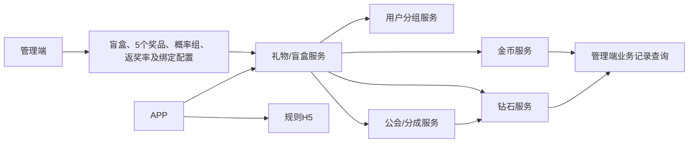
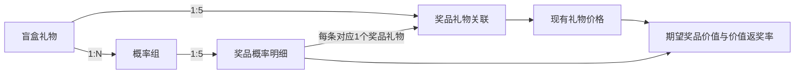
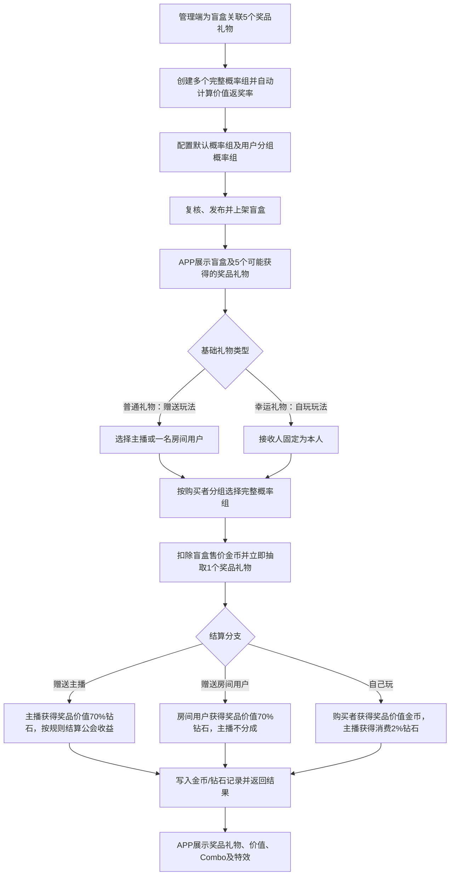
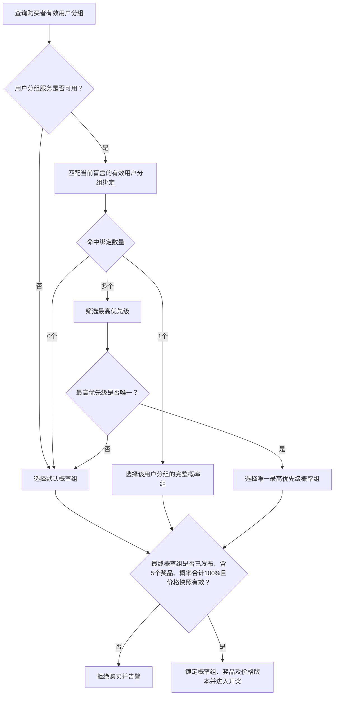
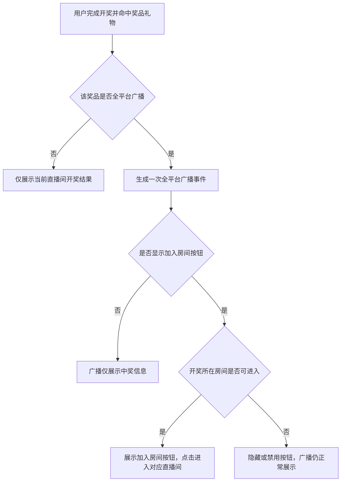

# 盲盒礼物产品开发需求文档

## 文档信息

| 项目 | 内容 |
|---|---|
| 需求名称 | 盲盒礼物 |
| 文档版本 | V1.0 |
| 文档定位 | 产品开发指导文档 |
| 文档状态 | 待评审 |
| 涉及范围 | APP、管理端、规则H5、礼物服务、用户分组服务、公会/分成服务、金币服务、钻石服务 |

# 第一部分 产品需求

## 1. 功能综合说明

### 1.1 功能目标

平台在现有普通礼物和幸运礼物体系内增加盲盒能力，不新增第三种礼物类型。现有礼物增加“是否为盲盒礼物”标识：普通礼物标记为盲盒后用于赠送他人，幸运礼物标记为盲盒后用于自己玩。

每个盲盒固定关联5个奖品礼物。用户以盲盒礼物的现有金币价格购买，购买成功后立即开奖，每次从5个奖品礼物中随机命中1个；本次返奖价值取命中奖品礼物的现有价格。盲盒不形成库存，不支持先购买后开启、延迟开奖或转赠。

盲盒包含两类玩法：

- **赠送他人**：用户将盲盒赠送给当前直播间主播或房间内一名其他用户，复用普通礼物的接收人选择、发送、展示、统计和榜单链路。
- **自己玩**：购买者本人获得开奖结果，复用当前幸运礼物的购买、Combo、特效、统计和榜单链路。

每个盲盒可以配置多个概率组。每个概率组必须为同一盲盒的5个奖品礼物分别设置概率，概率之和必须为100%。系统根据盲盒售价、奖品礼物价格和概率自动计算价值返奖率。一个概率组作为默认组，其他概率组可按购买者用户分组匹配使用。

### 1.2 涉及端及职责

| 端/系统 | 主要职责 |
|---|---|
| 管理端 | 配置盲盒标识、5个奖品礼物、规则H5、奖品展示行为、多套概率组、价值返奖率、默认及用户分组绑定；查询业务记录和审计日志 |
| APP | 展示盲盒及5个可能获得的奖品礼物；承载赠送他人、自己玩、Combo、开奖结果、特效及广播交互 |
| 规则H5 | 展示玩法、5个奖品礼物、开奖方式及收入规则，不展示各奖品概率和后台价值返奖率 |
| 礼物/盲盒服务 | 校验购买条件、选择完整概率组、抽取奖品礼物、计算结算结果并协调金币/钻石入账 |
| 用户分组服务 | 返回购买者当前所属用户分组，供概率组匹配 |
| 公会/分成服务 | 返回接收人或主播的有效公会关系及现有公会比例，供公会收益计算 |
| 金币服务 | 完成购买扣款、自玩返奖，并保存盲盒业务主记录及开奖快照 |
| 钻石服务 | 完成赠送接收人收入、自玩主播2%收益以及公会收益入账 |
| 现有统计/榜单 | 赠送盲盒继续按普通礼物处理，自玩盲盒继续按幸运礼物处理 |

### 1.3 核心要点

- 购买成功即开奖，一次购买只命中5个关联奖品礼物中的1个。
- 一个盲盒必须关联且只能关联5个互不重复的有效奖品礼物。
- 命中奖品价值取开奖时锁定的奖品礼物价格，不根据盲盒售价进行倍数换算。
- 每个盲盒支持多个完整概率组，每组均包含相同5个奖品礼物的概率配置。
- 每个概率组内5个概率均应处于0%至100%之间，合计必须严格等于100%。
- 每个盲盒必须有一套已发布的默认概率组，可按用户分组绑定其他完整概率组。
- 用户分组服务不可用、未命中用户分组绑定或最高优先级不唯一时使用默认概率组；最终概率组无效时拒绝购买并告警。
- 价值返奖率由系统自动计算：`Σ(奖品礼物价格×对应概率)÷盲盒售价×100%`。
- 价值返奖率为只读计算结果，不由运营直接填写；奖品价格、盲盒售价或概率变化时实时重新计算。
- 赠送主播或其他用户时，接收人获得命中奖品价值70%的等值钻石。
- 接收人有公会时，公会按现有公会规则获得接收人收益的一定比例，最高20%，该金额作为平台额外支出。
- 赠送房间其他用户时，当前主播不参与任何分成。
- 自己玩时，购买者获得命中奖品价值对应的金币，主播获得实际消费金币2%的等值钻石。
- 主播有公会时，公会按现有公会规则获得主播收益的一定比例，最高20%，该金额作为平台额外支出。
- 金币与钻石按1:1等值，最小单位换算沿用平台现有完整规则。
- 自玩返奖金币可立即继续使用，不设置流水要求、解锁条件或冻结期。
- 礼物价格继续使用现有礼物配置能力，不设置低、中、高、超高等档位。
- V1不设置盲盒专属次数、累计金额、高价准入或未成年人限制；平台通用风控及合规规则继续生效。

### 1.4 V1不包含

- 一次同时赠送多个接收人。
- 盲盒库存、背包、延迟开奖或用户间转赠。
- 用户自主选择奖品礼物或通过额外付费改变单次概率。
- 概率未满100%时的“未中奖”区间。
- 共享奖池、蓄水池、保底机制。
- 实物奖品、人工兑奖及物流。

## 2. 名词定义

| 名词 | 定义 |
|---|---|
| 基础礼物类型 | 当前系统既有的普通礼物和幸运礼物两种类型；本需求不增加第三种类型 |
| 盲盒标识 | 现有礼物新增的“是否为盲盒礼物”字段，用于识别该礼物是否启用盲盒开奖能力 |
| 盲盒礼物 | 用户支付固定金币价格购买并立即开奖的礼物；其售价沿用现有礼物价格 |
| 赠送盲盒 | 基础类型为普通礼物的盲盒，购买者指定主播或房间内其他用户作为接收人 |
| 自玩盲盒 | 基础类型为幸运礼物的盲盒，购买者本人获得命中奖品价值对应金币 |
| 奖品礼物 | 盲盒可能命中的现有礼物；其现有礼物价格作为奖品价值 |
| 奖品池 | 一个盲盒固定关联的5个互不重复奖品礼物及其展示配置 |
| 奖品价值 | 开奖时锁定的命中奖品礼物价格，统一按金币口径计算 |
| 概率组 | 同一盲盒5个奖品礼物的一套完整概率配置；一个盲盒可以有多个概率组 |
| 概率明细 | 概率组内某个奖品礼物对应的中奖概率 |
| 默认概率组 | 用户未命中特定用户分组概率组，或分组匹配无法唯一决策时使用的兜底概率组 |
| 用户分组概率组 | 面向指定用户分组生效的完整概率组 |
| 期望奖品价值 | `Σ(奖品礼物价格×对应概率)`，表示长期平均每次开奖的奖品价值 |
| 价值返奖率 | `期望奖品价值÷盲盒售价×100%`，由管理端自动计算并只读展示 |
| Combo | 用户连续购买同一盲盒的交互表现；每一个Combo单位均独立选择概率组并开奖 |
| 盲盒业务流水号 | 单次购买开奖的全局唯一业务标识，用于关联金币和钻石记录 |
| 奖品特效 | 命中某奖品礼物后播放的客户端特效，优先复用奖品礼物既有特效，可按盲盒奖品关联配置覆盖 |
| 全平台广播 | 用户命中指定奖品礼物后，向符合现有广播接收条件的在线用户展示中奖消息 |
| 加入房间按钮 | 全平台广播中的可选按钮，点击后按现有直播间跳转能力进入中奖发生的直播间 |
| 规则H5地址 | 盲盒奖品配置中的公共规则说明页面地址字段（`rule_h5`） |

## 3. 整体业务流程与功能拓扑

### 3.1 功能拓扑



### 3.2 盲盒、奖品礼物与概率组关系



- 一个盲盒固定关联5个奖品礼物，5个奖品礼物不能重复。
- 一个盲盒可以配置多个概率组，所有概率组均针对同一组5个奖品礼物。
- 每个概率组必须有5条概率明细，每条明细唯一对应1个奖品礼物。
- 每组5个概率之和必须为100%，不存在空白概率区间或“未中奖”结果。
- 每个概率组独立计算价值返奖率；默认概率组和用户分组概率组可以具有不同的概率及价值返奖率。
- 选择概率组后，系统只在该组的5个奖品礼物中开奖，不得与其他概率组拼接概率。

### 3.3 总体业务流程



### 3.4 玩法结算总表

设：

- `P`：盲盒售价。
- `V`：本次命中奖品礼物价格。
- `g`：接收人或主播的公会比例，按现有规则取值，最高20%。

| 玩法 | 公会情况 | 用户侧收入 | 主播收入 | 公会收入 | 平台结算差额 |
|---|---|---:|---:|---:|---:|
| 赠送主播 | 主播无公会 | 主播获得`V×70%`钻石 | 主播即接收人 | 0 | `P－V×70%` |
| 赠送主播 | 主播有公会 | 主播获得`V×70%`钻石 | 主播即接收人 | `V×70%×g`钻石 | `P－V×70%－V×70%×g` |
| 赠送房间其他用户 | 接收人无公会 | 接收人获得`V×70%`钻石 | 0 | 0 | `P－V×70%` |
| 赠送房间其他用户 | 接收人有公会 | 接收人获得`V×70%`钻石 | 0 | `V×70%×g`钻石 | `P－V×70%－V×70%×g` |
| 自己玩 | 主播无公会 | 购买者获得`V`金币 | `P×2%`钻石 | 0 | `P－V－P×2%` |
| 自己玩 | 主播有公会 | 购买者获得`V`金币 | `P×2%`钻石 | `P×2%×g`钻石 | `P－V－P×2%－P×2%×g` |

补充规则：

- 公会收益是平台在接收人或主播收益之外的额外支出，不从接收人或主播到账金额中扣减。
- 公会比例不在盲盒功能内单独配置，完全复用平台现有公会关系及比例规则。
- 平台结算差额为正时归平台，为负时由平台承担。
- 高价值奖品导致平台负差额时仍按原开奖结果足额结算，不得重抽、减少入账或向用户追补。
- 金额产生最小单位小数时，完全复用现有金币/钻石换算规则，盲盒服务不自行取整。

## 4. 管理端功能

管理端配置是APP展示和开奖的前置条件，建议配置顺序为：盲盒礼物 → 关联5个奖品礼物 → 创建概率组并校验100% → 查看价值返奖率 → 配置默认及用户分组绑定 → 复核发布 → 上架使用。

### 4.1 盲盒礼物配置

#### 功能目的

在现有礼物管理中增加“是否为盲盒礼物”字段，在不改变普通礼物、幸运礼物既有类型的前提下启用盲盒能力。

#### 功能内容

- 礼物基础类型继续使用现有普通礼物、幸运礼物，不新增“盲盒礼物”类型值。
- 普通礼物开启盲盒标识后固定使用赠送他人玩法；幸运礼物开启盲盒标识后固定使用自己玩玩法。
- 玩法由“基础礼物类型＋盲盒标识”确定，管理端不单独配置玩法类型。
- 盲盒售价、图标、名称、上下架及基础素材复用现有礼物配置能力。
- 每个盲盒必须关联5个奖品礼物，并至少配置一套已发布的默认概率组后才允许上架。
- 未开启盲盒标识的普通礼物、幸运礼物继续执行现有逻辑，不进入盲盒奖品或概率组匹配。

### 4.2 奖品池配置

#### 功能目的

为每个盲盒维护固定的5个奖品礼物，以及规则H5、特效和广播等开奖展示行为。

#### 奖品礼物规则

- 一个盲盒必须关联且只能关联5个奖品礼物。
- 5个奖品礼物必须互不重复，均来自现有礼物数据。
- 奖品礼物不能是另一个已开启盲盒标识的礼物，避免盲盒嵌套开奖。
- 奖品礼物必须处于可用状态并具有大于0的有效价格。
- 奖品价值直接取奖品礼物价格，不由盲盒售价换算。
- 每个奖品关联展示奖品礼物名称、图标、当前价格和状态，价格本身仍在现有礼物管理中维护。
- 奖品池增加公共规则H5地址字段（`rule_h5`），供APP和规则H5入口使用；该字段不在5个奖品明细中重复配置。
- 每个奖品关联可配置特效地址，允许为空；为空时复用奖品礼物既有展示或只展示开奖结果。
- 每个奖品关联可配置“是否全平台广播”和“是否显示加入房间按钮”。
- “是否显示加入房间按钮”仅在“是否全平台广播”为是时生效；广播关闭时管理端禁用该配置或保存为否。
- 修改奖品列表时不得原地影响已发布概率组，应创建新的奖品池版本并重新配置、复核和发布相关概率组。
- 历史业务保留开奖时的5个奖品、价格、特效和广播配置快照。

### 4.3 概率组与价值返奖率

#### 功能目的

同一盲盒支持配置多个完整概率组。每个概率组为该盲盒的5个奖品礼物分别设置概率，系统校验概率合计为100%，并自动计算该组的期望奖品价值和价值返奖率。

#### 概率组组成

```text
一套概率组
= 当前盲盒及奖品池版本
+ 5个奖品礼物对应的5条概率明细
+ 概率合计100%
+ 系统计算的期望奖品价值
+ 系统计算的价值返奖率
```

#### 配置内容

- 同一盲盒可新建多套概率组，各概率组名称和版本必须可区分。
- 新建概率组时自动加载当前奖品池中的5个奖品礼物，不允许运营临时增加、删除或替换某一行。
- 每个奖品概率可设置为0%，但不得小于0%或大于100%。
- 5个奖品概率之和必须严格等于100%；小于或大于100%均不允许发布。
- 概率合计使用平台统一的概率精度进行精确校验，不使用客户端浮点计算结果作为最终依据。
- 概率编辑时实时展示“当前合计”，未达到100%时明确展示差额。
- 概率组支持新建、复制、编辑草稿、提交复核、发布、停用及查看历史版本。
- 已发布概率组不可原地修改；调整概率时复制或创建新版本。
- 概率组发布后作为不可拆分整体使用，运行时不得从多个概率组拼接概率。

#### 价值返奖率计算

设盲盒售价为`P`，5个奖品礼物价格分别为`V1...V5`，对应概率分别为`p1...p5`，其中概率使用小数参与计算，例如60%按0.6计算。

```text
概率合计 = p1 + p2 + p3 + p4 + p5 = 1

期望奖品价值 E
= V1×p1 + V2×p2 + V3×p3 + V4×p4 + V5×p5

价值返奖率 RTP
= E ÷ P × 100%
```

管理端计算规则：

- 盲盒售价、奖品礼物价格或任一概率发生变化时，实时重新计算期望奖品价值和价值返奖率。
- 期望奖品价值和价值返奖率均为系统计算的只读结果，运营不能直接修改。
- 管理端同时展示盲盒售价、每个奖品价格、概率、单项期望贡献、期望奖品价值、概率合计和价值返奖率。
- 价值返奖率用于运营评估奖品价值结构，不等同于赠送或自玩场景下扣除接收人、主播及公会支出后的平台利润率。
- 概率组发布时保存盲盒售价快照、5个奖品价格快照、概率快照、期望奖品价值和价值返奖率。
- 盲盒售价或任一奖品礼物价格发生变化时，所有受影响的已发布概率组进入待重新校验状态；完成重新计算、复核和发布前不得用于新购买。
- APP和服务端不得自行重新计算价值返奖率，统一使用管理端发布配置及服务端快照口径。

#### 计算示例

盲盒售价为20,000金币，5个奖品价格和概率如下：

| 奖品礼物价格 | 概率 | 单项期望贡献 |
|---:|---:|---:|
| 9,000 | 60% | 5,400 |
| 20,099 | 28% | 5,627.72 |
| 41,111 | 6% | 2,466.66 |
| 60,000 | 4.8% | 2,880 |
| 140,000 | 1.2% | 1,680 |
| **合计** | **100%** | **18,054.38** |

```text
期望奖品价值 = 18,054.38
价值返奖率 = 18,054.38 ÷ 20,000 × 100% = 90.2719%
```

### 4.4 概率组绑定与匹配

#### 功能目的

为每个盲盒提供默认概率组，并按购买者用户分组选择其他已发布的完整概率组。现有用户分组选择模式保持不变。

#### 绑定规则

- 每个上架盲盒在任一可售时间必须有且只有一套有效默认概率组。
- 可为不同用户分组绑定不同概率组，也可让多个用户分组复用同一概率组。
- 同一盲盒、同一用户分组的绑定有效时间不得重叠。
- 分组绑定配置优先级，用于购买者同时属于多个用户分组时决策。
- 被绑定概率组必须属于当前盲盒、对应当前有效奖品池版本，且已发布、概率合计100%、价格快照有效。
- 管理端支持输入用户ID预览其所属分组、最终命中概率组、该组价值返奖率及使用默认组的原因。

#### 匹配流程



#### 匹配结果

- 用户分组服务不可用时直接使用默认概率组。
- 用户命中多个相同最高优先级绑定时使用默认概率组。
- 最终选出的概率组无效时不得再次回落，必须拒绝购买并告警。
- 每次购买记录实际使用的概率组及版本、价值返奖率、匹配分组和默认回落原因。
- 配置切换不影响已经开始的业务；在途业务继续使用购买开始时锁定的概率组和价格快照。

### 4.5 配置发布与审计

- 奖品池和概率组执行创建、复核、发布流程，创建人与复核人不得相同。
- 礼物上下架、5个奖品关联、规则H5、特效、广播、概率、价值返奖率、默认及用户分组绑定均记录操作日志。
- 操作日志记录操作对象、修改前后内容、操作人、复核人、时间和原因。
- 发布前统一校验盲盒状态、5个奖品状态和价格、概率合计、价值返奖率、默认绑定及配置有效期。
- 紧急停用概率组时，使用该组且没有其他有效默认组的盲盒停止新购买；已扣款或已开奖业务继续按锁定配置结算。
- 概率组回滚通过重新绑定历史有效版本完成，不直接修改历史版本。

### 4.6 盲盒业务记录查询

#### 功能目的

复用现有金币、钻石记录查询能力，支持运营查询盲盒购买、概率组、开奖结果和结算结果。

#### 查询能力

- 按盲盒业务流水号、金币记录号、钻石记录号查询。
- 按购买者、接收人、主播、房间、盲盒、命中奖品礼物、概率组和时间筛选。
- 详情展示盲盒售价、5个奖品及价格快照、概率组及价值返奖率、命中奖品、奖品价值、接收人收入、主播收入、公会收入和各资金记录状态。
- 展示失败原因、补偿状态和最终结果。
- 管理端不得人工修改命中奖品、奖品价格快照、概率组或结算金额；补偿必须使用原结果和原金额。

## 5. APP功能

### 5.1 盲盒礼物面板

#### 功能目的

在直播间礼物面板提供盲盒入口，通过“是否为盲盒礼物”标识筛选礼物，并根据基础礼物类型进入赠送或自玩流程。

#### 展示内容

- 展示盲盒图标、名称和现有配置售价。
- 展示该盲盒可能获得的5个奖品礼物名称、图标和奖品价值。
- 不展示5个奖品各自概率、概率组名称、用户所属分组、价值返奖率或平台利润率。
- 普通礼物类型的盲盒对应赠送他人，幸运礼物类型的盲盒对应自己玩。
- 展示规则说明入口，地址读取当前有效奖品池配置中的`rule_h5`。
- 赠送模式展示当前接收人；自玩模式接收人固定为本人。

### 5.2 赠送主播

#### 前置条件

- 用户位于有效直播间，当前主播可接收礼物。
- 盲盒已上架，已关联5个有效奖品礼物，且存在有效默认或用户分组概率组。
- 用户金币余额充足。

#### 操作及处理流程

1. 用户选择已开启盲盒标识的普通礼物。
2. 接收人选择当前主播。
3. 用户点击发送，系统校验房间、主播、盲盒、5个奖品、概率组、余额和幂等信息。
4. 系统按用户分组选择完整概率组，扣除盲盒售价金币并立即抽取1个奖品礼物。
5. 主播获得命中奖品价值70%的等值钻石。
6. 主播有公会时，按现有公会比例额外结算公会收益。
7. APP展示命中奖品礼物、奖品价值、主播实际收入、Combo和特效。

#### 业务规则

- 一次只能赠送一名主播。
- 玩法、展示分层、Combo和房间消息复用普通礼物。
- 结算使用盲盒奖品价值规则，不额外叠加普通礼物的其他主播分成。
- 命中奖品特效播放完成前不可继续发送下一次赠送盲盒。

### 5.3 赠送房间其他用户

#### 前置条件

- 接收人是当前房间内除购买者外的有效用户。
- 其他条件与赠送主播一致。

#### 操作及处理流程

1. 用户选择已开启盲盒标识的普通礼物和一名房间用户。
2. 用户点击发送，服务端再次校验接收人仍在房间。
3. 系统选择完整概率组，扣除金币并立即抽取1个奖品礼物。
4. 接收用户获得命中奖品价值70%的等值钻石。
5. 接收用户有公会时，按现有公会比例额外结算公会收益。
6. 当前主播不参与任何分成，不生成主播收入记录。
7. APP展示命中奖品、奖品价值、接收人实际收入、Combo和特效。

#### 业务规则

- 赠送盲盒只能单送，不能同时选择多人。
- Combo期间接收人保持不变；切换接收人时结束当前Combo并开始新的赠送行为。
- 复用普通礼物接收人选择、发送、展示分层和房间消息链路。

### 5.4 自己玩

#### 前置条件

- 用户位于有效直播间。
- 盲盒已上架，已关联5个有效奖品礼物，且存在有效默认或用户分组概率组。
- 用户金币余额充足。

#### 操作及处理流程

1. 用户选择已开启盲盒标识的幸运礼物，接收人固定为本人。
2. 用户点击开启，系统选择完整概率组，扣除金币并立即抽取1个奖品礼物。
3. 购买者获得命中奖品价值对应的金币。
4. 当前主播获得实际消费金币2%的等值钻石。
5. 主播有公会时，按现有公会比例额外结算公会收益。
6. APP展示命中奖品礼物、奖品价值、返奖金币、Combo及幸运礼物既有特效。

#### 业务规则

- 购买者返奖不乘以70%。
- 返奖金币到账后立即成为可用余额，可继续购买盲盒或参与其他金币玩法。
- 不设置流水倍数、消费次数、解锁任务或冻结期。
- Combo、特效和结果展示复用当前幸运礼物，不新增盲盒专属交互开关。

### 5.5 Combo与特效

- Combo不改变盲盒售价、概率组或结算公式，每一个Combo单位独立选择概率组并抽取1个奖品礼物。
- 赠送盲盒命中奖品特效时，客户端锁定发送按钮，等待特效完成后再允许下一次发送。
- 奖品关联未配置覆盖特效时，复用奖品礼物既有特效；均无特效时展示结果后可继续发送。
- 自己玩沿用幸运礼物现有Combo和特效行为。
- 特效加载失败或客户端异常退出不影响已经完成的扣款和结算；客户端可查询原业务结果恢复展示。
- 客户端等待控制不能替代服务端幂等校验。

### 5.6 全平台广播与加入房间

当用户命中某奖品礼物后，系统读取本次开奖锁定的奖品关联广播配置：



- 广播同时适用于赠送盲盒和自玩盲盒，是否广播由命中奖品的关联配置决定。
- 广播复用平台现有全平台消息通道、展示样式、频控和接收范围。
- 广播内容至少能够表达中奖用户、盲盒礼物、命中奖品礼物、奖品价值及开奖所在直播间。
- 同一盲盒业务流水号只允许产生一次广播事件，重试不得重复广播。
- “加入房间”按钮复用现有直播间跳转能力。
- 房间关闭、主播下播、用户无权进入或房间不存在时，不进入房间并按现有方式提示。
- 广播发送失败、按钮展示失败或跳转失败均不影响扣款、开奖和资金结算。

### 5.7 公共异常处理

| 场景 | APP及业务处理 |
|---|---|
| 余额不足 | 不扣款、不开奖，提示充值或选择其他盲盒 |
| 盲盒已下架 | 不扣款、不开奖，刷新礼物列表 |
| 接收人已离开房间 | 不扣款、不开奖，提示重新选择接收人 |
| 房间关闭或主播下播 | 新购买失败；已扣款业务继续完成结算 |
| 奖品不足5个或存在无效奖品 | 不扣款、不开奖，提示系统繁忙并告警 |
| 概率组不存在、概率不满100%或价格快照无效 | 不扣款、不开奖，提示系统繁忙并告警 |
| 请求超时 | 使用原幂等键查询或重试，不产生第二次购买 |
| 结算处理中 | 展示处理中，补偿完成后返回原命中奖品 |
| 特效加载失败 | 不回滚账务，按既有播放器降级方式恢复交互 |

### 5.8 现有统计与榜单兼容

- 盲盒标识是现有礼物的扩展属性，不作为新的基础礼物类型。
- 赠送盲盒在统计、榜单及其他依赖礼物类型的业务中仍按普通礼物处理；自玩盲盒仍按幸运礼物处理。
- 统计金额、榜单计分、活动任务及其他衍生口径复用当前普通礼物或幸运礼物既定规则。
- 如运营需要单独分析盲盒，可将盲盒标识、命中奖品和概率组作为附加筛选维度，不改变原分类结果。
- 未开启盲盒标识的既有礼物，其展示、购买、统计和榜单行为保持不变。

## 6. 规则H5

APP规则入口使用当前有效奖品池配置中的公共字段`rule_h5`。规则H5用于解释玩法和可能获得的奖品，不披露后台概率组及价值返奖率。

### 6.1 展示内容

- 盲盒分为赠送他人和自己玩两类玩法。
- 购买成功即开奖，不存在库存或稍后开启。
- 当前盲盒固定关联的5个奖品礼物名称、图标和奖品价值。
- 每次从5个奖品礼物中随机获得1个，奖品价值以开奖时锁定价格为准。
- 赠送他人的接收人选择、70%钻石收入规则及公会收益说明。
- 赠送房间其他用户时主播不分成。
- 自己玩的全部奖品价值金币返奖、主播2%收入及公会收益说明。
- 自玩返奖金币可继续使用且无流水要求。
- 金币、钻石1:1等值及Combo、特效、广播等必要交互说明。

### 6.2 不展示内容

- 5个奖品礼物各自概率。
- 默认概率组、用户分组概率组及用户所属分组。
- 期望奖品价值、价值返奖率、平台利润率和平台预期收益。
- 概率组版本、生效日期及历史变更。
- 用户实际命中概率组、回落原因及其他后台配置明细。

# 第二部分 测试与验收

## 7. 测试优先级说明

| 优先级 | 说明 |
|---|---|
| P0 | 核心购买、开奖、资金结算、概率选择及幂等，失败会阻断上线 |
| P1 | 主要配置、交互、异常恢复和管理查询，影响完整业务使用 |
| P2 | 非核心展示、审计、监控和兼容性验证 |

## 8. 详细测试用例

### 8.1 管理端配置

| 用例编号 | 模块 | 优先级 | 测试点 | 前置条件 | 操作步骤 | 预期结果 |
|---|---|---|---|---|---|---|
| TC-ADMIN-001 | 礼物配置 | P0 | 普通礼物启用盲盒 | 已有普通礼物及配置权限 | 1. 编辑普通礼物<br>2. 开启盲盒标识<br>3. 保存 | 基础类型仍为普通礼物；进入赠送盲盒流程；不产生第三种礼物类型 |
| TC-ADMIN-002 | 礼物配置 | P0 | 幸运礼物启用盲盒 | 已有幸运礼物及配置权限 | 1. 编辑幸运礼物<br>2. 开启盲盒标识<br>3. 保存 | 基础类型仍为幸运礼物；进入自玩盲盒流程 |
| TC-ADMIN-003 | 礼物配置 | P1 | 复用现有售价 | 已存在盲盒礼物 | 1. 使用现有礼物管理修改售价<br>2. 发布<br>3. 重新加载 | APP展示新售价；不存在盲盒专用价格字段；相关概率组进入重新校验 |
| TC-ADMIN-004 | 奖品池 | P0 | 正常关联5个奖品 | 存在5个有效非盲盒礼物 | 1. 为盲盒依次选择5个奖品<br>2. 保存 | 保存成功；奖品池恰好包含5个互不重复奖品 |
| TC-ADMIN-005 | 奖品池 | P0 | 少于5个奖品 | 仅选择4个奖品 | 1. 保存或提交发布 | 不允许发布；提示必须关联5个奖品礼物 |
| TC-ADMIN-006 | 奖品池 | P0 | 超过5个奖品 | 已选择5个奖品 | 1. 尝试选择第6个奖品 | 管理端阻止继续选择，或保存校验失败 |
| TC-ADMIN-007 | 奖品池 | P0 | 奖品重复 | 已选择奖品A | 1. 再次选择奖品A<br>2. 保存 | 不允许重复选择；奖品ID必须唯一 |
| TC-ADMIN-008 | 奖品池 | P0 | 禁止盲盒嵌套 | 存在已开启盲盒标识的礼物B | 1. 将B选为奖品<br>2. 保存 | 保存失败；提示奖品礼物不能是盲盒 |
| TC-ADMIN-009 | 奖品池 | P0 | 无效奖品 | 奖品已停用、删除或价格小于等于0 | 1. 选择无效奖品<br>2. 提交发布 | 不允许发布；明确显示无效奖品及原因 |
| TC-ADMIN-010 | 奖品池 | P0 | 规则H5地址 | 已建立有效奖品池 | 1. 配置`rule_h5`<br>2. 保存并回显<br>3. APP打开规则 | 地址正确保存；APP打开对应规则H5 |
| TC-ADMIN-011 | 奖品展示 | P1 | 特效地址为空 | 已关联奖品A | 1. 清空覆盖特效<br>2. 发布<br>3. 命中奖品A | 允许发布；复用奖品既有特效或仅展示结果 |
| TC-ADMIN-012 | 奖品展示 | P0 | 配置全平台广播 | 已关联奖品A | 1. 开启奖品A全平台广播<br>2. 保存发布 | 配置正确保存，只对发布后的新开奖生效 |
| TC-ADMIN-013 | 奖品展示 | P0 | 广播关闭时按钮无效 | 奖品A未开启广播 | 1. 尝试开启加入房间按钮<br>2. 保存 | 按钮配置被禁用或保存为否 |
| TC-ADMIN-014 | 概率组 | P0 | 创建完整概率组 | 奖品池已有5个奖品 | 1. 新建概率组<br>2. 查看概率明细 | 系统自动加载5个奖品及当前价格，生成5条概率输入行 |
| TC-ADMIN-015 | 概率组 | P0 | 概率合计100% | 依次配置60%、28%、6%、4.8%、1.2% | 1. 保存草稿<br>2. 提交发布 | 概率合计显示100%，允许进入复核发布 |
| TC-ADMIN-016 | 概率组 | P0 | 概率合计小于100% | 5项合计99.99% | 1. 提交发布 | 发布失败；显示距离100%的差额 |
| TC-ADMIN-017 | 概率组 | P0 | 概率合计大于100% | 5项合计100.01% | 1. 提交发布 | 发布失败；显示超出100%的差额 |
| TC-ADMIN-018 | 概率组 | P0 | 概率超出范围 | 某项配置为负数或大于100% | 1. 保存或发布 | 校验失败；每项必须位于0%至100% |
| TC-ADMIN-019 | 概率组 | P1 | 单项概率为0 | 奖品A概率为0，其他4项合计100% | 1. 发布概率组<br>2. 执行测试开奖 | 允许发布；奖品A不命中，其他奖品正常参与开奖 |
| TC-ADMIN-020 | 返奖率 | P0 | 计算期望奖品价值 | 盲盒售价20000；奖品价格9000、20099、41111、60000、140000；概率60%、28%、6%、4.8%、1.2% | 1. 查看计算结果 | 单项贡献分别为5400、5627.72、2466.66、2880、1680；期望值为18054.38 |
| TC-ADMIN-021 | 返奖率 | P0 | 计算价值返奖率 | 使用TC-ADMIN-020数据 | 1. 查看价值返奖率 | 返奖率为18054.38÷20000×100%=90.2719% |
| TC-ADMIN-022 | 返奖率 | P0 | 概率变化实时重算 | 已有完整概率组 | 1. 修改任一奖品概率并保持合计100% | 单项贡献、期望值和返奖率实时更新；字段只读 |
| TC-ADMIN-023 | 返奖率 | P0 | 奖品价格变化 | 已发布概率组引用奖品A | 1. 在现有礼物管理修改A价格并发布 | 相关概率组进入待重新校验；重新发布前不能用于新购买 |
| TC-ADMIN-024 | 返奖率 | P0 | 盲盒售价变化 | 已发布概率组 | 1. 修改盲盒售价并发布 | 相关概率组重新计算返奖率并进入待复核状态 |
| TC-ADMIN-025 | 概率组 | P0 | 一个盲盒多个概率组 | 已有概率组P1 | 1. 复制创建P2<br>2. 配置不同概率并发布 | P1、P2均属于同一盲盒和相同5个奖品，但概率和返奖率可不同 |
| TC-ADMIN-026 | 概率组 | P0 | 已发布组不可原地修改 | 概率组P1已发布 | 1. 尝试修改P1任一概率 | 不允许直接修改；要求复制或创建新版本 |
| TC-ADMIN-027 | 概率绑定 | P0 | 绑定默认概率组 | P1已发布且完整 | 1. 为盲盒绑定P1为默认组<br>2. 设置有效期并发布 | 绑定成功；未命中用户分组时使用P1 |
| TC-ADMIN-028 | 概率绑定 | P0 | 默认绑定时间重叠 | 已有有效默认绑定 | 1. 新增另一重叠默认绑定<br>2. 发布 | 发布失败；同一时间只能有一个默认概率组 |
| TC-ADMIN-029 | 概率绑定 | P0 | 绑定用户分组概率组 | P2已发布；存在用户分组G1 | 1. 将G1绑定P2<br>2. 设置优先级和有效期 | 绑定成功；G1用户按规则使用P2 |
| TC-ADMIN-030 | 配置审计 | P1 | 配置及返奖率留痕 | 操作人具有权限 | 1. 修改奖品池、概率组和绑定<br>2. 完成复核发布<br>3. 查看日志 | 日志包含修改前后内容、价格快照、概率、返奖率、操作人、复核人、时间和原因 |

### 8.2 APP、H5与既有业务兼容

| 用例编号 | 模块 | 优先级 | 测试点 | 前置条件 | 操作步骤 | 预期结果 |
|---|---|---|---|---|---|---|
| TC-APP-001 | 礼物面板 | P0 | 按盲盒标识展示 | 同时存在盲盒和非盲盒礼物 | 1. 进入直播间<br>2. 打开盲盒入口 | 仅加载盲盒标识为真的礼物 |
| TC-APP-002 | 礼物面板 | P0 | 基础类型映射玩法 | 普通和幸运类型盲盒均已上架 | 1. 分别查看两种盲盒 | 普通类型进入赠送流程；幸运类型进入自玩流程 |
| TC-APP-003 | 礼物面板 | P0 | 展示5个可能奖品 | 盲盒已关联有效奖品池 | 1. 查看盲盒详情 | 展示5个奖品的名称、图标和价值，无缺失或重复 |
| TC-APP-004 | 礼物面板 | P0 | 不展示概率和返奖率 | 存在多个概率组 | 1. 检查盲盒详情及结果页 | 不展示奖品概率、用户分组、概率组名称或价值返奖率 |
| TC-APP-005 | 规则H5 | P0 | H5展示内容 | `rule_h5`可访问 | 1. 打开H5 | 展示两类玩法、5个奖品、购买即开奖及收入规则 |
| TC-APP-006 | 规则H5 | P0 | H5不披露后台配置 | 存在默认和用户分组概率组 | 1. 检查H5全部内容 | 不展示概率、返奖率、组版本、生效日期或用户实际命中组 |
| TC-APP-007 | 赠送主播 | P0 | 正常开奖 | 用户余额充足；主播在线；配置有效 | 1. 选择主播<br>2. 发送盲盒 | 扣款一次并立即命中1个奖品；展示奖品及主播实际收入 |
| TC-APP-008 | 赠送其他用户 | P0 | 正常开奖 | 接收人在房间 | 1. 选择一名用户<br>2. 发送盲盒 | 命中1个奖品；接收用户获得70%等值钻石；主播不分成 |
| TC-APP-009 | 赠送限制 | P0 | 单送限制 | 房间内存在多个用户 | 1. 尝试同时选择多人 | 只能保留一个有效接收人 |
| TC-APP-010 | 赠送Combo | P1 | Combo保持接收人 | 已向用户B成功赠送 | 1. 连续发送多次 | 每次独立开奖；接收人始终为B；结果可独立追溯 |
| TC-APP-011 | 赠送Combo | P1 | 切换接收人 | 正在对用户B进行Combo | 1. 切换用户C并发送 | 原Combo结束；新赠送绑定C，不串用接收人 |
| TC-APP-012 | 奖品特效 | P0 | 特效期间阻止发送 | 命中奖品配置了特效 | 1. 特效期间再次点击发送 | 不产生第二次购买；特效完成或降级超时后恢复 |
| TC-APP-013 | 奖品特效 | P1 | 无覆盖特效 | 命中奖品未配置覆盖特效 | 1. 完成开奖 | 复用奖品既有特效；均无特效时正常展示结果并恢复发送 |
| TC-APP-014 | 自己玩 | P0 | 正常开奖 | 用户余额充足；配置有效 | 1. 点击开启 | 扣款并命中1个奖品；购买者获得奖品价值金币；主播获得消费2%钻石 |
| TC-APP-015 | 自己玩 | P1 | 复用幸运礼物交互 | 幸运礼物支持Combo和特效 | 1. 连续开启 | Combo、特效及下一次开启时机与现有幸运礼物一致 |
| TC-APP-016 | 自己玩 | P0 | 返奖立即可用 | 自玩返奖已成功 | 1. 查看余额<br>2. 立即再次购买 | 返奖进入可用金币余额，无流水、任务或冻结要求 |
| TC-APP-017 | 结果恢复 | P1 | 客户端开奖后退出 | 服务端已完成开奖 | 1. 重新进入<br>2. 查询原业务 | 返回原奖品、价格和金额；不重新开奖或入账 |
| TC-APP-018 | 全平台广播 | P0 | 命中广播奖品 | 目标奖品开启广播 | 1. 命中奖品<br>2. 在其他用户端观察 | 只产生一次广播，包含盲盒、奖品、价值和房间信息 |
| TC-APP-019 | 全平台广播 | P0 | 命中非广播奖品 | 目标奖品关闭广播 | 1. 命中奖品 | 正常开奖结算，不产生全平台广播 |
| TC-APP-020 | 加入房间 | P0 | 按钮正常跳转 | 奖品开启广播及按钮；房间可进入 | 1. 点击广播按钮 | 进入本次开奖所在直播间 |
| TC-APP-021 | 加入房间 | P1 | 房间不可进入 | 广播后房间关闭或用户无权限 | 1. 点击按钮 | 隐藏、禁用或提示无法进入；不影响结算 |
| TC-COMPAT-001 | 统计兼容 | P0 | 赠送盲盒沿用普通礼物 | 已完成赠送盲盒 | 1. 查询普通礼物统计和榜单 | 按现有普通礼物口径处理，不新增第三类统计 |
| TC-COMPAT-002 | 统计兼容 | P0 | 自玩盲盒沿用幸运礼物 | 已完成自玩盲盒 | 1. 查询幸运礼物统计和榜单 | 按现有幸运礼物口径处理 |
| TC-COMPAT-003 | 非盲盒兼容 | P0 | 既有礼物不受影响 | 盲盒标识为否 | 1. 分别使用普通和幸运礼物 | 不匹配奖品池或概率组，完全执行原有逻辑 |

### 8.3 开奖与资金结算

| 用例编号 | 模块 | 优先级 | 测试点 | 前置条件 | 操作步骤 | 预期结果 |
|---|---|---|---|---|---|---|
| TC-SETTLE-001 | 赠送主播 | P0 | 无公会结算 | 盲盒售价100；命中奖品价值120；主播无公会 | 1. 赠送主播<br>2. 完成结算 | 购买者扣100金币；主播获得84钻石；平台差额16 |
| TC-SETTLE-002 | 赠送主播 | P0 | 有公会20% | 使用TC-SETTLE-001数据；主播公会比例20% | 1. 完成结算 | 主播获得84钻石；公会额外获得16.8钻石；平台差额-0.8 |
| TC-SETTLE-003 | 赠送其他用户 | P0 | 无公会结算 | 盲盒售价500；奖品价值400；接收人无公会 | 1. 赠送接收人 | 接收人获得280钻石；主播收入0；平台差额220 |
| TC-SETTLE-004 | 赠送其他用户 | P0 | 接收人有公会 | 使用TC-SETTLE-003数据；公会比例20% | 1. 完成结算 | 接收人获得280钻石；公会获得56钻石；主播收入0；平台差额164 |
| TC-SETTLE-005 | 赠送其他用户 | P0 | 主播不分成 | 接收人与当前主播不同 | 1. 完成多次开奖结算 | 当前主播始终不产生盲盒收入记录 |
| TC-SETTLE-006 | 自己玩 | P0 | 主播无公会 | 盲盒售价1000；奖品价值5600 | 1. 自己玩并开奖 | 购买者获得5600金币；主播获得20钻石；平台差额-4620 |
| TC-SETTLE-007 | 自己玩 | P0 | 主播有公会20% | 使用TC-SETTLE-006数据 | 1. 完成结算 | 购买者5600金币；主播20钻石；公会4钻石；平台差额-4624 |
| TC-SETTLE-008 | 平台差额 | P0 | 低价值奖品正利润 | 盲盒售价200；奖品价值100 | 1. 分别执行赠送和自玩 | 各玩法按对应公式产生正差额 |
| TC-SETTLE-009 | 平台差额 | P0 | 高价值奖品负利润 | 奖品价值高于盲盒售价 | 1. 开奖结算 | 平台承担负差额；不重抽、不减少金额、不追扣用户 |
| TC-SETTLE-010 | 公会结算 | P0 | 无公会不产生记录 | 接收人或主播无公会 | 1. 完成结算<br>2. 查询钻石记录 | 不生成公会收益记录 |
| TC-SETTLE-011 | 公会结算 | P0 | 使用实际公会比例 | 公会比例低于20% | 1. 完成结算 | 按现有实际比例计算，不固定使用20%；不得超过20% |
| TC-SETTLE-012 | 公会结算 | P0 | 公会收益额外支出 | 有公会关系 | 1. 对比接收人/主播和公会入账 | 公会收益不从个人收入中扣减，作为平台额外支出 |
| TC-SETTLE-013 | 金额换算 | P0 | 70%产生小数 | 奖品价值使70%产生最小单位小数 | 1. 结算并对比记录 | 完全使用现有换算规则，各端金额一致 |
| TC-SETTLE-014 | 金额换算 | P0 | 主播2%产生小数 | 盲盒售价使2%产生小数 | 1. 自玩并结算 | 主播收入使用现有换算结果 |
| TC-SETTLE-015 | 金额换算 | P0 | 公会比例产生小数 | 个人收入乘公会比例产生小数 | 1. 结算并查询记录 | 公会收入使用现有换算结果，不由盲盒自行取整 |
| TC-SETTLE-016 | 业务记录 | P0 | 资金记录完整关联 | 已完成有公会自玩业务 | 1. 使用业务流水号查询 | 扣款、用户返奖、主播收入和公会收入均正确关联 |
| TC-SETTLE-017 | 奖品价格 | P0 | 使用开奖锁定价格 | 开奖后修改奖品礼物价格 | 1. 查询原业务并补偿 | 原业务始终使用开奖时价格快照，新价格不回溯 |

### 8.4 概率组选择与开奖

| 用例编号 | 模块 | 优先级 | 测试点 | 前置条件 | 操作步骤 | 预期结果 |
|---|---|---|---|---|---|---|
| TC-PROB-001 | 概率选择 | P0 | 无分组使用默认组 | 用户不属于任何已绑定分组 | 1. 发起购买<br>2. 查询快照 | 使用有效默认概率组，记录默认原因 |
| TC-PROB-002 | 概率选择 | P0 | 命中单一用户分组 | 用户属于一个已绑定分组 | 1. 发起购买 | 使用该分组绑定的完整概率组 |
| TC-PROB-003 | 概率选择 | P0 | 最高优先级唯一 | 用户属于多个不同优先级分组 | 1. 发起购买 | 使用唯一最高优先级概率组 |
| TC-PROB-004 | 概率选择 | P0 | 最高优先级不唯一 | 多个绑定具有相同最高优先级 | 1. 发起购买 | 使用默认概率组并记录回落原因 |
| TC-PROB-005 | 概率选择 | P0 | 分组服务不可用 | 模拟分组服务超时 | 1. 发起购买 | 使用默认概率组，不阻断正常购买 |
| TC-PROB-006 | 概率选择 | P0 | 默认组无效 | 默认组缺失、未发布、概率不满100%或价格失效 | 1. 发起购买 | 拒绝购买并告警，不扣款、不开奖 |
| TC-PROB-007 | 概率选择 | P0 | 用户分组概率组无效 | 用户命中绑定但最终概率组无效 | 1. 发起购买 | 拒绝购买并告警；不再次回落默认组 |
| TC-PROB-008 | 配置版本 | P0 | 开奖前锁定概率组 | 业务已锁定P1后将新业务切换到P2 | 1. 完成原业务<br>2. 发起新业务 | 原业务使用P1及价格快照；新业务使用P2 |
| TC-PROB-009 | 开奖 | P0 | 单次命中一个奖品 | 使用完整有效概率组 | 1. 连续执行单次购买 | 每次恰好命中5个奖品中的1个 |
| TC-PROB-010 | 开奖 | P0 | Combo独立开奖 | 连续10次Combo | 1. 查询结果 | 每个单位独立选择概率组和随机结果，可单独追溯 |
| TC-PROB-011 | 开奖 | P0 | 概率为0的奖品 | 奖品A概率为0 | 1. 执行大样本开奖 | A不命中，其余奖品按区间正常命中 |
| TC-PROB-012 | 开奖 | P1 | 大样本分布 | 固定概率组并准备足够样本 | 1. 模拟开奖<br>2. 按奖品统计 | 实际分布在约定容差内接近配置概率 |
| TC-PROB-013 | 幂等开奖 | P0 | 重试不重新随机 | 已生成结果但响应超时 | 1. 使用原幂等键重试 | 始终返回同一奖品、价格和概率组版本 |
| TC-PROB-014 | 配置隔离 | P0 | 多概率组不拼接 | P1、P2概率不同 | 1. 强制选择P1开奖 | 只使用P1的5条概率，不读取P2任何明细 |
| TC-PROB-015 | 价格快照 | P0 | 奖品价格失效 | 概率组发布后奖品价格被修改 | 1. 发起购买 | 相关组未重新发布时拒绝购买并告警 |
| TC-PROB-016 | 返奖率快照 | P1 | 业务记录返奖率 | 完成默认和分组概率组业务 | 1. 查询业务记录 | 分别记录实际使用概率组及其价值返奖率快照 |

### 8.5 异常、幂等与补偿

| 用例编号 | 模块 | 优先级 | 测试点 | 前置条件 | 操作步骤 | 预期结果 |
|---|---|---|---|---|---|---|
| TC-ERR-001 | 购买校验 | P0 | 余额不足 | 用户金币少于盲盒售价 | 1. 点击购买 | 不扣款、不开奖，提示余额不足 |
| TC-ERR-002 | 接收人校验 | P0 | 接收人离开房间 | 选择后使其离开 | 1. 点击发送 | 服务端拒绝；不扣款、不开奖 |
| TC-ERR-003 | 房间校验 | P0 | 房间关闭 | 请求前关闭房间 | 1. 发起购买 | 新购买失败；不扣款和开奖 |
| TC-ERR-004 | 盲盒状态 | P0 | 盲盒已下架 | APP仍有缓存 | 1. 点击购买 | 服务端拒绝并要求刷新列表 |
| TC-ERR-005 | 奖品状态 | P0 | 奖品不足或无效 | 5个奖品中一个失效 | 1. 发起购买 | 拒绝购买并告警，不从剩余4个奖品开奖 |
| TC-ERR-006 | 幂等 | P0 | 重复点击 | 连续提交相同幂等键 | 1. 快速重复点击<br>2. 查询记录 | 只扣款、开奖和结算一次 |
| TC-ERR-007 | 补偿 | P0 | 扣款后开奖中断 | 模拟扣款成功后中断 | 1. 恢复并执行补偿 | 不重复扣款；基于锁定概率组完成唯一一次开奖 |
| TC-ERR-008 | 补偿 | P0 | 接收人入账失败 | 模拟钻石入账失败 | 1. 触发补偿 | 保留原奖品和价格，只重试接收人入账 |
| TC-ERR-009 | 补偿 | P0 | 自玩返奖失败 | 模拟金币返奖失败 | 1. 触发补偿 | 只重试购买者金币返奖 |
| TC-ERR-010 | 补偿 | P0 | 主播或公会入账失败 | 个人返奖已成功 | 1. 触发补偿 | 只重试失败的主播或公会收入，不重复其他资金记录 |
| TC-ERR-011 | 超时恢复 | P0 | 服务端成功但APP超时 | 服务端已完成结算 | 1. 使用原幂等键查询 | 返回原业务、奖品及金额，不重复执行 |
| TC-ERR-012 | 特效异常 | P1 | 特效加载失败 | 命中有特效奖品 | 1. 模拟资源失败 | 账务不回滚；APP恢复发送能力 |
| TC-ERR-013 | 高价值奖品 | P0 | 平台负差额 | 测试组固定命中高价值奖品 | 1. 购买并结算 | 用户、主播及公会足额入账；平台承担负差额 |
| TC-ERR-014 | 人工补偿 | P1 | 自动补偿超阈值 | 准备持续失败记录 | 1. 执行至阈值 | 进入人工处理和告警队列，保留原奖品、价格和次数 |

### 8.6 权限、审计与监控

| 用例编号 | 模块 | 优先级 | 测试点 | 前置条件 | 操作步骤 | 预期结果 |
|---|---|---|---|---|---|---|
| TC-OPS-001 | 权限 | P1 | 无概率发布权限 | 使用仅查看账号 | 1. 编辑并尝试发布 | 不允许发布，不改变线上配置 |
| TC-OPS-002 | 双人复核 | P1 | 创建人不能自审 | 用户A创建概率组 | 1. A尝试复核 | 复核失败，必须由其他有权用户完成 |
| TC-OPS-003 | 审计 | P1 | 紧急停用留痕 | 概率组正在生效 | 1. 停用并填写原因 | 记录操作人、时间、原因及前后状态 |
| TC-OPS-004 | 监控 | P1 | 概率回落统计 | 已产生三类默认回落 | 1. 查看报表 | 分别统计未命中分组、服务不可用和优先级不唯一 |
| TC-OPS-005 | 监控 | P1 | 概率合计与价格异常 | 构造异常配置 | 1. 执行配置巡检 | 产生告警并定位盲盒和概率组 |
| TC-OPS-006 | 监控 | P1 | 账务不一致 | 构造用户、主播或公会金额不一致 | 1. 执行对账 | 告警可定位业务流水号和异常记录 |
| TC-OPS-007 | 监控 | P2 | 高价值奖品监控 | 产生多笔高价值结果 | 1. 查看监控 | 可查看命中次数、用户、奖品、概率组和平台成本 |
| TC-OPS-008 | 回滚 | P0 | 回滚不影响在途业务 | P2已生效，部分业务已锁定P2 | 1. 回滚绑定到P1<br>2. 完成在途业务 | 在途业务继续使用P2；新业务使用P1；历史可追溯 |
