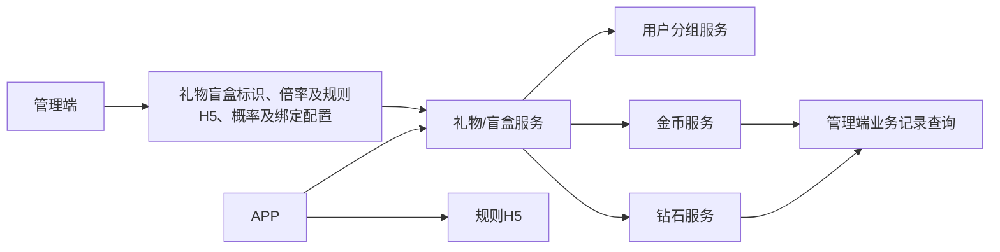
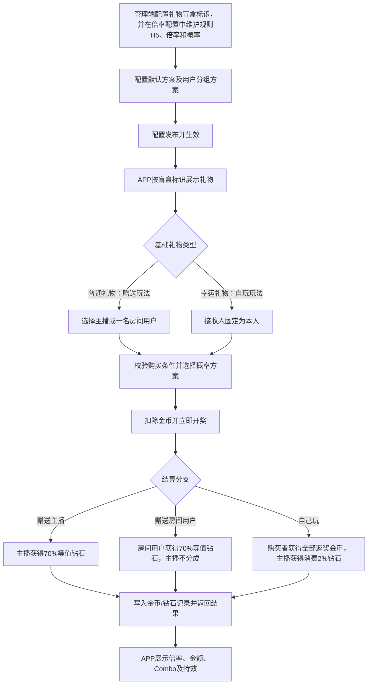
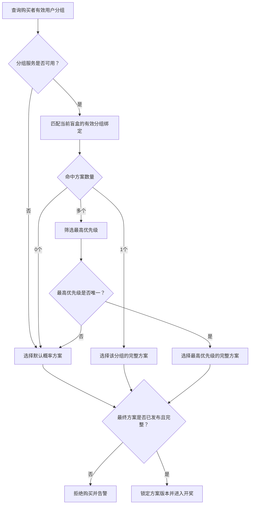
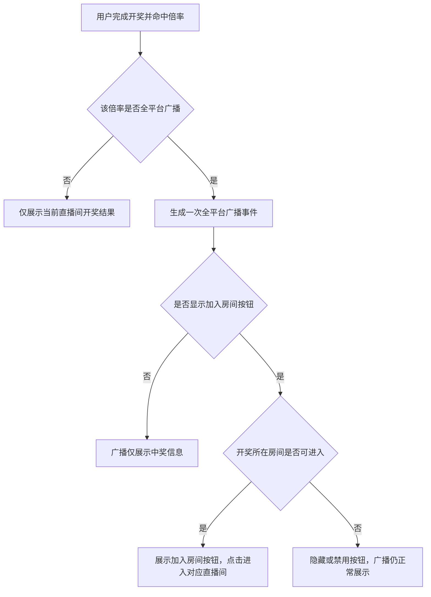

# 盲盒礼物产品开发需求文档

## 文档信息

| 项目 | 内容 |
|---|---|
| 需求名称 | 盲盒礼物 |
| 文档版本 | V1.0 |
| 文档定位 | 产品开发指导文档 |
| 文档状态 | 待评审 |
| 涉及范围 | APP、管理端、规则H5、礼物服务、用户分组服务、金币服务、钻石服务 |

# 第一部分 产品需求

## 1. 功能综合说明

### 1.1 功能目标

平台在现有普通礼物和幸运礼物体系内增加盲盒能力，不新增第三种礼物类型。现有礼物增加“是否为盲盒礼物”标识：普通礼物标记为盲盒后用于赠送他人，幸运礼物标记为盲盒后用于自己玩。用户以固定金币价格购买，购买成功后立即开奖，每次随机命中一个倍率，礼物价值为“礼物价格 × 命中倍率”。盲盒不形成库存，不支持先购买后开启、延迟开奖或转赠。

盲盒包含两类玩法：

- **赠送他人**：用户将盲盒赠送给当前直播间主播或房间内一名其他用户。玩法、展示分层和基础发送链路复用普通礼物，开奖结果决定本次礼物的实际价值。
- **自己玩**：购买者本人获得开奖结果。玩法、Combo、特效和基础开奖链路复用当前幸运礼物。

每类玩法可配置多个不同价格的盲盒礼物。客户端直接展示礼物的实际配置价格，礼物价格继续使用现有礼物价格配置能力。

### 1.2 涉及端及职责

| 端/系统 | 主要职责 |
|---|---|
| 管理端 | 在现有礼物上配置盲盒标识；在倍率配置中维护规则H5地址、倍率特效及广播行为；配置概率方案、默认及用户分组绑定；查询业务记录和审计日志 |
| APP | 展示盲盒礼物；承载赠送他人、自己玩、Combo、开奖结果及特效交互 |
| 规则H5 | 展示玩法、倍率列表、开奖方式及收入规则，不展示倍率概率 |
| 礼物/盲盒服务 | 校验购买条件、选择概率方案、开奖、计算结算结果并协调金币/钻石入账 |
| 用户分组服务 | 返回购买者当前所属用户分组，供概率方案匹配 |
| 金币服务 | 完成购买扣款、自玩返奖，并保存盲盒业务主记录及开奖快照 |
| 钻石服务 | 完成赠送接收人返奖及自玩主播2%分成 |

### 1.3 核心要点

- 购买成功即开奖，一次购买只命中一个倍率。
- 礼物基础类型仍只有普通礼物和幸运礼物，不新增盲盒礼物类型；盲盒能力由现有礼物上的盲盒标识控制。
- 普通礼物标记为盲盒后进入赠送玩法，幸运礼物标记为盲盒后进入自玩玩法，不增加独立的盲盒玩法类型字段。
- 现有统计、榜单及依赖礼物类型的业务继续按普通礼物、幸运礼物原有口径处理，避免重构既有分类逻辑。
- V1固定倍率为0.2、0.6、0.8、1、1.2、5.6、12、21、1000。
- 每个盲盒必须有一套默认概率方案，可按用户分组绑定其他概率方案。
- 一套概率方案是不可拆分的整体，包含一个公共基数和全部倍率的概率值。
- 每个倍率可独立控制是否触发全平台广播，以及广播中是否展示“加入房间”按钮。
- 赠送主播或其他用户时，接收人获得返奖金额70%的等值钻石。
- 赠送房间其他用户时，主播不参与任何分成。
- 自己玩时，购买者获得全部返奖金币，主播获得实际消费金币2%的等值钻石。
- 金币与钻石按1:1等值，最小单位换算沿用平台现有完整规则。
- 自玩返奖金币可立即继续使用，不设置流水要求、解锁条件或冻结期。
- V1不设置盲盒专属次数、累计金额、高价准入或未成年人限制；平台通用风控及合规规则继续生效。

### 1.4 V1不包含

- 一次同时赠送多个接收人。
- 盲盒库存、背包、延迟开奖或用户间转赠。
- 用户自主选择倍率或通过额外付费改变单次概率。
- 共享奖池、蓄水池、保底机制。
- 实物奖品、人工兑奖及物流。

## 2. 名词定义

| 名词 | 定义 |
|---|---|
| 基础礼物类型 | 当前系统既有的普通礼物和幸运礼物两种类型；本需求不增加第三种类型 |
| 盲盒标识 | 现有礼物新增的“是否为盲盒礼物”字段，用于识别该礼物是否启用盲盒开奖能力 |
| 赠送盲盒 | 购买者指定主播或房间内其他用户作为接收人，购买后立即开奖并向接收人结算 |
| 自玩盲盒 | 购买者本人参与开奖并获得全部返奖金币的盲盒玩法 |
| 盲盒单价 | 现有礼物配置中的金币价格 |
| 倍率 | 单次开奖命中的倍数，决定本次返奖金额 |
| 返奖金额 | 盲盒单价 × 命中倍率，统一按金币口径计算 |
| Combo | 用户连续购买同一盲盒的交互表现；每一个Combo单位均独立开奖 |
| 概率方案 | 一个公共基数加全部倍率概率值组成的完整配置 |
| 公共基数 | 概率方案内所有倍率概率值的统一分母，例如10000 |
| 默认概率方案 | 用户未命中特定分组方案，或分组匹配无法唯一决策时使用的兜底方案 |
| 用户分组概率方案 | 面向指定用户分组生效的完整概率方案 |
| 盲盒业务流水号 | 单次购买开奖的全局唯一业务标识，用于关联金币和钻石记录 |
| 倍率特效 | 命中某倍率后播放的客户端特效，允许不配置 |
| 全平台广播 | 用户命中指定倍率后，向平台内符合现有广播接收条件的在线用户展示中奖消息 |
| 加入房间按钮 | 全平台广播中的可选操作按钮，点击后按现有直播间跳转能力进入中奖发生的直播间 |
| 规则H5地址 | 倍率配置中的公共规则说明页面地址字段（`rule_h5`），APP通过该地址打开盲盒规则 |

## 3. 整体业务流程与功能拓扑

### 3.1 功能拓扑



### 3.2 总体业务流程



### 3.3 玩法结算总表

本表是各端、服务端和测试使用的统一结算口径。

| 玩法 | 接收人 | 购买者扣款 | 接收人收入 | 主播额外收入 | 平台结算差额 |
|---|---|---:|---:|---:|---:|
| 赠送主播 | 当前主播 | 礼物单价金币 | 返奖金额×70%的等值钻石 | 无额外收入，主播即接收人 | 消费金币－主播实际入账钻石等值金额 |
| 赠送房间其他用户 | 指定房间用户 | 礼物单价金币 | 返奖金额×70%的等值钻石 | 0 | 消费金币－接收用户实际入账钻石等值金额 |
| 自己玩 | 购买者本人 | 礼物单价金币 | 全部返奖金币 | 消费金币×2%的等值钻石 | 消费金币－返奖金币－主播分成钻石等值金额 |

补充规则：

- 赠送盲盒中未向接收人结算的30%归平台，不生成用户侧收入记录。
- 平台结算差额为正时归平台收益，为负时由平台承担。
- 高倍率导致平台负差额时仍按原开奖结果足额结算，不得重抽、减少入账或向用户追补。
- 金额产生最小单位小数时，完全复用现有金币/钻石换算结果，盲盒服务不自行取整。

## 4. 管理端功能

管理端配置是APP展示和开奖的前置条件，配置顺序为：盲盒礼物 → 倍率特效 → 概率方案 → 概率绑定 → 发布使用。

### 4.1 盲盒礼物配置

#### 功能目的

在现有礼物管理中仅增加“是否为盲盒礼物”字段，在不改变普通礼物、幸运礼物既有类型的前提下启用盲盒能力。规则H5地址不在礼物中配置，统一放在倍率配置中维护。

#### 功能内容

- 礼物基础类型继续使用现有普通礼物、幸运礼物，不新增“盲盒礼物”类型值。
- 增加“是否为盲盒礼物”字段，用于控制该礼物是否启用盲盒开奖逻辑。
- 普通礼物设置为盲盒礼物时，固定使用赠送他人玩法，复用普通礼物发送、统计和榜单链路。
- 幸运礼物设置为盲盒礼物时，固定使用自己玩玩法，复用幸运礼物开奖、统计和榜单链路。
- 玩法由“基础礼物类型＋盲盒标识”共同确定，管理端不再单独配置“赠送他人/自己玩”玩法类型。
- 每类玩法可配置多个不同价格的礼物，具体数量及价格由现有礼物配置决定。
- 礼物价格、上下架状态及基础素材复用现有礼物管理能力，不增加盲盒专用价格配置。
- 未开启盲盒标识的普通礼物、幸运礼物继续执行现有逻辑，不受盲盒倍率和概率方案影响。
- 上架前必须存在一套完整、已发布且在有效期内的默认概率方案。

#### 结果

配置生效后，APP通过盲盒标识筛选并加载对应礼物，再根据基础礼物类型进入赠送或自玩流程。现有统计、榜单及其他依赖礼物类型的逻辑仍识别为普通礼物或幸运礼物；配置变化只影响新购买，不回溯历史记录。

### 4.2 倍率与特效配置

#### 功能目的

统一维护盲盒规则H5地址、可命中的倍率、倍率特效及命中后的全平台广播行为。

#### 功能内容

- 倍率配置中增加公共规则H5地址字段（`rule_h5`），供APP盲盒规则入口使用；该字段属于倍率配置，不在单个礼物中重复配置。
- `rule_h5`是整套倍率配置的公共字段，不随具体命中倍率变化；用户开奖前即可通过该地址查看玩法规则。
- V1固定倍率：0.2、0.6、0.8、1、1.2、5.6、12、21、1000。
- 每个倍率可配置一个特效地址，允许为空。
- 每个倍率增加“是否全平台广播”字段（逻辑字段：`is_global_broadcast`），用于控制命中该倍率后是否触发全平台广播。
- 每个倍率增加“是否显示加入房间按钮”字段（逻辑字段：`show_join_room_button`），用于控制广播消息中是否展示“加入房间”按钮。
- “是否显示加入房间按钮”仅在“是否全平台广播”为是时生效；全平台广播关闭时，管理端应禁用该配置或在保存时将其按否处理。
- 特效配置为空时，APP只展示开奖结果，不进入赠送特效等待状态。
- 广播和加入房间按钮配置均按开奖时的倍率配置生效，不受礼物属于普通类型还是幸运类型影响。
- V1不允许运营直接新增或删除倍率；新增倍率需重新评审APP兼容、规则H5、概率方案和账务精度。
- 特效、广播及加入房间按钮配置的修改只影响生效后的新开奖结果，历史记录保留开奖时的配置快照。

### 4.3 概率方案配置

#### 功能目的

以完整方案为单位维护各倍率的出现概率，并支持版本化发布。

#### 方案组成

```text
一套概率方案 = 一个公共基数 + 全部9个倍率 + 每个倍率对应的概率值
```

#### 功能内容

- 支持新建、复制、编辑草稿、提交复核、发布、停用及查看历史版本。
- 不同方案可以使用不同公共基数，同一方案内全部倍率使用同一个公共基数。
- 每个倍率概率值必须为大于或等于0的整数。
- 全部倍率概率值之和必须等于公共基数。
- 已发布方案不可原地修改；调整时生成新版本。
- 管理端展示每个倍率的配置概率、理论返奖率、赠送理论入账率和自玩理论总支出率。
- 理论指标仅供内部配置、监控和审计，不展示在规则H5。

### 4.4 概率方案绑定与匹配

#### 功能目的

为每个盲盒提供默认概率方案，并按购买者用户分组选择其他方案。

#### 绑定规则

- 每个上架盲盒在任一可售时间必须有且只有一套有效默认方案。
- 可为不同用户分组绑定不同方案，也可让多个分组复用同一方案。
- 同一盲盒、同一用户分组的绑定有效时间不得重叠。
- 分组方案配置优先级，用于购买者同时属于多个分组时决策。
- 管理端支持输入用户ID预览其所属分组、最终命中方案及使用默认方案的原因。

#### 匹配流程



#### 结果

每次购买记录实际使用的方案、版本、公共基数、匹配分组及默认回落原因；配置切换不影响已经开始的业务。

### 4.5 配置发布与审计

- 概率方案建议执行创建、复核、发布的双人复核流程，创建人不得复核本人配置。
- 礼物上下架、规则H5地址、倍率特效、倍率广播及加入房间按钮、概率方案、方案绑定和人工补偿均记录操作日志。
- 操作日志记录操作对象、前后内容、操作人、复核人、时间和原因。
- 紧急停用概率方案时，使用该方案且没有其他有效方案的盲盒停止新购买；已经扣款或开奖的业务继续结算。

### 4.6 盲盒业务记录查询

#### 功能目的

复用现有金币、钻石记录查询能力，支持运营查询盲盒购买、开奖和结算结果。

#### 查询能力

- 按盲盒业务流水号、金币记录号、钻石记录号查询。
- 按购买者、接收人、主播、房间、礼物、玩法、倍率、概率方案和时间筛选。
- 详情展示购买价格、命中倍率、返奖金额、接收人入账、主播分成、概率方案快照及各资金记录状态。
- 展示失败原因、补偿状态和最终结果。
- 管理端不得人工修改倍率、开奖结果或结算金额；补偿必须使用原结果和原金额。

## 5. APP功能

### 5.1 盲盒礼物面板

#### 功能目的

在直播间礼物面板提供盲盒入口，通过“是否为盲盒礼物”标识筛选礼物，并根据礼物原有类型区分赠送他人和自己玩。

#### 展示内容

- 盲盒入口及盲盒标识为真的礼物，展示礼物图标、名称和现有礼物价格。
- 普通礼物对应赠送他人，幸运礼物对应自己玩；玩法标识由基础礼物类型映射得出。
- 礼物实际配置价格。
- 规则说明入口，地址读取当前生效倍率配置中的`rule_h5`。
- 赠送模式展示当前接收人；自玩模式接收人固定为本人。

### 5.2 赠送主播

#### 前置条件

- 用户位于有效直播间，当前主播可接收礼物。
- 盲盒已上架且存在有效概率方案。
- 用户金币余额充足。

#### 操作及处理流程

1. 用户选择已开启盲盒标识的普通礼物。
2. 接收人选择当前主播。
3. 用户点击发送，系统校验房间、主播、礼物、余额和幂等信息。
4. 系统选择概率方案，扣除礼物价格金币并立即开奖。
5. 主播获得返奖金额70%的等值钻石。
6. APP展示命中倍率、返奖金额、主播实际收入、Combo和特效。

#### 业务规则

- 一次只能赠送一名主播。
- 玩法、展示分层、Combo和房间消息复用普通礼物。
- 结算使用盲盒专属规则，不额外叠加普通礼物分成。
- 命中特效时，特效完成前不可继续发送下一次赠送盲盒。

### 5.3 赠送房间其他用户

#### 前置条件

- 接收人是当前房间内除购买者外的有效用户。
- 其他条件与赠送主播一致。

#### 操作及处理流程

1. 用户选择已开启盲盒标识的普通礼物和一名房间用户。
2. 用户点击发送，服务端再次校验接收人仍在房间。
3. 系统选择概率方案，扣除金币并立即开奖。
4. 接收用户获得返奖金额70%的等值钻石。
5. 当前主播不参与任何分成，不生成主播收入记录。
6. APP展示倍率、返奖金额、接收人实际收入、Combo和特效。

#### 业务规则

- 赠送盲盒只能单送，不能同时选择多人。
- Combo期间接收人保持不变；切换接收人时结束当前Combo并开始新的赠送行为。
- 复用普通礼物接收人选择、发送、展示分层和房间消息链路。

### 5.4 自己玩

#### 前置条件

- 用户位于有效直播间。
- 盲盒已上架且存在有效概率方案。
- 用户金币余额充足。

#### 操作及处理流程

1. 用户选择已开启盲盒标识的幸运礼物，接收人固定为本人。
2. 用户点击开启，系统选择概率方案，扣除金币并立即开奖。
3. 购买者获得全部返奖金币。
4. 当前主播获得实际消费金币2%的等值钻石。
5. APP展示倍率、返奖金币、Combo及幸运礼物既有特效。

#### 业务规则

- 购买者返奖不乘以70%。
- 返奖金币到账后立即成为可用余额，可继续购买盲盒或参与其他金币玩法。
- 不设置流水倍数、消费次数、解锁任务或冻结期。
- Combo、特效和结果展示复用当前幸运礼物，不新增盲盒专属交互开关。

### 5.5 Combo与特效

- Combo不改变单次价格、概率、倍率或结算公式，每一个Combo单位独立开奖。
- 赠送盲盒命中特效时，客户端锁定发送按钮，等待特效完成后再允许下一次发送。
- 未配置特效时，展示结果后可继续发送。
- 自己玩沿用幸运礼物现有Combo和特效行为。
- 特效加载失败或客户端异常退出不影响已经完成的扣款和结算；客户端可查询原业务结果恢复展示。
- 客户端等待控制不能替代服务端幂等校验。

### 5.6 全平台广播与加入房间

当用户命中某倍率后，系统读取该倍率在本次开奖时锁定的广播配置，并按以下流程处理：



- 全平台广播同时适用于赠送盲盒和自玩盲盒，是否广播只由命中倍率的配置决定。
- 广播复用平台现有全平台消息通道、展示样式、频控和接收范围，不新建独立消息体系。
- 广播内容至少能够表达中奖用户、盲盒礼物、命中倍率及开奖所在直播间；具体文案和脱敏规则沿用现有广播规范。
- 同一盲盒业务流水号只允许产生一次广播事件，客户端或服务端重试不得重复广播。
- “加入房间”按钮点击后复用现有直播间跳转能力，目标为本次开奖发生的直播间。
- 点击时房间已关闭、主播已下播、用户无权进入或房间不存在时，不进入房间，并按现有直播间跳转失败方式提示。
- 广播发送失败、按钮展示失败或跳转失败均不影响已经完成的扣款、开奖和资金结算。

### 5.7 公共异常处理

| 场景 | APP及业务处理 |
|---|---|
| 余额不足 | 不扣款、不开奖，提示充值或选择低价礼物 |
| 礼物已下架 | 不扣款、不开奖，刷新礼物列表 |
| 接收人已离开房间 | 不扣款、不开奖，提示重新选择接收人 |
| 房间关闭或主播下播 | 新购买失败；已扣款业务继续完成结算 |
| 概率方案无效 | 不扣款、不开奖，提示系统繁忙并产生告警 |
| 请求超时 | 使用原幂等键查询或重试，不产生第二次购买 |
| 结算处理中 | 展示处理中，补偿完成后返回原开奖结果 |
| 特效加载失败 | 不回滚账务，按既有播放器降级方式恢复交互 |

### 5.8 现有统计与榜单兼容

- 盲盒标识是现有礼物的扩展属性，不作为新的礼物基础类型。
- 赠送盲盒在统计、榜单及其他依赖礼物类型的业务中仍按普通礼物处理；自己玩的盲盒仍按幸运礼物处理。
- 统计金额、榜单计分、活动任务及其他衍生口径复用普通礼物或幸运礼物当前既定规则，本需求不重新定义计算方式。
- 如运营需要单独分析盲盒数据，可将盲盒标识作为附加筛选维度，但不得改变普通礼物、幸运礼物原有分类及统计结果。
- 未开启盲盒标识的既有礼物，其展示、购买、统计和榜单行为保持不变。

## 6. 规则H5

APP规则入口使用当前生效倍率配置中的公共字段`rule_h5`。该地址不随礼物单独配置，也不根据用户最终命中的倍率切换。

### 6.1 展示内容

- 盲盒分为赠送他人和自己玩两类玩法。
- 购买成功即开奖，不存在库存或稍后开启。
- 完整倍率列表：0.2、0.6、0.8、1、1.2、5.6、12、21、1000。
- 赠送他人的玩法定位、开奖方式、接收人70%钻石收入规则和平台差额承担规则。
- 赠送房间其他用户时主播不分成。
- 自己玩的玩法定位、全部返奖金币和主播2%钻石分成规则。
- 自玩返奖金币可继续使用且无流水要求。
- 金币、钻石1:1等值及Combo、特效等必要交互说明。

### 6.2 不展示内容

- 各倍率对应概率及用户分组概率。
- 理论返奖率、理论支出率和平台预期收益。
- 概率方案版本、生效日期及历史变更。
- 用户所属分组、实际命中方案及其他后台配置明细。

# 第二部分 测试与验收

## 7. 测试优先级说明

| 优先级 | 说明 |
|---|---|
| P0 | 核心购买、开奖、资金结算、概率选择及幂等，失败会阻断上线 |
| P1 | 主要配置、交互、异常恢复和管理查询，影响完整业务使用 |
| P2 | 非核心展示、审计、监控和兼容性验证 |

## 8. 详细测试用例

### 8.1 管理端配置

| 用例编号 | 模块 | 优先级 | 测试点 | 前置条件 | 操作步骤 | 预期结果 |
|---|---|---|---|---|---|---|
| TC-ADMIN-001 | 礼物配置 | P0 | 普通礼物启用盲盒 | 已有可用礼物素材和价格配置权限 | 1. 新增或编辑普通礼物<br>2. 开启“是否为盲盒礼物”<br>3. 使用现有能力设置价格<br>4. 保存 | 保存成功；基础礼物类型仍为普通礼物；该礼物进入赠送盲盒流程；不产生第三种礼物类型 |
| TC-ADMIN-002 | 礼物配置 | P0 | 幸运礼物启用盲盒 | 已有可用礼物素材和价格配置权限 | 1. 新增或编辑幸运礼物<br>2. 开启“是否为盲盒礼物”<br>3. 使用现有能力设置价格<br>4. 保存 | 保存成功；基础礼物类型仍为幸运礼物；该礼物进入自玩盲盒流程；接收人固定为购买者本人 |
| TC-ADMIN-003 | 礼物配置 | P1 | 复用现有价格 | 已存在盲盒礼物 | 1. 使用现有礼物管理修改价格<br>2. 发布价格<br>3. APP重新加载礼物 | APP展示新价格；新购买使用新价格；历史业务记录价格不变；不存在盲盒专用价格配置 |
| TC-ADMIN-004 | 礼物配置 | P0 | 无默认方案禁止上架 | 盲盒礼物未绑定默认概率方案 | 1. 尝试上架礼物 | 上架失败并明确提示缺少有效默认方案；APP不可购买该礼物 |
| TC-ADMIN-005 | 倍率配置 | P0 | 固定倍率完整性 | 具有倍率配置权限 | 1. 打开倍率配置<br>2. 查看倍率列表 | 展示0.2、0.6、0.8、1、1.2、5.6、12、21、1000共9个倍率，无缺失或重复 |
| TC-ADMIN-006 | 倍率配置 | P1 | 特效地址允许为空 | 存在一个可编辑倍率 | 1. 清空特效地址<br>2. 保存并发布<br>3. 触发该倍率开奖 | 配置保存成功；APP正常展示开奖结果；不播放倍率特效，不进入赠送等待状态 |
| TC-ADMIN-007 | 概率方案 | P0 | 创建完整方案 | 9个倍率均已存在 | 1. 新建方案<br>2. 设置公共基数10000<br>3. 配置全部倍率概率值且总和为10000<br>4. 保存 | 保存成功；方案包含同一公共基数和全部9个倍率概率；理论指标正确计算 |
| TC-ADMIN-008 | 概率方案 | P0 | 概率总和不等于基数 | 新建概率方案草稿 | 1. 设置基数10000<br>2. 配置概率总和9999<br>3. 提交发布 | 不允许发布；明确提示概率值总和必须等于公共基数 |
| TC-ADMIN-009 | 概率方案 | P0 | 缺少倍率明细 | 新建概率方案草稿 | 1. 只配置8个倍率<br>2. 提交发布 | 不允许发布；提示方案必须包含全部固定倍率 |
| TC-ADMIN-010 | 概率方案 | P1 | 概率为0 | 新建完整概率方案 | 1. 将某倍率概率设为0<br>2. 其他倍率补足基数<br>3. 保存并发布 | 允许发布；该倍率在此方案中不会命中；其他倍率概率正确 |
| TC-ADMIN-011 | 概率方案 | P0 | 已发布方案不可原地修改 | 存在已发布方案 | 1. 尝试修改公共基数或任一倍率概率 | 不允许直接修改；系统要求复制或创建新版本 |
| TC-ADMIN-012 | 概率绑定 | P0 | 绑定默认方案 | 盲盒礼物和已发布概率方案均存在 | 1. 为礼物新增默认绑定<br>2. 设置有效期<br>3. 发布 | 绑定成功；有效期内未命中分组的用户使用该方案 |
| TC-ADMIN-013 | 概率绑定 | P0 | 默认绑定时间重叠 | 同一礼物已有有效默认绑定 | 1. 新增另一默认绑定<br>2. 设置重叠有效时间<br>3. 发布 | 发布失败；同一礼物同一时间只能有一套默认方案 |
| TC-ADMIN-014 | 概率绑定 | P1 | 用户分组方案绑定 | 已有用户分组和已发布方案 | 1. 选择盲盒礼物<br>2. 绑定用户分组及方案<br>3. 设置优先级和有效期<br>4. 发布 | 绑定成功；匹配该分组的购买者按配置优先级使用方案 |
| TC-ADMIN-015 | 配置审计 | P1 | 配置操作留痕 | 操作人具有配置权限 | 1. 修改规则H5地址、倍率特效、广播及加入房间按钮配置<br>2. 发布概率方案<br>3. 调整绑定<br>4. 查看操作日志 | 日志包含操作对象、修改前后内容、操作人、复核人、时间和原因 |
| TC-ADMIN-016 | 业务记录 | P1 | 盲盒业务关联查询 | 已完成一笔盲盒购买及结算 | 1. 使用盲盒业务流水号查询<br>2. 查看关联金币和钻石记录 | 可查看购买、倍率、概率快照、返奖、主播分成和各记录状态；金额相互一致 |
| TC-ADMIN-017 | 倍率配置 | P0 | 公共规则H5地址字段 | 存在可编辑的倍率配置 | 1. 在倍率配置中填写`rule_h5`地址并保存<br>2. 重新打开倍率配置<br>3. APP打开规则入口 | 地址可正确保存和回显；APP从当前生效倍率配置读取该地址并打开规则H5；礼物配置中无需重复维护该字段 |
| TC-ADMIN-018 | 兼容性 | P0 | 非盲盒礼物保持原逻辑 | 存在普通礼物和幸运礼物且盲盒标识均为否 | 1. 分别发送普通礼物和使用幸运礼物<br>2. 查询业务记录 | 两类礼物继续执行原有流程；不匹配盲盒概率方案、不执行盲盒开奖和结算 |
| TC-ADMIN-019 | 倍率配置 | P0 | 配置全平台广播 | 存在可编辑倍率 | 1. 将该倍率“是否全平台广播”设为是<br>2. 保存并发布<br>3. 重新进入配置页面 | 配置保存并正确回显；仅影响发布生效后的新开奖结果 |
| TC-ADMIN-020 | 倍率配置 | P0 | 配置加入房间按钮 | 目标倍率已开启全平台广播 | 1. 将“是否显示加入房间按钮”设为是<br>2. 保存并发布 | 配置保存成功；新命中该倍率的广播允许展示“加入房间”按钮 |
| TC-ADMIN-021 | 倍率配置 | P0 | 广播关闭时按钮配置无效 | 目标倍率未开启全平台广播 | 1. 尝试开启“是否显示加入房间按钮”<br>2. 保存配置 | 管理端禁用该配置，或保存后按否处理；不得形成不广播但显示按钮的无效组合 |
| TC-ADMIN-022 | 倍率配置 | P1 | 各倍率广播配置独立 | 为两个倍率配置不同的广播和按钮值 | 1. 保存并发布<br>2. 分别查看两个倍率配置 | 每个倍率独立保存自己的广播及按钮配置，互不覆盖 |

### 8.2 APP、H5与既有业务兼容

| 用例编号 | 模块 | 优先级 | 测试点 | 前置条件 | 操作步骤 | 预期结果 |
|---|---|---|---|---|---|---|
| TC-APP-001 | 礼物面板 | P0 | 按盲盒标识展示 | 已上架开启盲盒标识和未开启盲盒标识的礼物 | 1. 进入直播间<br>2. 打开礼物面板<br>3. 进入盲盒入口 | 盲盒入口仅加载盲盒标识为真的礼物；卡片显示名称、实际配置价格、玩法标识和规则入口 |
| TC-APP-002 | 礼物面板 | P0 | 基础类型映射玩法 | 普通类型和幸运类型的盲盒礼物均已上架 | 1. 查看普通类型盲盒<br>2. 查看幸运类型盲盒 | 普通类型盲盒可选择接收人并进入赠送流程；幸运类型盲盒进入自玩流程且接收人固定为本人；无需独立玩法类型配置 |
| TC-APP-003 | 规则H5 | P0 | H5展示内容 | 当前生效倍率配置中的`rule_h5`已配置且可访问 | 1. 点击规则入口<br>2. 检查玩法和倍率内容 | APP从倍率配置读取地址；页面展示购买即开奖、两类玩法、完整9倍率列表、开奖和收入规则、金币钻石口径 |
| TC-APP-004 | 规则H5 | P0 | H5不披露概率 | 当前生效倍率配置中的`rule_h5`已配置 | 1. 打开规则H5<br>2. 检查全部页面内容 | 不展示倍率对应概率、用户分组概率、理论返奖率、方案版本、生效日期或历史变更 |
| TC-APP-005 | 赠送主播 | P0 | 正常购买开奖 | 用户金币充足；主播在线；礼物配置有效 | 1. 选择赠送盲盒<br>2. 接收人选择主播<br>3. 点击发送 | 只扣一次金币并立即开奖；APP展示唯一倍率、返奖金额、主播实际钻石收入和Combo |
| TC-APP-006 | 赠送其他用户 | P0 | 正常购买开奖 | 购买者和接收人均在房间；金币充足 | 1. 选择赠送盲盒<br>2. 选择一名房间用户<br>3. 点击发送 | 立即开奖；接收用户获得70%等值钻石；主播不获得收入；APP展示正确结果 |
| TC-APP-007 | 赠送其他用户 | P0 | 单送限制 | 房间内存在多个用户 | 1. 进入接收人选择<br>2. 尝试同时选择多人 | 只能保留一个有效接收人；不能发起多人同时赠送 |
| TC-APP-008 | 赠送Combo | P1 | Combo保持接收人 | 已成功向用户B赠送一次 | 1. 不切换接收人继续发送多次<br>2. 查看Combo与结果 | 每次独立开奖；接收人始终为B；Combo正确累计；每次均有独立结果 |
| TC-APP-009 | 赠送Combo | P1 | 切换接收人 | 正在向用户B进行Combo | 1. 切换接收人为用户C<br>2. 再次发送 | 原Combo结束；新赠送绑定用户C并开始新的Combo，不串用接收人 |
| TC-APP-010 | 赠送特效 | P0 | 特效期间阻止下一次发送 | 命中配置了特效的倍率 | 1. 发送盲盒并命中特效<br>2. 特效期间再次点击发送 | 发送按钮处于等待状态，不产生第二次购买；特效完成或超时降级后恢复 |
| TC-APP-011 | 赠送特效 | P1 | 无特效倍率 | 目标倍率未配置特效 | 1. 发送并命中该倍率<br>2. 观察结果后再次发送 | 正常展示结果；不进入特效等待状态；可继续发送 |
| TC-APP-012 | 自己玩 | P0 | 正常购买开奖 | 用户金币充足；自玩盲盒配置有效 | 1. 选择自玩盲盒<br>2. 点击开启 | 扣除金币并立即开奖；购买者获得全部返奖金币；主播获得消费2%的钻石 |
| TC-APP-013 | 自己玩 | P1 | 复用幸运礼物交互 | 当前幸运礼物支持Combo及特效 | 1. 连续开启自玩盲盒<br>2. 观察Combo、特效和结果展示 | Combo、特效和下一次开启时机与当前幸运礼物一致；无额外盲盒开关 |
| TC-APP-014 | 自己玩 | P0 | 返奖可继续使用 | 自玩返奖已结算成功 | 1. 查看金币余额<br>2. 立即使用返奖金币再次购买 | 返奖立即进入可用余额；不校验流水倍数、解锁任务或冻结期；可正常继续购买 |
| TC-APP-015 | 玩法限制 | P1 | 无盲盒专属次数和准入限制 | 有效账号且余额充足 | 1. 连续多次购买<br>2. 选择超高价盲盒 | 不因每日次数、累计金额、等级或白名单被玩法层拒绝；平台既有风控仍生效 |
| TC-APP-016 | 结果恢复 | P1 | 客户端异常退出 | 服务端已完成开奖，APP在展示前退出 | 1. 重新进入直播间<br>2. 查询原业务结果 | 返回原倍率和原金额；不重新开奖、不重复扣款或入账 |
| TC-APP-017 | 全平台广播 | P0 | 命中开启广播的倍率 | 目标倍率“是否全平台广播”为是 | 1. 完成盲盒开奖并命中目标倍率<br>2. 在其他在线用户端观察广播 | 开奖结果确认后产生一次全平台广播；内容包含按现有规范展示的中奖用户、礼物、倍率和房间信息 |
| TC-APP-018 | 全平台广播 | P0 | 命中关闭广播的倍率 | 目标倍率“是否全平台广播”为否 | 1. 完成盲盒开奖并命中目标倍率<br>2. 检查广播消息 | 正常完成开奖和结算，但不产生全平台广播 |
| TC-APP-019 | 加入房间按钮 | P0 | 广播展示加入房间按钮 | 目标倍率的广播和加入房间按钮均开启；开奖房间可进入 | 1. 命中目标倍率<br>2. 在其他用户端查看广播<br>3. 点击“加入房间” | 广播展示“加入房间”按钮；点击后通过现有跳转能力进入本次开奖所在直播间 |
| TC-APP-020 | 加入房间按钮 | P1 | 广播不展示加入房间按钮 | 目标倍率开启广播但关闭加入房间按钮 | 1. 命中目标倍率<br>2. 查看广播 | 广播正常展示中奖信息，但不展示“加入房间”按钮 |
| TC-APP-021 | 加入房间按钮 | P1 | 目标房间不可进入 | 广播及按钮均开启；开奖后关闭房间或使测试用户无权进入 | 1. 查看广播<br>2. 点击按钮（如仍显示） | 按钮被隐藏、禁用，或点击后按现有规则提示无法进入；不影响开奖和资金结算 |
| TC-APP-022 | 广播幂等 | P0 | 重试不重复广播 | 同一盲盒业务请求发生重试且命中广播倍率 | 1. 使用相同幂等键重复请求<br>2. 统计广播事件 | 仅扣款、开奖和结算一次，且同一盲盒业务流水号只产生一次广播 |
| TC-COMPAT-001 | 统计兼容 | P0 | 赠送盲盒沿用普通礼物口径 | 已完成多笔普通类型盲盒赠送 | 1. 查询现有普通礼物统计<br>2. 对比赠送记录 | 赠送盲盒仍归入普通礼物既有统计链路，计算口径与当前普通礼物规则一致；无需新增第三类统计 |
| TC-COMPAT-002 | 榜单兼容 | P0 | 赠送盲盒沿用普通礼物榜单 | 赠送盲盒产生符合现有榜单条件的记录 | 1. 完成赠送开奖及结算<br>2. 查看相关礼物榜单 | 记录按现有普通礼物榜单逻辑处理；盲盒标识不改变基础礼物类型或既有榜单分类 |
| TC-COMPAT-003 | 统计兼容 | P0 | 自玩盲盒沿用幸运礼物口径 | 已完成多笔幸运类型自玩盲盒 | 1. 查询现有幸运礼物统计及相关榜单<br>2. 对比自玩记录 | 自玩盲盒仍归入幸运礼物既有统计和榜单链路，计算口径与当前幸运礼物规则一致 |

### 8.3 开奖与资金结算

| 用例编号 | 模块 | 优先级 | 测试点 | 前置条件 | 操作步骤 | 预期结果 |
|---|---|---|---|---|---|---|
| TC-SETTLE-001 | 赠送主播 | P0 | 100金币命中1.2倍 | 可控制测试方案命中1.2倍 | 1. 选择100金币赠送盲盒<br>2. 赠送主播<br>3. 完成开奖 | 购买者扣100金币；返奖金额120；主播入账84钻石；平台差额按100－84记录 |
| TC-SETTLE-002 | 赠送其他用户 | P0 | 500金币命中0.8倍 | 可控制命中0.8倍；接收人在房间 | 1. 选择500金币赠送盲盒<br>2. 赠送房间用户<br>3. 完成开奖 | 购买者扣500金币；返奖金额400；接收用户入账280钻石；主播收入为0 |
| TC-SETTLE-003 | 自己玩 | P0 | 1000金币命中5.6倍 | 可控制命中5.6倍 | 1. 选择1000金币自玩盲盒<br>2. 完成开奖 | 购买者扣1000金币并返奖5600金币；主播入账20钻石；记录完整关联 |
| TC-SETTLE-004 | 赠送主播 | P0 | 平台正差额 | 可控制100金币盲盒命中0.2倍 | 1. 赠送主播<br>2. 完成结算<br>3. 查询业务记录 | 主播入账14钻石；平台结算差额为86金币等值并归平台收益 |
| TC-SETTLE-005 | 赠送主播 | P0 | 平台负差额 | 可控制100金币盲盒命中5.6倍 | 1. 赠送主播<br>2. 完成结算<br>3. 查询业务记录 | 主播入账392钻石；平台结算差额为-292金币等值并由平台承担；不改变开奖结果 |
| TC-SETTLE-006 | 赠送其他用户 | P0 | 主播不分成 | 接收用户和主播均在线 | 1. 赠送房间用户<br>2. 完成开奖<br>3. 查询主播钻石记录 | 只生成接收用户返奖记录；不生成主播收入记录；不触发普通礼物分成 |
| TC-SETTLE-007 | 资产换算 | P0 | 金币钻石1:1 | 存在跨资产入账场景 | 1. 产生100金币口径接收人收入<br>2. 查询钻石记录 | 实际钻石数值为100；不存在浮动汇率或额外汇差 |
| TC-SETTLE-008 | 金额换算 | P0 | 70%产生最小单位小数 | 准备会产生最小单位小数的价格和倍率 | 1. 赠送并开奖<br>2. 查询现有换算服务结果<br>3. 对比APP、金币和钻石记录 | 完全使用现有换算服务最终值；各处结果一致；盲盒服务未自行取整 |
| TC-SETTLE-009 | 金额换算 | P0 | 2%产生最小单位小数 | 准备会产生最小单位小数的自玩价格 | 1. 自玩并开奖<br>2. 查询主播分成记录<br>3. 对比现有换算规则 | 主播分成使用现有换算结果；APP、业务主记录和钻石记录一致 |
| TC-SETTLE-010 | 自己玩 | P0 | 低于1倍返奖 | 可控制命中0.2倍 | 1. 购买自玩盲盒<br>2. 完成开奖 | 购买者按实际0.2倍获得返奖金币；主播仍按消费金额2%入钻石，与倍率无关 |
| TC-SETTLE-011 | 自己玩 | P0 | 1000倍返奖 | 可控制命中1000倍 | 1. 购买自玩盲盒<br>2. 完成开奖 | 购买者足额获得单价×1000返奖金币；主播按消费2%入钻石；平台承担相应成本 |
| TC-SETTLE-012 | 业务记录 | P0 | 资金记录完整关联 | 已完成一笔自玩盲盒 | 1. 使用盲盒业务流水号查询<br>2. 查看购买、返奖和主播分成记录 | 金币扣款、金币返奖和钻石分成均关联同一业务流水号；金额、倍率和状态一致 |

### 8.4 概率选择与开奖

| 用例编号 | 模块 | 优先级 | 测试点 | 前置条件 | 操作步骤 | 预期结果 |
|---|---|---|---|---|---|---|
| TC-PROB-001 | 概率选择 | P0 | 无分组使用默认方案 | 用户不属于任何已绑定分组 | 1. 发起购买<br>2. 查询业务快照 | 使用当前有效默认方案；记录绑定类型为默认及相应回落原因 |
| TC-PROB-002 | 概率选择 | P0 | 命中单一分组方案 | 用户属于一个已绑定分组 | 1. 发起购买<br>2. 查询业务快照 | 使用该分组绑定的完整方案；不与默认方案或其他方案拼接 |
| TC-PROB-003 | 概率选择 | P0 | 多分组且最高优先级唯一 | 用户属于多个绑定分组，优先级不同 | 1. 发起购买<br>2. 查询最终方案 | 使用唯一最高优先级方案；记录命中分组和优先级 |
| TC-PROB-004 | 概率选择 | P0 | 最高优先级不唯一 | 用户命中多个相同最高优先级分组 | 1. 发起购买<br>2. 查询最终方案和回落原因 | 使用默认方案；记录“最高优先级不唯一”回落原因；正常进入开奖 |
| TC-PROB-005 | 概率选择 | P0 | 分组服务不可用 | 模拟用户分组服务超时或异常 | 1. 发起购买<br>2. 查询最终方案和回落原因 | 使用默认方案；记录“分组服务不可用”；不因分组服务异常阻断购买 |
| TC-PROB-006 | 概率选择 | P0 | 默认方案无效 | 默认方案缺失、未发布、停用或不完整 | 1. 发起购买 | 拒绝购买并告警；不扣款、不开奖；不使用代码内置概率 |
| TC-PROB-007 | 概率选择 | P0 | 分组方案无效 | 用户命中分组绑定，但最终方案未发布或不完整 | 1. 发起购买 | 拒绝购买并告警；不自动改用默认方案；不扣款和开奖 |
| TC-PROB-008 | 概率版本 | P0 | 开奖前锁定版本 | 购买已开始且方案A已锁定 | 1. 将礼物切换到方案B<br>2. 继续原业务开奖 | 原业务使用方案A及其概率快照；新业务使用方案B |
| TC-PROB-009 | 开奖 | P0 | 单次只命中一个倍率 | 使用完整有效方案 | 1. 连续执行多次单次购买<br>2. 检查每次结果 | 每次恰好命中一个倍率；不存在无结果或同时命中多个倍率 |
| TC-PROB-010 | 开奖 | P0 | Combo独立开奖 | 连续购买同一盲盒 | 1. 执行10个Combo单位<br>2. 查询业务结果 | 每个单位独立使用服务端随机结果；均可单独追溯；Combo不改变概率 |
| TC-PROB-011 | 开奖 | P0 | 概率为0的倍率 | 某方案中倍率12概率为0 | 1. 使用该方案进行大样本测试 | 倍率12不命中；其他倍率按方案区间正常命中 |
| TC-PROB-012 | 开奖 | P1 | 大样本分布 | 准备固定概率方案和足够样本 | 1. 执行约定数量模拟开奖<br>2. 按倍率统计结果 | 实际命中分布在测试约定容差内接近配置概率；异常偏差可被监控发现 |
| TC-PROB-013 | 开奖 | P0 | 重试不重新随机 | 已生成开奖结果但响应超时 | 1. 使用原幂等键重试<br>2. 多次查询结果 | 始终返回同一倍率、金额和方案版本；不产生第二个随机结果 |

### 8.5 异常、幂等与补偿

| 用例编号 | 模块 | 优先级 | 测试点 | 前置条件 | 操作步骤 | 预期结果 |
|---|---|---|---|---|---|---|
| TC-ERR-001 | 购买校验 | P0 | 余额不足 | 用户金币少于礼物价格 | 1. 选择盲盒<br>2. 点击购买 | 提示余额不足；不扣款、不开奖、不生成有效返奖记录 |
| TC-ERR-002 | 接收人校验 | P0 | 接收人已离开 | 选择接收人后使其离开房间 | 1. 点击发送 | 服务端校验失败；不扣款、不开奖；APP提示重新选择接收人 |
| TC-ERR-003 | 房间校验 | P0 | 房间关闭 | 在购买请求前关闭房间 | 1. 发起购买 | 新购买失败；不扣款和开奖 |
| TC-ERR-004 | 礼物状态 | P0 | 礼物已下架 | APP缓存中仍展示已下架盲盒 | 1. 点击购买 | 服务端拒绝购买；不扣款和开奖；APP刷新礼物列表 |
| TC-ERR-005 | 幂等 | P0 | 重复点击 | APP连续提交相同幂等键 | 1. 快速重复点击发送<br>2. 查询资金记录 | 只生成一笔扣款和一个开奖结果；重复请求返回原业务结果 |
| TC-ERR-006 | 幂等 | P0 | 不同幂等键独立购买 | 用户连续正常购买两次 | 1. 分别使用两个幂等键提交<br>2. 查询记录 | 生成两笔独立业务，各自扣款、开奖和结算；结果可独立追溯 |
| TC-ERR-007 | 补偿 | P0 | 扣款成功后服务中断 | 模拟扣款成功、开奖前服务中断 | 1. 恢复服务<br>2. 执行补偿任务<br>3. 查询结果 | 不重复扣款；基于原主记录完成唯一一次开奖和后续结算 |
| TC-ERR-008 | 补偿 | P0 | 赠送返奖失败 | 模拟接收人钻石入账失败 | 1. 完成扣款和开奖<br>2. 触发补偿 | 原倍率和金额保持不变；只重试接收人钻石入账；成功后状态完成 |
| TC-ERR-009 | 补偿 | P0 | 自玩返奖失败 | 模拟购买者金币返奖失败 | 1. 完成扣款和开奖<br>2. 触发补偿 | 只重试购买者返奖金币；不重复扣款和开奖 |
| TC-ERR-010 | 补偿 | P0 | 主播分成失败 | 自玩返奖成功，主播钻石分成失败 | 1. 触发补偿<br>2. 查询金币和钻石记录 | 只重试主播2%钻石分成；不重复购买者返奖 |
| TC-ERR-011 | 超时恢复 | P0 | 服务端成功但APP超时 | 服务端已完成全部结算但响应丢失 | 1. APP使用原幂等键查询<br>2. 查看结果 | 返回原业务流水号、倍率和金额；不重复产生资金记录 |
| TC-ERR-012 | 特效异常 | P1 | 特效加载失败 | 赠送盲盒命中特效倍率 | 1. 模拟特效资源加载失败<br>2. 等待播放器降级或超时保护 | 账务结果不回滚；APP恢复发送能力；不会永久锁定按钮 |
| TC-ERR-013 | 高倍率 | P0 | 1000倍导致平台负差额 | 测试方案固定命中1000倍 | 1. 购买并开奖<br>2. 查询用户和平台记录 | 用户按原规则足额入账；平台承担负差额；不重抽、不减少金额、不追扣用户 |
| TC-ERR-014 | 人工补偿 | P1 | 自动补偿超过阈值 | 准备持续失败的结算记录 | 1. 执行多次自动补偿至阈值<br>2. 查看管理端 | 业务进入人工处理队列并告警；保留原倍率、金额、失败原因和补偿次数 |

### 8.6 权限、审计与监控

| 用例编号 | 模块 | 优先级 | 测试点 | 前置条件 | 操作步骤 | 预期结果 |
|---|---|---|---|---|---|---|
| TC-OPS-001 | 权限 | P1 | 无概率发布权限 | 使用仅有查看权限的运营账号 | 1. 编辑概率方案<br>2. 尝试发布 | 不允许发布；不改变线上配置；记录权限校验结果 |
| TC-OPS-002 | 双人复核 | P1 | 创建人不能自审 | 用户A创建并提交概率方案 | 1. 用户A尝试复核本人方案 | 复核失败；必须由有权限的其他用户完成复核 |
| TC-OPS-003 | 审计 | P1 | 紧急停用留痕 | 存在生效中的概率方案 | 1. 停用方案并填写原因<br>2. 查看审计日志 | 日志完整记录操作人、时间、原因和前后状态；依赖且无替代方案的礼物停止新购买 |
| TC-OPS-004 | 监控 | P1 | 概率回落统计 | 已产生未命中分组、服务不可用、优先级不唯一三类业务 | 1. 查看监控报表 | 可分别统计三类默认回落次数，不混为单一原因 |
| TC-OPS-005 | 监控 | P1 | 账务不一致告警 | 构造金币与钻石关联金额不一致 | 1. 执行对账或等待监控周期 | 产生账务一致性告警，可定位盲盒业务流水号和异常记录 |
| TC-OPS-006 | 监控 | P1 | 长时间未结算告警 | 构造已扣款但结算未完成业务 | 1. 超过监控阈值<br>2. 查看告警 | 产生待补偿或长时间未结算告警，包含处理阶段和失败原因 |
| TC-OPS-007 | 监控 | P2 | 高倍率监控 | 产生多笔1000倍开奖结果 | 1. 查看高倍率监控和成本统计 | 可查看命中次数、用户、礼物、方案、平台成本；监控不改变合法结果 |
| TC-OPS-008 | 回滚 | P0 | 配置回滚不影响在途业务 | 方案B已生效，部分业务已锁定方案B | 1. 将绑定回滚到方案A<br>2. 完成在途业务<br>3. 发起新业务 | 在途业务继续使用B；新业务使用A；历史方案和操作记录可追溯 |
