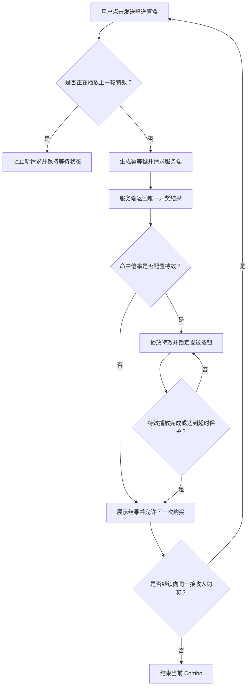
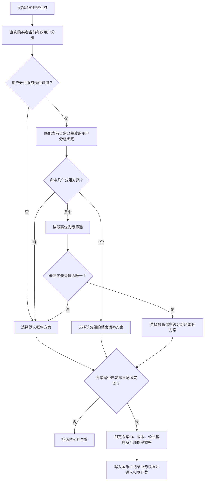
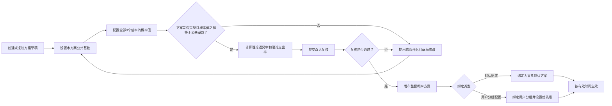
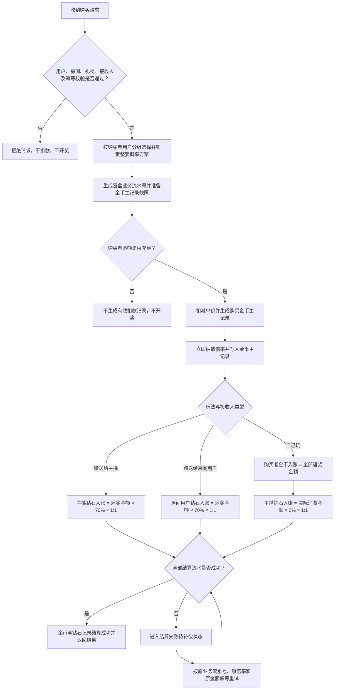

# 盲盒礼物需求设计文档

## 1. 文档信息

| 项目 | 内容 |
|---|---|
| 需求名称 | 盲盒礼物 |
| 文档版本 | V1.0 |
| 文档状态 | 待评审 |
| 适用端 | APP端、直播间服务、礼物服务、金币/钻石服务、管理端 |
| 时间口径 | 默认沿用平台现有时间口径 |

## 2. 项目背景与目标

### 2.1 项目背景

平台计划在现有普通礼物、幸运礼物之外新增“盲盒礼物”。盲盒采用“购买即开奖”模式：用户每次支付成功后立即随机命中一个礼物倍率，中奖金额由盲盒单价和命中倍率共同决定，不产生可保存或稍后开启的盲盒资产。

盲盒礼物分为两类玩法：

- **赠送盲盒**：用户选择当前直播间内的一名指定接收人并购买，支付成功后立即开奖和结算；接收人可以是主播或房间内其他用户。
- **自玩盲盒**：购买者自己开启并获得全部返奖，同时按照实际消费金额的一定比例向当前直播间主播分成。

### 2.2 项目目标

- 提供“赠送他人”和“自己玩”两类盲盒玩法。
- 每类玩法支持低、中、高、超高4个价位。
- 支持倍率、倍率特效及多套概率方案的后台配置。
- 确保抽奖、扣款、返奖、主播分成全链路可追溯、可对账、可重试。
- 在现有金币记录和钻石记录中明确标识盲盒礼物业务类型。
- 支持概率版本快照、配置审计和异常监控，避免配置变化影响历史业务记录。

## 3. 名词定义

| 名词 | 定义 |
|---|---|
| 盲盒单价 | 单次购买并立即开奖需要支付的金币金额，例如100、500、1000、10000 |
| 实际消费金额 | 盲盒单价 × 本次成功开启数量，单位为金币，不包含失败或未扣款的数量 |
| 倍率 | 单次开启随机命中的倍数，V1支持0.2、0.6、0.8、1、1.2、5.6、12、21、1000 |
| 返奖金额 | 单次盲盒单价 × 命中倍率，统一按金币口径计算 |
| 金币与钻石汇率 | 金币与钻石等价，固定按1:1转换，即1金币等值1钻石 |
| 赠送盲盒 | 购买者指定接收人并支付，系统立即开奖后将应得金额结算给该接收人，不形成盲盒实物或库存 |
| 自玩盲盒 | 购买者自己开启盲盒并获得返奖 |
| Combo | 用户连续开启同一盲盒的交互与计数表现；每次开启仍独立抽取倍率 |
| 公共基数 | 一套概率方案内所有倍率概率值的统一分母，例如10000 |
| 概率值 | 某倍率占公共基数的整数份数，例如基数10000、概率值1表示万分之一 |
| 倍率特效 | 命中某个倍率后播放的客户端特效，特效地址允许为空 |

## 4. 需求范围

### 4.1 V1范围

- 盲盒礼物展示和规则说明。
- 赠送盲盒、自玩盲盒。
- 每类玩法配置低、中、高、超高4档盲盒礼物，实际价格复用现有礼物价格配置能力。
- 9个固定倍率及其特效配置。
- 多套倍率概率方案配置、发布和绑定。
- 单送、Combo及特效串行控制。
- 扣款、返奖和主播分成。
- 购买开奖结果、金币记录、钻石记录和管理端查询。
- 基础风控、监控、幂等和补偿能力。

### 4.2 V1不包含

- 一次同时赠送多个接收人。
- 盲盒库存、背包、先购买后开启、延迟开奖或转赠；盲盒不是可持有资产，购买成功即开奖。
- 实物奖品、人工兑奖或物流发货。
- 用户自主选择倍率或付费改变单次抽奖概率。
- 盲盒奖池蓄水、跨用户共享奖池或保底机制。

## 5. 核心业务规则

### 5.1 盲盒类型与价位

| 盲盒类型 | 业务编码建议 | 接收人 | 价位 |
|---|---|---|---|
| 赠送盲盒 | `GIFT_TO_OTHER` | 当前直播间主播或其他用户 | 低、中、高、超高各1档 |
| 自玩盲盒 | `SELF_PLAY` | 购买者本人 | 低、中、高、超高各1档 |

以下金额仅为需求示例。每个盲盒礼物的实际金币价格直接读取现有礼物价格字段，通过现有礼物管理功能维护，不新增盲盒专用价格配置：

| 价位等级 | 示例单价（金币） |
|---|---:|
| 低 | 100 |
| 中 | 500 |
| 高 | 1000 |
| 超高 | 10000 |

约束如下：

- 每个盲盒只能归属一种玩法类型和一个价位等级。
- 低、中、高、超高是盲盒礼物的档位标识，不决定具体价格。
- 单价复用现有礼物价格字段、保存精度、校验规则和修改权限；盲盒模块不单独保存价格。
- 上架盲盒的现有礼物价格必须为大于0的金币整数。
- 同一玩法类型、同一价位等级可以配置并生效多套概率方案，不做唯一方案限制。
- 每个盲盒必须绑定一套默认概率方案，并可额外绑定多套用户分组概率方案。
- 用户购买时，系统根据购买者所属用户分组选择对应的整套概率方案；未命中任何用户分组方案时使用默认概率方案。
- 盲盒属于即时消费玩法，不发放至用户背包，不形成库存，不支持稍后开启或用户间转赠。
- 用户点击购买后，服务端在同一业务流程内完成支付、开奖和结算；用户侧不存在“已购买但未开奖”的可操作状态。
- 每一笔购买成功记录必须对应唯一的开奖结果。系统处理中断时，由服务端按原盲盒业务流水继续开奖或结算，用户不能再次手动开启。
- 上下架、单价或概率方案发生变化时，只影响新发起的购买开奖业务，不回溯历史金币或钻石记录。

#### 5.1.1 与现有礼物玩法的复用关系

- **赠送主播或房间其他用户**：复用当前普通礼物的玩法、展示分层和基础发送链路，包括接收人选择、单送、Combo、房间消息、礼物展示及既有公共能力。
- 赠送盲盒可理解为“用户用固定金币价格购买一个需要开奖后才能确定实际价值的普通礼物”。支付成功后立即抽取倍率，再按开奖结果确定礼物价值和接收人收入。
- 赠送模式虽然复用普通礼物基础链路，但资金结算仍使用本需求的盲盒规则：接收人获得返奖金额70%的等值钻石；赠送给房间其他用户时主播不参与分成。
- **自己玩**：复用当前幸运礼物的玩法和基础开奖链路，包括购买即开奖、倍率结果展示、Combo及现有幸运礼物公共能力。
- 自玩盲盒可理解为“用户用固定金币价格购买一个已知可能倍率列表、但不知道各倍率对应概率的幸运礼物”。购买者命中一个倍率后获得全部返奖金币，主播获得实际消费金额2%的等值钻石。
- 盲盒仍使用独立的礼物分类和业务类型，以便管理端配置、金币/钻石记录及报表能够与普通礼物、幸运礼物明确区分。

### 5.2 倍率范围

V1支持以下倍率：

```text
0.2、0.6、0.8、1、1.2、5.6、12、21、1000
```

规则如下：

- 每次成功开启必须且只能命中一个倍率。
- 每次Combo中的每一个盲盒均独立抽取倍率。
- 倍率使用定点小数保存，禁止使用浮点数参与账务计算。
- 每个倍率可配置一个特效地址，允许为空。
- 未配置特效的倍率只展示开奖结果，不进入特效等待状态。

### 5.3 金额与资产计算

单次返奖金额：

```text
返奖金额 = 盲盒单价 × 命中倍率
```

Combo汇总：

```text
实际消费金额 = 盲盒单价 × 成功开启次数
返奖金额合计 = 每次返奖金额之和
```

资产口径如下：

- 盲盒单价、实际消费金额、原始返奖金额和主播分成均统一按金币口径计算。
- 购买盲盒从购买者金币账户扣除金币。
- 收益入购买者本人账户时，以金币入账并生成金币记录。
- 收益入购买者以外的其他人账户时，以钻石入账并生成钻石记录；“其他人”包括主播和房间内其他用户。
- 金币与钻石固定按1:1等值转换，按金币口径计算出的入账数值无需折算比例，100金币等值入账100钻石。
- 赠送盲盒接收人收益和自玩盲盒主播2%分成都属于“入他人账户”，因此均以钻石入账。

示例：

| 盲盒单价 | 命中倍率 | 返奖金额 |
|---:|---:|---:|
| 100 | 0.2 | 20 |
| 500 | 1.2 | 600 |
| 1000 | 21 | 21000 |
| 10000 | 1000 | 10000000 |

### 5.4 赠送盲盒结算

赠送盲盒只能单送，即一次操作只能指定一个接收人。

#### 5.4.1 赠送给主播

```text
购买者扣款金币 = 盲盒单价
返奖金额（金币口径） = 盲盒单价 × 命中倍率
主播实际获得钻石 = 返奖金额 × 70% × 1:1
```

- 当前直播间主播为盲盒接收人。
- 购买者不获得本次返奖。
- 主播按金币口径计算应得金额，并以1:1的等值钻石进入主播钻石账户。

#### 5.4.2 赠送给房间其他用户

```text
购买者扣款金币 = 盲盒单价
返奖金额（金币口径） = 盲盒单价 × 命中倍率
接收用户实际获得钻石 = 返奖金额 × 70% × 1:1
```

- 接收人必须是当前房间内除购买者外的有效用户。
- 购买者不获得本次返奖。
- 当前直播间主播不参与任何分成；虽然复用普通礼物的玩法和发送链路，但不得触发普通礼物的主播分成逻辑。
- 该场景不生成主播分成钻石记录；仅接收用户获得返奖金额70%的等值钻石。
- 接收用户按金币口径计算应得金额，并以1:1的等值钻石进入其钻石账户。

#### 5.4.3 赠送盲盒平台结算差额

返奖金额中未向接收人结算的30%归平台，不再向购买者、主播或其他用户分配，也不生成用户侧金币或钻石入账记录。

```text
平台结算差额 = 购买者实际消费金额 - 接收人实际入账金额
```

- 平台结算差额大于或等于0时，差额归平台所有并计入盲盒业务收益。
- 平台结算差额小于0时，负差额全部由平台承担并计入盲盒业务成本，不向购买者、接收人或主播追补、扣回或分摊。
- 高倍率命中时，接收人仍按既定结果足额获得70%的等值钻石，不得因平台差额为负而改变倍率或减少入账。
- 返奖金额中30%归平台的分配口径与单笔平台最终盈亏口径应分开记录；平台最终盈亏仍以上述“实际消费金额减接收人实际入账金额”计算。

### 5.5 自玩盲盒结算

```text
购买者扣款金币 = 盲盒单价
购买者返奖金币 = 盲盒单价 × 命中倍率
主播分成钻石 = 盲盒实际消费金额 × 2% × 1:1
```

- 购买者获得本次全部返奖金额，不再乘以70%，并以金币进入购买者本人金币账户。
- 自玩返奖金币结算成功后立即成为可用余额，可直接继续购买盲盒或参与平台内允许使用金币的其他玩法。
- 自玩返奖不设置流水倍数、消费次数、解锁任务或冻结期，不区分“本金金币”和“返奖金币”。
- 提现或兑换能力沿用平台现有金币账户规则，盲盒玩法不新增额外流水门槛或限制。
- 当前直播间主播获得实际消费金额的2%，与命中倍率无关，并以1:1的等值钻石进入主播钻石账户。
- 自玩盲盒必须在有效直播间内进行，并绑定当前主播。
- 每一次开启成功后，购买者返奖和主播2%分成必须分别生成独立账务明细。

单次平台结算差额：

```text
平台结算差额 = 盲盒单价 - 购买者返奖 - 主播分成
```

### 5.6 Combo与特效控制

- Combo只表示连续开启，不改变单次概率、倍率、价格或结算公式。
- 每次开启由服务端生成独立结果，客户端不得本地抽奖。
- 赠送盲盒始终保持一个接收人；切换接收人视为结束当前Combo并开始新的赠送操作。
- 赠送盲盒命中配置了特效的倍率时，客户端必须等待当前特效播放完成后，才允许继续发送下一次购买请求。
- 赠送盲盒特效播放期间发送按钮置为等待状态，禁止重复点击产生并发购买流水。
- 自玩盲盒的Combo、特效播放和下一次开启时机完全复用当前幸运礼物玩法，不新增盲盒专属阻塞开关或交互规则。
- 客户端异常退出、断网或特效播放失败不得影响服务端已经完成的扣款和结算。
- 客户端重新进入房间后，可通过结果查询接口恢复未展示或最近一次开奖结果，但不得重复结算。
- 服务端仍需使用幂等键防止客户端绕过等待机制并发重复扣款。

赠送盲盒Combo与特效串行流程：



### 5.7 接收人有效性

赠送请求提交时，服务端必须校验：

- 房间存在且处于可赠送状态。
- 购买者具备送礼权限且余额充足。
- 接收人存在、状态正常且当前仍在房间内。
- 赠送给主播时，接收人必须等于当前房间主播。
- 赠送给其他人时，接收人不能等于购买者，也不能错误标记为主播类型。
- 用户离开房间、账号封禁或房间关闭后，新的赠送请求应失败；已完成结算的历史结果不回滚。

### 5.8 玩法限制

V1暂不设置盲盒专属业务限制：

- 不限制单用户每日购买或开奖次数。
- 不设置单次以外的每日、每周或累计消费金额上限。
- 高价和超高价盲盒不设置用户等级、会员等级或白名单准入条件。
- 不新增盲盒专属的未成年人限制。

上述“不限制”仅指不新增盲盒玩法配额。用户余额、账号状态、房间状态、平台既有风控、国家/地区合规和未成年人通用规则仍按现有系统执行。服务端为防止重复点击、并发攻击或系统过载实施的技术限流，也不视为每日次数或金额限制。

## 6. 概率与随机规则

### 6.1 概率方案

系统支持配置多套相互独立的概率方案。概率方案必须成套创建、校验、发布和绑定，不允许只配置某一个倍率或从不同方案中拼接概率。每套方案完整包含：

- 方案名称和唯一编码。
- 公共基数。
- 9个倍率各自的概率值。
- 理论返奖率。
- 版本号和状态。

公共基数属于方案本身，不是多套方案共用的全局基数。不同方案可以使用不同的公共基数，但每套方案内部的全部倍率必须使用该方案自己的同一个公共基数。

单套方案示例（下表仅节选两个倍率，实际配置必须包含全部9个倍率）：

| 倍率 | 概率值 | 公共基数 | 实际概率 |
|---:|---:|---:|---:|
| 1000 | 1 | 10000 | 0.01% |
| 0.8 | 500 | 10000 | 5% |

### 6.2 概率校验

发布概率方案前必须满足：

```text
所有倍率概率值之和 = 公共基数
```

- 公共基数必须为正整数。
- 每个概率值必须为大于或等于0的整数。
- 9个倍率必须全部存在于方案中，允许某倍率概率值为0。
- 至少一个倍率概率值大于0。
- 方案发布后内容不可直接修改；调整时复制生成新版本。
- 公共基数和倍率概率明细必须作为同一个配置整体保存和发布。
- 同一玩法类型、同一价位等级允许存在多套已发布概率方案，由默认绑定和用户分组绑定决定实际使用哪一套。

### 6.3 理论返奖率

单套概率方案的理论倍率期望：

```text
理论返奖率 = Σ（倍率 × 该倍率概率值 ÷ 公共基数）
```

结算后的理论成本率：

```text
赠送盲盒理论入账率 = 理论返奖率 × 70%
自玩盲盒理论总支出率 = 理论返奖率 + 2%
```

管理端应实时展示上述指标，并在超过运营配置的预警阈值时阻止发布或要求更高权限复核。

### 6.4 抽取算法

建议使用整数区间抽取，避免浮点误差：

1. 读取金币购买主记录锁定的概率方案版本和公共基数。
2. 使用服务端安全随机源生成区间 `[1, 公共基数]` 内的随机整数。
3. 按固定倍率顺序累加概率值，随机数落入的区间即为命中倍率。
4. 保存随机结果、倍率、概率版本和计算金额。
5. 后续重试只读取已保存结果，不重新抽取。

同一个业务幂等键只能产生一个随机结果。任何扣款或入账重试均不得重新开奖。

### 6.5 概率方案绑定

每个可售盲盒必须配置一套默认概率方案，并可以额外配置多套用户分组概率方案。绑定信息包括：

- 盲盒礼物ID。
- 玩法类型。
- 绑定类型：默认配置或用户分组配置。
- 用户分组ID；默认配置不填写。
- 用户分组匹配优先级；用于购买者同时属于多个分组时确定唯一方案。
- 生效开始时间和结束时间。

概率方案选择规则：

1. 以本次购买者作为用户分组匹配对象，不根据主播或礼物接收人的分组选择概率。
2. 查询购买者当前所属的有效用户分组；用户分组服务不可用时，直接使用该盲盒的默认概率方案。
3. 用户分组服务可用时，在当前盲盒已生效的用户分组绑定中进行匹配。
4. 未命中分组方案时，使用默认概率方案；只命中一个分组方案时，使用该整套方案。
5. 同时命中多个分组方案时，先筛选最高优先级。最高优先级唯一时使用该分组的整套方案；最高优先级不唯一时回落默认概率方案。
6. 选出分组方案或默认方案后，统一校验方案是否已发布且配置完整。
7. 最终选出的方案未发布、已停用或配置不完整时，拒绝本次购买并立即告警，不得临时拼接其他方案或使用代码内置概率。

同一个盲盒在同一时间可以有一套默认方案和多套面向不同用户分组的方案。每次购买开奖时，都要先确定唯一的整套概率方案，再将实际命中的方案ID、版本、公共基数、用户分组ID和匹配优先级写入本次金币主记录的业务快照，确保配置切换不影响在途业务及历史审计。

概率方案匹配流程：



## 7. APP端功能设计

### 7.1 礼物面板

现有直播间礼物分类增加“盲盒礼物”。盲盒礼物卡片展示：

- 礼物图标和名称。
- 玩法标签：赠送或自玩。
- 价位等级和单价。
- 规则说明入口。
- 当前选中接收人；自玩盲盒固定显示“自己”。

点击规则入口，通过管理端配置的 `rule_h5` 打开规则说明页面。

#### 7.1.1 规则H5内容

规则H5用于解释玩法和资金结算，不展示运营概率配置。页面必须说明：

- 盲盒分为“赠送他人”和“自己玩”两类玩法。
- 盲盒购买成功即立即开奖，每次随机命中一个倍率，不存在库存或稍后开启。
- **倍率列表**：明确展示盲盒可能命中的倍率为0.2、0.6、0.8、1、1.2、5.6、12、21、1000，但不展示各倍率对应概率。
- **赠送他人玩法定位**：相当于以固定金币价格购买一个需要开奖后才能确定实际价值的普通礼物，复用普通礼物的玩法、展示分层和发送链路。
- **赠送他人开奖规则**：用户选择当前房间内的一名主播或其他用户，支付金币后立即命中一个倍率，返奖金额按“礼物价格 × 命中倍率”计算。
- **赠送主播收入规则**：主播获得返奖金额70%的等值钻石，剩余部分归平台；平台差额为负时由平台承担。
- **赠送房间其他用户收入规则**：接收用户获得返奖金额70%的等值钻石，当前主播不参与任何分成。
- **自己玩玩法定位**：相当于以固定金币价格购买一个已知可能倍率列表、但不知道各倍率概率的幸运礼物，复用当前幸运礼物玩法。
- **自己玩开奖规则**：购买者支付金币后立即命中一个倍率，购买者获得全部返奖金币，返奖金币到账后可以继续玩且没有流水要求。
- **自己玩主播收入规则**：当前主播获得实际消费金币2%的等值钻石。
- 金币与钻石按1:1等值，具体金额换算复用平台现有规则。
- Combo及特效等待等用户需要了解的基础交互规则。

规则H5不展示以下内容：

- 每个倍率的实时概率或用户分组概率。
- 理论返奖率、理论支出率或平台预期收益。
- 概率方案生效日期、版本号和历史变更。
- 用户所属分组、实际命中的概率方案或后台配置明细。

上述概率、版本和理论指标仅供管理端配置、风控、监控及审计使用，不通过规则H5向用户展示。

### 7.2 赠送盲盒

操作流程：

1. 用户进入直播间并打开盲盒礼物分类。
2. 选择赠送盲盒及价位。
3. 选择当前主播或房间内一名其他用户作为接收人。
4. 点击发送即发起购买开奖请求，客户端生成业务幂等键并提交服务端。
5. 服务端完成校验、抽奖、扣款和结算后返回结果。
6. 客户端展示倍率、金币口径返奖金额、接收人实际获得钻石金额和Combo计数。
7. 命中特效时播放特效，播放结束后恢复发送能力。

### 7.3 自玩盲盒

操作流程：

1. 用户进入直播间并打开盲盒礼物分类。
2. 选择自玩盲盒及价位。
3. 页面固定标识返奖归购买者本人。
4. 点击开启，服务端完成抽奖、扣款、本人返奖和主播2%分成。
5. 客户端展示倍率、本人返奖金币金额及Combo计数。
6. Combo、倍率特效及下一次开启时机复用当前幸运礼物的既有交互，不增加盲盒专属开关。

### 7.4 余额不足和失败处理

- 余额不足：不开启、不抽奖、不生成有效扣款，提示充值或更换低价盲盒。
- 接收人已离开：不扣款、不抽奖，提示重新选择接收人。
- 礼物已下架：不扣款、不抽奖，刷新礼物面板。
- 概率配置无效：不扣款、不抽奖，返回系统繁忙并产生高优先级告警。
- 服务超时：客户端使用原幂等键查询或重试，不允许生成新幂等键直接重复开启。
- 结算处理中：展示处理中状态，服务端补偿完成后更新最终结果。

## 8. 管理端功能设计

### 8.1 礼物分类与基础配置

在现有直播间礼物分类中增加：

```text
BLIND_BOX = 盲盒礼物
```

礼物基础配置新增或明确以下字段：

| 字段 | 说明 |
|---|---|
| gift_type | 礼物分类，新增盲盒礼物枚举 |
| blind_box_play_type | 赠送盲盒或自玩盲盒 |
| price_level | 低、中、高、超高 |
| price | 复用现有礼物价格字段和管理能力，不新增盲盒专用价格配置 |
| rule_h5 | 规则说明H5地址 |
| status | 草稿、已上架、已下架 |
| effective_time | 生效时间 |

校验规则：

- 盲盒礼物必须配置玩法类型、价位等级、现有礼物价格、规则说明地址和一套有效的默认概率方案。
- `rule_h5` 必须为合法的HTTPS地址；如测试环境允许HTTP，应按环境白名单控制。
- `rule_h5` 页面必须按第7.1.1节说明两类玩法、开奖方式、收入规则及完整倍率列表；可以展示倍率值，但不得展示倍率对应概率、理论返奖率、生效日期或配置历史。
- 上架前必须校验默认概率方案完整且已发布；用户分组概率方案可按业务需要配置多套。
- 礼物已产生金币或钻石业务记录后不得变更玩法类型；需要调整时创建新礼物配置。

### 8.2 倍率配置

倍率配置页面展示：

| 字段 | 说明 |
|---|---|
| multiplier | 倍率值 |
| effect_url | 特效资源地址，可为空 |
| effect_duration_ms | 特效标准时长，供客户端超时保护 |
| status | 启用、停用 |
| update_user | 最后操作人 |
| update_time | 最后更新时间 |

V1倍率值固定为0.2、0.6、0.8、1、1.2、5.6、12、21、1000。运营可调整特效，不建议直接新增或删除倍率；新增倍率需重新评审客户端兼容、账务精度及概率方案。

### 8.3 概率方案管理

列表字段：

- 方案ID、方案名称、方案编码。
- 公共基数。
- 理论返奖率、赠送理论入账率、自玩理论总支出率。
- 默认绑定数量、用户分组绑定数量和已绑定用户分组。
- 版本号、状态、创建人、复核人。

操作能力：

- 新建、复制、编辑草稿。
- 按整套方案维护公共基数和全部9个倍率概率，保存及发布时进行完整性校验。
- 概率校验和理论返奖率试算。
- 提交复核、发布、停用和查看历史版本。
- 查看每个倍率的概率值及实际概率。
- 查看方案绑定的礼物、绑定类型、用户分组、优先级和有效时间。
- 为盲盒配置或切换默认方案。
- 为不同用户分组新增、编辑、停用概率方案绑定。

绑定校验规则：

- 每个上架盲盒在任一可售时间必须有且只有一套有效默认方案。
- 同一盲盒、同一用户分组的绑定有效时间不得重叠。
- 不同用户分组可以同时绑定不同方案，也可以复用同一套方案。
- 允许同一购买者同时属于多个用户分组；最高优先级唯一时使用该分组方案，最高优先级不唯一时回落默认方案。
- 配置预览应支持输入用户ID，展示其命中的分组、最终概率方案和回落默认方案的原因。

概率方案配置与发布流程：



状态流转：

```text
草稿 → 待复核 → 已发布 → 已停用
             ↘ 驳回
```

- 概率配置建议执行双人复核，创建人不得作为复核人。
- 已生效方案不可原地编辑。
- 紧急停用后，所有依赖该方案且无其他有效方案的盲盒应同步停止新开启。

### 8.4 盲盒金币与钻石记录

管理端复用现有金币记录、钻石记录查询能力，通过盲盒业务类型和统一业务流水号展示盲盒明细，不新增独立的盲盒订单或开奖记录查询表。筛选条件包括：

- 盲盒业务流水号、金币记录号、钻石记录号。
- 购买者ID、接收人ID、主播ID、房间ID。
- 盲盒礼物ID、玩法类型、价位等级。
- 命中倍率、概率方案和版本。
- 金币记录状态、钻石记录状态和整体结算状态。
- 创建时间和完成时间。

详情展示：

- 原始请求和业务幂等键。
- 金币单价、命中倍率、金币口径返奖金额、实际入账资产类型和金额、主播分成钻石。
- 购买扣款金币记录、返奖金币或钻石记录、主播分成钻石记录及其状态。
- 概率方案快照。
- 失败原因、补偿次数和最终结果。

管理端只允许查询和按既有审批流程发起补偿，不允许人工修改金币/钻石记录中的倍率、随机结果或结算金额。

### 8.5 操作审计

以下操作必须记录操作日志：

- 礼物新增、编辑、上架和下架。
- `rule_h5` 修改。
- 倍率特效新增、修改和停用。
- 概率方案创建、编辑、复核、发布和停用。
- 概率绑定关系调整。
- 人工补偿或账务处理。

日志至少保存操作对象、操作前内容、操作后内容、操作人、复核人、时间、原因和客户端IP。

## 9. 服务端流程设计

### 9.1 单次购买即开奖主流程

实现上，赠送主播或房间其他用户应复用普通礼物的基础发送、展示和房间消息链路；自己玩应复用幸运礼物的基础开奖、Combo和结果展示链路。盲盒服务只增加概率方案选择、倍率开奖、盲盒专属结算和业务记录标识，避免重复建设已有公共能力。

1. 接收请求并校验用户、房间、礼物、接收人和幂等键。
2. 读取礼物价格和玩法类型，查询购买者所属用户分组，并按绑定优先级匹配用户分组概率方案；分组服务不可用、未匹配分组或最高优先级不唯一时使用默认概率方案。
3. 生成唯一盲盒业务流水号，准备写入现有金币记录的价格、匹配分组、绑定类型及整套概率方案版本快照。
4. 校验购买者余额并扣减盲盒单价，生成一条盲盒购买类型的金币记录，作为本次业务主记录。
5. 在同一次服务端业务流程中使用安全随机源抽取倍率，并立即将随机值、倍率和返奖金额写入该金币主记录；服务端不得在扣款后向用户返回一个可稍后开启的盲盒。
6. 按金币口径计算返奖、接收人入账金额和主播分成，并按1:1确定实际金币或钻石入账数值。
7. 自玩返奖进入购买者金币账户；赠送返奖进入主播或房间其他用户的钻石账户。
8. 自玩模式下执行主播2%分成，并生成主播钻石记录。
9. 按统一盲盒业务流水号更新现有金币、钻石记录状态并返回结果。
10. 任一步骤异常时进入可重试状态，由补偿任务继续处理，不重新开奖。

购买即开奖与资金结算主流程：



### 9.2 业务流水状态

不新增盲盒订单状态表。以下是盲盒业务的逻辑状态，应映射到现有金币记录和钻石记录的状态字段；如现有状态枚举不足，可扩充枚举或写入业务扩展字段：

```text
INIT（初始化）
PROCESSING（正在完成扣款和开奖，仅内部短暂状态）
DRAW_SUCCESS（扣款和开奖均已成功，即业务上的购买成功）
SETTLING（结算中）
SUCCESS（结算成功）
PAY_FAILED（扣款失败）
SETTLE_FAILED（结算失败，待补偿）
CLOSED（未扣款关闭）
```

`PROCESSING` 仅用于系统故障恢复，不向用户提供“稍后开启”入口，也不代表用户拥有一个盲盒。未完成扣款的业务可以关闭；已经生成有效扣款金币记录的业务必须按原业务流水号继续完成唯一一次开奖和后续结算，不得直接删除记录。

### 9.3 幂等规则

- 客户端每次实际点击生成一个全局唯一业务幂等键。
- 服务端在现有金币记录中对“购买者ID + 业务幂等键”建立唯一约束，或通过现有幂等组件保证同等效果。
- 相同幂等键重复请求返回同一盲盒业务流水号和同一开奖结果。
- 扣款、返奖和主播分成分别使用稳定的子流水号保证账务幂等。
- 定时补偿不得生成新的随机结果或新的业务金额。

### 9.4 一致性与补偿

盲盒涉及随机结果与多账户结算，不建议依赖跨服务强事务。建议复用现有金币/钻石记录状态、可靠消息和幂等账务接口实现最终一致性，不新增盲盒订单、开奖结果或结算关联表。

- 扣款成功但开奖前服务异常：恢复后根据金币主记录和原业务幂等键进入唯一一次开奖步骤，禁止重新扣款。
- 开奖成功但返奖失败：保留开奖结果并重试原返奖金额。
- 购买者返奖成功但主播分成失败：只重试主播分成。
- 重试超过阈值：进入人工告警队列，不改变原开奖结果。
- 所有补偿需记录次数、时间、错误码和处理结果。

## 10. 金币与钻石记录

### 10.1 业务类型

现有金币记录、钻石记录必须新增或明确以下业务标识：

| 建议字段 | 建议值 | 说明 |
|---|---|---|
| biz_type | `BLIND_BOX_GIFT` | 盲盒礼物一级业务类型 |
| biz_sub_type | `BLIND_BOX_PURCHASE` | 购买者金币支付 |
| biz_sub_type | `BLIND_BOX_GIFT_REWARD` | 赠送盲盒接收人钻石返奖 |
| biz_sub_type | `BLIND_BOX_SELF_REWARD` | 自玩盲盒购买者金币返奖 |
| biz_sub_type | `BLIND_BOX_ANCHOR_SHARE` | 自玩盲盒主播钻石分成 |
| source_type | `GIFT_TO_ANCHOR` | 赠送给主播 |
| source_type | `GIFT_TO_ROOM_USER` | 赠送给房间其他用户 |
| source_type | `SELF_PLAY` | 自己玩 |

如现有账务系统只支持一个类型字段，应至少保证一级类型可区分盲盒礼物，并将具体玩法、资金方向保存在扩展字段中。

### 10.2 记录落点

每次购买即开奖生成一个全局唯一的 `blind_box_biz_no`，不再创建独立盲盒订单号和开奖明细号。各资金记录落点如下：

| 业务动作 | 记录表 | 业务子类型 | 说明 |
|---|---|---|---|
| 购买者支付盲盒单价 | 现有金币记录表 | `BLIND_BOX_PURCHASE` | 本次盲盒业务主记录，保存完整开奖与配置快照 |
| 赠送盲盒接收人返奖 | 现有钻石记录表 | `BLIND_BOX_GIFT_REWARD` | 金币口径应得金额按1:1入等值钻石，通过`blind_box_biz_no`关联主记录 |
| 自玩盲盒购买者返奖 | 现有金币记录表 | `BLIND_BOX_SELF_REWARD` | 全部返奖以金币进入购买者本人账户，通过`blind_box_biz_no`关联主记录 |
| 自玩盲盒主播2%分成 | 现有钻石记录表 | `BLIND_BOX_ANCHOR_SHARE` | 金币口径分成按1:1入等值钻石，独立生成主播收入记录 |

金币购买主记录需保存或通过扩展字段保存：

- `blind_box_biz_no`、客户端业务幂等键和Combo序号。
- 房间ID、主播ID、购买者ID、接收人ID及接收人类型。
- 礼物ID、礼物名称、玩法类型、价位等级和单价。
- 随机整数、公共基数、命中倍率和原始返奖金额。
- 接收人实际入账金额和主播分成金额。
- 概率方案ID、版本、绑定类型、命中用户分组ID、绑定优先级和默认方案回落原因。
- 特效地址快照、业务状态、失败原因、补偿次数、创建时间和完成时间。

关联的金币返奖记录或钻石记录至少保存：

- `blind_box_biz_no`和本条资金记录号。
- 业务子类型、账户用户ID、资金方向和实际变动金额。
- 变动前后余额、记录状态、失败原因、创建时间和完成时间。
- 现有表字段不足时写入统一业务扩展字段，但不得只记录无法检索的自由文本备注。

### 10.3 关联与幂等约束

- 同一次购买的扣款、返奖和主播分成必须使用同一个 `blind_box_biz_no`。
- 购买金币主记录中的“购买者ID + 业务幂等键”必须唯一。
- 返奖及分成记录按“`blind_box_biz_no` + 业务子类型 + 账户用户ID”保证唯一，防止补偿时重复入账。
- 管理端和对账任务以金币购买主记录为入口，通过 `blind_box_biz_no` 查询关联金币、钻石记录。
- 随机结果一旦写入金币购买主记录，任何重试均只能读取原结果，不得重新抽奖。

### 10.4 金额精度与现有换算规则

- 倍率建议使用 `DECIMAL(10,4)` 或按整数倍率基数保存。
- 金额统一使用平台最小资产单位的整数保存。
- 金币与钻石固定按1:1等值转换，不配置浮动汇率，也不因资产转换产生额外汇差。
- 返奖金额乘以70%、实际消费金额乘以2%以及金币转钻石过程中出现最小单位小数时，必须调用平台现有金币/钻石完整换算规则处理。
- 本需求不新增或覆盖向下取整、四舍五入等算法，也不得在盲盒服务内复制一套独立换算逻辑。
- 以现有金币/钻石服务返回的最终入账金额为唯一账务结果，并将该结果写入金币购买主记录的金额快照。
- 同一笔业务的金币记录、钻石记录、页面展示和报表必须复用该最终结果，禁止各系统分别换算。

## 11. 核心数据设计

### 11.1 礼物表扩展

在现有礼物表增加或扩展：

| 字段 | 类型建议 | 说明 |
|---|---|---|
| gift_type | VARCHAR | 新增盲盒礼物类型 |
| blind_box_play_type | VARCHAR | `GIFT_TO_OTHER`、`SELF_PLAY` |
| price_level | VARCHAR | `LOW`、`MEDIUM`、`HIGH`、`ULTRA_HIGH` |
| rule_h5 | VARCHAR(512) | 规则说明H5地址 |

盲盒单价直接使用现有礼物表的价格字段，不增加 `blind_box_price` 等重复字段，也不建设独立价格表。

礼物与默认概率方案、用户分组概率方案之间的关系统一保存在概率绑定表中，礼物表不保存单一的 `probability_plan_id`。

### 11.2 倍率配置表（blind_box_multiplier_config）

| 字段 | 说明 |
|---|---|
| id | 主键 |
| multiplier | 倍率，固定精度 |
| effect_url | 特效地址，可为空 |
| effect_duration_ms | 特效标准时长 |
| status | 启用状态 |
| create_user | 创建人 |
| update_user | 更新人 |
| create_time | 创建时间 |
| update_time | 更新时间 |

### 11.3 概率方案表（blind_box_probability_plan）

| 字段 | 说明 |
|---|---|
| id | 主键 |
| plan_code | 方案唯一编码 |
| plan_name | 方案名称 |
| version | 版本号 |
| base_number | 公共基数 |
| expected_rate | 理论返奖率 |
| status | 草稿、待复核、已发布、已停用、驳回 |
| create_user | 创建人 |
| review_user | 复核人 |
| create_time | 创建时间 |
| update_time | 更新时间 |

建议对 `plan_code + version` 建立唯一约束。

### 11.4 概率明细表（blind_box_probability_item）

| 字段 | 说明 |
|---|---|
| id | 主键 |
| plan_id | 概率方案ID |
| multiplier | 倍率 |
| probability_value | 概率值 |
| sort_no | 固定抽奖区间顺序 |
| create_time | 创建时间 |
| update_time | 更新时间 |

建议对 `plan_id + multiplier` 建立唯一约束。

### 11.5 概率绑定表（blind_box_probability_binding）

| 字段 | 说明 |
|---|---|
| id | 主键 |
| gift_id | 盲盒礼物ID |
| plan_id | 概率方案ID |
| binding_type | `DEFAULT`或`USER_GROUP` |
| user_group_id | 用户分组ID；默认绑定为空 |
| priority | 分组匹配优先级；默认绑定不参与分组优先级比较 |
| effective_start_time | 生效开始时间 |
| effective_end_time | 生效结束时间 |
| status | 状态 |
| create_time | 创建时间 |
| update_time | 更新时间 |

必须校验同一礼物的默认绑定有效时间段不重叠；同一礼物、同一用户分组的绑定有效时间段不重叠。不同用户分组的方案允许同时生效；购买者命中多个分组时优先使用唯一的最高优先级方案，最高优先级不唯一时回落默认方案。

### 11.6 现有金币记录表与钻石记录表适配

V1不新增以下盲盒专用业务表：

- `blind_box_order`。
- `blind_box_draw_result`。
- `blind_box_settlement_record`。

购买扣款、开奖结果、接收人返奖和主播分成全部落入现有金币记录表、钻石记录表。现有记录通过统一的 `blind_box_biz_no` 关联，金币购买记录作为主记录保存完整的开奖结果和概率配置快照，字段及幂等要求见第10章。

## 12. 接口建议

### 12.1 APP端接口

| 接口 | 用途 |
|---|---|
| 获取盲盒礼物列表 | 返回玩法、价位、单价、规则地址和展示配置 |
| 获取房间可赠送用户 | 返回主播及当前房间内可接收盲盒的用户 |
| 购买并开奖 | 一次请求完成校验、扣款、开奖和结算，不产生盲盒库存 |
| 查询盲盒业务结果 | 按盲盒业务流水号进行超时重试、结果恢复和补偿状态查询 |
| 查询个人盲盒记录 | 展示购买、接收、倍率和金额明细 |

购买并开奖接口建议请求字段：

```json
{
  "idempotencyKey": "客户端唯一键",
  "roomId": 10001,
  "giftId": 20001,
  "playType": "GIFT_TO_OTHER",
  "receiverUserId": 30001
}
```

购买并开奖接口建议响应字段：

```json
{
  "blindBoxBizNo": "BBOX202608050001",
  "status": "SUCCESS",
  "unitPrice": 500,
  "consumeAsset": "COIN",
  "multiplier": "1.2",
  "rewardAmount": 600,
  "receiverCreditAmount": 420,
  "receiverCreditAsset": "DIAMOND",
  "anchorShareAmount": 0,
  "anchorShareAsset": "DIAMOND",
  "effectUrl": "https://example.com/effect/1.2.svga",
  "comboSequence": 1
}
```

资产字段规则：赠送盲盒的 `receiverCreditAsset` 固定为 `DIAMOND`；自玩盲盒的 `receiverCreditAsset` 固定为 `COIN`；主播分成资产固定为 `DIAMOND`。所有金额数值均先按金币口径计算，金币与钻石按1:1等值。

### 12.2 管理端接口

- 礼物基础配置新增、编辑、上下架。
- 倍率及特效查询、编辑。
- 概率方案创建、复制、校验、试算、提交复核、发布和停用。
- 概率方案绑定查询和调整。
- 盲盒金币记录、钻石记录及其关联结果查询。
- 补偿任务查询及审批后重试。

## 13. 权限与安全

- 普通运营可查看礼物、倍率、概率方案以及盲盒金币/钻石记录。
- 礼物上下架、概率编辑、概率发布、紧急停用应拆分权限。
- 概率方案建议执行双人复核和操作审计。
- 随机结果只能由服务端生成，客户端不得上传倍率或返奖金额。
- 服务端必须根据礼物价格和倍率重新计算所有金额，不信任客户端金额字段。
- 开奖接口可执行防重复、防并发和防攻击的技术限流，并继续执行设备风险和账号状态校验；技术限流不得实现为单用户每日玩法次数或金额配额。
- 高倍率命中应进入实时风控和监控，但已经合法完成的随机结果不能因金额较高而被重新抽取。
- 规则H5、图片和特效资源必须使用可信域名白名单，防止加载恶意内容。

## 14. 监控与报表

### 14.1 业务指标

- 盲盒开启人数、开启次数和实际消费金额。
- 赠送盲盒、自玩盲盒各自的开启次数和金额。
- 各价位开启次数和金额。
- 按概率方案、用户分组统计各倍率实际命中次数、实际命中率和理论概率偏差。
- 默认方案使用次数、用户分组方案使用次数、各分组方案命中人数，以及按“未命中分组、分组服务不可用、最高优先级不唯一”拆分的默认方案回落次数。
- 原始返奖金额、实际入账金额、主播分成和平台结算差额。
- Combo平均次数及特效触发次数。

### 14.2 系统指标

- 购买并开奖接口成功率、耗时和超时率。
- 扣款成功率、开奖成功率、结算成功率。
- 待补偿业务流水数量、最长等待时间和重试次数。
- 幂等重复请求数量。
- 礼物或概率配置缺失次数。

### 14.3 告警建议

- 同一概率方案的实际倍率分布持续明显偏离理论值。
- 1000倍等高倍率命中频率超过统计预警阈值。
- 概率明细之和不等于公共基数。
- 金币购买主记录已扣款但长时间未开奖或未结算。
- 金币记录、钻石记录之间的盲盒关联金额不一致。
- 理论返奖率或实际支出率超过配置阈值。
- 单用户、单设备或单房间短时间开启频次异常。

## 15. 异常与边界规则

| 场景 | 处理规则 |
|---|---|
| 余额刚好等于盲盒单价 | 允许开启，扣款后余额为0 |
| 接收人在请求过程中离开房间 | 以服务端接收请求时的最终校验结果为准；校验失败则不扣款不开启 |
| 主播下播或房间关闭 | 新请求失败；已生成扣款金币记录的业务继续完成结算 |
| 礼物在客户端展示后被下架 | 服务端拒绝新请求，客户端刷新列表 |
| 概率方案恰好切换 | 以金币购买主记录创建时锁定的有效版本为准 |
| 购买者未命中任何配置分组 | 使用该盲盒当前有效的默认概率方案 |
| 购买者同时命中多个配置分组且最高优先级唯一 | 使用唯一的最高优先级方案，并将命中分组及优先级写入金币购买主记录快照 |
| 购买者同时命中多个配置分组且最高优先级不唯一 | 回落默认概率方案，并记录回落原因为优先级不唯一 |
| 用户分组服务不可用 | 回落默认概率方案，并记录回落原因为分组服务不可用 |
| 请求超时但服务端已成功 | 使用原幂等键查询并返回原结果 |
| 特效地址为空 | 正常展示结果，不等待特效 |
| 特效加载失败 | 使用超时保护恢复发送，不影响账务结果 |
| 返奖或分成失败 | 保留原开奖结果并按原金额补偿，不重新开奖 |
| 1000倍导致大额支出 | 正常按结果结算，同时触发高倍率监控和风控记录 |
| 计算结果包含最小单位小数 | 调用平台现有金币/钻石换算规则，以账务服务返回值入账并保存最终金额快照 |

## 16. 测试场景与验收标准

### 16.1 功能测试

| 编号 | 场景 | 预期结果 |
|---|---|---|
| TC-BBOX-001 | 礼物面板查看盲盒礼物 | 独立展示盲盒分类、玩法、价位、单价和规则入口 |
| TC-BBOX-002 | 打开规则说明 | 跳转至管理端配置的 `rule_h5`，展示赠送他人、自己玩的开奖和收入规则 |
| TC-BBOX-003 | 100单价命中0.2倍 | 原始返奖金额为20 |
| TC-BBOX-004 | 500单价命中5.6倍 | 原始返奖金额为2800 |
| TC-BBOX-005 | 10000单价命中1000倍 | 原始返奖金额为10000000 |
| TC-BBOX-006 | Combo连续开启10次 | 生成10个独立开奖结果，每次仅命中一个倍率 |
| TC-BBOX-007 | Combo切换接收人 | 结束原Combo，新请求绑定新的单一接收人 |
| TC-BBOX-008 | 命中无特效倍率 | 立即展示结果并允许继续开启 |
| TC-BBOX-009 | 命中有特效倍率 | 特效完成或超时保护触发后才恢复下一次发送 |
| TC-BBOX-010 | 通过现有礼物管理功能修改盲盒礼物价格 | 修改生效后的新购买读取现有礼物最新价格，历史金币记录价格不变 |
| TC-BBOX-011 | 检查规则H5披露内容 | 展示完整倍率列表、两类玩法、开奖及收入规则；不展示任何倍率对应概率、理论返奖率、生效日期或历史变更 |
| TC-BBOX-012 | 有效用户连续多次购买或直接选择超高价盲盒 | 不因每日次数、累计金额、用户等级或白名单条件被玩法层拒绝；余额及既有风控校验正常执行 |
| TC-BBOX-013 | 赠送主播或房间其他用户 | 复用普通礼物的接收人、发送、展示分层、Combo和房间消息链路，结算使用盲盒专属规则 |
| TC-BBOX-014 | 自己玩 | 复用幸运礼物的购买即开奖、Combo、特效和结果展示链路，结算使用盲盒专属规则 |

### 16.2 结算测试

| 编号 | 场景 | 预期结果 |
|---|---|---|
| TC-SETTLE-001 | 100金币单价赠送主播，命中1.2倍 | 购买者扣100金币，返奖按120金币计算，主播入账84钻石 |
| TC-SETTLE-002 | 500金币单价赠送房间用户，命中0.8倍 | 购买者扣500金币，接收用户入账280钻石 |
| TC-SETTLE-003 | 1000金币单价自玩，命中5.6倍 | 购买者扣1000金币、返奖5600金币，主播入账20钻石 |
| TC-SETTLE-004 | 自玩Combo开启5次 | 主播钻石分成数值等于5次金币实际消费金额之和的2% |
| TC-SETTLE-005 | 赠送房间其他用户 | 主播不参与任何分成，不生成主播钻石记录；仅接收用户获得返奖金额70%的等值钻石 |
| TC-SETTLE-006 | 金币或钻石返奖失败后重试 | 按原资产类型和原金额重试，倍率和随机结果不变，不重复扣款 |
| TC-SETTLE-007 | 主播分成单独失败 | 只重试主播分成，不重复购买者返奖 |
| TC-SETTLE-008 | 相同幂等键重复请求 | 返回同一盲盒业务流水号及开奖结果，只产生一笔金币扣款记录 |
| TC-SETTLE-009 | 100金币赠送主播，命中0.2倍 | 主播入账14钻石，平台结算差额为86金币等值并归平台收益 |
| TC-SETTLE-010 | 100金币赠送主播，命中5.6倍 | 主播入账392钻石，平台结算差额为-292金币等值并由平台承担 |
| TC-SETTLE-011 | 自玩返奖金币结算成功后立即再次购买盲盒 | 返奖金币可直接作为可用余额继续购买，不校验或扣减任何流水门槛 |
| TC-SETTLE-012 | 70%返奖或2%主播分成产生最小单位小数 | 调用平台现有金币/钻石换算规则，页面、金币记录、钻石记录和报表结果一致 |

### 16.3 概率配置测试

| 编号 | 场景 | 预期结果 |
|---|---|---|
| TC-PROB-001 | 基数10000，1000倍概率值1 | 页面显示实际概率0.01% |
| TC-PROB-002 | 9项概率值之和小于基数 | 不允许发布 |
| TC-PROB-003 | 9项概率值之和大于基数 | 不允许发布 |
| TC-PROB-004 | 某倍率概率为负数 | 不允许保存 |
| TC-PROB-005 | 某倍率概率为0 | 允许保存，该倍率在此方案中不命中 |
| TC-PROB-006 | 修改已发布概率方案 | 不允许原地修改，必须创建新版本 |
| TC-PROB-007 | 同一盲盒配置两个时间重叠的默认方案 | 不允许发布第二个默认绑定 |
| TC-PROB-008 | 金币购买主记录创建后概率方案切换 | 原业务仍使用主记录创建时锁定的方案版本 |
| TC-PROB-009 | 大样本概率回放 | 各倍率实际频率在设定统计容差内接近配置概率 |
| TC-PROB-010 | 购买者未属于任何配置分组 | 使用默认概率方案，并记录绑定类型为`DEFAULT` |
| TC-PROB-011 | 购买者命中一个用户分组 | 使用该用户分组绑定的整套概率方案，不与默认方案混用 |
| TC-PROB-012 | 购买者同时命中两个用户分组且优先级不同 | 使用唯一的最高优先级分组方案，并记录最终分组及优先级 |
| TC-PROB-013 | 不同用户分组的方案同时生效 | 允许发布，各分组用户分别使用对应方案 |
| TC-PROB-014 | 同一盲盒、同一用户分组的绑定时间重叠 | 不允许发布重叠绑定 |
| TC-PROB-015 | 方案只有公共基数和部分倍率概率 | 不允许保存为完整方案或发布 |
| TC-PROB-016 | 购买者命中多个分组且最高优先级不唯一 | 使用默认概率方案，并记录优先级不唯一的回落原因 |

### 16.4 异常测试

| 编号 | 场景 | 预期结果 |
|---|---|---|
| TC-ERR-001 | 余额不足 | 不扣款、不开启、不生成开奖结果 |
| TC-ERR-002 | 接收人不在房间 | 请求失败且不扣款 |
| TC-ERR-003 | 房间关闭 | 新请求失败，已生成扣款金币记录的业务继续结算 |
| TC-ERR-004 | 特效资源加载失败 | 不回滚账务，超时后恢复交互 |
| TC-ERR-005 | 购买并开奖接口响应超时 | 原幂等键可查询到唯一最终结果，不生成待开启盲盒 |
| TC-ERR-006 | 默认概率方案缺失或无效 | 拒绝购买并产生告警 |
| TC-ERR-007 | 开奖后服务重启 | 从持久化结果继续结算，不重新开奖 |
| TC-ERR-008 | 用户分组服务查询失败 | 使用默认概率方案，并记录分组服务不可用的回落原因 |

### 16.5 验收标准

- 两类盲盒均可按配置正常展示、开启和结算。
- 每类均支持低、中、高、超高4个价位。
- 盲盒实际价格完全复用现有礼物价格配置、校验和权限，不存在独立盲盒价格字段或价格表。
- 规则H5展示完整倍率列表，并准确说明赠送他人、自己玩的玩法定位、开奖和收入规则；不展示任何倍率对应概率、理论返奖率、生效日期及历史变更。
- 赠送模式复用普通礼物玩法、展示分层和发送链路；自玩模式复用当前幸运礼物玩法及开奖链路。
- V1不设置盲盒专属每日次数、累计金额、高价准入或未成年人限制，同时不影响平台既有通用规则和技术风控。
- 每次开启只命中一个倍率，Combo内各次结果相互独立。
- 赠送盲盒始终只允许一个接收人。
- 赠送主播或其他用户时，实际入账钻石准确等于金币口径返奖金额的70%，金币与钻石按1:1等值。
- 赠送盲盒返奖金额中未向接收人结算的30%归平台；单笔结算差额为正时归平台收益，为负时由平台承担。
- 赠送给房间其他用户时，主播不参与分成，也不产生任何主播收入记录。
- 自玩盲盒购买者获得全部返奖金币，主播获得数值等于实际消费金币2%的钻石。
- 自玩返奖金币到账后可立即继续使用，不设置流水倍数、解锁条件或冻结期。
- 金额出现最小单位小数时完全复用平台现有金币/钻石换算结果，盲盒服务不自行取整。
- 有特效时可正确阻塞下一次发送，无特效或特效失败时不会永久阻塞。
- 每套概率方案完整包含一个公共基数和全部倍率概率，且概率值总和等于该方案公共基数。
- 每个上架盲盒都有一套有效默认方案，并可同时配置多套用户分组方案。
- 购买者命中唯一最高优先级用户分组时使用该分组的整套方案；未命中分组、分组服务不可用或最高优先级不唯一时准确回落默认方案。
- 最终选出的默认或分组方案未发布或配置不完整时，拒绝购买并告警；金币购买主记录可追溯实际方案、版本及回落原因。
- 同一幂等键不会重复扣款、重复开奖或重复返奖。
- 金币记录和钻石记录可以明确识别盲盒购买、盲盒返奖及主播分成。
- 任一盲盒业务均可通过 `blind_box_biz_no` 关联扣款、开奖结果、返奖和主播分成记录。

## 17. 上线与回滚建议

### 17.1 上线前

- 完成规则H5玩法文案、适用国家/地区及应用商店政策的合规评审。
- 使用历史或模拟数据验证理论返奖率、理论支出率和预算峰值。
- 压测高并发Combo、账务结算和补偿任务。
- 校验所有礼物均绑定一套有效默认概率方案、所有分组绑定均可唯一决策，并配置可访问的规则H5。
- 配置防重复、防并发和防攻击的技术限流阈值及高倍率告警，不配置每日玩法次数或消费金额上限。

### 17.2 灰度发布

- 按国家、渠道、用户白名单或房间白名单灰度。
- 首期使用低流量观察实际倍率分布、返奖成本和账务成功率。
- 灰度期间不得临时修改生效中的概率内容，应通过新版本切换。

### 17.3 回滚

- 紧急情况下关闭盲盒礼物新开启入口。
- 已生成扣款金币记录或已开奖的业务继续按原结果完成结算。
- 不得通过回滚配置撤销合法命中的高倍率结果。
- 概率方案回滚通过重新绑定上一有效版本实现，保留完整操作记录。

## 18. 待确认事项

以下事项需在产品、财务、运营、风控和研发评审时确认：

1. **Combo请求模式**：V1是客户端逐次请求，还是允许一次购买多个后服务端批量开奖；本文建议逐次请求以满足特效串行要求。
2. **自玩特效阻塞**：特效等待规则是否只适用于赠送盲盒；本文默认两类玩法复用特效并可通过开关控制。
3. **用户分组来源**：需明确用户分组由哪个系统维护、成员关系的实时性、缓存时长、优先级配置责任方及查询失败时的监控责任方；本文按购买者分组进行匹配。
4. **特效完成信号**：客户端以播放器回调还是后台配置的标准时长作为完成条件；建议播放器回调为主、超时保护为辅。

在上述待确认项定稿后，应同步更新结算公式、接口枚举、数据库字段精度和验收用例，再进入开发评审。
