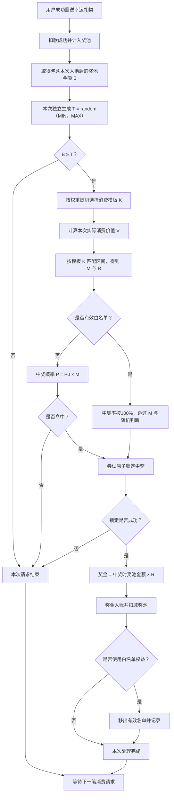
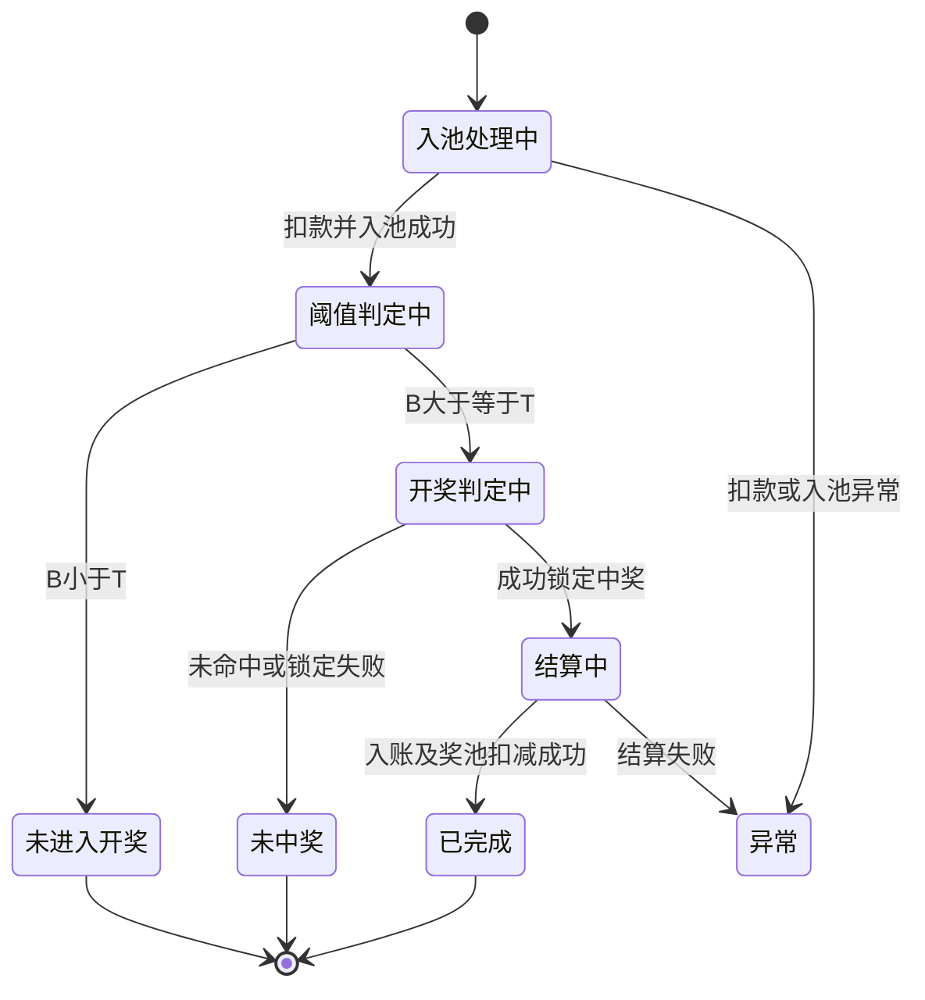

# Jackpot随机中奖机制优化需求文档

## 1. 文档信息

| 项目 | 内容 |
| --- | --- |
| 产品范围 | SANO Jackpot－幸运礼物 |
| 文档状态 | 交流确认稿 |
| 核心机制 | 每笔消费请求独立随机阈值，通过阈值后随机消费模板 |
| 配置范围 | 随机阈值最小值/最大值、消费模板及权重、消费区间倍率、消费区间中奖比例、白名单 |
| 本期交付 | Markdown需求文档、管理端SVG/PNG原型 |

## 2. 需求背景

现有Jackpot在达到固定阈值后，按幸运礼物个数执行中奖判断。礼物单价和单次赠送金额不影响单个礼物的抽奖概率，导致用户可以在接近开奖时使用大量低价礼物拆分抽奖，逐渐识别并利用开奖规律。

本次优化将判断单位调整为“一次成功赠送请求”，并取消预先生成、长期锁定开奖参数的方式。每笔请求均独立随机阈值；达到该阈值后，再为该请求随机选择消费模板，并根据请求实际消费价值取得倍率和中奖比例。消费越高可以拥有更高的相对中奖概率，但任何消费档位均不能形成必中奖占位。

白名单用于承接其他业务模块或运营授予的一次性优先中奖权益。白名单不预留奖池、不覆盖已产生的中奖结果，只在该用户自己的有效请求通过阈值判定后，将中奖概率按100%处理。

## 3. 需求目标

1. 降低固定阈值和固定模板被用户测定、推算或利用的可能性。
2. 将中奖判断从礼物个数改为单次请求，避免低价礼物天然获得更多抽奖次数。
3. 让较高消费价值拥有相对更高的中奖概率，同时保持随机性。
4. 每笔消费请求使用独立随机阈值；不预生成、不复用后续请求的阈值。
5. 仅当本次请求通过阈值判定时，按权重随机选择一套消费模板。
6. 中奖比例配置在消费模板的价值区间内，不作为单独随机参数。
7. 支持一次性白名单权益，并与普通请求共同使用原子中奖与结算机制。
8. 完整记录每笔开奖判定实际使用的参数，支持运营查询、问题核对和审计。

## 4. 核心概念

### 4.1 一次消费请求

用户一次独立发起、服务端一次成功扣款并计入奖池的幸运礼物赠送请求，是本机制的最小判断单位。

- 单价2金币、一次赠送1个：请求实际消费价值为2。
- 单价2金币、一次赠送100个：请求实际消费价值为200。
- 单价1,000金币、一次赠送1个：请求实际消费价值为1,000。

用户将大额赠送拆成多次独立请求时，不做短时间归并；每个成功请求独立执行一次完整判定。

### 4.2 当前奖池金额

本次消费成功计入奖池后，系统取得可用于本次判定的实际奖池金额，记为`B`。

`B`必须在阈值判定时读取；若并发请求发生在奖金结算期间，应通过现有奖池原子机制保证读取口径与扣减结果一致。

### 4.3 随机阈值范围

运营配置随机阈值最小值`MIN`和最大值`MAX`。每笔成功消费请求都在`MIN～MAX`之间独立生成随机绝对阈值`T`。

`T`仅服务于当前请求，用完即结束，不向后续请求复用。

### 4.4 单次实际消费价值

本次请求成功扣除并计入幸运礼物消费的金币总额，记为`V`。

```text
V = 礼物单价 × 本次成功赠送数量
```

只使用实际成功扣款部分；失败、退款、超时或未计入奖池的金额不得参与。

### 4.5 消费价值模板

一套消费价值模板包含模板名称、抽取权重、是否默认，以及一个或多个按上限递增的消费区间。每个区间配置中奖倍率`M`和中奖比例`R`。

模板只在本次请求满足`B ≥ T`后随机选择。不同请求可以选中不同模板。

### 4.6 白名单一次性优先中奖权益

- 只有用户产生有效幸运礼物消费请求并通过阈值判定时才参与。
- 仍计算`V`、随机选择模板`K`并匹配区间中奖比例`R`。
- 不应用区间倍率`M`，不执行普通随机命中，中奖率按100%处理。
- 直接尝试锁定中奖；锁定并结算成功后自动移出有效名单。
- 普通用户已经先中奖时，白名单不追溯、不覆盖，权益继续保留。
- 多个有效白名单用户按照服务端请求进入判定的顺序先到先处理。

## 5. 总体业务模型



执行顺序固定为：先生成阈值并比较奖池金额；通过后再随机模板、计算价值区间参数；最后判断白名单并进入对应中奖分支。

## 6. 请求级随机阈值

### 6.1 生成与判定

```text
T = random（MIN，MAX）

若 B < T：本次请求不进入开奖流程。
若 B ≥ T：本次请求进入开奖流程。
```

- `MIN`、`MAX`均为包含边界的绝对奖池金额。
- 每笔成功消费请求只生成一次`T`。
- 不使用当前奖池金额调整随机区间下限。
- 不保存可供后续请求复用的阈值。

因此，`B < MIN`时必然不能通过；`MIN ≤ B < MAX`时由本次`T`决定；`B ≥ MAX`时必然通过，奖池派奖与扣减机制应避免该状态长期持续。

### 6.2 示例

配置`MIN = 2,600,000`，`MAX = 3,200,000`：

```text
请求A入池后 B = 2,800,000，生成 T = 2,867,000，B < T，本次结束。
请求B入池后 B = 2,805,000，重新生成 T = 2,730,000，B ≥ T，进入开奖流程。
```

请求A的`T`不得被请求B沿用。

### 6.3 配置与保密

- `MIN`、`MAX`必须为正整数金币，且`MIN < MAX`。
- 修改后从后续开始处理的请求读取最新配置；已经读取参数的在途请求不切换配置。
- 不向客户端返回`MIN`、`MAX`或本次随机阈值`T`。
- 不展示“距离开奖还差多少金币”等可反推规则的信息。

## 7. 消费价值模板

### 7.1 区间结构

| 单次消费价值 | 倍率`M` | 中奖比例`R` |
| --- | ---: | ---: |
| ≤5,000 | 1 | 10% |
| ≤10,000 | 2 | 12% |
| ≤15,000 | 3 | 15% |
| ≤20,000 | 5 | 20% |

最后一档同样配置明确的`≤上限值`，不使用`>某值`表达。

### 7.2 模板权重

设有效模板权重为`W1...Wn`，本次请求选中模板`Ki`的概率为：

```text
P（Ki） = Wi ÷ ΣW
```

- 仅已启用、已发布且拥有完整有效区间的模板参与随机。
- 模板在请求通过阈值后即时随机，不提前选定。
- 默认模板仅用于随机服务异常或有效模板集合临时不可用时的受控兜底。

### 7.3 区间匹配与生效

系统按上限从小到大查找首个满足`V ≤ 上限值`的区间，并同时取得`M`和`R`。

- 上限必须唯一且严格递增。
- 倍率必须大于0；中奖比例必须大于0且不超过100%。
- 所有允许的消费价值必须能匹配到唯一有效区间。
- 保存后，后续进入开奖流程的请求读取最新已发布版本。
- 已经开始处理的请求继续使用其已经读取的模板版本和区间参数。

## 8. 单次中奖判断

### 8.1 普通用户

一次成功赠送请求最多执行一次阈值判定，最多执行一次中奖判断。礼物数量不再拆解成多次抽奖。

```text
P = P0 × M
```

其中`P0`为基础中奖概率。命中后仍需成功取得原子中奖锁；未取得锁视为本次未中奖。

### 8.2 白名单用户

白名单分支必须位于阈值、模板和价值区间计算之后：

1. 本次请求满足`B ≥ T`。
2. 按权重随机选择模板`K`。
3. 计算`V`并匹配区间，得到`M`和`R`。
4. 判定消费者是否拥有有效白名单权益。
5. 若有，忽略`M`，不执行随机命中，中奖率按100%处理。
6. 直接尝试取得原子中奖锁。
7. 锁定和结算成功后消费权益并移出有效名单。

白名单只是中奖概率优先权，不是提前指定开奖结果。用户未消费、请求未通过阈值、锁定失败或已有其他请求先结算时，权益均不消耗。

### 8.3 多个白名单用户

- 仅对各自实际到达且通过阈值的请求进行判定。
- 按服务端请求进入原子中奖判定的顺序先到先处理。
- 先成功结算的用户使用权益；其他用户权益继续有效。
- 不允许后台预先绑定某笔开奖或覆盖已完成中奖。

## 9. 中奖比例与奖金结算

```text
A = J × R
```

- `J`：实际中奖时的奖池金额。
- `R`：本次命中区间的中奖比例。
- `A`：本次中奖金额。

奖金基数是实际中奖时的奖池金额，不是随机阈值，也不是达到阈值前的金额。

示例：实际中奖时奖池金额2,980,000，`V = 8,000`，命中`≤10,000`区间，`R = 12%`，则奖金为357,600金币。

取整沿用现有Jackpot资金系统规则，管理端和执行记录展示实际入账金额。

### 9.1 幂等与并发

- 同一消费请求不得重复开奖或重复入账。
- 同一时刻只允许一个Jackpot中奖结算持有原子锁。
- 并发请求不得基于前一笔派奖扣减前的过期奖池金额继续结算。
- 锁定失败的请求结束，不得覆盖已锁定结果。
- 入账和奖池扣减保持现有事务、补偿和幂等能力。

## 10. 请求状态与流转

| 状态 | 含义 |
| --- | --- |
| 入池处理中 | 执行礼物扣款和奖池计入 |
| 阈值判定中 | 读取奖池金额并生成本次随机阈值 |
| 未进入开奖 | 奖池金额小于本次阈值 |
| 开奖判定中 | 随机模板、匹配区间、判定白名单或普通概率 |
| 未中奖 | 未命中或未取得原子中奖锁 |
| 结算中 | 已锁定中奖，正在入账和扣减奖池 |
| 已完成 | 本次处理与必要结算成功 |
| 异常 | 配置、随机、锁定或结算异常 |



异常恢复不得重新扣款、重复开奖或重复消费白名单权益。

## 11. 管理后台需求

### 11.1 Jackpot配置列表

每行保留“修改”“明细配置”“白名单”三个业务入口。不再提供正在使用参数的查看入口，因为系统不存在预先锁定的待开奖参数。

### 11.2 明细配置

奖池阈值区域展示Jackpot类型、基础中奖概率、当前奖池金额、随机阈值最小值、随机阈值最大值、单次请求随机范围。页面明确：每笔消费成功入池后独立生成`T`，当前奖池金额不参与调整随机范围。

消费模板区域左右分栏：

- 左侧卡片展示模板名称、权重、区间数量、是否默认，支持新增、编辑和设为默认。
- 右侧展示所选模板区间，包含`≤消费价值上限`、倍率、中奖比例、实际中奖概率、奖金计算说明和操作。
- 模板新增、编辑使用弹窗；消费区间新增、编辑使用表格行内编辑。

### 11.3 开奖判定记录

至少记录：

- 请求ID、礼物流水ID、用户ID、请求时间。
- 入池金额和阈值判定时奖池金额`B`。
- 本次随机阈值`T`及是否通过。
- 通过阈值时选中的模板ID、名称、版本和权重。
- `V`、命中区间、`M`、`R`。
- 白名单判定、实际中奖概率、命中结果、原子锁结果。
- 中奖流水ID、中奖时奖池金额、计算奖金、实际入账、扣减后奖池金额。
- 异常状态、重试或补偿结果。

阈值未通过时，模板、区间、白名单等后续字段应为空。历史记录保存当时实际使用的参数，不使用最新配置重新计算。

### 11.4 白名单管理

配置列表每行提供“白名单”入口，页面分为“有效名单”和“名单记录”。

有效名单展示用户ID/昵称、权益来源、加入原因、创建人、加入时间、最近幸运礼物消费和操作；支持新增、查询、人工移除。人工移除必须填写原因，正在结算或已锁定中奖时禁止移除。

名单记录永久记录用户、权益来源、加入原因、创建人、加入时间、结束方式、关联中奖流水、结束时间和操作人，只读且不可删除。

## 12. 权限与审计

建议拆分基础配置、阈值配置、模板管理、消费区间管理、开奖记录查看/导出、白名单查看/新增/移除/导出权限。

配置和白名单变更记录对象、变更前值、变更后值、原因、操作人、时间、来源IP或终端标识。每笔开奖判定记录保存实际读取和随机得到的参数。

## 13. 异常处理

- 无有效模板：若请求通过阈值但没有可用模板，记录配置异常并告警，不得开奖。
- 区间无法匹配：记录请求ID、模板版本和`V`，终止本次开奖，不得默认使用相邻区间。
- 阈值配置无效：管理端禁止保存；运行时读取到无效配置则不开奖并高优先级告警。
- 并发中奖：普通命中和白名单100%分支使用同一原子中奖锁。
- 入账失败：保持中奖锁并按现有资金补偿机制重试，结算成功前不得消费白名单权益。
- 长时间无人中奖：不新增概率递增或最长开奖时限，沿用已有出奖实现。

## 14. 监控与运营数据

- 消费请求总数、阈值通过率、随机阈值分布、模板抽取分布。
- 各价值区间请求量、命中量和实际中奖率。
- 白名单判定量、锁定成功量、结算成功量和有效名单存量。
- 原子锁冲突量、结算失败量、补偿重试量。
- 配置读取、随机服务和区间匹配异常量。

## 15. 用户端兼容要求

- 客户端继续沿用现有“幸运中奖”展示，不展示白名单身份。
- 不返回请求级随机阈值、模板、倍率、中奖比例或白名单判定结果。
- 中奖广播、到账和奖池金额更新沿用现有能力。

## 16. 验收口径

1. 每笔成功消费请求独立生成一个`MIN～MAX`内的随机阈值，且不被后续请求复用。
2. 只有`B ≥ T`时才随机选择消费模板并继续开奖。
3. 模板按有效权重随机，不单独随机中奖比例。
4. 礼物数量不会拆成多次中奖判断。
5. 实际消费价值能够唯一匹配一个`≤上限值`区间。
6. 普通用户中奖概率等于基础概率乘以区间倍率。
7. 白名单用户同样随机模板、计算`V`并匹配`R`，但跳过倍率和随机命中，中奖率按100%。
8. 普通用户先成功锁定中奖时，白名单不得覆盖，未使用权益继续保留。
9. 多个白名单用户按服务端请求顺序竞争，不得预占。
10. 中奖金额等于实际中奖时奖池金额乘以命中区间中奖比例。
11. 同一请求不会重复开奖或重复入账，并发请求不能重复扣减同一奖池金额。
12. 管理端配置列表仅保留修改、明细配置和白名单三个业务入口。
13. 开奖判定记录可还原每笔请求实际使用的`B、T、K、V、M、R`及白名单结果。

## 17. 当前明确不做

- 不按礼物个数抽奖。
- 不对短时间拆单做归并。
- 不设置固定开奖阈值。
- 不预先选定可供后续请求持续使用的模板。
- 不单独随机中奖比例。
- 不增加概率递增或最长开奖时限。
- 不向用户披露白名单及后台开奖参数。
- 不新增客户端页面原型。

## 18. 待技术确认

1. 并发消费请求在奖池入池、阈值判定、中奖锁和奖池扣减之间的具体事务边界。
2. 在途请求读取配置版本的准确时点，以及发布配置的缓存刷新策略。
3. 请求级随机数生成、模板权重随机和执行记录的存储容量及保留周期。
4. 默认模板兜底触发条件是否沿用现有随机服务降级规范。
