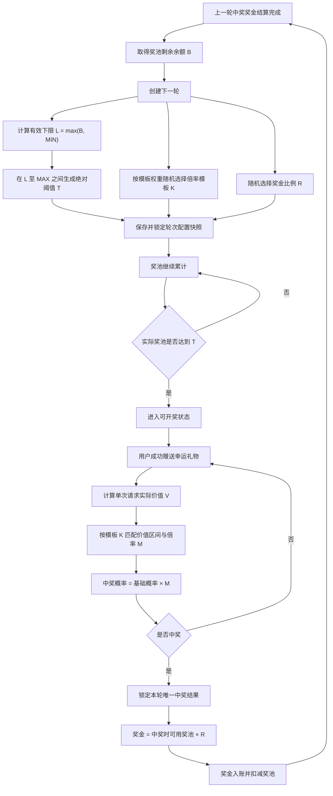
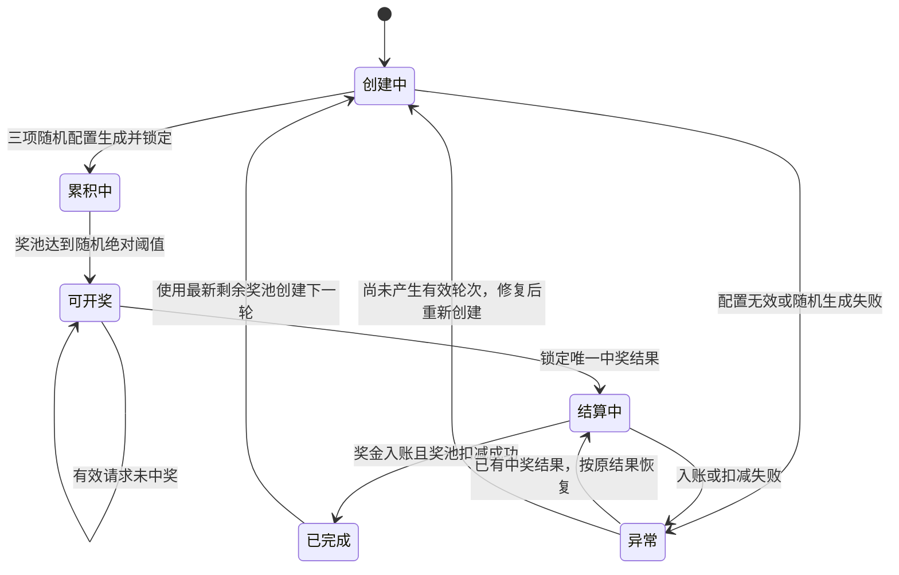

# Jackpot随机中奖机制优化需求文档

## 1. 文档信息

| 项目 | 内容 |
| --- | --- |
| 需求名称 | Jackpot随机中奖机制优化 |
| 文档状态 | 需求讨论稿，待需求评审 |
| 涉及端 | Jackpot服务、幸运礼物赠送链路、金币服务、运营管理后台、现有中奖展示链路 |
| 目标使用者 | 幸运礼物消费用户、运营人员及其他授权人员 |
| 文档范围 | 随机绝对开奖阈值、消费价值倍率模板、模板权重、单次中奖判断、随机奖金比例、奖池结算、轮次快照、配置与审计 |
| 非本文范围 | Jackpot入池比例调整、客户端视觉改版、数据库表结构、接口技术设计、测试用例、概率递增、最长开奖时限、强制中奖及运营定向名单机制 |

## 2. 需求背景

当前Jackpot在奖池达到固定阈值后进入开奖阶段。用户赠送幸运礼物时，系统按照礼物个数逐个执行中奖判断，单个礼物中奖概率一致，不考虑礼物单价和一次赠送请求的实际消费总价值。

例如：

- 单价2金币的礼物一次赠送1个，执行1次中奖判断。
- 单价2金币的礼物一次赠送100个，执行100次中奖判断。
- 单价10000金币的礼物一次赠送1个，仍只执行1次中奖判断。

该机制使低价礼物在相同或更低消费金额下可以获得更多判断次数。用户能够通过历史开奖表现识别这一规律，并在奖池接近固定阈值时集中使用低价礼物增加中奖机会。固定开奖阈值、按礼物个数判断和固定中奖倍率共同造成了较强的可预测性。

本次优化不改变Jackpot现有资金入池来源和达到阈值后的基础出奖链路，重点调整每轮开奖条件和单次中奖概率计算方式：开奖阈值改为每轮随机绝对值，中奖判断单位改为一次赠送请求，中奖概率根据该请求的实际消费总价值匹配本轮随机倍率模板，奖金比例也在创建轮次时随机生成。

## 3. 需求目标

1. 将固定开奖阈值改为每轮随机绝对开奖阈值，降低用户根据固定奖池金额判断开奖时点的能力。
2. 将中奖判断单位从“单个礼物”调整为“一次赠送请求”，不再因一次请求内礼物数量增加而重复判断。
3. 根据一次赠送请求的实际消费总价值匹配中奖倍率，使高价值请求相对更容易中奖，但不形成固定礼物单价优势。
4. 支持运营配置多套消费价值倍率模板，并按模板权重为每轮随机选择一套模板。
5. 支持每轮随机选择奖金比例，中奖金额按照实际中奖时的奖池金额计算。
6. 每轮创建时同时生成并锁定随机阈值、倍率模板和奖金比例，保证当前轮次执行口径稳定、历史结果可追溯。
7. 不新增短时间请求归并、开奖概率递增、最长开奖时限或系统强制中奖机制，达到阈值后的开奖过程沿用现有实现。

## 4. 核心概念与产品边界

### 4.1 Jackpot轮次

从上一轮奖金结算完成、下一轮随机参数生成开始，到本轮产生有效中奖结果并完成奖金结算为止，定义为一个Jackpot轮次。

每个轮次拥有独立且不可变的随机配置快照，包括：

- 轮次起始奖池余额。
- 运营配置的随机阈值最小值和最大值。
- 随机绝对开奖阈值。
- 随机选中的消费价值倍率模板及版本。
- 模板被选中时的权重快照。
- 基础中奖概率。
- 随机奖金比例。

### 4.2 轮次起始奖池余额

上一轮中奖奖金成功扣减后，奖池剩余的实际可用余额，记为`B`。该值参与计算下一轮随机区间下限，但当`B`小于配置最小值时，不直接作为随机下限。

### 4.3 随机阈值范围配置

运营分别配置下一轮随机绝对开奖阈值的最小值`MIN`和最大值`MAX`。`MIN`是运营希望维持的最低开奖线，`MAX`是随机阈值上限。现有机制保证每次派奖后的剩余值`B`一定小于`MAX`。

### 4.4 随机绝对开奖阈值

创建新轮次时，先取`B`与`MIN`中的较大值作为有效随机下限`L`，再在`L`至`MAX`之间随机生成绝对奖池余额`T`。

当实际奖池余额达到或超过`T`时，该轮次进入可开奖状态。`T`是绝对余额，不是需要新增的奖池金额。

### 4.5 一次赠送请求

用户向服务端提交并成功完成的一次幸运礼物赠送业务请求。一次请求可以包含一个或多个同种幸运礼物。

本需求统一规定：一次有效赠送请求只执行一次Jackpot中奖判断，不按照请求中的礼物数量拆分为多次判断。

用户主动拆分为多个独立请求时，每个成功请求分别作为一次独立中奖判断。系统不进行短时间合并，不增加额外冷却或请求归并窗口。

### 4.6 单次实际消费价值

一次有效幸运礼物赠送请求实际扣除的金币总价值，记为`V`：

```text
V = 礼物有效单价 × 本次请求有效赠送数量
```

中奖倍率按照`V`匹配，不按照礼物名称、礼物个数或单个礼物价格直接匹配。

### 4.7 消费价值倍率模板

一套完整的单次消费价值区间与中奖倍率配置。一个模板包含多个互不重叠的价值区间，每个区间对应一个倍率。

运营可以维护多套已发布模板，并为每套模板配置抽取权重。创建轮次时，系统按照权重随机选中一套模板，本轮所有中奖判断均使用该模板。

### 4.8 随机奖金比例

运营配置多个可选奖池发放比例。创建轮次时，系统随机选择一个比例并写入轮次快照。本轮中奖金额按照实际中奖时的奖池金额乘以该比例计算。

## 5. 总体业务模型



总体规则：

1. 随机绝对阈值、倍率模板和奖金比例必须在创建轮次时一起生成。
2. 三项随机结果生成后立即写入轮次快照，本轮内不得重新随机或人工替换。
3. 奖池达到阈值前不执行本轮Jackpot中奖判断；达到阈值的赠送请求作为本轮第一笔有效中奖判断。
4. 进入可开奖状态后，每个有效赠送请求独立判断一次，直至产生本轮唯一中奖者。
5. 长时间未中奖时不提高概率、不强制开奖、不设置最长时限，继续沿用现有出奖过程。
6. 中奖奖金按实际中奖时的奖池金额计算，不按随机阈值或达到阈值时的余额计算。

## 6. 随机绝对开奖阈值

### 6.1 生成规则

设：

- `B`：上一轮奖金扣减完成后的奖池剩余余额。
- `MIN`：运营配置的随机阈值最小值。
- `MAX`：运营配置的随机阈值最大值。
- `L`：本轮有效随机下限。
- `T`：本轮随机绝对开奖阈值。

生成公式：

```text
L = max(B, MIN)
T = random(L, MAX)
```

`T`按照金币系统支持的最小单位生成，并允许取区间上下边界。

例如：

```text
上一轮开奖后剩余奖池 B = 2,430,000
运营配置随机阈值最小值 MIN = 2,600,000
运营配置随机阈值最大值 MAX = 3,200,000
本轮有效随机下限 L = max(2,430,000, 2,600,000) = 2,600,000
本轮随机绝对阈值 T = 2,867,000
```

当实际奖池余额达到或超过2,867,000金币时，本轮进入可开奖状态。

### 6.2 下限规则

随机区间下限按照`L = max(B, MIN)`计算：

- 当`B < MIN`时，随机范围为`MIN～MAX`。
- 当`MIN ≤ B < MAX`时，随机范围为`B～MAX`。

现有机制保证实际中奖时奖池金额不超过`MAX`，且派奖比例大于0，因此派奖后的剩余值`B`必然小于`MAX`，本需求不设计`B ≥ MAX`的业务分支。

### 6.3 配置校验

- `MIN`和`MAX`必须大于0。
- `MIN`必须严格小于`MAX`。
- 管理端根据当前奖池剩余值实时展示`max(B, MIN)～MAX`的下一轮有效随机范围。
- `MIN`或`MAX`修改只影响修改后创建的新轮次，不影响已经生成的轮次阈值。

### 6.4 用户展示

- 本轮真实随机绝对阈值不向客户端返回。
- 客户端不得展示“距离本轮真实阈值还差多少金币”。
- 现有奖池金额或模糊进度展示可以继续保留，但不得通过接口或文案泄露本轮阈值。
- 达到阈值后，客户端继续沿用现有Jackpot可开奖或中奖表现。

## 7. 消费价值倍率模板

### 7.1 模板结构

每套模板至少包括：

- 模板名称。
- 模板说明。
- 模板状态。
- 模板抽取权重。
- 模板版本。
- 多个消费价值区间。
- 每个价值区间对应的中奖倍率。

示例：

| 单次消费价值 | 模板A | 模板B | 模板C |
| --- | ---: | ---: | ---: |
| 1—1000 | 1倍 | 1倍 | 1倍 |
| 1001—3000 | 1.5倍 | 2倍 | 2.5倍 |
| 3001—5000 | 2.5倍 | 3倍 | 4倍 |
| 5001—10000 | 4倍 | 5倍 | 6倍 |
| 10001及以上 | 6倍 | 8倍 | 10倍 |

示例仅用于说明模板结构，正式倍率由运营根据基础概率、预期开出速度和历史幸运礼物消费分布配置。

### 7.2 模板抽取权重

每套已发布模板可以配置独立抽取权重，例如：

| 模板 | 抽取权重 |
| --- | ---: |
| 模板A | 50 |
| 模板B | 30 |
| 模板C | 20 |

创建轮次时，系统按照有效模板权重占全部有效模板权重之和的比例随机选择：

```text
模板选中概率
= 当前模板权重 ÷ 全部有效模板权重之和
```

未发布、已停用、权重小于等于0或配置校验失败的模板不得参与随机。

### 7.3 模板随机与锁定

- 模板与随机绝对阈值、奖金比例在同一次轮次创建过程中生成。
- 被选中的模板ID、版本、权重和完整区间规则写入轮次快照。
- 本轮所有赠送请求只使用该模板，不在每次赠送时重新选择模板。
- 运营修改、停用或删除模板时，不得改变正在进行轮次的模板快照。
- 下一轮创建时重新从当时有效的模板集合中随机选择。

### 7.4 模板校验

模板发布前必须校验：

- 至少存在一个有效消费价值区间。
- 区间下限不得大于区间上限。
- 区间不得重叠。
- 区间边界必须明确，不能使同一消费价值同时命中两个区间。
- 所有区间均使用明确的“≤ 上限值”配置；最高档上限必须覆盖业务允许的单次最大消费价值，不使用“＞某值”的无上限表达。
- 倍率必须大于0。
- 高价值区间倍率原则上不得低于低价值区间倍率。
- `基础中奖概率 × 倍率`不得大于100%。

系统不额外设置业务层面的中奖概率绝对上限。管理端在配置阶段直接计算并展示所有区间的最终中奖概率，由运营在发布前确认。

## 8. 单次中奖判断

### 8.1 判断单位

一次有效幸运礼物赠送请求只执行一次中奖判断，不按请求中包含的礼物个数展开。

| 赠送请求 | 单次实际消费价值 | Jackpot判断次数 |
| --- | ---: | ---: |
| 单价2金币，赠送1个 | 2 | 1次 |
| 单价2金币，赠送100个 | 200 | 1次 |
| 单价1000金币，赠送1个 | 1000 | 1次 |
| 单价1000金币，赠送10个 | 10000 | 1次 |

### 8.2 独立请求

用户主动将一笔消费拆为多个独立赠送请求时，每个成功请求分别判断一次。例如用户连续提交100个独立请求，每次赠送1个礼物，则产生100次独立中奖判断。

本期明确不增加：

- 短时间请求归并。
- Combo合并判断。
- 用户抽奖冷却时间。
- 单用户单位时间抽奖次数限制。
- 跨请求累计价值后统一判断。

### 8.3 价值计算

中奖判断使用该请求实际成功扣除的幸运礼物消费价值：

```text
V = 本次有效扣款金币总额
```

如现有系统的礼物单价乘数量与实际扣款金额存在差异，以最终成功扣款金币总额为准，避免优惠、价格变化或异常请求造成中奖价值与真实消费不一致。

无效、失败、已撤销或未完成扣款的请求不得执行中奖判断。

### 8.4 概率计算

设：

- `P0`：基础中奖概率，当前默认沿用现有十万分之一口径。
- `V`：本次请求实际消费价值。
- `K`：本轮随机选中的倍率模板。
- `M(K,V)`：模板`K`中消费价值`V`对应的倍率。
- `P`：本次最终中奖概率。

计算公式：

```text
P = P0 × M(K,V)
```

例如：

```text
基础中奖概率 P0 = 1 / 100000
本轮模板 = 模板B
本次实际消费价值 V = 4000
匹配倍率 M = 3
本次中奖概率 P = 3 / 100000
```

每次判断使用平台统一安全随机能力生成结果，并记录实际使用的轮次、模板版本、价值区间、倍率和概率快照。

### 8.5 达到阈值的请求

当某笔有效幸运礼物赠送使奖池余额从低于阈值变为达到或超过阈值时：

1. 该笔请求先完成扣款和奖池入池。
2. 系统将轮次状态原子更新为可开奖。
3. 该笔请求按照本轮模板执行第一次中奖判断。
4. 未中奖时，后续请求继续执行独立判断。

不得因为该笔请求承担了阈值跨越而重复判断或额外增加倍率。

## 9. 随机奖金比例与结算

### 9.1 奖金比例配置

运营维护多个有效奖金比例候选值，例如：

```text
10%、15%、20%
```

创建轮次时，系统从当前有效奖金比例中随机选择一个比例`R`，与随机绝对阈值、消费价值倍率模板一起写入轮次快照。

当前各有效奖金比例采用等概率随机；某个比例被选中后，本轮内不再变化。

### 9.2 奖金计算基数

本轮奖金以实际中奖时的奖池金额为计算基数，不以随机阈值、轮次起始余额或达到阈值时的余额为基数。

设：

- `J`：本轮实际中奖时的奖池金额。
- `R`：本轮创建时随机生成并锁定的奖金比例。
- `A`：本轮中奖金额。

计算公式：

```text
A = J × R
```

例如：

```text
本轮绝对开奖阈值 = 2,867,000
本轮奖金比例 = 20%
实际中奖时奖池金额 = 3,050,000
中奖金额 = 3,050,000 × 20% = 610,000
```

奖金扣减后奖池剩余2,440,000金币，该余额作为下一轮随机绝对阈值区间的下限。

### 9.3 取整规则

中奖金额产生非整数金币时，完全沿用现有金币系统的精度和取整规则。Jackpot服务不得自行增加另一套取整方式。

轮次快照必须保存计算前奖池余额、奖金比例、取整前金额、实际入账金额和扣减后余额，确保账务结果可核对。

### 9.4 结算幂等

- 同一轮次只能存在一个有效中奖结果。
- 同一中奖赠送流水只能生成一次奖金。
- 中奖结果确定后，入账超时或失败只允许重试原中奖用户、原奖金比例和原金额。
- 重试不得重新随机阈值、模板、奖金比例、中奖用户或中奖金额。
- 奖金成功入账并完成奖池扣减后，才允许关闭本轮并创建下一轮。

## 10. 轮次状态与流转

### 10.1 状态定义

| 状态 | 含义 |
| --- | --- |
| 创建中 | 正在生成随机阈值、倍率模板和奖金比例 |
| 累积中 | 轮次配置已锁定，奖池尚未达到随机阈值 |
| 可开奖 | 奖池已达到随机阈值，后续有效赠送可以执行中奖判断 |
| 结算中 | 已产生唯一中奖结果，正在完成奖金入账和奖池扣减 |
| 已完成 | 本轮奖金结算成功，可以创建下一轮 |
| 异常 | 轮次创建、配置随机、中奖锁定或资金结算出现异常，需要恢复处理 |

### 10.2 状态流转



### 10.3 状态约束

- 累积中状态不得执行Jackpot中奖判断。
- 可开奖状态不得重新生成本轮随机配置。
- 结算中状态不得接受新的本轮中奖结果。
- 已完成轮次不得再次打开或重新结算。
- 异常恢复必须根据是否已经生成中奖结果选择恢复路径，不得无条件重新抽奖。

## 11. 管理后台需求

### 11.1 Jackpot全局配置

管理后台提供以下配置：

- 功能启停状态。
- 基础中奖概率。
- 随机阈值最小值。
- 随机阈值最大值。
- 有效奖金比例列表。
- 当前配置版本。
- 配置生效时间。

保存时显示：

- 当前奖池余额。
- 当前轮次状态。
- 当前配置是否会影响正在进行的轮次。
- 根据当前剩余值、随机阈值最小值和最大值计算出的下一轮有效随机范围。
- 修改后开始使用该配置的最早轮次。

正在进行的轮次不读取修改后的配置；新配置仅在下一轮创建时生效。

#### 11.1.1 当前周期查看

Jackpot配置列表每行操作列增加“当前周期”。点击后以只读弹窗展示该Jackpot类型正在使用的周期参数，便于运营核对线上实际运行状态。

弹窗展示：

- 周期ID、周期状态和创建时间。
- 本周期使用的阈值最小值、阈值最大值及最终生成的随机绝对开奖阈值。
- 当前奖池实际余额，以及距离达到阈值的金额。
- 本周期锁定的基础中奖概率和奖金比例。
- 本周期随机选中的消费倍率模板，包括模板名称、抽取权重、是否默认、区间数量、倍率范围和配置版本。
- 模板全部消费区间快照，包括消费价值上限、倍率、中奖比例、实际中奖概率和奖金计算规则。
- 本周期是否存在白名单；存在时展示白名单人数及用户列表。
- 白名单用户列表展示用户ID、昵称、本周期幸运礼物消费金额、是否已有消费和加入时间。

交互规则：

- 当前周期弹窗仅用于查看，不提供任何修改、删除或移出白名单操作。
- 所有开奖参数均展示周期创建时锁定的快照，不能使用后台最新配置覆盖。
- 奖池实际余额和白名单用户的本周期消费状态按当前数据刷新。
- 当前没有白名单时，展示“无白名单”，不展示空表格。
- 当前不存在进行中周期时，弹窗展示空状态“暂无进行中的周期”。
- 后台配置修改仍仅从下一周期开始生效。

### 11.2 倍率模板管理

模板列表展示：

- 模板名称。
- 模板版本。
- 模板状态。
- 抽取权重。
- 价值区间数量。
- 最低和最高倍率。
- 基于当前基础概率计算的最低和最高实际中奖概率。
- 创建人、修改人和更新时间。

模板编辑支持：

- 新增、修改和删除价值区间。
- 配置区间上下限。
- 配置区间倍率。
- 配置模板抽取权重。
- 查看每个区间的最终中奖概率。
- 保存草稿、发布和停用。

已经被历史轮次引用的模板版本不得物理删除；修改时创建新版本，保留历史快照。

#### 11.2.1 倍率模板新增与编辑交互

新增、编辑倍率模板采用居中弹窗，运营无需离开当前Jackpot明细配置页。

- 点击左侧模板区域的“新增模板”，打开新增弹窗。
- 点击模板卡片内的“编辑”，打开编辑弹窗并回显当前模板配置。
- 弹窗字段包括模板名称、抽取权重和是否默认。
- 同一Jackpot类型仅允许一个默认模板；将当前模板设为默认时，系统同步取消原默认模板。
- 新增成功后自动选中新模板，并在右侧展示空的消费区间表格，引导继续配置区间。
- 未配置有效消费区间的模板不得参与轮次模板随机选择。
- 编辑模板不会清空或重建原有消费区间；保存后的配置仅供后续新轮次读取，不影响当前轮次。
- 点击“取消”、关闭按钮或遮罩区域时不保存本次修改；存在未保存内容时应二次确认。

#### 11.2.2 消费区间新增与编辑交互

新增、编辑消费区间采用表格行内编辑，使录入字段与展示列保持一致，并可直接对照相邻区间。

- 点击“新增区间”后，在表格底部插入一条高亮编辑行。
- 点击某一行的“编辑”后，仅该行切换为编辑态，其他行保持只读。
- 可编辑字段为消费价值上限、倍率和中奖比例；每一档均按“单次消费价值 ≤ 上限值”配置，最后一档也不使用“大于”表达。
- 实际中奖概率由系统按“基础中奖概率 × 倍率”实时计算，只读展示。
- 奖金计算由系统按“中奖时奖池金额 × 中奖比例”实时展示，只读不可填写。
- 行内提供“保存”和“取消”；保存成功后退出编辑态，取消则恢复原数据或移除未保存的新行。
- 保存时校验：三项配置必填、上限值为正整数且不可重复、各档上限严格递增、倍率大于0、中奖比例大于0且不超过100%、计算后的实际中奖概率不超过100%。
- 同一时间只允许一行处于编辑状态；切换模板或离开页面时，如有未保存内容，应提示运营先保存或放弃。

### 11.3 轮次记录

轮次列表至少支持按以下条件查询：

- 轮次ID。
- 轮次状态。
- 创建时间和完成时间。
- 随机绝对开奖阈值。
- 倍率模板。
- 奖金比例。
- 中奖用户。

轮次详情展示：

- 轮次起始奖池余额。
- 随机阈值最小值和最大值快照。
- 本轮有效随机下限。
- 随机绝对开奖阈值。
- 倍率模板完整快照。
- 模板选择权重快照。
- 基础概率和各价值区间最终概率。
- 随机奖金比例。
- 达到阈值时间。
- 中奖赠送流水及实际消费价值。
- 命中的价值区间和倍率。
- 中奖时奖池金额。
- 实际奖金和扣减后余额。
- 结算状态和异常信息。

轮次详情只读，不允许修改历史随机结果和结算数据。

## 12. 权限与审计

### 12.1 权限

至少区分：

- 配置查看权限。
- 全局配置编辑权限。
- 倍率模板编辑权限。
- 配置发布权限。
- 配置停用权限。
- 轮次查看权限。
- 异常处理权限。
- 审计日志查看权限。

配置编辑和发布建议由不同授权人员完成。没有发布权限的用户只能保存草稿，不得使配置进入后续轮次随机范围。

### 12.2 审计日志

以下行为必须记录审计日志：

- 修改基础中奖概率。
- 修改随机阈值最小值或最大值。
- 新增、修改、发布或停用倍率模板。
- 修改模板权重。
- 新增或删除奖金比例。
- 启停Jackpot功能。
- 处理异常轮次。

日志至少包含操作对象、修改前内容、修改后内容、操作人、复核人、操作时间和原因。

每轮随机生成的阈值、模板和奖金比例需要记录生成时间、配置版本及内部随机结果凭证，供问题追踪；对用户端不暴露本轮未开奖参数。

## 13. 异常处理

### 13.1 无有效倍率模板

创建轮次时没有任何已发布、权重大于0且校验通过的模板：

- 不得创建不完整轮次。
- 保留上一轮结算后的奖池余额。
- 进入配置异常状态并告警。
- 运营修复配置后重新创建轮次。

### 13.2 无有效奖金比例

创建轮次时不存在有效奖金比例：

- 不得创建轮次。
- 不得使用代码默认比例静默兜底。
- 告警并等待运营修复。

### 13.3 随机阈值范围配置无效

当随机阈值最小值或最大值未配置、数值小于等于0，或者`MIN ≥ MAX`时：

- 不生成随机阈值。
- 不创建新轮次。
- 管理端明确提示随机阈值最小值和最大值的配置错误。
- 运营修复配置后重新创建。

### 13.4 阈值跨越并发

多个赠送请求并发使奖池达到阈值时：

- 轮次从累积中切换为可开奖必须使用原子状态控制。
- 所有完成入池且符合现有业务顺序的请求按照唯一确定的处理顺序判断。
- 每个请求最多执行一次中奖判断。
- 任何并发路径不得产生多个本轮中奖者。

### 13.5 中奖后入账失败

- 保留已经锁定的中奖用户、赠送流水、中奖时奖池余额、奖金比例和中奖金额。
- 轮次保持结算中或进入异常状态。
- 只重试原奖金入账和奖池扣减。
- 入账失败期间不允许重新开奖或创建下一轮。

### 13.6 长时间未中奖

奖池达到阈值后长时间没有请求中奖时：

- 轮次继续保持可开奖状态。
- 后续有效赠送继续按照本轮锁定模板执行判断。
- 不自动增加中奖概率。
- 不切换倍率模板。
- 不修改奖金比例。
- 不设置最长开奖时间。
- 不触发系统强制中奖。
- 继续沿用现有出奖实现和现有异常监控。

## 14. 监控与运营数据

### 14.1 运行监控

至少监控：

- 新轮次创建失败次数。
- 随机阈值生成失败次数。
- 无有效模板或奖金比例次数。
- 当前轮次状态及持续时间。
- 达到阈值后未中奖持续时间。
- 中奖锁定冲突次数。
- 奖金入账失败次数和重试次数。
- 业务奖池余额与账务余额差异。

达到阈值后未中奖持续时间只用于观察和告警，不触发概率递增、模板切换或强制开奖。

### 14.2 运营分析

运营报表建议展示：

- 各轮次起始余额、随机阈值和达到阈值耗时。
- 各倍率模板实际被选中次数及占比。
- 各价值区间参与请求数、消费金额、中奖次数和实际中奖率。
- 各奖金比例被选中次数、中奖金额和奖池扣减金额。
- 从达到阈值到实际中奖的请求数、消费金额和耗时。
- 单次请求价值分布。
- 不同礼物单价下的请求数和中奖结果，用于观察低价礼物策略是否发生变化。

报表使用轮次快照解释历史结果，不得使用当前最新模板重新计算历史中奖概率。

## 15. 用户端兼容要求

- 幸运礼物选择、数量选择、赠送、扣款、Combo及现有特效流程保持不变。
- Jackpot中奖后的房间展示、全平台广播和奖金到账提示沿用现有能力。
- 客户端不需要根据礼物数量自行计算抽奖次数或概率。
- 中奖判断完全由服务端按一次请求实际扣款价值执行。
- 客户端不得缓存或推断本轮随机阈值、倍率模板和奖金比例。
- 服务端返回中奖结果和实际奖金后，客户端只负责展示，不自行重新计算。

## 16. 验收口径

1. 每轮奖金结算完成后，系统能够按照`random(max(B, MIN), MAX)`生成一个绝对随机阈值。
2. 创建轮次时能够按照模板权重随机选择一套已发布倍率模板，并同时随机选择奖金比例。
3. 随机阈值、倍率模板和奖金比例生成后在本轮内保持不变。
4. 奖池未达到随机阈值时不执行本轮中奖判断。
5. 使奖池达到阈值的赠送请求能够作为本轮第一笔中奖判断。
6. 一次赠送100个礼物只判断一次，不拆分为100次。
7. 用户提交100个独立赠送请求时，每个成功请求分别判断一次，系统不做短时间归并。
8. 每次请求按照实际扣款总价值匹配本轮模板的唯一价值区间。
9. 本次中奖概率等于基础概率乘以匹配倍率，并使用轮次快照记录的模板版本。
10. 中奖金额按照实际中奖时奖池金额乘以本轮奖金比例计算。
11. 中奖入账重试不改变用户、概率模板、奖金比例、中奖时奖池余额和奖金金额。
12. 长时间未中奖时不增加概率、不切换模板、不修改奖金比例且不强制开奖。
13. 运营修改全局配置或模板时，正在进行的轮次不受影响，下一轮使用新配置。
14. 历史轮次能够完整查看随机阈值、模板、价值区间、倍率、奖金比例和资金结算快照。

## 17. 当前明确不做

- 不调整幸运礼物消费进入Jackpot奖池的现有来源和比例。
- 不按照礼物个数逐个抽奖。
- 不对多个独立赠送请求进行短时间归并。
- 不增加用户抽奖冷却或单位时间抽奖次数限制。
- 不增加程序级业务概率绝对上限；最终概率在模板配置阶段计算和确认。
- 不增加达到阈值后的概率递增。
- 不增加最长开奖时间或强制中奖。
- 不新增客户端页面或客户端页面原型；本期仅增加Jackpot配置、当前周期查看及其配置交互状态等管理端原型。
- 不在本文中设计数据库表、接口和详细测试用例。
- 不在本文中包含运营定向名单或指定开奖结果机制。

## 18. 待确认事项

当前核心业务口径已经确认。进入详细设计或开发前，仅需结合现有系统核对以下实现现状，不改变本文业务规则：

1. 现有金币系统实际扣款金额、奖池入池金额和中奖判断的执行先后顺序。
2. 现有Jackpot中奖随机组件、中奖锁定和并发顺序的具体实现能力。
3. 当前奖金金额的最小金币单位及统一取整规则。
4. 当前有效奖池余额是否已经扣除冻结中、结算中或待补偿金额。
5. 倍率模板与奖金比例发布是否需要沿用现有双人复核权限。
