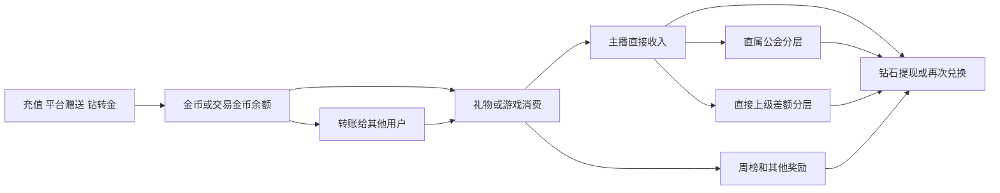

# SANO公会运营与公会画像产品需求文档

## 1. 文档信息

| 项目 | 内容 |
| --- | --- |
| 需求名称 | SANO公会运营与公会画像 |
| 文档状态 | 需求设计稿，待业务评审 |
| 涉及端 | SANO管理后台 |
| 目标使用者 | 公会运营总监、公会运营、BD、风控人员及其他授权管理人员 |
| 核心目标 | 管理者先看清授权公会整体价值，运营者先看清自己的公会盘子，再下钻单公会经营与风险依据 |
| 当前数据范围 | 金币和钻石逐笔流水保留60天；充值、提现、邀请等数据保留全量历史 |
| 当前输出范围 | 产品需求、指标口径、风险计算和人工审核流程 |
| 非本文范围 | 页面视觉原型、数据库表结构、接口字段类型、机器学习模型训练、处罚自动执行 |

## 2. 需求背景

SANO现有公会即代理。平台已经具备公会层级、主播归属、公会长和主播收支、用户充值提现、直播场次、上下麦、邀请关系、账号登录及设备信息，也具备公会分层和多类自然周榜单奖励。

当前信息分散在公会、用户、钱包、直播、排行榜和风控相关模块中。运营人员能够看到单项数据，但难以快速回答以下问题：

1. 公会是否持续组织主播开展真实直播经营。
2. 公会的业务收入来自真实独立用户，还是来自公会成员或公会关联账号。
3. 公会长、主播、子公会、消费账号和提现账号之间是否形成资金闭环。
4. 公会是否通过集中消费、贴榜单门槛、循环转账等方式获取平台奖励。
5. 当前风险结论由哪些业务记录支持，运营如何复核并形成最终判断。

本需求建设以角色经营工作台为入口的公会运营管理能力，使用路径为“自己的管理盘子 → 经营列表 → 单公会详情 → 必要时核查明细与风险”。管理者不应逐个进入画像拼凑平台全貌，运营者不应先看到其他负责人数据再手动筛选。单公会画像、评分和审核是支撑经营决策的下钻能力，不是整个模块的首页定位。

## 3. 需求目标

1. 建立按角色与授权范围自动加载的经营工作台：管理者看整体，运营者看自己的公会，BD看其业务归属公会。
2. 同时提供直属口径和全树口径，避免公会自身经营与下级规模混算。
3. 统一主播活跃、消费、收入、公会分层、奖励、资金流向和平台贡献口径。
4. 输出可解释的真实经营指数、套利风险指数、画像分类和风险依据。
5. 将风险结论下钻到用户、订单、钱包流水、直播场次、奖励批次和提现记录。
6. 由系统输出风险判断，由授权人员人工确认是否套利。
7. 使用自然周快照保存长期趋势，降低60天原始钱包流水清理带来的影响。

## 4. 产品原则

### 4.1 双轴判断

公会画像使用两个独立分数：

- 真实经营指数：衡量主播真实活跃、独立用户贡献、经营持续性、收入健康和奖励独立性。
- 套利风险指数：衡量公会成员及公会关联账号消费、资金闭环、直播与收入不匹配、奖励套利和关系异常。

| 真实经营指数 | 套利风险指数 | 画像分类 |
| --- | --- | --- |
| 高 | 低 | 真正经营型公会 |
| 高 | 高 | 经营中夹杂风险 |
| 低 | 高 | 经营薄弱且存在风险；仅命中疑似套利门槛时提示疑似套利 |
| 低 | 低 | 低活跃公会，不直接定为“空壳” |

低经营不等于套利；高经营也不代表没有套利。

### 4.2 机器判断与人工定性分离

- 系统可以输出：暂无明显风险、关注、中风险、高风险、疑似套利。
- “已确认套利”必须由授权人员人工审核后产生。
- 人工审核需要保存审核人、审核时间、审核结论、说明和引用证据。
- 本期不根据机器分数自动冻结资产、取消奖励、限制提现或执行处罚。
- 系统本期只负责评估和形成结论，奖励、提现、账号或公会的后续处置由运营人员根据结论自行决定和执行。

### 4.3 结论必须可解释

每个风险结论至少包含：统计周期、命中规则、实际值、阈值、涉及金额、涉及账号、关键时间、证据记录、证据等级、规则版本和计算时间。

### 4.4 历史归属使用当时关系

历史消费、主播收入和公会分层必须使用业务发生时有效的公会关系和分层比例，不得使用当前关系倒推历史归属。

公会周榜是明确例外：按该自然周结算时主播的最终公会归属统计其整周榜单收入。主播退出公会需要公会长同意，周榜按最终归属执行；该规则不改变实际公会分层流水的收款公会。详见14.2。

### 4.5 角色先于页面，范围贯穿全程

产品定位：帮助管理者判断整体价值与资源投向，帮助运营者管理其负责公会，再通过详情定位问题与核验依据。

| 使用者 | 默认入口与数据范围 | 首要问题 | 按需使用 |
| --- | --- | --- | --- |
| 管理者/总监 | 经营工作台；全部授权公会，不一定等于全平台 | 整体公会数、发展、收益、平台贡献和主播结构 | 公会列表、详情、负责人业绩；有权限时进入审核 |
| 公会运营 | 同一工作台“我的公会”状态；自己负责且获授权公会 | 自己盘子是否改善，哪家需要扶持、改善或核验 | 我的公会列表、详情；获授权评估/重评，风险证据脱敏 |
| BD | 同一工作台；自身业务归属且获授权公会 | 开发的公会是否形成持续经营与价值 | 归属列表、详情、本人BD业绩 |
| 风险审核人员 | 风险审核；授权事项和公会 | 依据是否成立，如何形成人工结论 | 引用同一详情/证据及评估版本，不另建经营看板 |

- 登录后服务端确定角色、权限、责任归属和可见公会集合。工作台、汇总、Top10、筛选候选、列表、导出、评估记录及详情必须一致鉴权，不仅在前端默认选中负责人。
- 多角色账号只能切换已获授权视角；普通运营不能选择“全部运营”扩大权限。管理者选择某负责人是授权子集，不是更换登录身份。
- 默认最近已完成自然周。有效性、绑定和身份取截止日；风险/性质取对应正式批次。责任范围取周期截止日责任快照，与当前查询授权求交集；缺快照显示待补，不用当前负责人回填。
- 负责父公会不自动授权后代，不将未负责后代加入“我的盘子”；当前公会实际收到的子公会差额仍计自身收益。无授权不开放子公会完整自身收益、账号资料或详情。
- 单公会全树切换另行鉴权。没有完整全树权限时禁用并说明，不用部分可见树冒充全树指标或评分。后台可计算完整风险，证据展示按授权脱敏。
- 无负责公会显示空工作台，不回退全平台。越权、真实0、数据未就绪分开处理。
- 下钻携带来源范围、角色视角、周期、批次、截止日、筛选、排序和分页；返回恢复原状态。
- 负责人业绩用于管理者跨负责人比较；运营本人只看自己，不显示其他运营排行。

### 4.6 公会对平台的价值

分三类事实，不新增综合价值分，不用公会到账收益代替平台价值：

1. 经济价值：消费、公会自身收益、主播收益、奖励成本、平台贡献及变化。平台贡献沿用15.2按消费金额计算。
2. 供给价值：有效主播、单人/多人时长/场次、超级/优质/常规结构及变化。
3. 用户经营价值：独立付费、独立消费、复购及变化。

风险并列：有价值也可能有风险，贡献为负不证明套利。性质、趋势、风险是三个不同维度。

## 5. 核心概念与统计范围

### 5.1 公会与公会长

- 公会与代理为同一业务对象，产品文案统一使用“公会”。
- 一个公会只有一个公会账号，并唯一绑定一个公会长用户。
- 一个公会可以存在上级公会、直属子公会和更深层后代公会。
- BD不是组织层级，是公会的业务归属角色。
- 每个公会绑定运营负责人和BD负责人。

### 5.2 直属口径

直属口径包含：

- 当前公会长。
- 统计时点或历史快照中直接归属于当前公会的主播。
- 当前公会直接获得的公会分层。
- 直属子公会对当前公会产生的一层差额分层。

直属口径不包含直属子公会的主播经营数据，除非指标明确说明为“直属子公会贡献”。

### 5.3 全树口径

全树口径包含当前公会及其所有后代公会、公会长和主播。全树统计按用户ID和业务记录ID去重，避免用户或交易在多个层级重复累计。

全树数据由服务端预聚合。页面查询不得实时递归整棵公会树。

### 5.4 主播身份

主播分为：超级主播、优质主播、常规主播。身份按生效和失效历史判断，不使用当前身份覆盖历史周期。

| 主播身份 | 奖励资格 |
| --- | --- |
| 超级主播 | 达标后获得超级主播周奖励，所属公会获得对应奖励；不能领取常规主播等级直播时长奖励 |
| 优质主播 | 达标后获得优质主播周奖励；可以领取常规主播等级直播时长奖励 |
| 常规主播 | 可以领取常规主播等级直播时长奖励 |

### 5.5 基础指标账号分类定义

以下四个名称是本文基础指标、真实经营指数和套利风险指数使用的正式术语。在计算任何用户数、消费金额、消费占比或关联风险之前，必须先完成账号分类。

```text
分类优先级：SANO内部账号 > 公会成员 > 公会关联账号 > 独立用户
```

| 正式名称 | 明确定义 | 指标处理 |
| --- | --- | --- |
| SANO内部账号 | SANO官方所属人员、内部运营人员、测试账号和系统账号，以业务发生时有效的SANO内部账号名单为准 | 默认从经营指标、画像评分和风险评分的分子、分母中同时排除；保留排除数量、金额、内部账号类型和原因供审计 |
| 公会成员 | 业务发生时属于目标公会组织的用户，包括目标公会长、所有后代公会长，以及直接归属目标公会或其后代公会的主播 | 正常统计；公会成员向目标公会统计范围内主播产生的消费，单独记为公会成员消费 |
| 公会关联账号 | 不属于SANO内部账号或公会成员，但与公会成员命中同一实名主体、同一稳定MAC、经确认的账号映射或已配置的确定资金关联规则的账号 | 正常统计并单独计算公会关联账号消费及套利风险 |
| 独立用户 | 不属于SANO内部账号、公会成员或公会关联账号的普通SANO用户；消费不是成为独立用户的前提 | 作为真实独立用户经营贡献的计算基础；周期内产生成功消费后，计为独立付费用户 |

补充规则：

- “内部账号”在本文中只表示SANO内部账号，不表示公会成员。
- 账号分类相对于目标公会和业务发生时间计算。同一账号在不同时间或针对不同目标公会可能属于不同分类。
- 公会成员归属按业务发生时的公会及主播关系判断，不使用当前关系覆盖历史交易。
- 直属经营口径下，公会成员边界仍包括目标公会及其所有后代公会长和主播；直属口径只限制被统计的主播、直播间和收益范围，避免子公会用户向直属主播消费时被误判为独立用户。
- 同一完整IP仅标记为IP关联线索，不单独归为公会关联账号，也不能单独认定套利。
- 标准化后相同邮箱属于关联线索；只有业务明确确认其为同一主体或命中已配置强关联规则时，才归为公会关联账号。
- 邀请关系本身不构成公会关联。由公会邀请但不存在实名、设备、确定资金关系等强关联的普通用户，仍归为独立用户。
- 非实名用户可以消费和参加消费榜单，但不能直播；是否实名不直接决定其是否为独立用户。
- 因公会关系、内部账号名单或关联数据缺失而无法完成判断时，标记为“账号分类失败”，不得默认归为独立用户。“账号分类失败”是数据质量状态，不是第五种账号分类。

## 6. 全局数据口径

### 6.1 时间口径

- 业务时区确定为UTC+8。
- 所有经营、画像和风险指标不统计今天发生的数据。日常扫描以昨日23:59:59截止；正式周评估以所选周的周日23:59:59截止；手动重评以所选截止日23:59:59截止，不得晚于昨日。
- 昨日：数据截止日00:00:00至23:59:59。
- 自然周：周一00:00:00至周日23:59:59。
- 近7天：昨日及其前6个完整自然日。
- 近30天：昨日及其前29个完整自然日。
- 近60天：昨日及其前59个完整自然日。
- 本周截至昨日：本周一00:00:00至昨日23:59:59；若查询日为周一则本周期无数据，显示`--`。
- 本月截至昨日：本月1日00:00:00至昨日23:59:59；若查询日为当月1日则本周期无数据，显示`--`。
- 自定义日期的结束日期不得晚于昨日。
- 首页性质/风险数量、公会列表及画像默认读取最近一个正式周期的评估批次：经营窗口为该批次截止日及前29个完整自然日，风险/资金链为该批次截止日及前59个完整自然日。日常“最新观察”和手动重评须显式切换，不自动替换正式结果；周趋势展示可覆盖的最近8个完整自然周。
- “昨日及前N天”用于日常查询；查看历史正式或手动版本时，以该版本截止日及前N天替代昨日。页面必须展示准确起止日期、批次、范围和版本。
- 最新观察只作新增证据/风险变化提示，点击后明确切换结果类型。默认正式批次尚未完成时显示该批次等待状态；旧快照可作历史参考但不能静默补入本批次数量。没有正式结果时显示未生成，不自动伪装为正式评估。
- 跨自然日直播按实际覆盖时长拆分到对应自然日。
- 周榜使用实际结算周期和奖励批次，不根据页面查询时间重新划分。
- 今天的数据如需查看，应进入独立实时监控能力，不进入本文经营评分、风险评分及排行榜结论。

### 6.2 金额和资产口径

- `1美元 = 10000金币 = 10000钻石`。
- 金币用于消费。
- 钻石用于收入、兑换金币和提现。
- 钻石可以兑换金币，金币不能兑换钻石。
- 交易金币可以转给其他用户；接收方获得可消费金币。
- 本文全部金额指标、金额阈值、评分公式、榜单金额门槛、奖励金额及页面和导出金额，统一换算为美元（USD）。后文未另写单位的金额均为美元。
- 金币金额（美元）= 原始金币数量 ÷ 10000；钻石金额（美元）= 原始钻石数量 ÷ 10000。交易金币先按实际兑换关系还原为等值金币，再除以10000。
- 原始资产类型和原始数量仅在底层留存，用于追溯与对账，不改变真实钱包资产或实际结算规则；金币、钻石等字样用于说明资产来源，不作为画像金额的展示单位。
- 先以足够精度计算美元金额，再汇总和计算比例；不得逐笔四舍五入至美分后汇总。涉及小额收入的明细需保留足够小数位，不得将非零金额展示成0。

### 6.3 有效记录

- 消费、收入、充值、提现、奖励和其他交易仅统计最终状态为成功的记录。
- 退款、撤销和冲正按明确业务类型和最终状态处理，不重复统计正向和反向金额。
- SANO内部账号在业务指标中默认排除，在风险证据中保留内部账号类型、排除原因、原始记录数量和涉及金额。
- 无数据、真实为0和不适用必须区分。无数据或口径不可计算时显示`--`，不得显示为0。

#### 6.3.1 直播经营与财务统计的房型范围

- 所有主播的直播时长、直播场次仅统计单人直播和多人直播，不统计语言房。在此房型筛选后，继续使用现有有效直播判定，不以房型替代有效性判断。
- 有效开播主播、开播率、有效开播天数、连续开播周数以及依赖有效直播的留存指标，均使用相同房型范围；上下麦时长及人次用于直播经营时也排除语言房。成员绑定人数、主播身份人数不因未开播或只进入语言房而从组织人数中删除。
- 房型取业务事件或场次发生时的记录，不使用房间当前类型覆盖历史。发生类型切换时，时长按对应类型区间拆分，合格区间仅累计一次；场次按唯一场次ID去重，不因多人上麦或区间拆分复制。
- 财务统计与风险追溯仍保留完整消费、主播收入、分层、奖励和资金记录，不因语言房不计直播经营而剔除语言房中的成功财务记录。奖励以实际发放及追回为准，不因画像的新房型范围擅自取消历史奖励。
- 每小时、每场收入或消费等效率指标的分子必须与分母匹配同一批单人/多人直播记录及时间区间。不能以全房型收入除以排除语言房后的时长，或将仅语言房收入与零直播时长直接认定为异常。
- 多人直播房间消费归场次房主；本人收入归实际收益人，以上已确认。主播时长/场次是否纳入在他人多人房间的有效上麦参与，尚未明确：本次不将房主消费归属扩展成时长归属，也不自行把上麦参与计入或排除。实现前须对照现有有效直播规则确认，时长、场次、开播、留存及效率统一使用确认后的参与范围；上下麦明细作为独立事实保留。

### 6.4 主播直接收入

对每笔成功消费：

| 收入类型 | 主播直接收入公式 |
| --- | --- |
| 普通礼物 | 普通礼物价值 × 70% |
| 幸运礼物 | 幸运礼物价值 × 2% |
| 游戏 | 游戏消费金额 × 0.5% |

系统优先读取已结算的主播收入记录；仅在核对或补算场景使用上述公式，并记录使用的比例版本。

### 6.5 公会分层

公会分层比例为4%、8%、12%、16%、20%。

对主播的每笔直接收入`I`：

```text
直属公会分层金额 = I × 直属公会分层比例
直接上级公会分层金额 = I × max(直接上级公会比例 - 直属公会比例, 0)
```

- 分层层级只计算一层差额。
- 分层基数仅为成功结算的主播直接收入（普通礼物、幸运礼物、游戏），不包含主播本人获得的任何身份、时长、榜单、任务或其他奖励。主播奖励不向任何公会贡献分层。
- 当前主播的直属公会获得本公会分层。
- 直属公会的直接上级公会仅在自身比例更高时获得比例差。
- 祖父级及更高公会不继续获得本笔分层。公会已经取得的分层、子公会差额贡献及公会奖励也不作为新的主播收入再向上分层。
- 例：A20%→B16%→C12%。主播直属B且直接收入100美元时，B得16、A得4；主播直属C且直接收入100美元时，C得12、B得4、A得0。上级差额基于原主播收入，不是子公会自身收益乘比例。
- `PROXY_PROFIT`类记录表示当前公会获得的公会分层。
- `SON_PROXY_PROFIT`类记录表示直属子公会对当前公会的差额贡献。
- `ROOM_USER_PROFIT`属于独立分层且当前未启用，本期不纳入公会收入。

### 6.6 钱包业务类型分组

业务类型以线上枚举和实际记录为准。产品统计按以下业务含义分组：

| 分组 | 主要业务类型 |
| --- | --- |
| 普通礼物 | 赠送普通礼物、收到普通礼物、公会普通礼物分层、子公会普通礼物贡献 |
| 幸运礼物 | 赠送幸运礼物、收到幸运礼物、公会幸运礼物分层、子公会幸运礼物贡献、幸运礼物中奖、幸运礼物Jackpot |
| 游戏 | 游戏消费、游戏反奖、房主游戏分账、公会游戏分层、子公会游戏贡献、游戏Jackpot |
| 兑换及转账 | 金币转账、钻石兑换金币、钻石兑换交易金币、交易金币转账 |
| 充值提现 | 金币充值、交易金币充值、提现扣除、提现退款 |
| 平台奖励 | 榜单、直播时长、主播身份、邀请、签到、任务、VIP及其他平台奖励 |
| 其他消费与返还 | 道具、VIP、红包、竞猜、奖池及对应返还 |
| 运营调整 | 运营加减款及其他平台调整 |

枚举中的“游戏收入榜单奖励”按当前业务解释为游戏消费周榜奖励。页面按实际榜单名称展示，不直接展示技术枚举名称。

## 7. 数据处理与结果生成

### 7.1 统一事件链

系统需要在离线统计层形成以下可追溯链路：



底层业务单号不相同时，离线任务根据可追溯字段生成统一`trace_id`。复杂关联在每日计算任务中完成，不在画像页面打开时临时跨表计算。

### 7.2 数据更新

- 经营汇总每天至少更新一次。
- 每日数据在次日完成结算和数据校验后更新；画像读取所选评估版本的固定截止日，不纳入今天，也不因打开页面而把正式历史窗口滚动至昨日。
- 当前自然周可以展示“本周截至昨日”的过程指标，但必须标记“未结算”，不得生成最终排名或据此确认榜单奖励。
- 风险规则重算时保存规则版本，不覆盖历史人工审核结论。
- 原始钱包流水仅保留60天时，周快照、风险结果和已引用证据至少保留一年。

### 7.3 评估机制

公会画像采用“日常风险扫描、正式周期评估、手动重新评估”三种方式。三种方式都由系统计算指标和风险；人工只负责发起授权重算、审核证据和形成最终人工结论。

| 评估方式 | 触发方式 | 数据截止时间 | 计算窗口 | 结果性质 |
| --- | --- | --- | --- | --- |
| 日常风险扫描 | 每天在前一自然日数据完成结算和校验后自动执行 | 昨日23:59:59 | 真实经营指标近30个完整自然日；套利风险及资金链近60个完整自然日 | 最新观察结果，用于及时发现风险变化，不作为正式周评估快照 |
| 正式周期评估 | 每个自然周的周一，在上周数据完成结算和校验后自动执行 | 上周日23:59:59，不统计本周一数据 | 上周自然周指标；截至上周日的近30日真实经营指数和近60日套利风险指数 | 正式公会周评估，生成不可变快照，用于历史趋势、周报和审核依据 |
| 手动重新评估 | 具有权限的人员选择公会、数据截止日和重算原因后触发 | 所选截止日23:59:59，截止日不得晚于昨日 | 以所选截止日为终点，按近30日和近60日窗口重新计算 | 新的重算版本，用于数据修复、关系补录、规则调整或人工复核，不覆盖原结果 |

#### 7.3.1 日常风险扫描

1. 扫描范围为数据截止日仍有效的全部公会。
2. 每日结果更新该公会的“最新观察结果”，包括真实经营指数、套利风险指数、画像分类、命中规则和新增证据。
3. 日常扫描不生成正式周评估记录，也不覆盖最近一次正式周期评估。
4. 仅在首次达到高风险、首次升级为疑似套利、风险等级上升或出现新的高等级证据时新增待审核事项；相同风险和相同证据不重复生成。
5. 扫描失败或数据不完整时保留上一份成功观察结果，同时明确显示本次扫描状态、失败原因和最后成功时间，不得把旧结果标记为本次结果。

#### 7.3.2 正式周期评估

1. 评估日固定为每周一，数据截止时间固定为上周日23:59:59。
2. 周一当天发生的直播、消费、收入、分层、奖励、转账、兑换和提现均不得进入本次评估。
3. 如果上周日数据尚未结算完成，任务等待或重试；可以延迟生成，但不得将数据截止时间顺延到周一。
4. 每个有效公会每周只生成一份成功的正式主快照。任务重试必须保证幂等，不得产生重复主快照。
5. 正式快照至少保存：公会ID、评估日、数据截止时间、统计窗口、直属及全树指标、两项指数、画像分类、机器结论、风险证据、数据覆盖、关系版本、榜单配置版本、比例版本和规则版本。
6. 正式快照生成后不可直接修改。后续数据修复或规则变化通过手动重新评估生成新版本，并保留与原快照的差异。

#### 7.3.3 手动重新评估

1. 只有具备重新评估权限的人员可以发起。
2. 发起时必须选择目标公会、数据截止日和重算原因。重算原因至少包括：数据修复、关系补录、规则调整、配置调整和人工复核。
3. 对历史正式周评估进行重算时，默认沿用原数据截止日；不得通过扩大日期范围把周一或之后的数据加入原周评估。
4. 每次重算保存发起人、发起时间、原因、使用的数据版本、关系版本、配置版本、规则版本及新旧结果差异。
5. 手动重新评估产生新的系统评估版本，不覆盖原正式快照、原观察结果或历史人工审核结论。
6. 重算结果不会自动改变“已确认套利”或“排除套利”等人工结论；审核人员需要基于新证据另行更新审核结论。

#### 7.3.4 数据覆盖与新公会

- 可用完整数据不足7天：执行扫描并保存数据质量结果，但综合评分和画像分类显示“数据积累中”。
- 可用完整数据达到7天但不足30天：可以输出“观察期评估”，必须展示实际覆盖天数，不进入正式经营等级横向排名。
- 可用完整数据达到30天：正常输出真实经营指数和经营等级。
- 套利风险窗口不足60天时按实际可用完整天数计算并展示覆盖天数；不得因为未覆盖60天直接给出低风险结论。

### 7.4 数据质量状态

每次画像计算记录：数据覆盖开始时间、结束时间、缺失数据源、关联失败记录及计算版本。本轮不预设数据覆盖率、关联成功率等准入阈值，具体规则在实现时结合实际数据确定。

以下情况必须标记结果不完整：

- 公会或主播历史关系无法还原。
- 消费无法关联主播收入。
- 主播收入无法关联公会分层。
- 钱包流水不足以覆盖所选周期。
- 历史榜单配置无法确定。

## 8. 功能范围

### 8.1 经营工作台：先看自己的盘子

同一布局按角色加载范围与操作项：管理者“公会经营工作台”、运营“我的公会经营工作台”，BD使用自身业务归属。首屏不以单公会性质卡、评分或评估任务作为主内容。

默认最近已完成自然周，支持昨日、近7/30/60天、本周/月截至昨日、完整自然周、自定义日期，不含今天。发展趋势固定比较最近两个可比完整周，不随日/月金额选择改变窗口；显示两组日期。风险/性质使用显式选定的评估类型/批次/直属范围，切换金额周期不静默改变评估窗口。

首屏顺序：

1. 范围与时间：角色/负责人、授权范围及公会数、业务周期、对比周、组织/身份截止日、风险批次。
2. 公会概况：总数、已评/待评，正向发展/回落/平稳/混合/待判；高风险及其中疑似套利数量。
3. 经济价值：房间消费、主播收益、公会自身收益、平台贡献净收益、奖励成本。公会自身收益＝分层＋公会奖励，不含主播收益；关联归属奖励只计风险/平台成本。可展开三类消费、收益和成本，引用既有计算。
4. 主播结构：公会主播、有效主播、超级/优质/常规。全平台授权管理者另见平台主播及身份总量，拆公会内/未归属；其他角色不显示平台总量。
5. 用户经营与发展：独立付费、消费、复购及变化，解释供给、用户和经济价值，不用总流水或评分代替。
6. Top10：平台贡献、公会收益、经营增长三张榜单同屏平铺，不用Tab切换。每榜只显示排名、公会ID/名称、该榜对应指标和“详情”操作，不混入身份、其他金额、经营性质、风险分数或审核字段。
7. 本周需要关注：回落、贡献为负、高风险/疑似、未评/数据未就绪；点击当前范围带筛选列表，审核只作有权限时的下一步。

工作台各区域共用角色授权范围；金额卡和金额榜使用所选业务周期，增长榜使用明确的可比完整周。风险/性质数量单独读取所选评估批次，不能将风险批次及30/60日窗口套到排行榜。平台主播总量是明确标识的全平台补充，不混入公会金额。性质分布和详细依据可展开/进列表，不挤占平台价值和主播结构。

### 8.2 公会经营列表：找到需要关注的公会

入口：工作台“查看公会/我的公会”、概况卡、关注事项和Top10。继承授权范围、金额周期、评估批次及筛选。运营标题“我的公会”，负责人固定本人；重置筛选不重置权限。

默认列：公会ID/名称、公会长、发展趋势/经营性质、绑定/有效主播、超级/优质人数、消费、公会自身收益、平台贡献、风险、人工结论/审核提示、详情入口。金额可排序；趋势、风险、贡献正负可筛选；国家、层级、分层、归属等不能越权。

金额取所选周期，身份取截止日，性质30日、风险60日须写明来源。分数、关键依据和收益细项放行展开/可选列，不要求先解释评分。正向不自动判优质，回落不判套利。详情仍突出性质＋一句话结论＋依据；列表负责横向经营比较。

两种角色列表复用组件。数量、汇总和详情对账；无具体公会静态原型时，不把其他公会按钮跳星河冒充结果。

### 8.3 公会详情与画像

全局导航为经营工作台、公会管理、评估中心、风险审核、运营与BD业绩五个主模块。工作台是默认入口，公会管理落在经营列表；评估/审核/负责人业绩是按权限的辅助入口，不要求普通运营先进入。公会详情固定七个标签；人工审核记录通过风险页进入审核模块，不另建第八个详情标签。

| 标签 | 核心问题与负责内容 | 不在本页重复的内容 |
| --- | --- | --- |
| 画像概览 | 公会是什么性质、为什么。突出性质＋一句话结论，经营与风险依据各最多3条；两块标题右侧分别显示经营评分、风险评分（数值/100），适度放大，仍小于性质主标题；附审核进度、人工结论、版本、范围及变化 | 不展示全套指标表、交易明细或评分公式；不在主卡重复一行过小评分 |
| 组织与归属 | 谁属于谁、谁负责。公会树、直属主播、公会长、运营/BD归属、生效历史、周期关系变动；画像主体与选中节点明确区分，变动记录标注所属公会 | 分层贡献金额转到分层与奖励；账号协同风险解释转到风险页 |
| 主播经营 | 有没有持续经营。仅单人/多人直播的有效主播、场次/时长、连续性、留存及身份；增加房间总消费（单人＋多人），只记给该场次房主，上麦主播仅计本人收入；金额可下钻到场次与订单 | 房间消费与个人收入不可互相推算；不重复奖励明细或资金链 |
| 消费与收入总览 | 公会整体消费和收益是多少。先说明四类账号，再展示消费质量和三类业务消费/主播直接收入；收入包含主播收益、公会收益、整体业务收益，覆盖直接收入、分层及奖励；另列关联账号奖励和平台贡献 | 分层和奖励仅展示分类汇总、引用明细；不复制逐笔全表，也不把关联消费账号奖励当成公会到账 |
| 分层与奖励 | 分层和奖励给谁、怎么算。直属分层、子公会差额及基数/贡献者/比例；顶部固定当前公会的直属主播贡献、直属子公会贡献、分层合计、公会奖励、自身收益；明细分直属主播/直属子公会子标签，区分贡献者自身收益与给本公会的分层。主播奖励按类型显示金额/人数；公会奖励按公会周榜/超级主播达标/其他来源显示金额/净有效笔数/入口，关联账号奖励单列 | 不重复平台贡献计算卡；同一奖励只属于一个奖励类型，人数跨类型不可直接相加 |
| 资金流向 | 钱从哪里来、到哪里去。按成员/关联/指定账号选择账户侧范围，统计充值、转账、钻转金、消费、提现及反向记录总览；单笔链路、双方账户、业务单号和追溯凭证 | 不把账户流水直接等同直播间收入；不在本页重复风险评分或定性 |
| 套利风险与证据 | 为什么有风险、依据有多强、还缺什么核验。实际风险指标、异常解释、涉及金额及账号、直接/推定证据、待核验事项；规则可展开实际值/阈值/贡献分/版本；审核进度、人工结论与审核入口 | 引用业务模块证据，不复制全套消费、奖励、关系和资金明细 |

概览结论先用运营可理解的自然语言表达，并保留第18.3节的分类编码及双轴结果；不是新增一套评分规则。有经营但系统提示疑似套利时必须显式说“有真实经营，但存在疑似套利行为”，不能被“真正经营型”字样弱化。不得自动输出“已确认套利”；人工结论独立展示。

概览经营依据优先组合“持续有效开播＋独立付费用户/消费＋独立复购”，不能仅凭场次、时长或总消费证明真实经营；引用第11、12节已有指标，不新增板块或调整评分权重。没有可用独立消费或复购事实时说明限制，不用规模代替。

概览及列表的结论和依据来自所选评估结果。同一指标可在概览作为摘要、在所属标签解释明细，数值引用同一结果，不分别计算或维护。资料不足时说明可用事实与限制，不编造关键依据；本次不追加缺失率或风险算法门槛。

“最新观察结果”“正式周评估”“手动重新评估”作为结果类型和版本选择，不并列生成三套完整分析卡。三类结果必须标明评估方式、数据截止时间、实际覆盖天数、计算时间和规则版本，不得互相覆盖历史。正式周评估详情复用同一画像及七标签，仅增加历史版本、执行信息和变化提示，不再另建独立周报告。

全树画像是统计范围切换，版本对比与数据积累/异常是操作状态，均不增加主导航。切换范围重新读取对应指标、分类和结论；不能只改标题或累加下级分数。全树组织按层加载。历史与全树均复用画像模板；数据积累/异常图为多个公会的状态示例集合，不是生产页面内的多个公会分析卡。

组织节点切换只更新节点资料，不静默切换当前画像主体。关系变动列表可以查询画像主体或选中节点，标题必须明确当前查询公会。由子公会“查看分层贡献”进入分层与奖励时，保留父公会画像主体及评估上下文，并带入选中子公会ID过滤；返回恢复树节点。清除筛选才显示父公会全部分层，不能落到无筛选的汇总冒充子公会明细。

### 8.4 主播与用户下钻

- 主播ID和消费用户ID支持进入现有用户画像。
- 直播场次支持进入直播详情。
- 消费、收入、分层、奖励、转账和提现支持查看对应业务记录。
- 下钻页面自动带入公会、统计范围、周期和风险规则条件。

### 8.5 运营与BD业绩

- 公会运营按负责的底层公会直属经营事实去重汇总；全树仅作获授权的单公会视图，不累加父子全树金额形成业绩。
- BD按其开发并仍处于有效归属的公会汇总经营结果。
- 同一公会在同一统计周期只能归属一个运营负责人和一个BD负责人。
- 周期内交接按周期截止日责任快照确定一个负责人；实际消费/分账仍按业务发生时归属，不改原交易。历史业绩不使用当前负责人回填，缺快照显示待补。
- 统一入口下设“公会运营业绩”和“BD业绩”两个标签。运营表仅以运营负责人为分组键，BD表仅以BD负责人为分组键，不使用“运营/BD组合”作为运营排名主体。

### 8.6 风险审核

审核进度与人工结论是两类字段，不共用一个状态枚举：

| 字段 | 可选值 | 含义 |
| --- | --- | --- |
| 审核进度 | 待审核、审核中、完成、待复核 | 表示事项流转；待复核用于已有完成结论后出现新证据/风险变化 |
| 人工结论 | 暂无、排除套利、确认高风险、已确认套利 | 暂无表示未形成结论，不等同低风险；只有授权人员可以提交其余结论 |

没有触发事项的公会显示“未进入审核/暂无人工结论”，这不是新增审核事项状态。列表、画像及审核详情分别展示系统结论、审核进度和人工结论。

每次人工结论绑定公会、统计范围、来源评估类型/版本/截止日、证据清单及证据版本、审核人、审核时间和说明。新证据或风险升级按第7.3.1节触发复核：保留旧结论并标明其适用版本，生成/合并待复核事项；不能把旧“排除套利”自动沿用为新版本结论，也不能屏蔽新系统风险。尚无旧完成结论时仍使用待审核/审核中。重算无实质变化时保存差异，不自动重复创建事项。

审核人员可以：

- 查看系统结论和全部命中规则。
- 查看资金链、账号关系和直播证据。
- 添加审核说明和补充证据。
- 排除误报或确认风险。
- 查看历史审核和规则重算差异。
- 对指定公会发起手动重新评估，并填写数据截止日和重算原因。

审核模块只负责事项领取、进度、人工结论、说明、引用证据及审核历史。评估的完整分析仍在画像；审核使用同一证据编号，不重新生成另一套风险结论。审核不联动任何资金处置。

### 8.7 评估中心

统一入口下设“日常风险扫描”“正式周期评估”“手动重评记录”三个标签，执行周期与触发规则沿用第7.3节。

- 日常风险扫描：按日查看截至昨日的最新观察、变化、新增证据、事项合并及任务状态，不覆盖正式周评估。
- 正式周期评估：每周一生成上周日截止的正式结果，展示自然周、截止日、任务状态和版本。成功记录进入同版本画像；不纳入当前周一数据。
- 手动重评记录：保留目标公会、范围、原/新版本、截止日、发起人、原因及进度；支持发起重评、查看失败原因、进入结果或版本对比。不覆盖正式主快照和人工结论。
- 进入画像及跨标签、证据下钻时，携带公会ID、直属/全树范围、评估类型、版本、数据截止日、实际指标窗口和证据条件。30日经营与60日风险不静默切换；来源不同必须明确标注。
- 等待数据或失败不能显示为成功或低风险；旧结果只作带原截止日的历史参考。此处仅约束展示，不新增数据缺失评分规则。

## 9. 指标计算总则

### 9.1 基础函数

```text
安全除法 SafeDivide(a, b)：
当b > 0时返回a ÷ b；当b = 0或数据缺失时返回--。

截断函数 Clamp(x, 0, 1)：
小于0返回0，大于1返回1，其余返回x。

线性严重度 S(x, L, H)：
Clamp((x - L) ÷ (H - L), 0, 1)。

同群百分位 PR(x)：
(同群中小于x的公会数 + 0.5 × 等于x的公会数) ÷ 同群有效公会数 × 100。
```

### 9.2 同群范围

真实经营指数中的绝对量指标使用同群百分位，降低国家和公会规模差异造成的偏差。

同群优先使用“同国家 + 直属主播规模档”：

- 1—5人。
- 6—10人。
- 11—20人。
- 21—50人。
- 51人及以上。

同群有效公会少于20个时，依次扩展为同国家全部规模、全球同规模、全球全部公会。扩展规则需要随评分结果保存。

### 9.3 空值处理

- 业务真实为0时参与计算。
- 数据源缺失导致不可计算时，该指标显示`--`并说明原因；缺失指标如何影响综合评分，在实现时结合实际数据确定，本轮不预设权重重新分配规则。
- 对正向经营指标，分母因真实无业务而为0且分子也为0时，页面比例显示`--`，评分按0分处理，不得按缺失数据重新分配权重。
- 对风险指标，分母因真实无消费或无收益而为0时，该项风险记0分；分母对应数据源缺失时才记为不可计算。
- 直属主播数为0时，真实经营指数为0。
- 核心数据源包括公会关系、主播关系及身份、直播及上下麦、消费收入及分层、钱包及奖励。缺失时保留问题记录，不预设“缺失超过几类”的判定门槛；数据缺失不能解释为真实0或无风险。

## 10. 组织与主播指标

| 指标 | 计算方式 |
| --- | --- |
| 直属公会数 | 所选数据截止时点`parent_guild_id = 当前公会ID`且有效的公会数量 |
| 全树公会数 | 当前公会所有有效后代公会去重数量，不包含当前公会 |
| 直属主播数 | 所选数据截止时点直接归属当前公会的有效主播用户数，同一用户只计1人 |
| 全树主播数 | 当前公会及所有后代公会的有效主播用户ID去重数量 |
| 新增直属主播数 | 统计周期内首次或再次生效加入当前公会的去重主播数 |
| 流失直属主播数 | 统计周期内与当前公会关系失效的去重主播数 |
| 超级主播数 | 统计时点身份为超级主播的直属主播数 |
| 优质主播数 | 统计时点身份为优质主播的直属主播数 |
| 常规主播数 | 统计时点身份为常规主播的直属主播数 |
| 有效开播主播数 | 周期内至少产生1场有效直播的直属主播去重数 |
| 主播开播率 | 有效开播主播数 ÷ 周期内有效直属主播数 |
| 4周主播留存率 | 最近一个完整自然周周末的4周前周末有效直属主播中，在最近一个完整自然周周末仍属于当前公会且该完整周有有效直播的主播数 ÷ 4周前周末有效直属主播数 |
| 主播身份优质率 | 周期内有效开播的超级和优质主播数 ÷ 有效开播主播数 |
| 周期内有效直属主播数 | 与当前公会的有效直属绑定区间和统计周期存在交集的主播用户ID去重数，包括期中加入或退出的主播；不以有效开播为前提 |
| 结算周期关系变动率 | 统计周期内发生加入或退出的直属主播用户ID并集去重数 ÷ 当周期有效直属主播数；同一主播多次加入、退出只计1人 |

结算周期关系变动率跟随所计算指标的统计窗口，不读取截止日之后的关系变化。正式周评估的周指标使用上周一至上周日；风险评分中使用风险评估的近60日窗口，并明确展示起止日期。

## 11. 直播经营指标

本节用于经营分析的直播、场次和上下麦指标统一遵守第6.3.1节：仅单人直播、多人直播，排除语言房。涉及主播个人收入的财务总额另按实际收益归属统计。

| 指标 | 计算方式 |
| --- | --- |
| 有效直播场次 | 周期内最终判定有效的直播场次记录数 |
| 有效直播时长 | 有效直播场次在周期内覆盖的时长之和，跨自然日拆分，单位小时 |
| 有效直播天数 | 周期内至少存在1场有效直播的自然日去重数 |
| 近4周持续开播主播数 | 以评估截止日之前最近一个已结束的完整自然周为末周，向前取连续4个完整自然周；每周均在统计范围内有至少1场有效直播的主播用户ID去重数。属于连续性事实指标，不新增评分项 |
| 连续有效开播周数 | 对单个主播，从上述最近一个已结束完整自然周向前逐周检查，在统计范围内每周至少有1场有效直播则累计1周，遇无有效直播周即停止；超过可用历史时标注“至少N周”，不能把缺失历史视为断播。本版表格展示最近4个完整周内的连续周数，上限4 |
| 主播平均直播时长 | 有效直播时长 ÷ 有效开播主播数 |
| 每场平均直播时长 | 有效直播时长 ÷ 有效直播场次 |
| 直播间进入人数 | 每场内按用户ID去重后再跨场累加；同一用户进入多场时按场次分别计数 |
| 直播间去重进入用户数 | 周期内进入统计范围直播间的用户ID去重数量；该指标中的“去重”只表示用户ID去重，不代表账号被分类为独立用户 |
| 直播间付费用户数 | 周期内在统计范围直播间产生成功礼物或游戏消费的用户ID去重数量 |
| 独立付费用户数 | 直播间付费用户中被分类为独立用户的用户ID去重数量 |
| 进入付费转化率 | 直播间付费用户数 ÷ 直播间去重进入用户数 |
| 新增付费用户数 | 首次在统计范围主播直播间成功消费的时间落在统计周期内的去重用户数 |
| 复购付费用户数 | 周期内成功消费且周期开始前已有成功消费记录的去重用户数 |
| 复购付费率 | 复购付费用户数 ÷ 直播间付费用户数 |
| 独立复购付费用户数 | 周期内成功消费、周期开始前已有成功消费记录且本周期消费时被分类为独立用户的用户ID去重数量 |
| 独立付费用户复购率 | 独立复购付费用户数 ÷ 独立付费用户数 |
| 上麦人次 | 每场内按上麦用户ID去重后再跨场累加 |
| 独立上麦用户数 | 周期内上麦用户ID去重数 |
| 人均上麦时长 | 全部有效上麦时长 ÷ 独立上麦用户数 |
| 每小时独立用户消费 | 与分母同一批有效单人/多人直播及时间区间内的独立用户成功消费美元等价值 ÷ 有效直播时长 |
| 每场独立用户消费 | 与分母同一批有效单人/多人直播及时间区间内的独立用户成功消费美元等价值 ÷ 有效直播场次 |

### 11.1 主播明细的房间消费与个人收入

| 字段 | 计算方式 |
| --- | --- |
| 单人直播房间消费 | 周期内、场次房主ID为该主播且发生在单人直播类型区间内的成功普通礼物、幸运礼物、游戏消费美元金额之和；排除SANO内部账号，按原始消费订单去重 |
| 多人直播房间消费 | 同上，房型改为多人直播。整间房消费只归该场次房主，不重复计给其他上麦主播，不按麦位、上麦人数或时长分摊 |
| 房间总消费（单人＋多人） | 单人直播房间消费 + 多人直播房间消费；不含语言房消费，零房主场次且数据完整时为0，数据缺失则为`--` |
| 主播个人直接收入 | 实际收益主播ID为该主播的成功普通礼物、幸运礼物、游戏收入美元金额之和；包含在其他房主房间上麦获得的本人收入，不包含其他上麦主播的收入。财务全量房型口径，不包含分层和奖励 |

房间消费按房主和场次唯一归属，主播收入按实际收益人归属，两者不要求一一相等。下钻保留场次ID、房型、房主ID、收益主播ID、订单ID、发生时间和公会归属。多人房跨公会上麦时，也不能把整个房间消费复制到上麦主播所在公会。全树按原始消费订单/实际收入记录去重，不能累加父子公会的全树汇总。

房间总消费是场次消费规模，不要求场次已达到“有效直播”门槛；计算每小时/每场消费时需额外筛到分母对应的有效场次。因此，该列不必等于效率指标的分子，也不必等于包含语言房的全量消费总览。

## 12. 消费与收入指标

### 12.1 成员侧与直播间侧分离

- 成员侧指标：统计公会长和范围内主播自身的充值、消费、收入、兑换、转账和提现。
- 直播间侧指标：统计全部消费者在范围内主播直播间产生的消费和由此形成的主播收入、公会分层。
- 两类指标不得混为同一个“公会消费”或“公会收入”。

### 12.1.1 资金流向页账户范围

资金页明确使用账户侧统计，支持以下选择；与消费与收入总览的直播间侧口径不混用：

| 范围 | 账户集合与计算 |
| --- | --- |
| 公会成员 | 按第5节成员定义，公会长及主播账户ID去重；排除SANO内部账号，保存所用关系时间 |
| 公会关联账号 | 仅第5节识别的关联消费账号；排除内部账号及已归类成员 |
| 成员＋关联账号 | 上述两类账户取并集，不重复计账户；原型总览默认此联合范围，名称不得缩写成“成员流水” |
| 指定账号 | 在当前有权查看的账户集合中选择账号ID，显示账号分类与关联依据 |

每类充值、流入转账、流出转账、钻转金、账户消费、提现及退回金额＝所选账户集合在所选窗口内该类最终有效业务记录美元金额之和。转账双边分别显示流入/流出，同一侧按原始业务ID去重；兑换双边不当作两笔新增收入。联合集合内转账可保留两侧事件供追溯，但标记集合内转账，不能据此推算外部净流入。成员/关联账号在其他公会的消费仍属于账户侧消费，不等于本公会房间消费。事件金额不能直接累加成收入、余额或闭环金额。切换账户范围只改变资金事实，不改写当前画像主体或风险结果；跨页证据下钻保留选定账号和订单。

### 12.2 基础指标

| 指标 | 计算方式 |
| --- | --- |
| 普通礼物消费 | 周期内剔除SANO内部账号后，向范围内主播发送普通礼物的成功消费金币数量之和 ÷ 10000 |
| 幸运礼物消费 | 周期内剔除SANO内部账号后，向范围内主播发送幸运礼物的成功消费金币数量之和 ÷ 10000 |
| 游戏消费 | 周期内剔除SANO内部账号后，范围内主播房间发生的成功游戏消费金币数量之和 ÷ 10000 |
| 直播间总消费 | 普通礼物消费 + 幸运礼物消费 + 游戏消费 |
| SANO内部账号消费金额 | 周期内SANO内部账号在范围内主播直播间产生的三类成功消费之和；仅供审计，不计入直播间总消费和评分 |
| 独立用户消费金额 | 消费者被分类为独立用户的直播间总消费 |
| 公会成员消费金额 | 消费者被分类为公会成员的直播间总消费 |
| 公会关联账号消费金额 | 消费者属于公会关联账号的直播间总消费 |
| 独立用户消费占比 | 独立用户消费金额 ÷ 直播间总消费 |
| 公会成员消费占比 | 公会成员消费金额 ÷ 直播间总消费 |
| 公会关联账号消费占比 | 公会关联账号消费金额 ÷ 直播间总消费 |
| 主播普通礼物收入 | 周期内范围内主播成功普通礼物收入钻石数量之和 ÷ 10000 |
| 主播幸运礼物收入 | 周期内范围内主播成功幸运礼物收入钻石数量之和 ÷ 10000 |
| 主播游戏收入 | 周期内范围内主播成功房主游戏分账钻石数量之和 ÷ 10000 |
| 主播直接收入 | 主播普通礼物收入 + 主播幸运礼物收入 + 主播游戏收入 |
| 每名活跃主播收入 | 有效开播主播集合在对应有效单人/多人直播范围产生的本人直接收入美元等价值 ÷ 有效开播主播数；不混入语言房或非活跃主播收入 |
| 每小时主播收入 | 与分母同一批有效单人/多人直播及时间区间内的本人直接收入美元等价值 ÷ 有效直播时长 |

完成账号分类后，应满足：`直播间总消费 = 独立用户消费金额 + 公会成员消费金额 + 公会关联账号消费金额`。若不相等，差额标记为“账号分类失败金额”，本周期账号分类数据质量不通过。

### 12.3 成员账户指标

成员账户范围为所选直属或全树口径内的公会长与主播账号。所有资产按6.2换算为美元后计算指标，同时保留来源资产类型。

| 指标 | 计算方式 |
| --- | --- |
| 成员充值金额 | 周期内成员账户成功金币充值与交易金币充值的美元等价值之和 |
| 成员消费金额 | 周期内成员账户成功礼物、游戏及其他消费的金币美元等价值之和 |
| 成员收入金额 | 周期内成员账户成功主播收入、公会分层及其他经营收入的钻石美元等价值之和 |
| 成员平台奖励 | 周期内成员账户成功收到的平台奖励美元等价值之和 |
| 成员钻转金金额 | 周期内成员账户成功兑换为金币或交易金币的钻石美元等价值之和；扣钻与加币链路只计一次 |
| 成员转出金额 | 周期内成员账户成功转给其他账号的金币或交易金币美元等价值之和；扣款侧统计 |
| 成员转入金额 | 周期内其他账号成功转入成员账户的金币或交易金币美元等价值之和；入账侧统计 |
| 成员提现金额 | 周期内成员账户最终成功提现的钻石美元等价值之和，提现退款不计为成功提现 |
| 公会长消费金额 | 当前公会长账号的成员消费金额 |
| 公会长经营收入 | 当前公会长获得的主播收入、公会分层及其他经营收入美元等价值之和，不含平台奖励 |

同一笔转账在成员转出和成员转入中可以分别出现，用于观察方向；计算成员范围净流入时按业务单号匹配并抵销公会成员之间的转账，避免将公会成员内部转账误认为独立来源资金。

### 12.4 收入集中度

对每个消费者汇总其向统计范围主播产生的成功消费金额，按金额降序排列。

| 指标 | 计算方式 |
| --- | --- |
| Top 1贡献占比 | 最大消费者贡献金额 ÷ 直播间总消费 |
| Top 3贡献占比 | 前3名消费者贡献金额之和 ÷ 直播间总消费 |
| Top 10贡献占比 | 前10名消费者贡献金额之和 ÷ 直播间总消费 |
| 有效消费用户数 | 周期内成功消费的消费者ID去重数量 |
| 人均消费金额 | 直播间总消费 ÷ 有效消费用户数 |

同金额时依次按成功消费笔数降序、用户ID升序排序。

### 12.5 公会整体收入总览

总览同时展示“直播间消费规模”和“按实际受益人归属的收益”。消费不是收入，主播个人收益也不等于房主房间消费。所有金额遵守相同评估版本、截止日、直属/全树范围及最终有效交易口径，保留语言房等全量财务记录。

| 指标 | 计算方式 |
| --- | --- |
| 主播收益 | 范围内主播个人直接收入之和 + 主播平台奖励 |
| 公会收益 | 公会分层总收入 + 公会平台奖励；直属范围仅当前公会所得，包含其直属子公会贡献；全树按范围内各公会实际获得的底层分层和奖励记录去重 |
| 整体业务收益 | 主播收益 + 公会收益，等同第13节“总收益”；必须展开为主播直接收入、主播奖励、公会分层、公会奖励四项，不能新增一套重复计算 |
| 关联消费账号奖励（单列） | 分别显示账号实际获奖总额、可归属本公会的奖励金额；不计入整体业务收益，仍按第13.1节参与套利分析和平台成本 |

直接收入、分层是实际发放给不同受益主体的不同分账，可按各自净有效金额相加；同一笔主播收入不能再以公会长经营收入、钱包收入等名目重复加总。公会长兼主播时按业务类型区分，奖励依据实际奖励类型归类，不能因角色重叠计算两次。充值、转账、钻转金、提现、提现退款均不作为新增业务收益；关联账号奖励也不等于公会已经取得的收入。全树合并底层原始记录，不叠加各节点的全树总额。

消费与收入总览的公会收益卡同步展示当前公会实际所得的构成摘要：直属主播贡献＋直属子公会贡献＋公会奖励（例如1500＋240＋600＝2340美元）。原先“公会分层”可在收益构成中展开前两项，但不得同时把分层合计与其子项再次相加。公会奖励进一步列明周榜、超级主播达标及其他来源；主播本人奖励不分层。所有摘要引用分层与奖励的同一结果，不另建计算口径。

页面展示分类汇总并链接到“分层与奖励”，该模块负责完整计算依据和逐笔发放记录。平台贡献仍按消费净收益比例减奖励成本计算，不与整体业务收益相混淆。

## 13. 公会分层与奖励指标

| 指标 | 计算方式 |
| --- | --- |
| 本公会普通礼物分层 | 周期内当前公会获得的普通礼物`PROXY_PROFIT`成功金额之和 |
| 本公会幸运礼物分层 | 周期内当前公会获得的幸运礼物代理分层成功金额之和 |
| 本公会游戏分层 | 周期内当前公会获得的游戏代理分层成功金额之和 |
| 直属主播贡献 | 当前公会实际获得的三类主播直接收入分层净有效美元金额之和；按主播收入记录逐笔关联`PROXY_PROFIT`等对应业务，不含任何主播奖励 |
| 直属子公会贡献 | 当前公会实际获得的直属子公会一层差额分层净有效美元金额之和，按`SON_PROXY`等业务关联原主播收入；只取原主播当时直属于本公会直属子公会的记录，不穿透孙子级贡献 |
| 公会分层总收入 | 本公会三类分层 + 直属子公会三类贡献 |
| 主播平台奖励 | 周期内实际发放成功给范围内主播的直播时长、身份、榜单、任务及其他平台奖励美元等价值之和 |
| 公会平台奖励 | 受益主体为所选公会、发放落在窗口内的公会周榜奖励＋超级主播达标公会奖励＋其他公会奖励净有效金额；按奖励ID去重、按业务主体分类，不按公会长收款账号简单归类 |
| 本公会自身收益 | 当前公会实际获得的直属主播贡献＋直属子公会贡献＋本公会平台奖励；不含主播本人收益、关联账号奖励或其他公会自身收益 |
| 平台奖励总额 | 主播平台奖励 + 公会平台奖励 |
| 经营收益 | 主播直接收入美元等价值 + 公会分层总收入美元等价值 |
| 总收益 | 经营收益 + 平台奖励总额 |
| 奖励依赖度 | 平台奖励总额 ÷ 总收益 |
| 非奖励收益占比 | 经营收益 ÷ 总收益 |

奖励取消或追回时按最终有效金额计算。

### 13.1 公会关联账号奖励

新增关联账号奖励分析，覆盖非主播关联消费账号通过幸运礼物消费周榜、游戏消费周榜及其他可追溯奖励获得的平台收益。所有金额均为美元。

| 指标 | 计算方式 |
| --- | --- |
| 公会关联账号获奖人数 | 对目标公会存在有效关联关系且在周期内获得成功奖励的账号ID去重数，不包含SANO内部账号或公会成员 |
| 公会关联账号获奖金额 | 上述账号在周期内实际发放成功的奖励金额之和；仅表示这些账号获奖总额，不直接全部归属目标公会 |
| 可归属本公会的关联账号奖励 | 将关联账号的成功奖励按以下规则分配到目标公会后汇总的金额 |
| 套利分析奖励总额 | 平台奖励总额 + 可归属本公会的关联账号奖励 |
| 套利分析总收益 | 经营收益 + 套利分析奖励总额 |
| 套利分析奖励依赖度 | 套利分析奖励总额 ÷ 套利分析总收益 |

消费榜奖励按该奖励所属自然周、同榜单有效消费分配：`单笔奖励归属金额 = 该笔成功奖励金额 × 关联账号在目标范围内计入该榜单的消费金额 ÷ 该账号当周计入该榜单的全部消费金额`。分母包括该账号在其他公会的同类消费，不能将一笔奖励全额归给多个公会。

其他奖励优先通过实际业务来源归属；无法追溯到公会的奖励仅展示在账号获奖明细，标记“未分配”，不强行计入公会奖励或成本。消费分配使用该笔消费所属公会；关联判断保存所用关系及时间。按奖励记录ID去重，公会长兼主播获得的同一奖励不得在主播、公会或关联账号奖励中重复统计。全树汇总合并各底层公会的分配金额，不叠加父子公会的全树汇总。

经营评分的非奖励收益占比继续反映公会与主播自身经营；套利风险评分使用“套利分析奖励依赖度”，纳入可归属的关联账号奖励。两者分别注明收益范围。

### 13.2 主播奖励分类、获奖人数与明细

奖励按发放记录的业务类型分类，不能仅凭主播查询时的当前身份分类。身份取奖励对应业务周期或资格判定时的生效历史；当前身份变化不能改写历史奖励类型。页面以发放时间落在所选统计窗口的记录汇总，同时保留奖励所属自然周，避免将发放周期与考核周期混为一谈。

| 分类 | 奖励金额计算 | 获奖主播数计算 |
| --- | --- | --- |
| 超级主播奖励 | 超级主播本人周奖励的净有效金额之和；不含其达标带给公会的奖励 | 本分类净有效奖励金额大于0的主播ID去重数 |
| 优质主播奖励 | 优质主播本人周奖励的净有效金额之和；不含另行获得的时长奖励 | 同上，限本分类 |
| 主播等级直播时长奖励 | 等级直播时长奖励净有效金额之和，包含符合资格的常规主播及优质主播；可按适用身份再拆分 | 本分类获奖主播ID去重，并可展示常规/优质身份分组；跨周期变更身份时组间人数不可直接相加 |
| 其他主播奖励 | 主播榜单、任务及其他未落入以上三类的成功平台奖励净有效金额之和 | 同上，限本分类 |
| 全部主播奖励 | 以上互斥奖励类型金额相加，与主播平台奖励对账 | 对全部分类的获奖主播ID取并集，不能将分类人数相加 |

单条奖励净有效金额＝成功发放美元金额−与原记录明确关联的取消/追回美元金额，按第6.3节及所选评估版本截至时间的最终有效状态处理；不能在净值上重复再扣反向流水。取消或全额追回不计净获奖人数，部分追回后净额大于0仍计1人。原始金额、追回金额与净有效金额在明细中并列保留。新重评版本与原快照独立存储。

超级主播不领取等级直播时长奖励；优质主播周奖励与其时长奖励属于两笔、两个类型，金额分别归类，全部获奖人数仍去重。超级主播达标产生的公会奖励归“公会奖励”。未能识别类型的成功主播奖励进入“其他/待分类”，注明原因，不静默遗漏或推定身份。

每个分类的金额、人数均可进入明细，至少包含：获奖主播ID/昵称、适用身份及生效记录、奖励类型、考核自然周、发放时间、原奖励记录ID、发放批次、规则/配置依据、实际达标指标、原始发放金额、取消/追回金额、净有效金额、状态、公会归属。支持按主播、分类、身份、自然周、发放日期、状态筛选；可追溯每笔原发放和反向记录。这里只核对实际发放与既有资格规则，不通过画像新增或追溯改写平台奖励发放规则。

#### 13.2.1 奖励明细抽屉交互

- 入口始终是“分层与奖励”（admin-02-06-01）：点击超级主播奖励、优质主播奖励、主播等级直播时长奖励、公会与关联账号奖励或其他主播奖励明细链接，在该页右侧打开同一个奖励明细抽屉，默认选中对应Tab，不导航到独立详情页。
- 打开时保留分层与奖励底层页面并显示遮罩，抽屉内不重复全局侧栏和公会七个详情标签。遮罩覆盖底层操作区域，抽屉打开时底层不可操作或滚动。
- 抽屉从上到下固定为：统一标题“奖励明细”＋公会/评估/范围/周期上下文及关闭按钮 → 五个奖励类型Tab → 当前分类标题/口径说明/金额与人数汇总 → 筛选条件 → 逐笔明细 → 选中记录的发放凭证及达标/分配依据。Tab必须在分类汇总上方。
- 五个Tab依次为超级主播奖励、优质主播奖励、等级直播时长奖励、公会与关联账号奖励、其他主播奖励；切换仅改变抽屉内数据，不另开页面或叠加第二层抽屉。保持公会、评估版本、统计范围和发放窗口；切换类型时清除不适用筛选、重置分页及选中记录，避免展示上一类型的凭证。
- 点击关闭按钮、遮罩或按Esc关闭，回到分层与奖励父页，保留其直属主播/直属子公会子标签、子公会筛选、滚动位置和评估上下文，焦点返回触发链接；不使用“返回分类汇总”作为页间返回。抽屉内容超长时内部滚动，标题/上下文和Tab保持可见。
- 超级、优质、时长及其他主播奖励分别展示金额、人数和明细入口，即使为0也保留查询入口（可查原发放与取消/追回记录）。公会与关联账号奖励分别展示“公会净奖励”“关联账号实际净获奖”“可归属本公会奖励”，不将后两者混为一笔金额。公会净奖励按周榜/超级主播达标/其他来源分列金额和净有效笔数，各来源可查明细；点击来源链接进入同一Tab并带入来源筛选，不另建抽屉。关联账号的消费榜奖励不归入公会奖励来源。
- 原型采用`admin-02-06-02`至`admin-02-06-06`五张抽屉状态图，不代表新增路由或独立业务模块。`admin-02-06-01`为父页，`admin-02-06-07`是其子公会贡献筛选状态，`admin-02-06-08`为直属子公会贡献标签状态。导航按父页的子状态标识和分组。

### 13.3 贡献汇总与贡献者收益明细

“分层与奖励”顶部固定显示五项：直属主播贡献、直属子公会贡献、本公会分层收入合计、本公会奖励、本公会自身收益。五项关系：

```text
本公会分层收入合计 = 直属主播贡献 + 直属子公会贡献
本公会奖励 = 公会周榜奖励 + 超级主播达标公会奖励 + 其他公会奖励
本公会自身收益 = 本公会分层收入合计 + 本公会奖励
```

此处“本公会”始终是当前画像主体，按实际收款公会ID和净有效记录统计；即使查看全树经营，也不能把所有后代公会所得混进本公会自身收益。若提供全树财务汇总，须另标“全树各公会收益”，底层记录去重，不替换本公会的五项实际所得。零比例差的子公会可展示，但贡献为0；未取得分层不得按其经营规模虚构收入。

直属主播与直属子公会采用两个子标签共享顶部汇总；切换不改变公会、评估版本、截止日和统计窗口。主播本人及子公会自身收益来自已有收入/奖励计算，不新增经营评分，也不使用周榜最终归属改写日常实际分层。

#### 13.3.1 直属主播贡献

| 字段 | 计算方式 |
| --- | --- |
| 主播直接收入基数 | 所选周期内，主播实际结算、应归当前公会的三类直接收入净有效金额之和，按发生时关系归属；不含奖励 |
| 主播本人奖励 | 对应主播按第13.2节计算的净有效奖励之和，注明与直接收入一致的归属公会及窗口 |
| 主播本人总收益 | 主播直接收入基数＋主播本人奖励；不是公会获得的分层基数 |
| 分层比例 | 每笔收入结算时当前公会的比例；周期内变更时显示多个比例及分段明细，不用查询时比例回算全部记录 |
| 贡献给本公会 | 该主播贡献、实际由当前公会收取的分层净有效金额；核对公式为每笔主播直接收入×该笔公会比例后相加 |
| 明细入口 | 原主播收入、分层记录、消费者、收入类型、基数、比例、美元金额、发生时间、订单/trace及当时关系 |

列表按贡献金额降序展示，支持主播搜索/分页，合计与顶部直属主播贡献对账。一个主播同时出现在公会长和主播身份时，同笔记录仅计一次；周期内已退出但曾产生贡献的主播仍展示该周期贡献，并标注历史关系，不从列表静默移除。奖励列只说明本人收益，不向任何公会分层。

#### 13.3.2 直属子公会贡献

| 字段 | 计算方式 |
| --- | --- |
| 直属子公会 | 对该笔原主播收入发生时具有有效直接上下级关系的子公会ID；不把所有后代当作直属子公会 |
| 子公会直属主播直接收入 | 原主播当时直属于该子公会的三类直接收入净有效金额；不含主播奖励，也不包含子公会下级主播收入 |
| 子公会自身分层收入 | 子公会自身实际收到的直属主播分层＋其直属下级一层差额贡献；不是当前父公会的分层收入 |
| 子公会自身奖励 | 实际以该子公会为业务受益主体的净有效公会奖励，按第13.4节来源展开 |
| 子公会自身收益 | 子公会自身分层收入＋子公会自身奖励；不把其主播本人收益混入 |
| 本公会/子公会比例与差额 | 每笔原主播收入结算时的双方比例；差额为max(父比例−子比例,0)，变更时分段展示 |
| 贡献给本公会 | 当前公会实际收取该直属子公会来源的差额分层净有效金额；核对公式为其直属主播每笔直接收入×当时正比例差后相加 |
| 明细入口 | 子公会收益来源构成、贡献主播列表及逐笔收入/差额分层；保持当前父公会画像主体及子公会筛选 |

子公会自身收益是解释信息，不能作为贡献给父公会的计算基数，其自身取得的下级差额也不会再次向父公会分层。列表按对本公会贡献降序展示，可搜索/分页；列表贡献合计与顶部直属子公会贡献对账。子公会自身收益跨行相加不是当前父公会收益，不能加入父公会的总收益或奖励成本。子公会自身收益明细若切换为其画像，应明确切换主体和范围，不在父画像中偷换上下文。

### 13.4 公会奖励来源、金额与笔数

公会奖励分类依赖奖励业务类型与业务受益主体，不仅依赖收款账号。公会账号与公会长账号相同不代表该账号的所有个人奖励都是公会奖励。主播本人、关联消费账号和公会三类奖励互斥，同一奖励ID不能重复归类。

| 来源 | 金额计算 | 净有效发放笔数 |
| --- | --- | --- |
| 公会周榜奖励 | 所选发放窗口内，业务类型为公会周榜（现枚举ACT_RANK_PROXY_INCOME）、受益公会为目标公会的奖励净有效美元金额之和 | 本分类最终净有效金额>0的原奖励记录ID去重数 |
| 超级主播达标公会奖励 | 超级主播达标后平台另行给目标公会发放的公会奖励净有效金额之和；不从主播本人超级奖励中扣出，不推算未发放奖励 | 同上，限本来源 |
| 其他公会奖励 | 明确以目标公会为受益主体且不属于以上两类的奖励净有效金额之和；未确定来源但已确认公会主体的记录标注其他/待分类 | 同上，限本来源 |
| 公会奖励合计 | 上述互斥来源金额相加 | 对上述全部来源原奖励ID取并集，不重复统计反向流水 |

所有来源以实际发放时间进入窗口，保留奖励所属自然周、适用规则/配置及资格依据。每笔净有效金额按第13.2节的原发放减明确关联取消/追回计算；全额追回不计净有效笔数，仍可在明细查原发放与反向记录。界面用“净有效笔数”说明含义；不要把笔数称为获奖主播人数。

三个来源在父页分别显示金额、净有效笔数及明细链接；为0也保留入口。同一个“公会与关联账号奖励”抽屉Tab内按来源筛选，至少保留：来源业务类型、业务受益公会、收款账号、相关主播（若适用）、自然周、发放时间、原奖励ID、批次、原发放/取消追回/净金额、状态、榜单名次和达标指标或主播资格凭证。收款账号为公会长时，也明确业务受益主体是公会还是其个人。

公会周榜与超级主播达标公会奖励均属于公会自身收益和平台激励成本，不参与任何公会分层或一层差额。已有成本总额已包含公会奖励时，不能因为按来源展开又扣一遍。关联账号消费榜奖励仍只按第13.1节归属，不能混入公会奖励或公会实际到账。

## 14. 周榜指标与结算

所有榜单按自然周结算，实际奖励以成功奖励批次和钱包流水为准。当前完整档位配置位于`../资源/需求输入/周榜奖励配置.xlsx`。

| 榜单 | 排名范围 | 统计指标 | 奖励资产 |
| --- | ---: | --- | --- |
| 幸运礼物消费周榜 | 前40名 | 用户当周成功幸运礼物消费金额（美元） | 金币，金额折算美元 |
| 幸运礼物收入周榜 | 前40名 | 主播当周成功幸运礼物收入金额（美元） | 钻石，金额折算美元 |
| 游戏消费周榜 | 前40名 | 用户当周成功游戏消费金额（美元） | 金币，金额折算美元 |
| 公会周榜 | 前50名 | 公会长及直属主播总收入（美元）、幸运礼物收入（美元）、直属主播数量（人） | 钻石，金额折算美元 |
| PK积分周榜 | 前10名 | 主播当周有效PK积分 | 钻石，金额折算美元 |

### 14.1 通用榜单规则

读取原始配置时，所有金币或钻石金额门槛与奖励数量先除以10000换算为美元，再与画像金额比较；排名、主播数量和PK积分不进行货币换算。原始配置文件和榜单服务的实际结算单位保持原样。

```text
最终有效排名 = 现有榜单服务在自然周结算时生成的名次
达标 = 实际指标达到该名次对应的最低门槛
奖励金额（美元）= 当前生效配置中该名次奖励的原始金币或钻石数量 ÷ 10000
```

- 消费榜和收入榜按用户或主播维度统计，不按公会汇总后参与个人榜。
- 公会周榜只使用公会长及直属主播，不使用全树主播。
- 公会周榜同一名次配置的总收入、幸运礼物收入和主播数量需要同时达到。
- 公会长同时是直属主播时，同一用户收入只统计一次。
- 各榜单同分时不产生并列名次，先达到该最终指标值的对象优先占位；达到时间完全相同时，按照现有榜单服务的ID优先规则确定先后顺序。
- 历史配置不完整时，历史奖励金额和名次使用实际结算记录，不使用当前配置重算。
- 从本需求上线后，每个自然周保存榜单配置快照。
- 枚举名称与业务名称不一致时，产品统一使用当前业务榜单名称。

### 14.2 公会周榜指标

公会周榜按该自然周结算时主播最终归属的公会统计整周收入。主播脱离公会需要公会长同意，因此周内迁移后，整周榜单收入归结算时最终所属公会，不按每天或逐笔收入发生时的公会拆分。以该周榜单结算关系快照为准，不使用查询当天的当前归属替换结算归属。

```text
公会长及直属主播总收入 =
公会长及结算时最终归属本公会的直属主播在当周获得的普通礼物收入（美元）
+ 幸运礼物收入
+ 游戏房主分账

公会长及直属主播幸运礼物收入 =
上述用户当周成功幸运礼物收入钻石数量之和 ÷ 10000

直属主播数量 =
该自然周榜单结算关系快照中最终归属本公会的直属主播用户ID去重数量；
公会长同时为直属主播时计入直属主播数量，同一用户只计1人。
```

## 15. 经营效率与平台贡献指标

### 15.1 经营效率

| 指标 | 计算方式 |
| --- | --- |
| 每名活跃主播独立用户消费 | 独立用户消费金额美元等价值 ÷ 有效开播主播数 |
| 每小时独立用户消费 | 同一批有效单人/多人直播及时间区间的独立用户消费美元等价值 ÷ 有效直播时长，沿用第11节 |
| 每名独立付费用户消费 | 独立用户消费金额美元等价值 ÷ 独立付费用户数 |
| 独立付费用户密度 | 独立付费用户数 ÷ 有效开播主播数 |
| 周活跃率 | 最近8个完整周中同时存在有效开播和独立用户消费的周数 ÷ 实际覆盖完整周数 |
| 周收入变异系数 | 最近8个完整周经营收益标准差 ÷ 最近8个完整周经营收益平均值 |
| 收入稳定度 | `max(1 - 周收入变异系数, 0) × 100` |

### 15.2 平台贡献净收益

本指标沿用用户画像现有平台贡献口径，比例由后台配置并保存计算版本。正式比例为：普通礼物16%、幸运礼物1.1%、游戏2%。三个比例的计算基数均为对应业务的消费金额，不是主播收益金额。

```text
普通礼物平台业务净收入 = 普通礼物消费美元等价值 × 普通礼物平台净收入比例
幸运礼物平台业务净收入 = 幸运礼物消费美元等价值 × 幸运礼物平台净收入比例
游戏平台业务净收入 = 游戏消费美元等价值 × 游戏平台净收入比例

平台业务净收入 = 上述三项之和
平台激励总成本 = 周期内范围内主播及公会实际发放成功的平台奖励美元等价值
                 + 可归属本公会的关联账号奖励（按13.1分配，不重复扣除）
平台贡献净收益 = 平台业务净收入 - 平台激励总成本
平台贡献净收益率 = 平台贡献净收益 ÷ 平台业务净收入 × 100%
```

上述16%、1.1%和2%是平台基于对应消费金额计算的实际净收益比例。主播收益、幸运礼物和游戏返奖、Jackpot、公会分层等交易内成本均不在画像端再次扣减；公会分层也不加入平台激励总成本。榜单奖励、主播身份奖励、直播时长奖励和公会奖励属于平台额外发放的激励，因此仍按实际发放金额从平台业务净收入中扣除。

展示平台贡献净收益时，必须同时注明“按消费金额计算”，并展示本次计算使用的三个净收益比例及比例版本，避免被理解为按主播收益计算。

## 16. 真实经营指数

### 16.1 默认周期

当前真实经营指数默认基于近30天直属口径计算。全树真实经营指数使用相同公式独立计算，不用全树规模覆盖直属经营结果。

### 16.2 V1试运行公式

比例型指标先转换为0—100分；绝对量或人均量指标使用同群百分位`PR`。

| 指标 | 指标得分 | 权重 |
| --- | --- | ---: |
| 主播开播率 | 主播开播率 × 100 | 12% |
| 主播平均直播时长 | `PR(主播平均直播时长)` | 8% |
| 独立付费用户密度 | `PR(独立付费用户密度)` | 12% |
| 独立用户消费占比 | 独立用户消费占比 × 100 | 13% |
| 独立付费用户复购率 | 独立复购付费用户数 ÷ 独立付费用户数 × 100 | 8% |
| 非奖励收益占比 | 非奖励收益占比 × 100 | 10% |
| 收入分散健康度 | `(1 - Top 3贡献占比) × 100` | 7% |
| 周活跃率 | 周活跃率 × 100 | 10% |
| 4周主播留存率 | 4周主播留存率 × 100 | 7% |
| 收入稳定度 | 收入稳定度 | 5% |
| 主播身份优质率 | 主播身份优质率 × 100 | 8% |

```text
真实经营指数 = Σ(指标得分 × 指标权重)
```

### 16.3 经营等级

| 分数 | 经营等级 |
| ---: | --- |
| 80—100 | 强经营 |
| 60—79.99 | 稳定经营 |
| 40—59.99 | 弱经营 |
| 0—39.99 | 低活跃 |

等级阈值属于V1试运行参数，需要使用已知正常公会和套利公会样本进行校准。

## 17. 套利风险指标

### 17.1 资金来源归因

消费金币来源按以下顺序归因：

1. 有统一业务链路时使用直接关联。
2. 无直接关联时，在同一账户同一资产类型内按时间先后使用FIFO归因。
3. 平台赠送、奖励、充值、转账和钻转金分别保留来源标签。
4. 余额不足以解释消费时标记为“来源不完整”，不补造来源。

钻石提现同样可以使用FIFO形成时序归因，但必须标记为“推定来源”；不能将收入后发生的提现描述为某笔收入的确定提现。

### 17.2 风险基础指标

| 指标 | 计算方式 |
| --- | --- |
| 公会成员消费占比 | 公会成员向范围内主播消费金额 ÷ 直播间总消费；直播间总消费已剔除SANO内部账号 |
| 公会关联账号消费占比 | 公会关联账号向范围内主播消费金额 ÷ 直播间总消费；直播间总消费已剔除SANO内部账号 |
| 24小时资金消费占比 | 充值、转入或钻转金后24小时内被归因到范围内主播消费的金额 ÷ 直播间总消费 |
| 循环消费占比 | 按下述资金闭环算法识别并归因到闭环的消费金额 ÷ 直播间总消费 |
| 72小时快速提现占比 | 经营收益或平台奖励入账后72小时内按FIFO推定用于提现的钻石折算美元金额 ÷ 总收益（美元） |
| 单位收入直播投入 | 有效直播时长 ÷ 经营收益美元等价值 |
| 单位收入独立用户 | 独立付费用户数 ÷ 经营收益美元等价值 |
| 套利分析奖励依赖度 | 套利分析奖励总额 ÷ 套利分析总收益；包含按13.1分配的公会关联账号奖励 |
| 贴门槛周占比 | 最近有效完整周中满足贴门槛定义的周数 ÷ 可判断完整周数 |
| 结算周期关系变动率 | 评估周期内加入或退出的直属主播用户ID并集去重数 ÷ 当周期有效直属主播数；不读取周期结束后的变动，具体定义同第10节 |
| 公会关联集群占比 | 位于至少含2个公会成员或公会关联账号的关系连通分量中的账号数 ÷ 画像涉及账号总数 |

资金闭环算法：

1. 图节点为公会长、主播、消费者、转账双方和提现账号；同一用户ID合并为一个节点。
2. 有向边包括金币或交易金币转账、消费者向主播消费、该消费对应的主播收入与公会分层、钻石兑换金币以及提现；边保存发生时间、金额、资产类型、业务记录ID和`trace_id`。
3. 只识别相邻事件时间递增、首尾发生时间差不超过7天、路径长度不超过4条资金边且最终回到起点或起点的公会关联账号的路径。
4. 每条闭环可归因金额为路径各边换算后可用金额的最小值；同一原始业务记录在同一统计周期只归因一次，多个闭环竞争同一金额时按闭环完成时间升序分配。
5. 仅有同IP而无转账、消费或强关联关系时，不构成闭环。

“画像涉及账号总数”是剔除SANO内部账号后，周期内出现在组织关系、直播、消费、收入、分层、转账、兑换、奖励或提现记录中的用户ID去重数。公会关联集群按用户ID构建无向关系图；同实名、同稳定MAC、经确认的账号映射或命中已配置的确定资金关联规则形成关系边。同邮箱和同IP默认只作为边属性或关联线索，不单独连边。

### 17.3 贴门槛周

同时满足以下条件定义为贴门槛周：

1. 周榜最终指标达到对应名次最低门槛。
2. 最终指标不高于对应门槛的105%。
3. 首次达到门槛后至周末新增的同类指标不超过当周最终指标的5%。

历史周榜门槛版本未知时，该周不参与贴门槛周占比计算。

## 18. 套利风险指数

### 18.1 V1试运行公式

风险严重度统一使用`S(x,L,H)`，达到低阈值开始计分，达到高阈值计满分。

#### 18.1.1 公会成员及关联账号消费风险，25分

```text
公会成员及关联账号消费风险 = 25 × (
  60% × S(公会成员消费占比, 10%, 50%)
  + 40% × S(公会关联账号消费占比, 5%, 30%)
)
```

#### 18.1.2 资金闭环风险，30分

```text
资金闭环风险 = 30 × (
  40% × S(24小时资金消费占比, 5%, 30%)
  + 35% × S(循环消费占比, 3%, 20%)
  + 25% × S(72小时快速提现占比, 10%, 50%)
)
```

#### 18.1.3 直播与收入不匹配风险，15分

此分项涉及收入与直播时长/场次匹配时，双方统一使用第6.3.1节的单人/多人直播范围。语言房财务记录保留在财务与资金风险分析，但不能仅因语言房不计直播时长而命中不匹配风险；以下原有评分权重和门槛不变。

仅当经营收益不低于同群中位数时计算：

```text
直播收入不匹配度 = 100 - PR(单位收入直播投入)
用户收入不匹配度 = 100 - PR(单位收入独立用户)

直播与收入不匹配风险 = 15 × (
  60% × 直播收入不匹配度 ÷ 100
  + 40% × 用户收入不匹配度 ÷ 100
)
```

经营收益低于同群中位数时，本维度记0分，避免低收入小公会仅因分母偏小被误判。

#### 18.1.4 奖励套利风险，20分

```text
奖励套利风险 = 20 × (
  60% × S(套利分析奖励依赖度, 20%, 60%)
  + 40% × S(贴门槛周占比, 25%, 75%)
)
```

#### 18.1.5 关系与协同异常风险，10分

```text
关系与协同异常风险 = 10 × (
  50% × S(结算周期关系变动率, 10%, 50%)
  + 50% × S(公会关联集群占比, 10%, 40%)
)
```

#### 18.1.6 总分

```text
套利风险指数 =
公会成员及关联账号消费风险
+ 资金闭环风险
+ 直播与收入不匹配风险
+ 奖励套利风险
+ 关系与协同异常风险
```

总分范围为0—100。

### 18.2 风险等级与机器结论

| 风险指数 | 风险等级 | 默认机器结论 |
| ---: | --- | --- |
| 0—24.99 | 低 | 暂无明显风险 |
| 25—49.99 | 关注 | 建议关注 |
| 50—69.99 | 中 | 中风险 |
| 70—100 | 高 | 高风险 |

满足以下任一条件时，机器结论由“高风险”升级为“疑似套利”：

1. 套利风险指数不低于80，且资金闭环风险不低于18分。
2. 套利风险指数不低于80，且公会成员及关联账号消费风险不低于15分，同时奖励套利风险不低于12分。

本期不启用“命中单条资金闭环规则即可直接判为疑似套利”的硬规则。闭环行为进入资金闭环风险评分并展示证据，是否构成套利仍结合综合评分和人工审核判断。

### 18.3 画像分类

| 条件 | 画像分类 / 首屏自然语言 |
| --- | --- |
| 真实经营指数≥60且风险指数<50 | 真正经营型公会；风险为关注时仍明确提示关注线索 |
| 真实经营指数≥60且风险指数≥50且未命中疑似套利 | 有真实经营，但存在风险；中风险/高风险分别注明 |
| 真实经营指数≥60且机器结论为疑似套利 | 有真实经营，但存在疑似套利行为 |
| 真实经营指数<60且机器结论为疑似套利 | 经营薄弱且疑似套利 |
| 真实经营指数<60且风险指数≥50且未命中疑似套利 | 经营薄弱，存在中/较高套利风险 |
| 真实经营指数<60且风险指数<50 | 低活跃公会；关注级风险仍注明存在需关注线索 |

先应用第7.3.4节的数据积累/观察期边界，再按双轴结果表达性质。经营38/风险76但未达疑似套利门槛时，显示“经营薄弱，存在较高套利风险”，不得落入无风险暗示的低活跃分类。低经营本身不证明空壳，本期不自动输出“空壳”结论；如人工使用该描述，需另附组织、直播、用户及资金证据。这里仅调整分类展示，不修改第18.1、18.2节分数、权重、门槛或闭环算法。

首页性质分布是上述互斥分类的展示分组：真正经营型（经营≥60且风险<50，关注级线索仍须提示）；存在中/高风险（风险≥50但未达到疑似套利，含有经营/经营薄弱）；疑似套利（有经营/经营薄弱均可，详情分别注明）；低活跃（经营<60且风险<50，关注级线索仍须提示）；数据积累/暂不判定。观察期可在暂不判定分组下标明。同一公会同一批次/范围只进一个分组，风险数量另按风险轴统计，不能与性质分组相加。

## 19. 风险规则与证据

| 规则编码 | 风险类型 | 命中逻辑 | 主要证据 |
| --- | --- | --- | --- |
| R01 | 公会长成员消费 | 公会长向当前公会或全树主播消费并达到配置金额或占比 | 消费订单、公会关系、主播收入、公会分层 |
| R02 | 主播相互消费 | 范围内主播之间存在双向或多向消费 | 消费双方、交易时间、金额、主播关系 |
| R03 | 公会关联账号消费 | 同实名、同稳定MAC、经确认的账号映射或命中确定资金关联规则的账号集中向范围内主播消费 | 登录设备、实名、资金记录、消费订单、账号关系 |
| R04 | 资金快速流入消费 | 充值、转账或钻转金后24小时内流向范围内主播 | 充值或转换、转账、消费链路 |
| R05 | 收益快速提现 | 主播收入、公会分层或奖励后72小时内出现高比例提现 | 收入、分层、奖励、提现及FIFO归因 |
| R06 | 直播收入不匹配 | 经营收益达到同群中位数，但单位收入直播投入处于同群低位 | 直播场次、时长、经营收益、同群分布 |
| R07 | 独立用户不足 | 经营收益较高，但单位收入独立用户或独立用户消费占比异常低 | 消费者、关联关系、收入和同群分布 |
| R08 | 贴榜单门槛 | 多周满足贴门槛周定义 | 榜单指标、门槛、首次达标时间、周末增量 |
| R09 | 奖励依赖 | 公会、主播及可归属的关联账号奖励在套利分析总收益中占比异常高 | 奖励批次、钱包流水、关联账号、奖励分配明细、经营收益 |
| R10 | 结算周期关系变化 | 评估周期内加入或退出的直属主播占当周期有效直属主播的比例异常高 | 公会主播关系历史、周期内变动人数、有效直属主播数、周期起止日期 |
| R11 | 循环转账消费 | 账号间形成不超过4条边的转账或消费闭环 | 转账双方、消费双方、时间和金额 |
| R12 | 全树协同异常 | 多个子公会共享公会关联账号或资金来源 | 全树关系、设备、实名、转账和消费链路 |

### 19.1 证据等级

| 证据等级 | 定义 |
| --- | --- |
| 直接证据 | 通过业务单号或可验证追溯关系直接串联消费、主播收入和公会分层 |
| 强关联证据 | 同实名、同稳定MAC、经确认的账号映射、明确转账双方或多个业务事件形成闭环 |
| 时序关联证据 | 充值后消费、收入后提现等时间窗口内的FIFO推定关系 |
| 行为证据 | 直播不足、收入集中、贴门槛、关系集中变动等异常模式 |

同IP、单周收入上涨、幸运礼物占比高、提现金额高等单一事实只能作为辅助证据。

### 19.2 风险依据明细

风险页先展示主要异常、实际指标、涉及对象、证据等级和待核验事项；点击规则展开“实际值 → 阈值/权重/规则版本 → 贡献分 → 关键证据 → 待核验”。分项包含多个规则或子指标时，列明分项算法及各子指标，不把组分数重复标作每条规则贡献。所有金额用美元。未确定的阈值或无法计算的贡献分显示待配置/不可计算，不编造分数；静态原型中的试运行示例不等同已上线参数。

原始交易、奖励和关系仍在所属标签维护，展开区域引用同一证据ID与版本，支持原位收起/展开及对应模块下钻；不复制业务全表。审核复用这些证据，只补充必要核验事实与人工结论。

每条命中记录需要保存：

- 公会ID和统计范围。
- 规则编码及规则版本。
- 统计周期。
- 指标实际值、低阈值和高阈值。
- 该规则贡献分数。
- 涉及金额（美元）及来源资产类型。
- 涉及账号和账号关系。
- 关键业务记录ID和`trace_id`。
- 证据等级。
- 数据覆盖情况。
- 计算时间。

## 20. Dashboard和业绩指标

| 指标 | 计算方式 |
| --- | --- |
| 公会总数量 | 所选截止日有效、位于当前授权及责任范围的公会ID去重数；待评计总数，不填低风险 |
| 公会总人数 | 所选口径内公会长和主播用户ID去重数 |
| 有效开播主播数 | 周期内至少有1场有效直播的主播ID去重数 |
| 新增邀请数量 | 周期内由范围内公会长或主播作为邀请人的有效邀请用户ID去重数 |
| 幸运礼物流水 | 周期内范围内主播直播间成功幸运礼物消费金币数量之和 ÷ 10000 |
| 游戏流水 | 周期内范围内主播直播间成功游戏消费金币数量之和 ÷ 10000 |
| 成员充值金额 | 周期内范围内公会长和主播成功充值金额美元等价值之和 |
| 主播收入 | 周期内范围内主播三类直接收入美元等价值之和 |
| 公会分层 | 周期内范围内公会成功分层美元等价值之和 |
| 平台奖励 | 周期内范围内主播及公会成功平台奖励美元等价值之和 |
| 平台贡献净收益 | 按15.2计算 |
| 平台贡献净收益率 | 平台贡献净收益 ÷ 平台业务净收入 × 100% |
| 高风险公会数 | 所选评估批次、范围和筛选公会集合中，风险等级为高且本批次结果成功生成的公会ID去重数；包含疑似套利公会，不被旧人工结论屏蔽 |
| 疑似套利公会数 | 同一批次、范围和公会集合中，机器结论为疑似套利的公会ID去重数；系统数量不以历史人工排除直接扣减 |
| 待审核/待复核公会数 | 上述风险公会中当前具有待审核或待复核事项的公会ID去重数，与人工结论分开统计 |

首页、列表与画像同一批次的风险/性质数量必须使用相同直属或全树范围和筛选公会集合。默认最近正式批次；日常新增风险/新证据作为带独立截止日的变化提示，不混入正式数量。总公会数及等待/失败/未评数量分开展示，失败公会不按低风险补齐。经营规模卡可按所选业务周期统计，但须明确与画像30日/风险60日窗口不同。

“已人工排除”“已确认套利”等另设人工结论数量，并注明其适用评估版本、证据与审核时间；旧排除结论不扣减新版本系统风险。运营和BD业绩均按历史责任归属汇总上述指标。不同负责人之间不得重复统计同一公会同一周期数据。

### 20.1 工作台汇总、身份结构与Top10

G＝截止日有效、符合角色责任范围且当前有查询权的公会集合。管理者选负责人得到子集；运营/BD不能扩大G。

| 指标 | 计算方式及边界 |
| --- | --- |
| 已评数 | G中所选正式批次成功产生结果的公会ID去重；积累/观察期按状态标识，不伪装正式经营等级 |
| 待评数 | 公会总数−已评数，拆等待/失败/未生成，不推断风险 |
| 公会主播总数 | 截止日直接绑定G的主播用户ID并集去重，公会长仅兼主播才计入；排除SANO内部账号 |
| 超级/优质/常规数 | 上述集合按截止日生效身份分组去重，三类互斥且对账；无法还原单列未识别，不默认常规 |
| 全平台主播/身份数 | 仅全平台授权管理者：截止日有效主播去重，含未绑定公会，身份与归属分别分组。有公会数据但无全平台数据时显示平台项不可计算，不能用公会内数冒充 |
| 每公会身份结构 | 截止日直接绑定该公会的主播按身份计数，不含子公会；详情可显式切全树 |
| 工作台有效主播 | 窗口内直接归属G且有有效单人/多人直播的主播ID并集；跨公会不重复计人，时长/场次按记录及归属区间算 |
| 公会自身收益合计 | 实际受益公会在G的分层及公会奖励净有效原始记录之和；父子不同分账可各计，不再叠加全树总额 |
| 主播收益合计 | 发生时直接归属G的主播本人直接收入及奖励净有效记录之和，同原始记录只计一次 |
| 平台贡献/奖励成本 | G内底层消费按三项净收益比例计算，扣主播/公会奖励及13.1关联归属奖励；跨公会分配不超过原奖励，不累加各节点全树结果 |
| 独立付费/复购人数 | 先按消费发生时目标公会分类筛独立消费事实，再在G按用户ID取并集；复购沿用第11节，不相加各公会人数 |

工作台的授权/责任盘子与单公会直属/全树是不同维度，不能混称。

Top10规则：

- 平台贡献按净收益降序，可为负；公会收益按自身收益降序。同金额按公会ID升序。
- 经营增长按本完整周独立消费相对前完整周环比降序；同环比按本周独立消费降序，再按公会ID升序。显示两周金额，不称综合质量排名。
- 只取G内该项可计算公会，最多10家，少于10家不补位。真实0可入金额榜；增长榜只纳入有可比两周且基期>0者。
- 三榜同屏平铺、分别排序：平台贡献榜仅显示平台贡献净收益；公会收益榜仅显示公会自身收益；经营增长榜仅显示独立消费环比。各榜共有列只有排名、公会ID/名称、对应指标、详情，不增加风险等级、审核、身份或其他收益列。
- 金额榜标注所选业务周期及美元单位；增长榜标注当前周/对比周及百分比口径。排行不使用风险周期、不绑定风险评估是否成功，不能因未生成画像评分而排除财务指标已可计算的公会。
- 唯一行操作为“详情”，打开该行公会的画像，而不是进入风险审核、奖励榜或另一张排行。保留角色授权、来源榜单/排名、业务周期及返回位置；画像自己的评估类型与30/60日窗口独立标明，不强制改成排行周期。
- 页面总体仍可显示风险概况，经营关注区仍可进入带筛选列表，但两者在排行榜之外。不新增奖励，不改变现有榜单结算。

### 20.2 发展趋势：与经营性质、风险分开

V1取最近两个已结束、数据可比的完整自然周W与W-1。窗口、关系/分类版本和范围明确；不改第16、18节评分。

比较有效开播主播数A、独立消费C、独立复购人数R：

- 变化量ΔX＝X(W)−X(W-1)；环比＝ΔX÷X(W-1)，基期>0显示百分比，基期0且当前>0显示“新增”，均0显示“持平”；缺事实不可比较，不能填0%。
- 正向发展：三项Δ都≥0，且至少一项>0。
- 经营回落：三项Δ都≤0，且至少一项<0。
- 平稳：三项Δ都=0。
- 混合变动：既有上升又有下降，列明变化，不强行判好坏。
- 待判：缺两个完整可比周、关键事实缺失或关系不可还原。

五类在G内互斥且总数对账。空间有限可合并“平稳＋混合”为“其他”，展开分别列数。观察期可展示事实趋势，但不能因此获得正式经营等级。关系/身份变化或账号重分类引起变化须注明，正向不等于已确认真实经营，不覆盖风险。盘子整体环比用同一G的底层周事实算，不平均公会环比；G变化注明范围变化，不解释成经营增长。

### 20.3 工作台边界

- 无负责/授权公会：空工作台，不回退全平台。
- 部分成功：总数、已评/待评分开，事实汇总注明覆盖公会数；不以0补财务，不称全部无风险。
- 财务未就绪：金额待数据，不无标识挪用上期；身份可单独展示已就绪事实。
- 最新观察只作带独立截止日提示，不替代正式风险数量。
- 关注项进入同范围带筛选列表，经营依据再下钻详情；金额构成、身份及趋势详情复用既有模块，不新增一套业务表。

## 21. 全树查询与性能

- 公会概览直接读取服务端预计算的直属和全树汇总。
- 组织树默认只加载当前公会和直属子公会。
- 展开某个子公会时再加载其直属下级。
- 节点返回直属子公会数量、全树公会数量、直属主播数量、全树主播数量和`hasChildren`。
- 子公会列表支持分页和按公会ID、公会名称、公会长搜索。
- 全树指标按自然周和自然日预聚合，不在请求中递归统计原始业务表。
- 风险证据列表分页加载，不随概览一次返回全部明细。

## 22. 权限与数据安全

### 22.1 权限原则

- 公会运营总监可以查看授权范围内全部公会及汇总。
- 公会运营只查看自己负责且授权公会；服务端统一限制汇总、榜单、筛选候选、导出、评估和详情，不能只限制列表。
- BD只查看自身业务归属且授权公会；负责父公会不自动授权子公会。
- 风控人员查看风险证据和敏感关联信息。
- 人工确认套利需要独立权限。

### 22.2 敏感数据

- 邮箱、IP、MAC和实名信息默认脱敏展示。
- 普通运营只能看到“存在关联”和关联数量。
- 风控授权人员才能查看完整关联证据。
- 查看敏感信息需要记录操作日志。
- 导出风险证据需要单独权限和导出审计。

## 23. 异常与边界处理

1. 公会无直属主播时，真实经营指数为0，全树指数仍可独立计算。
2. 全树包含同一用户多次关系时，按用户ID和有效时间段去重。
3. 业务记录跨公会关系变更时，按业务发生时的关系快照归属。
4. 交易金币转账需要穿透到接收方消费金币，不能把转入金币当作接收方本人充值资金或独立来源资金。
5. 历史榜单配置缺失时，不计算贴门槛结论，但保留实际排名和奖励。
6. 同IP可能来自家庭、公司或公共网络，不单独形成强关联。
7. 收入后提现只形成时序归因，除非业务记录提供直接来源关联。
8. 退款、撤销和冲正按最终有效结果计算。
9. `ROOM_USER_PROFIT`在未启用期间不纳入任何当前指标。
10. 技术枚举名称和业务名称不一致时，页面使用业务名称，底层保留原枚举编码。

## 24. 验收标准

### 24.1 数据对账

1. 相同周期和范围下，指标卡、趋势、排行榜和明细汇总一致。
2. 消费可以下钻到主播收入和公会分层，无法关联的记录单独统计关联失败数。
3. 直属口径与全树口径不重复累计。
4. 金币、钻石和交易金币分别对账，换算展示不改变原始金额。
   所有画像金额、奖励金额、金额门槛和涉及金额均以美元展示和计算；快速提现占比等金额比例的分子、分母必须使用相同美元单位。
5. 奖励、退款、撤销和冲正按照最终有效状态对账。

### 24.2 指标计算

1. 每个画像指标均能对应到本文计算公式。
2. 评分结果能够展示各指标得分、权重和总分。
3. 风险规则能够展示实际值、阈值、贡献分和证据。
4. 数据缺失不显示为0，不产生虚假的低风险结论。
5. 历史计算能够识别使用的关系快照、榜单配置和规则版本。

6. 结算周期关系变动率只包含评估周期内加入或退出的直属主播，同一主播同时加入和退出只计1人，分母包含周期内曾有有效绑定的直属主播。
7. 关联账号消费榜奖励按原奖励记录去重并按同榜单消费占比分配；跨公会合计不得超过原成功奖励金额，不能将整笔奖励在多个公会重复计入。
8. 公会周榜中，主播周内变更公会后，其整周榜单收入和人数按该周结算快照的最终归属统计；实际分层收款记录不随周榜归属改写。

### 24.3 风险审核

1. 系统不能自动产生“已确认套利”。
2. 人工审核结论必须记录审核人、时间、说明和证据。
3. 规则重算不得覆盖历史人工结论；进度与人工结论分别保存和筛选。
4. 排除套利后保留原系统结论和排除原因，绑定评估版本、证据与审核时间；新证据触发待复核，旧结论不自动适用新版本。

### 24.4 性能

1. 打开公会画像时不一次加载全部后代公会。
2. 全树汇总不通过前端递归计算。
3. 证据明细、主播列表和子公会列表独立分页。
4. 公会规模增加时，概览查询耗时不随全树节点数线性增长。

### 24.5 评估调度与版本

1. 日常风险扫描只使用截至昨日的数据，不读取今天的数据生成指标或风险结论。
2. 正式周期评估在每周一执行，数据截止时间必须为上周日23:59:59；即使任务延迟执行，也不能纳入周一数据。
3. 同一公会、同一数据截止日的正式主快照只能有一份成功记录，任务重试不得产生重复记录。
4. 最新观察结果、正式周期评估和手动重新评估分别存储、分别展示，任何一种结果不得覆盖其他类型的历史结果。
5. 手动重新评估必须校验权限并记录发起人、截止日、原因、版本和新旧差异。
6. 数据不足7天、7—29天和达到30天三种情况，分别按照“数据积累中”“观察期评估”和正常评估处理。
7. 任一评估结果均可还原其统计窗口、账号分类、公会关系、指标值、评分参数、证据和计算版本。

### 24.6 结论优先与板块职责

1. 工作台先展示自己的盘子、公会数量、收益、平台贡献、身份结构、趋势和Top10；列表用于经营比较，详情保留性质＋一句话结论＋依据。不逐个打开画像拼全貌，不先解释评分。
2. 经营与风险分别给依据，概览各不超过3条；依据含真实指标值、窗口、范围和可追溯来源，不将推定表述为已确认事实。
3. 七标签与第8.3节职责一致；完整明细只在所属模块维护。概览可引用摘要，风险可引用证据，不能重复维护同一业务表。
4. 平台贡献在消费与收入总览，分层明细和全部相关奖励在分层与奖励，资金页同时有资金总览和单笔追溯；普通礼物、幸运礼物、游戏不合并隐藏。分层父页五项汇总与直属主播/子公会明细对账，贡献者自身收益与给本公会的贡献分列，不把全树收入当本公会实际所得。
5. 主导航五项；三种评估在评估中心；正式历史结果使用同一画像布局。全树、版本对比、异常和弹窗不作为独立主模块。
6. 运营与BD分别分组。不同范围、截止日和版本不混用结论；下钻可回到原评估上下文。
7. “已确认套利”只来源于人工审核，系统风险、审核进度、人工结论和真实经营表现分别可见。

### 24.6.1 角色工作台验收

1. 全平台授权管理者不进入详情即可读取公会总数、已评/待评、发展及高风险/疑似数量，主播/公会收益、平台贡献、奖励成本，平台及公会内超级/优质主播数。
2. 三个Top10同屏平铺，无Tab切换；每榜仅排名、公会、对应指标及详情，不带风险周期或风险字段。金额榜周期与增长对比周分别标注，增长基期0不显示无限增长；点击该行详情进入该公会画像并保留来源，不进入风险审核；榜单不是新增奖励榜。
3. 运营默认工作台、排行、列表和全部下钻仅其负责且授权集合；改负责人参数、重置、输入其他公会ID、导出不能越权。
4. 列表直接比较每公会超级/优质、收益、贡献、趋势和风险；详情返回恢复来源范围、筛选、排序、分页及周期。
5. 发展五类互斥对账，高风险包含疑似，二者不相加；风险与发展不混为单一分类。
6. 期末身份结构与期间获奖人数分开；未归属主播只进入明确标识的平台身份总量，不进公会财务。
7. 父子公会同时在G时按底层消费、收入、实际分账和奖励去重；不能相加节点全树结果。空范围不回退全平台，缺数据不填0。
8. 工作台展开显示经济/供给/用户价值依据；分数、审核和评估任务不是阅读前置条件。

### 24.7 房型、整体收益与奖励分类

1. 所有画像范围及评估版本的直播时长、场次均只取单人/多人直播；仅语言房活动不产生有效开播，财务记录仍可见。效率类分子分母使用同一场次集合。
2. 多人场次消费只计给房主一次；其他上麦主播仅得本人实际收入。单人/多人房间消费明细可追溯，跨公会及全树汇总不复制订单。
3. 消费与收入总览包含主播直接收入、主播奖励、公会分层、公会奖励，四项合计与整体业务收益对账；关联账号奖励、充值、转账、兑换及提现不混入。
4. 超级、优质、等级时长奖励分别显示金额、人数和逐笔明细；优质主播可在两类获奖，全部人数取并集；公会长兼主播的同笔奖励不重复。
5. 奖励明细的发放时间、所属周、适用身份、业务类型、原始/追回/净额和凭证可核验，分类汇总与明细净额一致。
6. 概览经营、风险评分分别位于对应依据块右侧且适度放大，历史与全树使用同一布局；不改变评分算法。
7. 五类奖励链接分别打开同一右侧抽屉并选中正确Tab；抽屉可见分层与奖励底层与遮罩，Tab在汇总上方，抽屉内不重复主导航。切换Tab不离开父页，关闭后原评估、范围和列表状态不丢失。其他主播奖励为0也可查明细，公会/关联实获/关联归属三种金额单列。
8. 子公会分层入口保留所选子公会筛选、父画像主体及评估版本；关系记录标题明确查询公会。
9. 主播多人上麦时长归属未明确前不自行新增业务口径；确认后有效直播、开播、留存及效率使用同一参与范围。
10. 主播本人所有奖励不向任何公会贡献；公会周榜、超级主播达标及其他公会奖励均按来源展示金额、净有效笔数和明细，按业务主体区分公会长个人奖励。
11. 子公会自身分层/奖励不再次向父级分层；孙子公会主播收入可贡献其直属公会及该公会直接上级，不贡献更高公会。贡献与自身收益摘要使用同一版本、发生时关系与净有效原始记录。

## 25. 上线与校准建议

1. 选择已知套利公会还原近60天完整资金和行为链路。
2. 选择10—20个明确正常经营公会作为对照。
3. 选择5—10个数据异常但经人工确认不是套利的公会作为误报样本。
4. 使用上述样本校准真实经营指数权重、风险阈值和疑似套利条件。
5. 初期运行2—4个自然周，只产生风险建议，不自动执行处罚。
6. 每周复盘命中率、误报率、漏报案例和人工审核结论。
7. 参数调整需要形成新规则版本，并保留历史结果。

## 26. 已确认决策与待校准项

1. 业务时区确定为UTC+8，所有画像数据不包含今天；日常以昨日结束，正式/手动以所选评估版本截止日结束。
2. 公会周榜人数和整周榜单收入按该周结算时最终公会归属计算；公会长兼任直属主播时计入，同一用户只计1人。实际分层流水仍保留原实际收款公会。
3. 榜单同分不并列，先达到最终指标值者优先；完全同时按现有榜单服务的ID优先规则排序。
4. 普通礼物16%、幸运礼物1.1%、游戏2%作为正式平台净收益比例，分别基于对应消费金额计算，并记录、展示比例版本。
5. 三项比例代表平台实际净收益比例，公会分层及交易内其他成本不在画像端再次扣除；平台额外奖励仍作为激励成本扣除。
6. 本期不配置单条闭环直接升级为疑似套利的硬规则，也不需要设置对应最低金额；闭环进入综合风险评分和人工审核。
7. 本期只输出评估、风险依据和审核结论，不自动联动奖励冻结、奖励追回、提现限制或其他处置。
8. V1真实经营指数和套利风险指数的权重、阈值仍需在样本回测后完成最终校准。
9. 全部金额指标和金额阈值统一为美元。结算周期关系变动率只使用评估周期内加入或退出的直属主播，取消结算后3天观察口径。
10. 关联账号奖励纳入套利分析，并按可追溯业务和消费分配规则归属公会。
11. 数据缺失的评分处理在实现时结合实际数据确定，本轮不设置数据质量率阈值。历史数据及手动重算边界、风险算法细化暂不深入。本轮仅澄清分类的展示逻辑，不新增算法门槛。
12. 资金闭环评分和闭环金额算法仍需按本轮审阅意见确认调整方案；第17、18节相关试运行公式暂保留，不代表该问题已解决。

13. 本轮确认以角色经营工作台为默认入口，范围贯穿所有汇总、排名、列表和下钻；新增发展事实比较不修改现有评分算法。发展趋势V1定义见20.2，交接责任默认取周期截止日快照。

## 27. 设计输出与命名

- 页面原型入口：[原型导航](../设计/原型导航.html)、[设计说明与完整清单](../设计/README.md)。PNG用于评审，SVG保留可编辑源文件，两者同名。
- 参考用户任务体系，文件使用`端类型-一级模块-二级功能-页面序号-页面名称`。管理端均为`admin`；一级模块01经营工作台、02公会管理、03评估中心、04风险审核、05运营与BD业绩。
- 文件编号是业务层级标识，评审排序不是独立页面数量。历史画像/全树/异常状态复用画像模板；日常/正式/手动复用评估中心任务结构；运营/BD复用业绩组件。奖励五图为同一抽屉，子公会贡献图为同一标签的筛选状态；我的工作台/列表和运营者详情均为同一模板状态，三个Top10是工作台内平铺区块而非切换状态，不增加主导航。
- 已分配编号稳定；后续状态在所属二级功能追加，不能因排序变更重排编号。旧编号与新文件名映射见设计说明。

## 28. 需求输入与信息优先级

当前需求输入包括：

- `../资源/需求输入/Sano_Live_公会管理系统_原型页面结构及产品开发文档_V1.docx`
- `../资源/需求输入/周榜奖励配置.xlsx`
- `../资源/需求输入/EBusinessType.java`
- `../../sano用户画像/需求文档/用户详情画像.md`

信息发生冲突时，按以下顺序处理：

1. 当前会话中用户最新明确确认的规则。
2. 本文档当前有效版本。
3. 修复后的周榜奖励配置和线上业务枚举。
4. 原始公会管理需求文档。
5. 用户画像参考资料。
