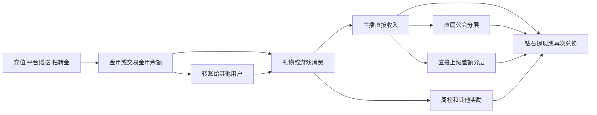

# SANO公会运营与公会画像产品需求文档

## 1. 文档信息

| 项目 | 内容 |
| --- | --- |
| 需求名称 | SANO公会运营与公会画像 |
| 文档状态 | 需求设计稿，待业务评审 |
| 涉及端 | SANO管理后台 |
| 目标使用者 | 公会运营总监、公会运营、BD、风控人员及其他授权管理人员 |
| 核心目标 | 统一管理公会经营数据，识别真正经营、低活跃、经营中夹杂风险和疑似套利公会，并提供可下钻证据 |
| 当前数据范围 | 金币和钻石逐笔流水保留60天；充值、提现、邀请等数据保留全量历史 |
| 当前输出范围 | 产品需求、指标口径、风险计算和人工审核流程 |
| 非本文范围 | 页面视觉原型、数据库表结构、接口字段类型、机器学习模型训练、处罚自动执行 |

## 2. 需求背景

SANO现有公会即代理。平台已经具备公会层级、主播归属、公会长和主播收支、用户充值提现、直播场次、上下麦、邀请关系、账号登录及设备信息，也具备公会分层和多类自然周榜单奖励。

当前信息分散在公会、用户、钱包、直播、排行榜和风控相关模块中。运营人员能够看到单项数据，但难以快速回答以下问题：

1. 公会是否持续组织主播开展真实直播经营。
2. 公会的业务收入来自真实独立用户，还是来自公会成员或公会关联账号。
3. 公会长、主播、子公会、消费账号和提现账号之间是否形成资金闭环。
4. 公会是否通过集中消费、贴榜单门槛、循环转账等方式获取平台奖励。
5. 当前风险结论由哪些业务记录支持，运营如何复核并形成最终判断。

本需求建设统一的公会运营管理和公会画像能力。系统分别计算真实经营能力和套利风险，不使用单一分数替代两种判断。

## 3. 需求目标

1. 建立平台、公会运营、BD、公会、子公会和主播的统一经营视图。
2. 同时提供直属口径和全树口径，避免公会自身经营与下级规模混算。
3. 统一主播活跃、消费、收入、公会分层、奖励、资金流向和平台贡献口径。
4. 输出可解释的真实经营指数、套利风险指数、画像分类和风险依据。
5. 将风险结论下钻到用户、订单、钱包流水、直播场次、奖励批次和提现记录。
6. 由系统输出风险判断，由授权人员人工确认是否套利。
7. 使用自然周快照保存长期趋势，降低60天原始钱包流水清理带来的影响。

## 4. 产品原则

### 4.1 双轴判断

公会画像使用两个独立分数：

- 真实经营指数：衡量主播真实活跃、独立用户贡献、经营持续性、收入健康和奖励独立性。
- 套利风险指数：衡量公会成员及公会关联账号消费、资金闭环、直播与收入不匹配、奖励套利和关系异常。

| 真实经营指数 | 套利风险指数 | 画像分类 |
| --- | --- | --- |
| 高 | 低 | 真正经营型公会 |
| 高 | 高 | 经营中夹杂风险 |
| 低 | 高 | 疑似套利型公会 |
| 低 | 低 | 低活跃或空壳公会 |

低经营不等于套利；高经营也不代表没有套利。

### 4.2 机器判断与人工定性分离

- 系统可以输出：暂无明显风险、关注、中风险、高风险、疑似套利。
- “已确认套利”必须由授权人员人工审核后产生。
- 人工审核需要保存审核人、审核时间、审核结论、说明和引用证据。
- 本期不根据机器分数自动冻结资产、取消奖励、限制提现或执行处罚。
- 系统本期只负责评估和形成结论，奖励、提现、账号或公会的后续处置由运营人员根据结论自行决定和执行。

### 4.3 结论必须可解释

每个风险结论至少包含：统计周期、命中规则、实际值、阈值、涉及金额、涉及账号、关键时间、证据记录、证据等级、规则版本和计算时间。

### 4.4 历史归属使用当时关系

历史消费、主播收入和公会分层必须使用业务发生时有效的公会关系和分层比例，不得使用当前关系倒推历史归属。

## 5. 核心概念与统计范围

### 5.1 公会与公会长

- 公会与代理为同一业务对象，产品文案统一使用“公会”。
- 一个公会只有一个公会账号，并唯一绑定一个公会长用户。
- 一个公会可以存在上级公会、直属子公会和更深层后代公会。
- BD不是组织层级，是公会的业务归属角色。
- 每个公会绑定运营负责人和BD负责人。

### 5.2 直属口径

直属口径包含：

- 当前公会长。
- 统计时点或历史快照中直接归属于当前公会的主播。
- 当前公会直接获得的公会分层。
- 直属子公会对当前公会产生的一层差额分层。

直属口径不包含直属子公会的主播经营数据，除非指标明确说明为“直属子公会贡献”。

### 5.3 全树口径

全树口径包含当前公会及其所有后代公会、公会长和主播。全树统计按用户ID和业务记录ID去重，避免用户或交易在多个层级重复累计。

全树数据由服务端预聚合。页面查询不得实时递归整棵公会树。

### 5.4 主播身份

主播分为：超级主播、优质主播、常规主播。身份按生效和失效历史判断，不使用当前身份覆盖历史周期。

| 主播身份 | 奖励资格 |
| --- | --- |
| 超级主播 | 达标后获得超级主播周奖励，所属公会获得对应奖励；不能领取常规主播等级直播时长奖励 |
| 优质主播 | 达标后获得优质主播周奖励；可以领取常规主播等级直播时长奖励 |
| 常规主播 | 可以领取常规主播等级直播时长奖励 |

### 5.5 基础指标账号分类定义

以下四个名称是本文基础指标、真实经营指数和套利风险指数使用的正式术语。在计算任何用户数、消费金额、消费占比或关联风险之前，必须先完成账号分类。

```text
分类优先级：SANO内部账号 > 公会成员 > 公会关联账号 > 独立用户
```

| 正式名称 | 明确定义 | 指标处理 |
| --- | --- | --- |
| SANO内部账号 | SANO官方所属人员、内部运营人员、测试账号和系统账号，以业务发生时有效的SANO内部账号名单为准 | 默认从经营指标、画像评分和风险评分的分子、分母中同时排除；保留排除数量、金额、内部账号类型和原因供审计 |
| 公会成员 | 业务发生时属于目标公会组织的用户，包括目标公会长、所有后代公会长，以及直接归属目标公会或其后代公会的主播 | 正常统计；公会成员向目标公会统计范围内主播产生的消费，单独记为公会成员消费 |
| 公会关联账号 | 不属于SANO内部账号或公会成员，但与公会成员命中同一实名主体、同一稳定MAC、经确认的账号映射或已配置的确定资金关联规则的账号 | 正常统计并单独计算公会关联账号消费及套利风险 |
| 独立用户 | 不属于SANO内部账号、公会成员或公会关联账号的普通SANO用户；消费不是成为独立用户的前提 | 作为真实独立用户经营贡献的计算基础；周期内产生成功消费后，计为独立付费用户 |

补充规则：

- “内部账号”在本文中只表示SANO内部账号，不表示公会成员。
- 账号分类相对于目标公会和业务发生时间计算。同一账号在不同时间或针对不同目标公会可能属于不同分类。
- 公会成员归属按业务发生时的公会及主播关系判断，不使用当前关系覆盖历史交易。
- 直属经营口径下，公会成员边界仍包括目标公会及其所有后代公会长和主播；直属口径只限制被统计的主播、直播间和收益范围，避免子公会用户向直属主播消费时被误判为独立用户。
- 同一完整IP仅标记为IP关联线索，不单独归为公会关联账号，也不能单独认定套利。
- 标准化后相同邮箱属于关联线索；只有业务明确确认其为同一主体或命中已配置强关联规则时，才归为公会关联账号。
- 邀请关系本身不构成公会关联。由公会邀请但不存在实名、设备、确定资金关系等强关联的普通用户，仍归为独立用户。
- 非实名用户可以消费和参加消费榜单，但不能直播；是否实名不直接决定其是否为独立用户。
- 因公会关系、内部账号名单或关联数据缺失而无法完成判断时，标记为“账号分类失败”，不得默认归为独立用户。“账号分类失败”是数据质量状态，不是第五种账号分类。

## 6. 全局数据口径

### 6.1 时间口径

- 业务时区确定为UTC+8。
- 所有经营、画像和风险指标统一以昨日23:59:59为数据截止点，不统计今天发生的数据。
- 昨日：数据截止日00:00:00至23:59:59。
- 自然周：周一00:00:00至周日23:59:59。
- 近7天：昨日及其前6个完整自然日。
- 近30天：昨日及其前29个完整自然日。
- 近60天：昨日及其前59个完整自然日。
- 本周截至昨日：本周一00:00:00至昨日23:59:59；若查询日为周一则本周期无数据，显示`--`。
- 本月截至昨日：本月1日00:00:00至昨日23:59:59；若查询日为当月1日则本周期无数据，显示`--`。
- 自定义日期的结束日期不得晚于昨日。
- 公会当前画像默认使用近30天；套利资金链默认检索近60天；周趋势默认展示数据可覆盖的最近8个完整自然周。
- 跨自然日直播按实际覆盖时长拆分到对应自然日。
- 周榜使用实际结算周期和奖励批次，不根据页面查询时间重新划分。
- 今天的数据如需查看，应进入独立实时监控能力，不进入本文经营评分、风险评分及排行榜结论。

### 6.2 金额和资产口径

- `1美元 = 10000金币 = 10000钻石`。
- 金币用于消费。
- 钻石用于收入、兑换金币和提现。
- 钻石可以兑换金币，金币不能兑换钻石。
- 交易金币可以转给其他用户；接收方获得可消费金币。
- 页面保留原始资产单位，同时可以按固定比例展示美元等价值。
- 金币、钻石、交易金币不得直接相加；需要比较时先换算为美元等价值。

### 6.3 有效记录

- 消费、收入、充值、提现、奖励和其他交易仅统计最终状态为成功的记录。
- 退款、撤销和冲正按明确业务类型和最终状态处理，不重复统计正向和反向金额。
- SANO内部账号在业务指标中默认排除，在风险证据中保留内部账号类型、排除原因、原始记录数量和涉及金额。
- 无数据、真实为0和不适用必须区分。无数据或口径不可计算时显示`--`，不得显示为0。

### 6.4 主播直接收入

对每笔成功消费：

| 收入类型 | 主播直接收入公式 |
| --- | --- |
| 普通礼物 | 普通礼物价值 × 70% |
| 幸运礼物 | 幸运礼物价值 × 2% |
| 游戏 | 游戏消费金额 × 0.5% |

系统优先读取已结算的主播收入记录；仅在核对或补算场景使用上述公式，并记录使用的比例版本。

### 6.5 公会分层

公会分层比例为4%、8%、12%、16%、20%。

对主播的每笔直接收入`I`：

```text
直属公会分层金额 = I × 直属公会分层比例
直接上级公会分层金额 = I × max(直接上级公会比例 - 直属公会比例, 0)
```

- 分层层级只计算一层差额。
- 当前主播的直属公会获得本公会分层。
- 直属公会的直接上级公会仅在自身比例更高时获得比例差。
- 祖父级及更高公会不继续获得本笔分层。
- `PROXY_PROFIT`类记录表示当前公会获得的公会分层。
- `SON_PROXY_PROFIT`类记录表示直属子公会对当前公会的差额贡献。
- `ROOM_USER_PROFIT`属于独立分层且当前未启用，本期不纳入公会收入。

### 6.6 钱包业务类型分组

业务类型以线上枚举和实际记录为准。产品统计按以下业务含义分组：

| 分组 | 主要业务类型 |
| --- | --- |
| 普通礼物 | 赠送普通礼物、收到普通礼物、公会普通礼物分层、子公会普通礼物贡献 |
| 幸运礼物 | 赠送幸运礼物、收到幸运礼物、公会幸运礼物分层、子公会幸运礼物贡献、幸运礼物中奖、幸运礼物Jackpot |
| 游戏 | 游戏消费、游戏反奖、房主游戏分账、公会游戏分层、子公会游戏贡献、游戏Jackpot |
| 兑换及转账 | 金币转账、钻石兑换金币、钻石兑换交易金币、交易金币转账 |
| 充值提现 | 金币充值、交易金币充值、提现扣除、提现退款 |
| 平台奖励 | 榜单、直播时长、主播身份、邀请、签到、任务、VIP及其他平台奖励 |
| 其他消费与返还 | 道具、VIP、红包、竞猜、奖池及对应返还 |
| 运营调整 | 运营加减款及其他平台调整 |

枚举中的“游戏收入榜单奖励”按当前业务解释为游戏消费周榜奖励。页面按实际榜单名称展示，不直接展示技术枚举名称。

## 7. 数据处理与结果生成

### 7.1 统一事件链

系统需要在离线统计层形成以下可追溯链路：



底层业务单号不相同时，离线任务根据可追溯字段生成统一`trace_id`。复杂关联在每日计算任务中完成，不在画像页面打开时临时跨表计算。

### 7.2 数据更新

- 经营汇总每天至少更新一次。
- 每日数据在次日完成结算和数据校验后更新；画像页面始终只展示截至昨日的数据。
- 当前自然周可以展示“本周截至昨日”的过程指标，但必须标记“未结算”，不得生成最终排名或据此确认榜单奖励。
- 风险规则重算时保存规则版本，不覆盖历史人工审核结论。
- 原始钱包流水仅保留60天时，周快照、风险结果和已引用证据至少保留一年。

### 7.3 评估机制

公会画像采用“日常风险扫描、正式周期评估、手动重新评估”三种方式。三种方式都由系统计算指标和风险；人工只负责发起授权重算、审核证据和形成最终人工结论。

| 评估方式 | 触发方式 | 数据截止时间 | 计算窗口 | 结果性质 |
| --- | --- | --- | --- | --- |
| 日常风险扫描 | 每天在前一自然日数据完成结算和校验后自动执行 | 昨日23:59:59 | 真实经营指标近30个完整自然日；套利风险及资金链近60个完整自然日 | 最新观察结果，用于及时发现风险变化，不作为正式周评估快照 |
| 正式周期评估 | 每个自然周的周一，在上周数据完成结算和校验后自动执行 | 上周日23:59:59，不统计本周一数据 | 上周自然周指标；截至上周日的近30日真实经营指数和近60日套利风险指数 | 正式公会周评估，生成不可变快照，用于历史趋势、周报和审核依据 |
| 手动重新评估 | 具有权限的人员选择公会、数据截止日和重算原因后触发 | 所选截止日23:59:59，截止日不得晚于昨日 | 以所选截止日为终点，按近30日和近60日窗口重新计算 | 新的重算版本，用于数据修复、关系补录、规则调整或人工复核，不覆盖原结果 |

#### 7.3.1 日常风险扫描

1. 扫描范围为数据截止日仍有效的全部公会。
2. 每日结果更新该公会的“最新观察结果”，包括真实经营指数、套利风险指数、画像分类、命中规则和新增证据。
3. 日常扫描不生成正式周评估记录，也不覆盖最近一次正式周期评估。
4. 仅在首次达到高风险、首次升级为疑似套利、风险等级上升或出现新的高等级证据时新增待审核事项；相同风险和相同证据不重复生成。
5. 扫描失败或数据不完整时保留上一份成功观察结果，同时明确显示本次扫描状态、失败原因和最后成功时间，不得把旧结果标记为本次结果。

#### 7.3.2 正式周期评估

1. 评估日固定为每周一，数据截止时间固定为上周日23:59:59。
2. 周一当天发生的直播、消费、收入、分层、奖励、转账、兑换和提现均不得进入本次评估。
3. 如果上周日数据尚未结算完成，任务等待或重试；可以延迟生成，但不得将数据截止时间顺延到周一。
4. 每个有效公会每周只生成一份成功的正式主快照。任务重试必须保证幂等，不得产生重复主快照。
5. 正式快照至少保存：公会ID、评估日、数据截止时间、统计窗口、直属及全树指标、两项指数、画像分类、机器结论、风险证据、数据覆盖、关系版本、榜单配置版本、比例版本和规则版本。
6. 正式快照生成后不可直接修改。后续数据修复或规则变化通过手动重新评估生成新版本，并保留与原快照的差异。

#### 7.3.3 手动重新评估

1. 只有具备重新评估权限的人员可以发起。
2. 发起时必须选择目标公会、数据截止日和重算原因。重算原因至少包括：数据修复、关系补录、规则调整、配置调整和人工复核。
3. 对历史正式周评估进行重算时，默认沿用原数据截止日；不得通过扩大日期范围把周一或之后的数据加入原周评估。
4. 每次重算保存发起人、发起时间、原因、使用的数据版本、关系版本、配置版本、规则版本及新旧结果差异。
5. 手动重新评估产生新的系统评估版本，不覆盖原正式快照、原观察结果或历史人工审核结论。
6. 重算结果不会自动改变“已确认套利”或“排除套利”等人工结论；审核人员需要基于新证据另行更新审核结论。

#### 7.3.4 数据覆盖与新公会

- 可用完整数据不足7天：执行扫描并保存数据质量结果，但综合评分和画像分类显示“数据积累中”。
- 可用完整数据达到7天但不足30天：可以输出“观察期评估”，必须展示实际覆盖天数，不进入正式经营等级横向排名。
- 可用完整数据达到30天：正常输出真实经营指数和经营等级。
- 套利风险窗口不足60天时按实际可用完整天数计算并展示覆盖天数；不得因为未覆盖60天直接给出低风险结论。

### 7.4 数据质量状态

每次画像计算记录：数据覆盖开始时间、结束时间、缺失数据源、关联成功率和计算版本。

以下情况必须标记结果不完整：

- 公会或主播历史关系无法还原。
- 消费无法关联主播收入。
- 主播收入无法关联公会分层。
- 钱包流水不足以覆盖所选周期。
- 历史榜单配置无法确定。

## 8. 功能范围

### 8.1 Dashboard

用于查看平台整体公会经营和风险情况，支持昨日、近7天、近30天、近60天、本周截至昨日、本月截至昨日、完整自然周和自定义日期。所有选项均不包含今天。

核心内容包括：

- 公会数量、主播数量、有效开播主播数量。
- 新增邀请人数。
- 普通礼物、幸运礼物和游戏消费。
- 主播直接收入、公会分层收入、平台奖励和提现。
- 真实经营型、低活跃、经营中夹杂风险和疑似套利公会数量。
- 收入趋势、平台贡献趋势、主播增长趋势和公会排行。
- 高风险及疑似套利公会待审核数量。

### 8.2 公会列表

支持按国家、运营负责人、BD负责人、公会层级、公会类型、分层比例、经营分类、风险等级和审核状态筛选。

列表至少展示：公会名称及ID、公会长、上级公会、运营负责人、BD负责人、直属主播数、全树主播数、有效开播主播数、独立用户消费金额、主播收入、公会分层、平台奖励、真实经营指数、套利风险指数、画像分类和最近更新时间。

### 8.3 公会详情与画像

公会详情按业务模块组织，不在本文定义视觉原型。功能内容包括：

1. 画像概览。
2. 组织与关系。
3. 主播经营。
4. 消费与收入。
5. 分层与奖励。
6. 资金流向。
7. 风险评估与证据。
8. 人工审核记录。

画像概览需要分别展示“最新观察结果”“最近一次正式周评估”和“手动重新评估版本”。三类结果必须标明评估方式、数据截止时间、实际覆盖天数、计算时间和规则版本，不得使用手动结果或日常观察结果覆盖正式周评估历史。

### 8.4 主播与用户下钻

- 主播ID和消费用户ID支持进入现有用户画像。
- 直播场次支持进入直播详情。
- 消费、收入、分层、奖励、转账和提现支持查看对应业务记录。
- 下钻页面自动带入公会、统计范围、周期和风险规则条件。

### 8.5 运营与BD业绩

- 公会运营按所负责公会汇总直属和全树经营结果。
- BD按其开发并仍处于有效归属的公会汇总经营结果。
- 同一公会在同一统计周期只能归属一个运营负责人和一个BD负责人。
- 历史业绩使用当期归属快照，不使用当前负责人覆盖历史。

### 8.6 风险审核

风险审核状态包括：待审核、审核中、排除套利、确认高风险、已确认套利。

审核人员可以：

- 查看系统结论和全部命中规则。
- 查看资金链、账号关系和直播证据。
- 添加审核说明和补充证据。
- 排除误报或确认风险。
- 查看历史审核和规则重算差异。
- 对指定公会发起手动重新评估，并填写数据截止日和重算原因。

## 9. 指标计算总则

### 9.1 基础函数

```text
安全除法 SafeDivide(a, b)：
当b > 0时返回a ÷ b；当b = 0或数据缺失时返回--。

截断函数 Clamp(x, 0, 1)：
小于0返回0，大于1返回1，其余返回x。

线性严重度 S(x, L, H)：
Clamp((x - L) ÷ (H - L), 0, 1)。

同群百分位 PR(x)：
(同群中小于x的公会数 + 0.5 × 等于x的公会数) ÷ 同群有效公会数 × 100。
```

### 9.2 同群范围

真实经营指数中的绝对量指标使用同群百分位，降低国家和公会规模差异造成的偏差。

同群优先使用“同国家 + 直属主播规模档”：

- 1—5人。
- 6—10人。
- 11—20人。
- 21—50人。
- 51人及以上。

同群有效公会少于20个时，依次扩展为同国家全部规模、全球同规模、全球全部公会。扩展规则需要随评分结果保存。

### 9.3 空值处理

- 业务真实为0时参与计算。
- 数据源缺失导致不可计算时，该指标不计入评分，并按剩余有效指标权重重新归一。
- 对正向经营指标，分母因真实无业务而为0且分子也为0时，页面比例显示`--`，评分按0分处理，不得按缺失数据重新分配权重。
- 对风险指标，分母因真实无消费或无收益而为0时，该项风险记0分；分母对应数据源缺失时才记为不可计算。
- 直属主播数为0时，真实经营指数为0。
- 核心数据源分为公会关系、主播关系及身份、直播及上下麦、消费收入及分层、钱包及奖励五类；缺失超过2类时，不输出综合评分，只显示“数据不完整”。

## 10. 组织与主播指标

| 指标 | 计算方式 |
| --- | --- |
| 直属公会数 | 查询时点`parent_guild_id = 当前公会ID`且有效的公会数量 |
| 全树公会数 | 当前公会所有有效后代公会去重数量，不包含当前公会 |
| 直属主播数 | 查询时点直接归属当前公会的有效主播用户数，同一用户只计1人 |
| 全树主播数 | 当前公会及所有后代公会的有效主播用户ID去重数量 |
| 新增直属主播数 | 统计周期内首次或再次生效加入当前公会的去重主播数 |
| 流失直属主播数 | 统计周期内与当前公会关系失效的去重主播数 |
| 超级主播数 | 统计时点身份为超级主播的直属主播数 |
| 优质主播数 | 统计时点身份为优质主播的直属主播数 |
| 常规主播数 | 统计时点身份为常规主播的直属主播数 |
| 有效开播主播数 | 周期内至少产生1场有效直播的直属主播去重数 |
| 主播开播率 | 有效开播主播数 ÷ 周期内有效直属主播数 |
| 4周主播留存率 | 最近一个完整自然周周末的4周前周末有效直属主播中，在最近一个完整自然周周末仍属于当前公会且该完整周有有效直播的主播数 ÷ 4周前周末有效直属主播数 |
| 主播身份优质率 | 周期内有效开播的超级和优质主播数 ÷ 有效开播主播数 |
| 结算窗口关系变动率 | 自然周结束前3天至到结束后3天内加入或退出的直属主播数 ÷ 当周有效直属主播数 |

## 11. 直播经营指标

| 指标 | 计算方式 |
| --- | --- |
| 有效直播场次 | 周期内最终判定有效的直播场次记录数 |
| 有效直播时长 | 有效直播场次在周期内覆盖的时长之和，跨自然日拆分，单位小时 |
| 有效直播天数 | 周期内至少存在1场有效直播的自然日去重数 |
| 主播平均直播时长 | 有效直播时长 ÷ 有效开播主播数 |
| 每场平均直播时长 | 有效直播时长 ÷ 有效直播场次 |
| 直播间进入人数 | 每场内按用户ID去重后再跨场累加；同一用户进入多场时按场次分别计数 |
| 直播间去重进入用户数 | 周期内进入统计范围直播间的用户ID去重数量；该指标中的“去重”只表示用户ID去重，不代表账号被分类为独立用户 |
| 直播间付费用户数 | 周期内在统计范围直播间产生成功礼物或游戏消费的用户ID去重数量 |
| 独立付费用户数 | 直播间付费用户中被分类为独立用户的用户ID去重数量 |
| 进入付费转化率 | 直播间付费用户数 ÷ 直播间去重进入用户数 |
| 新增付费用户数 | 首次在统计范围主播直播间成功消费的时间落在统计周期内的去重用户数 |
| 复购付费用户数 | 周期内成功消费且周期开始前已有成功消费记录的去重用户数 |
| 复购付费率 | 复购付费用户数 ÷ 直播间付费用户数 |
| 独立复购付费用户数 | 周期内成功消费、周期开始前已有成功消费记录且本周期消费时被分类为独立用户的用户ID去重数量 |
| 独立付费用户复购率 | 独立复购付费用户数 ÷ 独立付费用户数 |
| 上麦人次 | 每场内按上麦用户ID去重后再跨场累加 |
| 独立上麦用户数 | 周期内上麦用户ID去重数 |
| 人均上麦时长 | 全部有效上麦时长 ÷ 独立上麦用户数 |
| 每小时独立用户消费 | 独立用户成功消费金额美元等价值 ÷ 有效直播时长 |
| 每场独立用户消费 | 独立用户成功消费金额美元等价值 ÷ 有效直播场次 |

## 12. 消费与收入指标

### 12.1 成员侧与直播间侧分离

- 成员侧指标：统计公会长和范围内主播自身的充值、消费、收入、兑换、转账和提现。
- 直播间侧指标：统计全部消费者在范围内主播直播间产生的消费和由此形成的主播收入、公会分层。
- 两类指标不得混为同一个“公会消费”或“公会收入”。

### 12.2 基础指标

| 指标 | 计算方式 |
| --- | --- |
| 普通礼物消费 | 周期内剔除SANO内部账号后，向范围内主播发送普通礼物的成功消费金币之和 |
| 幸运礼物消费 | 周期内剔除SANO内部账号后，向范围内主播发送幸运礼物的成功消费金币之和 |
| 游戏消费 | 周期内剔除SANO内部账号后，范围内主播房间发生的成功游戏消费金币之和 |
| 直播间总消费 | 普通礼物消费 + 幸运礼物消费 + 游戏消费 |
| SANO内部账号消费金额 | 周期内SANO内部账号在范围内主播直播间产生的三类成功消费之和；仅供审计，不计入直播间总消费和评分 |
| 独立用户消费金额 | 消费者被分类为独立用户的直播间总消费 |
| 公会成员消费金额 | 消费者被分类为公会成员的直播间总消费 |
| 公会关联账号消费金额 | 消费者属于公会关联账号的直播间总消费 |
| 独立用户消费占比 | 独立用户消费金额 ÷ 直播间总消费 |
| 公会成员消费占比 | 公会成员消费金额 ÷ 直播间总消费 |
| 公会关联账号消费占比 | 公会关联账号消费金额 ÷ 直播间总消费 |
| 主播普通礼物收入 | 周期内范围内主播成功普通礼物收入钻石之和 |
| 主播幸运礼物收入 | 周期内范围内主播成功幸运礼物收入钻石之和 |
| 主播游戏收入 | 周期内范围内主播成功房主游戏分账钻石之和 |
| 主播直接收入 | 主播普通礼物收入 + 主播幸运礼物收入 + 主播游戏收入 |
| 每名活跃主播收入 | 主播直接收入美元等价值 ÷ 有效开播主播数 |
| 每小时主播收入 | 主播直接收入美元等价值 ÷ 有效直播时长 |

完成账号分类后，应满足：`直播间总消费 = 独立用户消费金额 + 公会成员消费金额 + 公会关联账号消费金额`。若不相等，差额标记为“账号分类失败金额”，本周期账号分类数据质量不通过。

### 12.3 成员账户指标

成员账户范围为所选直属或全树口径内的公会长与主播账号。各资产分别汇总，只有在展示总价值时才换算为美元等价值。

| 指标 | 计算方式 |
| --- | --- |
| 成员充值金额 | 周期内成员账户成功金币充值与交易金币充值的美元等价值之和 |
| 成员消费金额 | 周期内成员账户成功礼物、游戏及其他消费的金币美元等价值之和 |
| 成员收入金额 | 周期内成员账户成功主播收入、公会分层及其他经营收入的钻石美元等价值之和 |
| 成员平台奖励 | 周期内成员账户成功收到的平台奖励美元等价值之和 |
| 成员钻转金金额 | 周期内成员账户成功兑换为金币或交易金币的钻石美元等价值之和；扣钻与加币链路只计一次 |
| 成员转出金额 | 周期内成员账户成功转给其他账号的金币或交易金币美元等价值之和；扣款侧统计 |
| 成员转入金额 | 周期内其他账号成功转入成员账户的金币或交易金币美元等价值之和；入账侧统计 |
| 成员提现金额 | 周期内成员账户最终成功提现的钻石美元等价值之和，提现退款不计为成功提现 |
| 公会长消费金额 | 当前公会长账号的成员消费金额 |
| 公会长经营收入 | 当前公会长获得的主播收入、公会分层及其他经营收入美元等价值之和，不含平台奖励 |

同一笔转账在成员转出和成员转入中可以分别出现，用于观察方向；计算成员范围净流入时按业务单号匹配并抵销公会成员之间的转账，避免将公会成员内部转账误认为独立来源资金。

### 12.4 收入集中度

对每个消费者汇总其向统计范围主播产生的成功消费金额，按金额降序排列。

| 指标 | 计算方式 |
| --- | --- |
| Top 1贡献占比 | 最大消费者贡献金额 ÷ 直播间总消费 |
| Top 3贡献占比 | 前3名消费者贡献金额之和 ÷ 直播间总消费 |
| Top 10贡献占比 | 前10名消费者贡献金额之和 ÷ 直播间总消费 |
| 有效消费用户数 | 周期内成功消费的消费者ID去重数量 |
| 人均消费金额 | 直播间总消费 ÷ 有效消费用户数 |

同金额时依次按成功消费笔数降序、用户ID升序排序。

## 13. 公会分层与奖励指标

| 指标 | 计算方式 |
| --- | --- |
| 本公会普通礼物分层 | 周期内当前公会获得的普通礼物`PROXY_PROFIT`成功金额之和 |
| 本公会幸运礼物分层 | 周期内当前公会获得的幸运礼物代理分层成功金额之和 |
| 本公会游戏分层 | 周期内当前公会获得的游戏代理分层成功金额之和 |
| 直属子公会贡献 | 周期内所有直属子公会对当前公会产生的`SON_PROXY`类成功金额之和 |
| 公会分层总收入 | 本公会三类分层 + 直属子公会三类贡献 |
| 主播平台奖励 | 周期内实际发放成功给范围内主播的直播时长、身份、榜单、任务及其他平台奖励美元等价值之和 |
| 公会平台奖励 | 周期内实际发放成功给当前公会或范围内公会的公会类奖励美元等价值之和 |
| 平台奖励总额 | 主播平台奖励 + 公会平台奖励 |
| 经营收益 | 主播直接收入美元等价值 + 公会分层总收入美元等价值 |
| 总收益 | 经营收益 + 平台奖励总额 |
| 奖励依赖度 | 平台奖励总额 ÷ 总收益 |
| 非奖励收益占比 | 经营收益 ÷ 总收益 |

奖励取消或追回时按最终有效金额计算。

## 14. 周榜指标与结算

所有榜单按自然周结算，实际奖励以成功奖励批次和钱包流水为准。当前完整档位配置位于`../资源/需求输入/周榜奖励配置.xlsx`。

| 榜单 | 排名范围 | 统计指标 | 奖励资产 |
| --- | ---: | --- | --- |
| 幸运礼物消费周榜 | 前40名 | 用户当周成功幸运礼物消费金币 | 金币 |
| 幸运礼物收入周榜 | 前40名 | 主播当周成功幸运礼物收入钻石 | 钻石 |
| 游戏消费周榜 | 前40名 | 用户当周成功游戏消费金币 | 金币 |
| 公会周榜 | 前50名 | 公会长及直属主播总收入、幸运礼物收入、直属主播数量 | 钻石 |
| PK积分周榜 | 前10名 | 主播当周有效PK积分 | 钻石 |

### 14.1 通用榜单规则

```text
最终有效排名 = 现有榜单服务在自然周结算时生成的名次
达标 = 实际指标达到该名次对应的最低门槛
奖励金额 = 当前生效配置中该名次的奖励金额
```

- 消费榜和收入榜按用户或主播维度统计，不按公会汇总后参与个人榜。
- 公会周榜只使用公会长及直属主播，不使用全树主播。
- 公会周榜同一名次配置的总收入、幸运礼物收入和主播数量需要同时达到。
- 公会长同时是直属主播时，同一用户收入只统计一次。
- 各榜单同分时不产生并列名次，先达到该最终指标值的对象优先占位；达到时间完全相同时，按照现有榜单服务的ID优先规则确定先后顺序。
- 历史配置不完整时，历史奖励金额和名次使用实际结算记录，不使用当前配置重算。
- 从本需求上线后，每个自然周保存榜单配置快照。
- 枚举名称与业务名称不一致时，产品统一使用当前业务榜单名称。

### 14.2 公会周榜指标

```text
公会长及直属主播总收入 =
公会长及周末有效直属主播在当周获得的普通礼物收入
+ 幸运礼物收入
+ 游戏房主分账

公会长及直属主播幸运礼物收入 =
上述用户当周成功幸运礼物收入钻石之和

直属主播数量 =
周日23:59:59与当前公会关系有效的直属主播用户ID去重数量；
公会长同时为直属主播时计入直属主播数量，同一用户只计1人。
```

## 15. 经营效率与平台贡献指标

### 15.1 经营效率

| 指标 | 计算方式 |
| --- | --- |
| 每名活跃主播独立用户消费 | 独立用户消费金额美元等价值 ÷ 有效开播主播数 |
| 每小时独立用户消费 | 独立用户消费金额美元等价值 ÷ 有效直播时长 |
| 每名独立付费用户消费 | 独立用户消费金额美元等价值 ÷ 独立付费用户数 |
| 独立付费用户密度 | 独立付费用户数 ÷ 有效开播主播数 |
| 周活跃率 | 最近8个完整周中同时存在有效开播和独立用户消费的周数 ÷ 实际覆盖完整周数 |
| 周收入变异系数 | 最近8个完整周经营收益标准差 ÷ 最近8个完整周经营收益平均值 |
| 收入稳定度 | `max(1 - 周收入变异系数, 0) × 100` |

### 15.2 平台贡献净收益

本指标沿用用户画像现有平台贡献口径，比例由后台配置并保存计算版本。正式比例为：普通礼物16%、幸运礼物1.1%、游戏2%。三个比例的计算基数均为对应业务的消费金额，不是主播收益金额。

```text
普通礼物平台业务净收入 = 普通礼物消费美元等价值 × 普通礼物平台净收入比例
幸运礼物平台业务净收入 = 幸运礼物消费美元等价值 × 幸运礼物平台净收入比例
游戏平台业务净收入 = 游戏消费美元等价值 × 游戏平台净收入比例

平台业务净收入 = 上述三项之和
平台激励总成本 = 周期内范围内主播及公会实际发放成功的平台奖励美元等价值
平台贡献净收益 = 平台业务净收入 - 平台激励总成本
平台贡献净收益率 = 平台贡献净收益 ÷ 平台业务净收入 × 100%
```

上述16%、1.1%和2%是平台基于对应消费金额计算的实际净收益比例。主播收益、幸运礼物和游戏返奖、Jackpot、公会分层等交易内成本均不在画像端再次扣减；公会分层也不加入平台激励总成本。榜单奖励、主播身份奖励、直播时长奖励和公会奖励属于平台额外发放的激励，因此仍按实际发放金额从平台业务净收入中扣除。

展示平台贡献净收益时，必须同时注明“按消费金额计算”，并展示本次计算使用的三个净收益比例及比例版本，避免被理解为按主播收益计算。

## 16. 真实经营指数

### 16.1 默认周期

当前真实经营指数默认基于近30天直属口径计算。全树真实经营指数使用相同公式独立计算，不用全树规模覆盖直属经营结果。

### 16.2 V1试运行公式

比例型指标先转换为0—100分；绝对量或人均量指标使用同群百分位`PR`。

| 指标 | 指标得分 | 权重 |
| --- | --- | ---: |
| 主播开播率 | 主播开播率 × 100 | 12% |
| 主播平均直播时长 | `PR(主播平均直播时长)` | 8% |
| 独立付费用户密度 | `PR(独立付费用户密度)` | 12% |
| 独立用户消费占比 | 独立用户消费占比 × 100 | 13% |
| 独立付费用户复购率 | 独立复购付费用户数 ÷ 独立付费用户数 × 100 | 8% |
| 非奖励收益占比 | 非奖励收益占比 × 100 | 10% |
| 收入分散健康度 | `(1 - Top 3贡献占比) × 100` | 7% |
| 周活跃率 | 周活跃率 × 100 | 10% |
| 4周主播留存率 | 4周主播留存率 × 100 | 7% |
| 收入稳定度 | 收入稳定度 | 5% |
| 主播身份优质率 | 主播身份优质率 × 100 | 8% |

```text
真实经营指数 = Σ(指标得分 × 指标权重)
```

### 16.3 经营等级

| 分数 | 经营等级 |
| ---: | --- |
| 80—100 | 强经营 |
| 60—79.99 | 稳定经营 |
| 40—59.99 | 弱经营 |
| 0—39.99 | 低活跃 |

等级阈值属于V1试运行参数，需要使用已知正常公会和套利公会样本进行校准。

## 17. 套利风险指标

### 17.1 资金来源归因

消费金币来源按以下顺序归因：

1. 有统一业务链路时使用直接关联。
2. 无直接关联时，在同一账户同一资产类型内按时间先后使用FIFO归因。
3. 平台赠送、奖励、充值、转账和钻转金分别保留来源标签。
4. 余额不足以解释消费时标记为“来源不完整”，不补造来源。

钻石提现同样可以使用FIFO形成时序归因，但必须标记为“推定来源”；不能将收入后发生的提现描述为某笔收入的确定提现。

### 17.2 风险基础指标

| 指标 | 计算方式 |
| --- | --- |
| 公会成员消费占比 | 公会成员向范围内主播消费金额 ÷ 直播间总消费；直播间总消费已剔除SANO内部账号 |
| 公会关联账号消费占比 | 公会关联账号向范围内主播消费金额 ÷ 直播间总消费；直播间总消费已剔除SANO内部账号 |
| 24小时资金消费占比 | 充值、转入或钻转金后24小时内被归因到范围内主播消费的金额 ÷ 直播间总消费 |
| 循环消费占比 | 按下述资金闭环算法识别并归因到闭环的消费金额 ÷ 直播间总消费 |
| 72小时快速提现占比 | 经营收益或平台奖励入账后72小时内按FIFO推定用于提现的钻石金额 ÷ 总收益 |
| 单位收入直播投入 | 有效直播时长 ÷ 经营收益美元等价值 |
| 单位收入独立用户 | 独立付费用户数 ÷ 经营收益美元等价值 |
| 奖励依赖度 | 平台奖励总额 ÷ 总收益 |
| 贴门槛周占比 | 最近有效完整周中满足贴门槛定义的周数 ÷ 可判断完整周数 |
| 结算窗口关系变动率 | 自然周结束前后3天加入或退出主播数 ÷ 当周有效直属主播数 |
| 公会关联集群占比 | 位于至少含2个公会成员或公会关联账号的关系连通分量中的账号数 ÷ 画像涉及账号总数 |

资金闭环算法：

1. 图节点为公会长、主播、消费者、转账双方和提现账号；同一用户ID合并为一个节点。
2. 有向边包括金币或交易金币转账、消费者向主播消费、该消费对应的主播收入与公会分层、钻石兑换金币以及提现；边保存发生时间、金额、资产类型、业务记录ID和`trace_id`。
3. 只识别相邻事件时间递增、首尾发生时间差不超过7天、路径长度不超过4条资金边且最终回到起点或起点的公会关联账号的路径。
4. 每条闭环可归因金额为路径各边换算后可用金额的最小值；同一原始业务记录在同一统计周期只归因一次，多个闭环竞争同一金额时按闭环完成时间升序分配。
5. 仅有同IP而无转账、消费或强关联关系时，不构成闭环。

“画像涉及账号总数”是剔除SANO内部账号后，周期内出现在组织关系、直播、消费、收入、分层、转账、兑换、奖励或提现记录中的用户ID去重数。公会关联集群按用户ID构建无向关系图；同实名、同稳定MAC、经确认的账号映射或命中已配置的确定资金关联规则形成关系边。同邮箱和同IP默认只作为边属性或关联线索，不单独连边。

### 17.3 贴门槛周

同时满足以下条件定义为贴门槛周：

1. 周榜最终指标达到对应名次最低门槛。
2. 最终指标不高于对应门槛的105%。
3. 首次达到门槛后至周末新增的同类指标不超过当周最终指标的5%。

历史周榜门槛版本未知时，该周不参与贴门槛周占比计算。

## 18. 套利风险指数

### 18.1 V1试运行公式

风险严重度统一使用`S(x,L,H)`，达到低阈值开始计分，达到高阈值计满分。

#### 18.1.1 公会成员及关联账号消费风险，25分

```text
公会成员及关联账号消费风险 = 25 × (
  60% × S(公会成员消费占比, 10%, 50%)
  + 40% × S(公会关联账号消费占比, 5%, 30%)
)
```

#### 18.1.2 资金闭环风险，30分

```text
资金闭环风险 = 30 × (
  40% × S(24小时资金消费占比, 5%, 30%)
  + 35% × S(循环消费占比, 3%, 20%)
  + 25% × S(72小时快速提现占比, 10%, 50%)
)
```

#### 18.1.3 直播与收入不匹配风险，15分

仅当经营收益不低于同群中位数时计算：

```text
直播收入不匹配度 = 100 - PR(单位收入直播投入)
用户收入不匹配度 = 100 - PR(单位收入独立用户)

直播与收入不匹配风险 = 15 × (
  60% × 直播收入不匹配度 ÷ 100
  + 40% × 用户收入不匹配度 ÷ 100
)
```

经营收益低于同群中位数时，本维度记0分，避免低收入小公会仅因分母偏小被误判。

#### 18.1.4 奖励套利风险，20分

```text
奖励套利风险 = 20 × (
  60% × S(奖励依赖度, 20%, 60%)
  + 40% × S(贴门槛周占比, 25%, 75%)
)
```

#### 18.1.5 关系与协同异常风险，10分

```text
关系与协同异常风险 = 10 × (
  50% × S(结算窗口关系变动率, 10%, 50%)
  + 50% × S(公会关联集群占比, 10%, 40%)
)
```

#### 18.1.6 总分

```text
套利风险指数 =
公会成员及关联账号消费风险
+ 资金闭环风险
+ 直播与收入不匹配风险
+ 奖励套利风险
+ 关系与协同异常风险
```

总分范围为0—100。

### 18.2 风险等级与机器结论

| 风险指数 | 风险等级 | 默认机器结论 |
| ---: | --- | --- |
| 0—24.99 | 低 | 暂无明显风险 |
| 25—49.99 | 关注 | 建议关注 |
| 50—69.99 | 中 | 中风险 |
| 70—100 | 高 | 高风险 |

满足以下任一条件时，机器结论由“高风险”升级为“疑似套利”：

1. 套利风险指数不低于80，且资金闭环风险不低于18分。
2. 套利风险指数不低于80，且公会成员及关联账号消费风险不低于15分，同时奖励套利风险不低于12分。

本期不启用“命中单条资金闭环规则即可直接判为疑似套利”的硬规则。闭环行为进入资金闭环风险评分并展示证据，是否构成套利仍结合综合评分和人工审核判断。

### 18.3 画像分类

| 条件 | 画像分类 |
| --- | --- |
| 真实经营指数≥60且风险指数<50 | 真正经营型公会 |
| 真实经营指数≥60且风险指数≥50 | 经营中夹杂风险 |
| 真实经营指数<60且机器结论为疑似套利 | 疑似套利型公会 |
| 真实经营指数<60且未达到疑似套利 | 低活跃或空壳公会 |

## 19. 风险规则与证据

| 规则编码 | 风险类型 | 命中逻辑 | 主要证据 |
| --- | --- | --- | --- |
| R01 | 公会长成员消费 | 公会长向当前公会或全树主播消费并达到配置金额或占比 | 消费订单、公会关系、主播收入、公会分层 |
| R02 | 主播相互消费 | 范围内主播之间存在双向或多向消费 | 消费双方、交易时间、金额、主播关系 |
| R03 | 公会关联账号消费 | 同实名、同稳定MAC、经确认的账号映射或命中确定资金关联规则的账号集中向范围内主播消费 | 登录设备、实名、资金记录、消费订单、账号关系 |
| R04 | 资金快速流入消费 | 充值、转账或钻转金后24小时内流向范围内主播 | 充值或转换、转账、消费链路 |
| R05 | 收益快速提现 | 主播收入、公会分层或奖励后72小时内出现高比例提现 | 收入、分层、奖励、提现及FIFO归因 |
| R06 | 直播收入不匹配 | 经营收益达到同群中位数，但单位收入直播投入处于同群低位 | 直播场次、时长、经营收益、同群分布 |
| R07 | 独立用户不足 | 经营收益较高，但单位收入独立用户或独立用户消费占比异常低 | 消费者、关联关系、收入和同群分布 |
| R08 | 贴榜单门槛 | 多周满足贴门槛周定义 | 榜单指标、门槛、首次达标时间、周末增量 |
| R09 | 奖励依赖 | 平台奖励在总收益中占比异常高 | 奖励批次、钱包流水、经营收益 |
| R10 | 结算窗口关系变化 | 结算日前后主播集中加入或退出 | 公会主播关系历史、结算周期 |
| R11 | 循环转账消费 | 账号间形成不超过4条边的转账或消费闭环 | 转账双方、消费双方、时间和金额 |
| R12 | 全树协同异常 | 多个子公会共享公会关联账号或资金来源 | 全树关系、设备、实名、转账和消费链路 |

### 19.1 证据等级

| 证据等级 | 定义 |
| --- | --- |
| 直接证据 | 通过业务单号或可验证追溯关系直接串联消费、主播收入和公会分层 |
| 强关联证据 | 同实名、同稳定MAC、经确认的账号映射、明确转账双方或多个业务事件形成闭环 |
| 时序关联证据 | 充值后消费、收入后提现等时间窗口内的FIFO推定关系 |
| 行为证据 | 直播不足、收入集中、贴门槛、关系集中变动等异常模式 |

同IP、单周收入上涨、幸运礼物占比高、提现金额高等单一事实只能作为辅助证据。

### 19.2 风险依据明细

每条命中记录需要保存：

- 公会ID和统计范围。
- 规则编码及规则版本。
- 统计周期。
- 指标实际值、低阈值和高阈值。
- 该规则贡献分数。
- 涉及金额及资产类型。
- 涉及账号和账号关系。
- 关键业务记录ID和`trace_id`。
- 证据等级。
- 数据覆盖情况。
- 计算时间。

## 20. Dashboard和业绩指标

| 指标 | 计算方式 |
| --- | --- |
| 公会总数量 | 查询时点有效公会ID去重数 |
| 公会总人数 | 所选口径内公会长和主播用户ID去重数 |
| 有效开播主播数 | 周期内至少有1场有效直播的主播ID去重数 |
| 新增邀请数量 | 周期内由范围内公会长或主播作为邀请人的有效邀请用户ID去重数 |
| 幸运礼物流水 | 周期内范围内主播直播间成功幸运礼物消费金币之和 |
| 游戏流水 | 周期内范围内主播直播间成功游戏消费金币之和 |
| 成员充值金额 | 周期内范围内公会长和主播成功充值金额美元等价值之和 |
| 主播收入 | 周期内范围内主播三类直接收入美元等价值之和 |
| 公会分层 | 周期内范围内公会成功分层美元等价值之和 |
| 平台奖励 | 周期内范围内主播及公会成功平台奖励美元等价值之和 |
| 平台贡献净收益 | 按15.2计算 |
| 平台贡献净收益率 | 平台贡献净收益 ÷ 平台业务净收入 × 100% |
| 高风险公会数 | 最新风险等级为高的公会数 |
| 疑似套利公会数 | 最新机器结论为疑似套利且未被人工排除的公会数 |

运营和BD业绩均按历史责任归属汇总上述指标。不同负责人之间不得重复统计同一公会同一周期数据。

## 21. 全树查询与性能

- 公会概览直接读取服务端预计算的直属和全树汇总。
- 组织树默认只加载当前公会和直属子公会。
- 展开某个子公会时再加载其直属下级。
- 节点返回直属子公会数量、全树公会数量、直属主播数量、全树主播数量和`hasChildren`。
- 子公会列表支持分页和按公会ID、公会名称、公会长搜索。
- 全树指标按自然周和自然日预聚合，不在请求中递归统计原始业务表。
- 风险证据列表分页加载，不随概览一次返回全部明细。

## 22. 权限与数据安全

### 22.1 权限原则

- 公会运营总监可以查看授权范围内全部公会及汇总。
- 公会运营默认查看其负责公会。
- BD默认查看其业务归属公会。
- 风控人员查看风险证据和敏感关联信息。
- 人工确认套利需要独立权限。

### 22.2 敏感数据

- 邮箱、IP、MAC和实名信息默认脱敏展示。
- 普通运营只能看到“存在关联”和关联数量。
- 风控授权人员才能查看完整关联证据。
- 查看敏感信息需要记录操作日志。
- 导出风险证据需要单独权限和导出审计。

## 23. 异常与边界处理

1. 公会无直属主播时，真实经营指数为0，全树指数仍可独立计算。
2. 全树包含同一用户多次关系时，按用户ID和有效时间段去重。
3. 业务记录跨公会关系变更时，按业务发生时的关系快照归属。
4. 交易金币转账需要穿透到接收方消费金币，不能把转入金币当作接收方本人充值资金或独立来源资金。
5. 历史榜单配置缺失时，不计算贴门槛结论，但保留实际排名和奖励。
6. 同IP可能来自家庭、公司或公共网络，不单独形成强关联。
7. 收入后提现只形成时序归因，除非业务记录提供直接来源关联。
8. 退款、撤销和冲正按最终有效结果计算。
9. `ROOM_USER_PROFIT`在未启用期间不纳入任何当前指标。
10. 技术枚举名称和业务名称不一致时，页面使用业务名称，底层保留原枚举编码。

## 24. 验收标准

### 24.1 数据对账

1. 相同周期和范围下，指标卡、趋势、排行榜和明细汇总一致。
2. 消费可以下钻到主播收入和公会分层，无法关联的记录单独统计关联失败数。
3. 直属口径与全树口径不重复累计。
4. 金币、钻石和交易金币分别对账，换算展示不改变原始金额。
5. 奖励、退款、撤销和冲正按照最终有效状态对账。

### 24.2 指标计算

1. 每个画像指标均能对应到本文计算公式。
2. 评分结果能够展示各指标得分、权重和总分。
3. 风险规则能够展示实际值、阈值、贡献分和证据。
4. 数据缺失不显示为0，不产生虚假的低风险结论。
5. 历史计算能够识别使用的关系快照、榜单配置和规则版本。

### 24.3 风险审核

1. 系统不能自动产生“已确认套利”。
2. 人工审核结论必须记录审核人、时间、说明和证据。
3. 规则重算不得覆盖历史人工结论。
4. 排除套利后保留原系统结论和排除原因。

### 24.4 性能

1. 打开公会画像时不一次加载全部后代公会。
2. 全树汇总不通过前端递归计算。
3. 证据明细、主播列表和子公会列表独立分页。
4. 公会规模增加时，概览查询耗时不随全树节点数线性增长。

### 24.5 评估调度与版本

1. 日常风险扫描只使用截至昨日的数据，不读取今天的数据生成指标或风险结论。
2. 正式周期评估在每周一执行，数据截止时间必须为上周日23:59:59；即使任务延迟执行，也不能纳入周一数据。
3. 同一公会、同一数据截止日的正式主快照只能有一份成功记录，任务重试不得产生重复记录。
4. 最新观察结果、正式周期评估和手动重新评估分别存储、分别展示，任何一种结果不得覆盖其他类型的历史结果。
5. 手动重新评估必须校验权限并记录发起人、截止日、原因、版本和新旧差异。
6. 数据不足7天、7—29天和达到30天三种情况，分别按照“数据积累中”“观察期评估”和正常评估处理。
7. 任一评估结果均可还原其统计窗口、账号分类、公会关系、指标值、评分参数、证据和计算版本。

## 25. 上线与校准建议

1. 选择已知套利公会还原近60天完整资金和行为链路。
2. 选择10—20个明确正常经营公会作为对照。
3. 选择5—10个数据异常但经人工确认不是套利的公会作为误报样本。
4. 使用上述样本校准真实经营指数权重、风险阈值和疑似套利条件。
5. 初期运行2—4个自然周，只产生风险建议，不自动执行处罚。
6. 每周复盘命中率、误报率、漏报案例和人工审核结论。
7. 参数调整需要形成新规则版本，并保留历史结果。

## 26. 已确认决策与待校准项

1. 业务时区确定为UTC+8，所有画像数据统一统计至昨日结束。
2. 公会周榜直属主播数量按周日23:59:59的有效绑定关系计算；公会长兼任直属主播时计入，同一用户只计1人。
3. 榜单同分不并列，先达到最终指标值者优先；完全同时按现有榜单服务的ID优先规则排序。
4. 普通礼物16%、幸运礼物1.1%、游戏2%作为正式平台净收益比例，分别基于对应消费金额计算，并记录、展示比例版本。
5. 三项比例代表平台实际净收益比例，公会分层及交易内其他成本不在画像端再次扣除；平台额外奖励仍作为激励成本扣除。
6. 本期不配置单条闭环直接升级为疑似套利的硬规则，也不需要设置对应最低金额；闭环进入综合风险评分和人工审核。
7. 本期只输出评估、风险依据和审核结论，不自动联动奖励冻结、奖励追回、提现限制或其他处置。
8. V1真实经营指数和套利风险指数的权重、阈值仍需在样本回测后完成最终校准。

## 27. 需求输入与信息优先级

当前需求输入包括：

- `../资源/需求输入/Sano_Live_公会管理系统_原型页面结构及产品开发文档_V1.docx`
- `../资源/需求输入/周榜奖励配置.xlsx`
- `../资源/需求输入/EBusinessType.java`
- `../../sano用户画像/需求文档/用户详情画像.md`

信息发生冲突时，按以下顺序处理：

1. 当前会话中用户最新明确确认的规则。
2. 本文档当前有效版本。
3. 修复后的周榜奖励配置和线上业务枚举。
4. 原始公会管理需求文档。
5. 用户画像参考资料。
