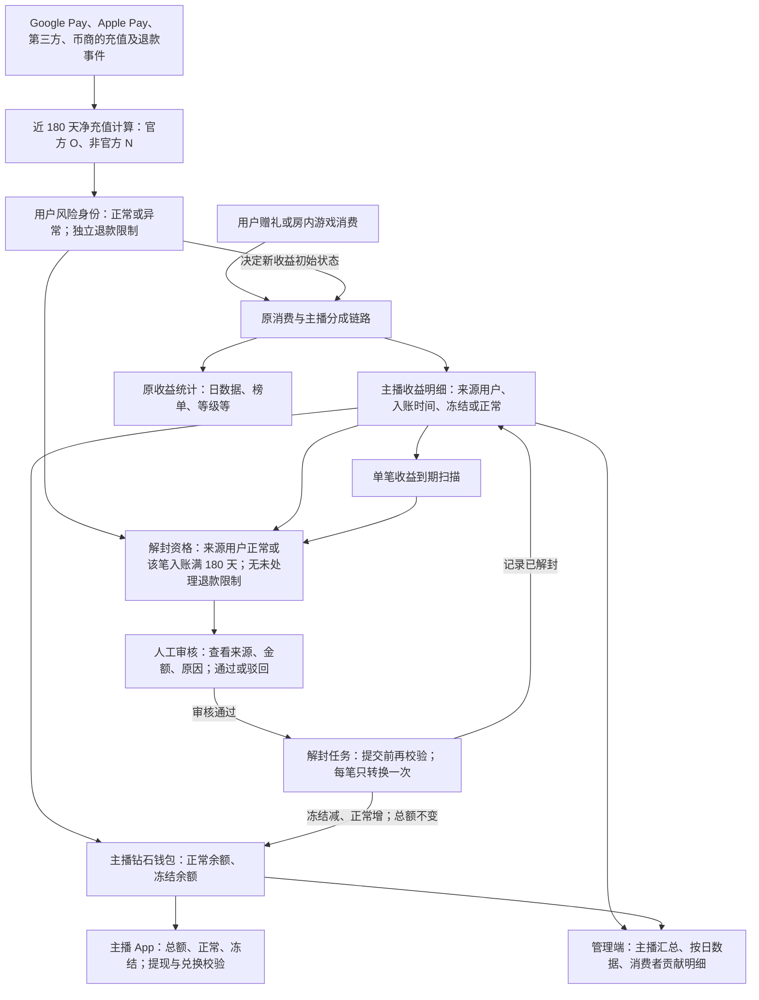
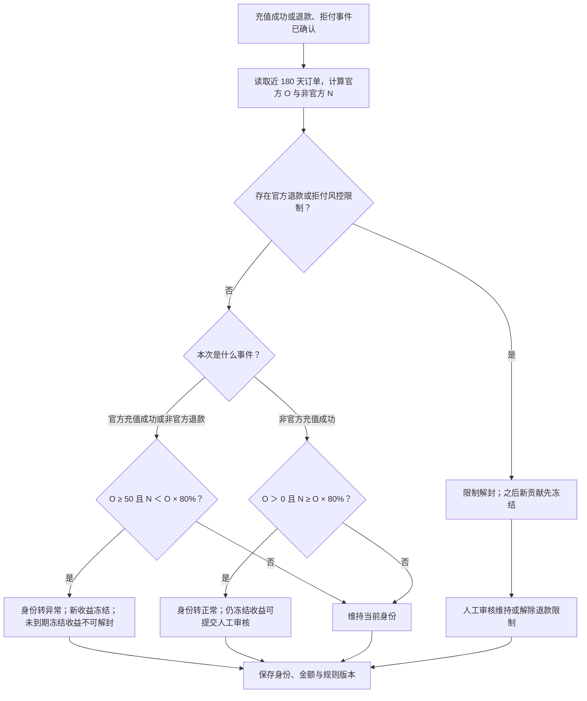
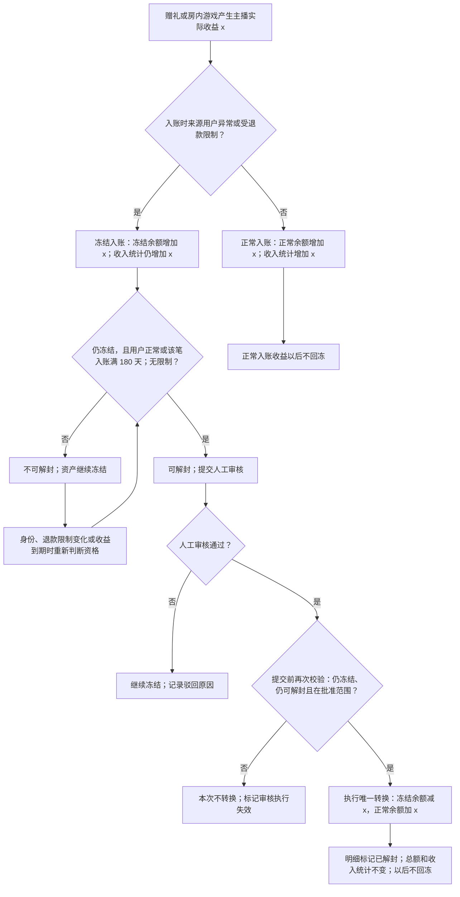

# 官方充值风险收益冻结核心设计

## 1. 文档信息

| 项目 | 内容 |
| --- | --- |
| 文档状态 | 核心设计稿，待产品、风控、财务和研发评审 |
| 设计范围 | 充值用户风险状态、主播收益冻结与解封、退款处理、统计口径、App 数据展示、管理端查询能力 |
| 本版不包含 | 页面布局、交互原型、视觉设计、接口字段类型及数据库建表语句 |
| 规则窗口 | 最近 180 天 |
| 货币口径 | 充值金额统一折算为美元；主播收益与冻结余额使用钻石原始数量 |

## 2. 目标与原则

Google Pay、Apple Pay 官方充值存在付款后退款或拒付的风险。当用户最近 180 天官方净充值达到门槛，且第三方与币商的净充值不足官方净充值的 80% 时，将其后续贡献给主播的收益暂时冻结。非官方充值达标，或某笔冻结收益入账满 180 天后，系统将符合条件的未解封收益标为可解封；**所有实际解封均须人工审核通过**。

本功能只改变**主播收益的可支配状态**，不改变赠礼、房内游戏消费、主播收入、榜单、等级和日统计的原有收入确认金额。冻结钻石不能用于提现或兑换金币。风险判定是**用户级**规则，并不宣称能精确识别某笔消费实际消耗了哪笔充值所得金币。

### 2.1 核心架构：做什么、怎么做

| 要做什么 | 怎么做 |
| --- | --- |
| 判断用户风险身份 | 从充值及退款订单计算近 180 天官方净充值 `O`、非官方净充值 `N`，在资金事件确认时切换身份。 |
| 决定新主播收益是否冻结 | 赠礼或房内游戏产生主播直接收益时读取来源用户身份，逐笔标记正常或冻结，并分别记入主播正常、冻结余额。 |
| 解封存量冻结收益 | 用户转正常或单笔冻结收益入账满 180 天时标记可解封；人工审核通过后逐笔转换一次。 |
| 展示与限制 | 收入统计保持原口径；主播 App、提现兑换和管理端从收益明细与钱包余额读取冻结状态。 |

读图顺序：**充值事件决定来源用户身份 → 消费入账时决定该笔收益的初始状态 → 转正常或单笔到期产生解封资格 → 人工审核通过后解封**。解封资格可以随身份变化，但收益本身只允许“冻结 → 正常”一次。原收入统计从消费与分成链路读取，不因冻结或解封重复计收。

## 3. 范围与术语

| 术语 | 定义 |
| --- | --- |
| 官方渠道 | Google Pay、Apple Pay，两个渠道合并统计。 |
| 非官方补充渠道 | 第三方充值、币商充值，两个渠道合并统计。其他渠道须先完成渠道映射，不得默认归入任一组。 |
| 官方净充值额 `O` | 评估时点最近 180 天内，官方渠道成功充值金额扣除该订单已发生的退款、撤销、拒付后的美元金额之和，最低为 0。 |
| 非官方净充值额 `N` | 同期第三方及币商成功充值金额扣除该订单已发生的退款、撤销、拒付后的美元金额之和，最低为 0。 |
| 异常充值用户 | 资金事件评估时命中 `O ≥ 50 美元` 且 `N < O × 80%` 的用户；`N = 0` 的纯官方充值用户包含在内，少量非官方充值不能使用户免于判定。已产生的冻结收益不会仅因 180 天窗口自然滚动而自动解封。 |
| 冻结收益 | 异常状态期间，该用户赠礼或在主播房内游戏而直接贡献给主播、已按原业务规则计入主播账户但暂不可提现或兑换的钻石收益。 |
| 正常收益 | 未被本规则冻结的主播钻石收益，包括已完成解封的收益。 |
| 可解封 | 一笔仍冻结的收益，其来源用户当前正常，或该笔主播收益入账已满 180 天，且没有未处理退款风控限制；表示可以提交人工审核，尚未代表审核通过或钻石已经解封。 |
| 到期时间 | 该笔主播收益的成功入账时间加 180 × 24 小时；到期规则按每笔收益分别计算，与充值判定使用的近 180 天窗口不同。 |
| 入账时间 | 主播钻石收益账务记录成功入账的时间；管理端日期筛选和按日汇总均以此时间为准。 |

充值订单使用支付成功时锁定的美元金额及订单渠道。平台赠币、金币转账、钻石兑换金币、返奖和运营奖励不属于充值。用户画像现有“成功充值”汇总在退款后不回减，**不得**直接作为本规则的 `O`、`N` 数据源。

## 4. 风险状态与转换

### 4.1 用户状态与收益状态

用户仅有“正常”“异常”两种充值风险身份；官方退款、拒付另设独立的风控限制标记，不创建“风险周期”。在充值事件评估时，`O ≥ 50 美元` 且 `N < O × 80%` 则转异常；非官方充值成功后，若 `O > 0`、`N ≥ O × 80%` 且无退款风控限制则转正常。**尚未触发本规则**且官方净充值未达到 50 美元的用户按正常处理。充值判定窗口自然过期不自动切换用户身份；单笔冻结收益入账满 180 天则走独立的到期送审规则。

每笔主播收益的**实际资产状态**只有“正常入账”“冻结中”“已解封”。正常入账的收益不受本功能影响；冻结中的收益最多执行一次“冻结中 → 已解封”。**收益状态只能从冻结变为正常，不能从正常变为冻结**；已经正常入账或已解封的收益均不得因来源用户身份变化或充值退款而回冻。

冻结明细增加“是否可解封”及“可解封原因”，只对**仍处于冻结中**的收益有意义。来源用户转正常时，仍冻结收益因“充值达标”可解封；单笔入账满 180 天时，即使来源用户仍异常，该笔也因“收益到期”可解封。未到期明细若在审核、执行前遇到来源用户再次异常，则恢复不可解封；已到期明细的资格不受身份再次异常影响。退款风控限制未解除时，两条路径均不得直接解封。这里变化的是**审核资格**，不是钻石资产状态；每笔收益不会在正常与冻结之间反复转换。

每次评估保存用户 ID、身份、触发时间、`O`、`N`、规则版本、计算时间和触发事件。充值金额仅统计成功且未退款的净额，未成功的订单不计入。

### 4.2 判定时机

1. 官方或非官方充值成功、退款、撤销、拒付确认时，立即重算并记录状态变化；退款、拒付的独立风控限制优先于比例判断。
2. 赠礼或房内游戏产生主播直接收益时，按入账时最新已提交的用户风险状态决定是否冻结；充值事件与收益入账按用户维度保证顺序一致。
3. 资金事件补偿任务负责发现遗漏与金额差异，不仅因充值 180 天窗口自然滚动就反复切换身份；另设收益到期任务，按每笔入账时间扫描满 180 天且仍冻结的收益，标为可解封并进入人工审核队列。重复任务不得再次入账或解封。
4. 180 天窗口按评估时点向前滚动，使用充值支付成功时间；日汇总按平台统一业务时区切分。

用户进入异常前已经入账的主播收益**不追溯冻结**。用户转正常时，该用户贡献给**所有主播**且仍处于冻结状态的收益变为可解封；单笔冻结收益入账满 180 天时也变为可解封。两种情况均需人工审核通过后由系统执行解封。解封只改变可支配状态，不产生第二笔主播收入。

充值订单移出近 180 天判定窗口，**不等于**冻结收益已入账满 180 天。系统不得仅因 `O` 自然降为 0 就按 80% 比例把用户转正常；此时未到期收益继续冻结，已入账满 180 天的收益按到期规则送人工审核。来源数据不完整或存在退款争议时，先进入人工风险处理，不自动放行。

用户转正常后若新增官方充值导致 `O ≥ 50 美元` 且 `N < O × 80%`，或非官方充值退款导致比例不足，则重新变为异常，**从状态变更后的新收益开始冻结**；此前已解封收益不回冻，尚未解封且未到期的收益变为不可解封，已到期收益仍可按到期原因送审。实际退款、拒付按第 6 节另行处理。

### 4.3 用户身份转换流程

身份只在已确认的资金事件后切换；**充值**180 天窗口自然滚动不单独改变身份。**收益**入账满 180 天由到期任务单独标为可解封，并须人工审核。官方退款、拒付是独立限制，不能利用官方净充值减少来满足 80% 条件并自动释放收益。

### 4.4 示例

同一用户 A 的身份可以随充值事件反复切换，但**每笔主播收益的资产状态最多改变一次**：

| 顺序 | 用户 A 的事件与身份 | 对主播的这笔贡献收益 |
| --- | --- | --- |
| 1 | A 当前正常，发生消费 | 正常入账，此后不会因 A 的身份变化而冻结。 |
| 2 | A 官方充值后达到异常条件，身份转异常；随后发生消费 | 新收益冻结，暂不可提现或兑换。 |
| 3 | A 通过第三方或币商充值达到 80%，身份转正常 | 将 A 此前贡献给所有主播、**仍冻结**的收益设为可解封；人工审核通过后执行解封。步骤 1 的正常收益不变。 |
| 4 | A 在正常身份下继续消费 | 新收益正常入账；步骤 3 已解封收益保持正常。 |
| 5 | A 再次官方充值后重新达到异常条件，随后消费 | 仅这次及之后异常期间的新收益冻结；步骤 1、3、4 的正常收益不回冻。未到期且尚未审核解封的收益恢复不可解封；入账满 180 天的收益仍可按到期原因送审。 |

“可解封”只描述能否提交审核。若 A 在审核或执行前又转异常，**未到期**且尚未解封的明细恢复不可解封；已到期明细仍可送审，已完成解封的明细保持正常。

| 事件 | `O` | `N` | 结果 |
| --- | ---: | ---: | --- |
| 近 180 天 Google Pay 充值 50 美元，未用其他渠道 | 50 | 0 | 变为异常；之后新入账的主播收益冻结。 |
| 上例再通过币商充值 30 美元 | 50 | 30 | 60%，继续冻结。 |
| 再通过第三方充值 10 美元 | 50 | 40 | 达到 80%，转正常；所有尚未解封的收益变为可解封，等待人工审核。 |
| 审核或解封任务尚未完成前通过 Apple Pay 充值 20 美元 | 70 | 40 | 重新异常；未到期且尚未解封的收益变为不可解封，已到期收益仍可送审，已解封收益不回冻，新收益冻结。 |

## 5. 主播钻石账务

### 5.1 余额与操作限制

主播当前钻石总额 = 正常钻石余额 + 本规则冻结钻石余额。正常钻石表示未被本规则限制的余额；实际可提现、可兑换量仍须扣除现有提现占用、其他冻结等限制。

每笔受本规则影响的主播收益保留原业务流水号、消费用户 ID、主播 ID、入账时间、业务类型、主播实际收益钻石数、风险状态与规则版本。原有赠礼、房内游戏消费、主播收益分成和公会分层计算均保持原口径。

| 账务动作 | 钻石总额 | 正常余额 | 冻结余额 | 统计收入 |
| --- | ---: | ---: | ---: | ---: |
| 异常用户贡献主播收益 `x` | `+x` | 不变 | `+x` | `+x` |
| 正常用户贡献主播收益 `x` | `+x` | `+x` | 不变 | `+x` |
| 冻结收益解封 `x` | 不变 | `+x` | `-x` | 不变 |
| 原消费订单退款并冲正未解封收益 `x` | `-x` | 不变 | `-x` | 按原退款口径冲正 `x` |
| 原消费订单退款并冲正正常或已解封收益 `x` | `-x` | 按原退款规则扣减 | 不变 | 按原退款口径冲正 `x` |

提现申请和钻石兑换金币都必须在最终扣钻交易中校验正常可用余额，不能只在按钮或申请入口校验。并发提现、兑换和解封必须保持 `冻结余额 ≥ 0`、`正常余额 ≥ 0`，且同一收益不可重复解封或重复冲正。

### 5.2 收益范围

本期冻结该消费用户直接贡献给主播的**全部主播直接收益**：普通礼物、幸运礼物及其他赠送行为产生的主播钻石收益，以及用户在主播房内游戏产生的主播钻石分账。以实际计入主播账户的钻石数为准，不以用户消耗的金币或礼物面值代替。房外游戏不产生主播收益，因此无可冻结金额；公会及上级公会分层、任务奖励、榜单奖励不纳入本期冻结。

同一笔消费对应多名受益主播时，按实际入账的每条主播收益分别标记。金币转账后的资金来源无法由本用户级规则直接归因，暂以**实际消费用户 ID**作为收益来源。

### 5.3 解封资格与执行

冻结明细展示“可解封 / 不可解封”及原因；系统在用户身份切换或单笔收益到期时更新资格。资格须满足：**明细仍冻结、来源用户当前正常或该笔收益入账满 180 天，且没有未处理退款风控限制**。它只表示可提交人工审核，不代表钻石已转为正常。查询可使用资格投影，但审核和账务提交时必须按实时身份、到期时间及退款限制重新校验，不能仅依赖旧标记。

所有解封均由授权人员审核。可按消费用户和同一触发原因汇总发起一项审核申请，列出涉及主播、收益流水、入账时间、冻结钻石数、可解封原因、充值与退款证据；一次审核可覆盖多笔明细，但须保存本次批准的**明细 ID 与金额快照**。审核结果为通过或驳回，均记录审核人、时间和理由；驳回后收益继续冻结，可在条件变化或补充证据后重新提交。

审核通过后，系统仅对批准范围内且提交时仍符合资格的明细执行解封。以原主播收益流水号为幂等键，单笔明细只允许一次“冻结中 → 已解封”；失败可重试且不重复增加正常余额。若用户在审核或执行前又变异常，**未到期**明细停止解封，已到期明细仍可依据到期资格执行；若出现新的未处理退款限制，则全部停止，待人工处理。审核通过但因资格变化未执行的明细须显示“执行失效/待重新审核”，不能把旧批准自动用于以后再次可解封的收益。

若解封任务处理中资格变化，可能出现同一来源用户的部分收益已解封、其余仍冻结。这是按单笔提交时间形成的结果：已提交收益保持正常，未提交收益继续冻结；管理端须能分别查到两类明细及对应操作时间。尚未完成解封的冻结余额仍不能提现或兑换。

### 5.4 主播收益冻结与解封流程

图中“可解封 / 不可解封”只是**仍冻结明细的审核资格**，不是反复转换收益。用户再次异常时，未到期明细失去资格；已到期明细仍可送审。任何收益均须人工审核通过才能实际解封；已经正常入账或已解封的收益保持正常。

## 6. 退款、拒付与异常处理

1. **充值订单退款不等于消费订单退款。** 官方充值退款、拒付只改变风险依据并触发风控复核，不能直接把已经完成的赠礼或房内游戏交易从收入统计中删除。若消费订单本身退款，才按原消费及主播收益冲正规则处理。
2. 已触发本规则的用户发生官方充值退款、拒付时，设置独立的退款风控限制；尚未解封收益保持冻结且不可解封，之后新增贡献先冻结，不因官方净充值额下降使 80% 比例看似达标而自动解封。未触发本规则的用户仍按现有退款风控流程处理，不因小额退款直接触发本功能的主播收益冻结。
3. 对已正常入账或已解封的收益，**不重新冻结**，也不从主播其他正常收益中自动扣减。系统识别关联主播与金额，记录已释放但遭遇来源充值退款的风险敞口；已提现、已兑换的部分同样纳入敞口分析。其他处置由授权人员按独立风控流程决定，不改变本功能的单向收益状态规则。
4. 退款风控限制只能由授权人员审核解除或维持。解除时先按当前 `O`、`N` 重新评估用户身份，再计算各笔冻结收益的资格：来源用户正常或该笔已入账满 180 天的明细可提交解封审核，其余继续冻结；解除限制本身不自动增加主播正常余额。同一审核操作可以同时批准明确列出的可解封明细，但必须分别记录“解除限制”和“批准解封”的结论、范围及证据。
5. 风控处理记录原充值订单、消费用户、关联收益、仍冻结额、已解封额、已提现或已兑换敞口、处理人、处理结果与时间。后续独立处置如涉及账务，必须有单独审核与流水，不以“收益回冻”实现。
6. 非官方充值退款导致不足 80% 时，从退款确认后的新贡献重新冻结；若同时存在官方退款、拒付，则优先处理退款风控限制。

“第三方及币商充值达到官方充值额 80%”是约定的状态转正常门槛，**不是官方充值不可退款的保证**。实际退款必须保留上述独立处置链路。

## 7. 统计与展示数据

### 7.1 统一统计口径

赠礼和房内游戏的主播直接收益入账时，无论正常或冻结，都按原主播实际收益计入直播间收益、主播日数据、榜单、等级及经营统计。冻结和解封本身不新增消费、收入或排名分数。原消费订单退款继续沿用现有统计回刷或冲正机制。

按入账日查看时：

`当日总钻石 = 当日已确认钻石 + 当日冻结钻石`

这里的“已确认/冻结”是**查询时点当前状态**对该入账日收益的分类。历史某日的冻结收益后来解封，该日“已确认”增加、“冻结”减少，“总钻石”不变；若需要审计过去某时点状态，读取状态变更流水，而不是用当前汇总倒推。

### 7.2 主播 App 数据能力

主播可查看当前钻石总额、正常钻石余额、冻结钻石余额。冻结余额需明确提示“暂不可提现或兑换金币”；提现与兑换入口的可操作金额以最终可用余额校验为准。余额数据与钱包同源，避免出现页面展示已解封而交易仍拒绝的长期不一致。

### 7.3 管理端冻结钻石查询能力

此处定义数据和查询能力，不规定页面布局或原型。

- 主列表按**主播 ID 一人一条**汇总，字段为主播 ID、主播国家、当前冻结钻石数量；默认仅展示有冻结余额的主播。列表中的“用户 ID”筛选指**主播 ID**，另支持入账时间段、主播国家筛选；国家使用主播注册国家，与现有主播日数据口径一致。
- 入账时间段作用于原主播收益的成功入账时间，冻结数量展示这些收益在**查询时点仍冻结**的余额。点击某主播后，仅查看该主播对应的数据。
- 主播冻结日数据可按入账时间段筛选，按入账日期显示日期、总钻石、已确认钻石、冻结钻石；三列按同一组有效收益记录计算，满足总额等于后两列之和。
- 点击某日进入具体明细，默认查看该主播、该入账日的消费者贡献。具体明细支持按**消费者 UID**和入账时间段进一步筛选；消费者 UID 不作为主播冻结钻石主列表的筛选条件。
- 具体明细至少显示消费者 UID、消费者昵称、业务类型、该用户贡献给主播且当前仍冻结的钻石数；为解释结算，还需保留收益流水号、入账时间、到期时间、收益是否已解封、仍冻结收益的**是否可解封**、可解封原因及对应数额。同一消费者当日多笔赠礼或房内游戏消费可汇总，但必须能按业务类型追溯逐笔流水。具体明细默认汇总的是当日**冻结钻石**，与上级日数据的“冻结钻石”对账；“总钻石”另含已确认收益，不要求仅靠冻结明细求和。
- 下钻时继承主播范围和上级时间条件，明细筛选只进一步缩小结果。历史解封行为通过状态变更流水审计，不把已解封收益伪装成当前冻结。
- 管理端另需解封审核能力：查看按消费用户汇总的可解封明细、可解封原因（充值达标或收益到期）、涉及主播及金额、退款限制与证据；授权人员可通过或驳回，并查看审核历史、执行结果和失败原因。此处只定义能力，不规定页面原型。

## 8. 数据保存、对账与上线

1. 充值判定读取原始订单与退款、拒付事件，保存渠道分组及美元净额，不使用仅按支付成功累计的用户画像展示字段。
2. 每条主播直接收益需要长期保留消费用户与收益流水的关联、业务类型、入账及到期时间、是否已解封、资格原因、审核记录、状态变化流水及解封执行记录；仍冻结明细的可解封资格按来源用户当前身份、该笔到期时间和退款限制共同判断。当前金币和钻石逐笔流水只保留 60 天，无法支撑 180 天窗口与长期冻结查询；本功能的必要明细须独立留存，未结清冻结及其审计记录不得随 60 天清理。
3. 系统按每笔入账时间计算到期时间，并定时扫描到期且仍冻结的明细，生成或更新可解封资格及待审核记录；重复扫描不得重复创建审核申请、重复批准或重复解封。
4. 每日对账：主播钻石总余额与正常、冻结分类相符；冻结明细之和与主播冻结余额相符；已审批解封执行额与钱包状态变更额相符；管理端主列表与日数据的冻结额、日数据冻结额与具体明细逐层可汇总。日数据总额按原全部有效收益记录另行对账。
5. 上线时用近 180 天订单为用户初始化风险状态。按照已确认口径，**不追溯冻结上线前已入账收益**；上线后新入账收益执行新规则。初始化期间的支付、退款、赠礼和房内游戏事件需要连续消费并校对，避免切换窗口漏判。
6. 规则阈值、渠道映射和规则版本留存变更记录；调整门槛时先制定存量冻结收益的迁移策略，不直接用新规则覆盖旧批次审计事实。

## 9. 验收重点

1. Google Pay 与 Apple Pay 合并净充值达到 50 美元，且第三方与币商合并净充值不足官方金额的 80% 时，后续赠礼及房内游戏产生的主播直接收益冻结；少量非官方充值不能绕过判定，官方净充值低于 50 美元不触发。
2. 第三方与币商可合并达到官方净充值额的 80%；不足时保持异常，达标后所有仍冻结收益变为可解封，但**审核通过前余额仍冻结**；审核通过并执行后收入统计不重复增加。
3. 异常触发前的历史收益不被追溯冻结；用户再次异常时，仅新入账收益冻结，旧的未到期、未解封收益变为不可解封，已到期收益仍可送审，已正常入账或已解封收益均不回冻。
4. 每笔冻结收益入账满 180 天时由系统标为可解封，即使来源用户仍异常也可提交人工审核；审核驳回、未审核或执行失败时余额继续冻结，不因到期自动转为正常。
5. 官方充值自然移出窗口使 `O = 0` 时，不能用零门槛把用户转正常或把未到期收益送审；仅每笔已到期收益可按到期原因进入人工审核。
6. 冻结钻石无法提现或兑换；并发操作也不能绕过最终余额校验。
7. 官方退款、拒付不会因 `O` 下降而自动解封；退款限制由人工审核解除，所有收益的实际解封另需明确审核批准。已正常入账或已解封收益不回冻，赠礼或房内游戏消费退款按原收益流水准确冲正一次。
8. 管理端主列表按主播 ID、入账时间段和主播国家筛选；具体明细按消费者 UID 筛选。主播汇总、日数据和消费者贡献明细的**冻结额**逐层一致；历史解封后总收入不变、当前冻结余额减少。
9. 重复支付回调、重复退款通知、重复消费消息、到期扫描、审核提交和解封任务重试均不产生重复入账、重复解封或负余额。

## 10. 上线前待确认事项

| 优先级 | 事项 | 当前设计及需要确认的决定 |
| --- | --- | --- |
| P0 | 人工审核责任与处理时限 | 已确认所有实际解封均需人工审核。上线前需指定可审核角色、是否需要复核、待审处理时限与逾期提醒；系统不得因审核超时自动解封。 |
| P1 | 异常充值用户列表与白名单 | 参考图含异常充值用户列表和白名单，但本需求已明确的管理端范围是主播冻结钻石及下钻明细。需确认异常用户列表、白名单是否纳入本期，以及白名单是否允许绕过冻结、是否追溯解封。 |
| P1 | 金币转账后的资金来源 | 当前按实际消费用户 ID 判定；异常用户先把金币转给另一账户再由其送礼，不能被本用户级规则穿透识别。若要覆盖该路径，需增加资金来源追踪规则。 |
| P1 | 基础技术口径 | 开发前与现有系统统一平台业务时区、美元汇率锁定点、钻石精度及取整顺序、其他支付渠道映射、明细留存年限、授权人工处置角色与审批流程。 |
