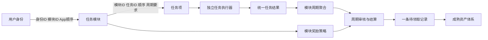
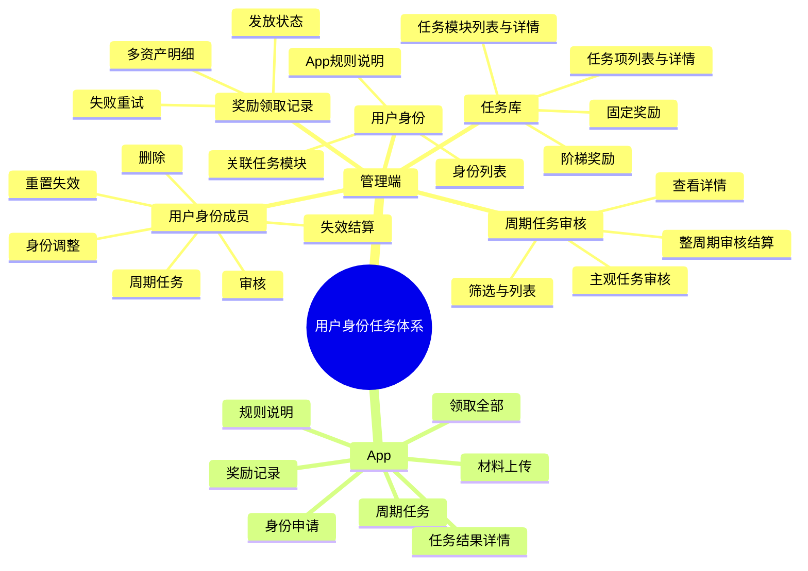
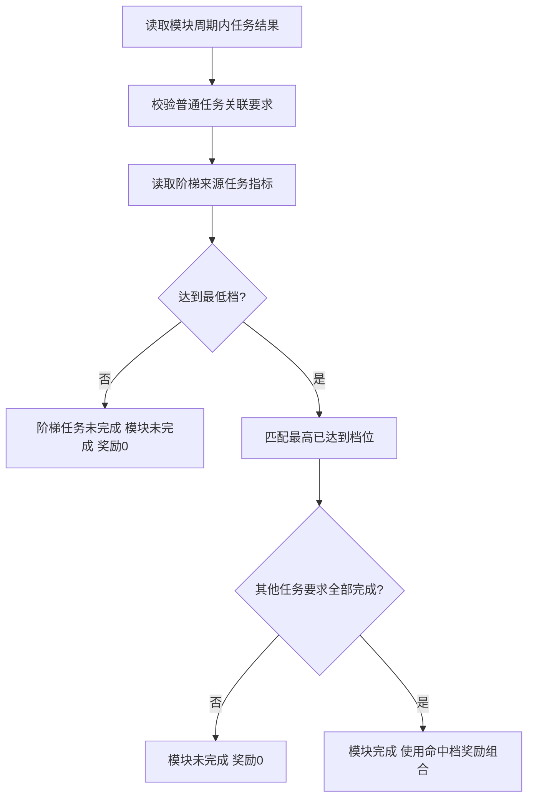
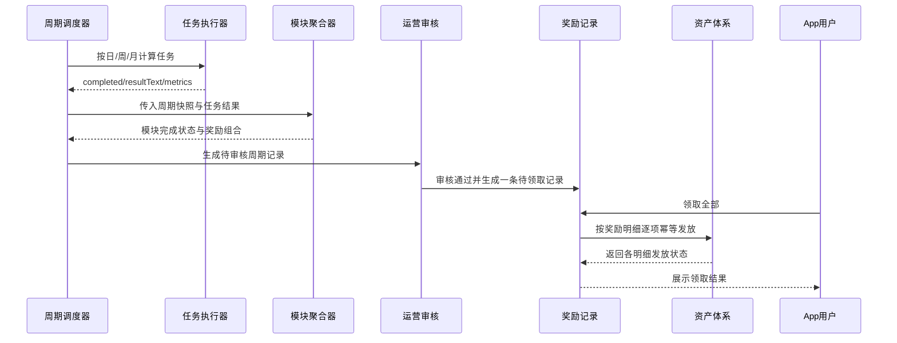

# 用户身份任务体系

## 1. 需求概述

### 1.1 核心描述

建设一套可复用、可扩展的“用户身份—任务模块—任务项—周期结果—奖励领取”体系。用户身份只表示用户当前拥有什么身份；身份关联的任务模块决定用户可完成哪些任务、模块如何完成以及完成后获得什么奖励；任务项由独立执行器计算并输出统一结果，不直接配置奖励。

首期以普通优质主播、黄金优质主播、外部认证主播、签约主播等身份落地，后续可继续扩展超级主播、地区计划、活动身份和其他用户任务场景。

### 1.2 核心要点

1. 用户身份只关注“有哪些身份”，不保存任务完成逻辑和奖励逻辑。
2. 身份与任务模块的关联只保存身份ID、模块ID和App展示顺序。
3. 任务模块关注“由哪些任务组成、怎样算完成、完成后奖励什么”。
4. 任务项关注“具体任务是什么、输入参数是什么、调用哪个执行器、输出什么结果”，任务项不配置奖励。
5. 模块内所有关联任务要求全部完成，模块才完成并获得该模块奖励；任意一项未完成，该模块奖励为0。
6. 日、周、月任务结果可以被上级周期模块复用，不同模块可对同一个小周期任务设置不同的最少完成周期数和连续要求。
7. 模块奖励支持无奖励、固定奖励和按任务指标阶梯奖励；奖励是多资产组合，不局限于单一金额。
8. 周期结算审核通过后，一个用户的一个周期只生成一条待领取记录，记录内包含多个资产明细，用户一次领取。
9. App完成申请、查看身份、查看周期任务、提交主观材料、查看结算结果和主动领奖。

## 2. 设计边界

### 2.1 本期包含

- 用户身份配置及身份与任务模块关联。
- 公共任务库：任务项和任务模块。
- 日、周、月周期配置与结果复用。
- 用户身份申请审核、身份调整、失效、重置失效、失效结算和周期任务查看。
- 周期任务审核、主观任务逐项审核、整周期通过或不通过。
- 多资产奖励结算、待领取记录和App主动领取。
- App身份申请状态、周期任务、任务详情、材料上传、规则说明和奖励记录。

### 2.2 本期不包含

- 独立的申请审核日志页面。
- 身份层级变更记录页面。
- 运行周期实例作为配置项。
- 运营直接编辑任务参数JSON或奖励策略JSON。
- 任务项直接配置奖励。
- 模块角色、基础门槛、前置任务、完成策略、奖励资格策略及相关依赖开关。

## 3. 总体架构



### 3.1 三个核心配置对象

| 对象 | 关注点 | 不负责 |
| --- | --- | --- |
| 用户身份 | 身份名称、编码、状态、资格说明、App规则 | 任务计算、模块完成、奖励计算 |
| 任务模块 | 模块周期、任务组成、关联任务的完成要求、奖励策略 | 具体任务指标计算 |
| 任务项 | 任务周期、任务类型、执行器、参数JSON、结果结构、描述 | 奖励配置、跨周期聚合 |

### 3.2 关系模型

#### 用户身份—任务模块关系

- identityId。
- moduleId。
- appDisplayOrder。

不增加“是否为基础门槛”“是否依赖基础模块”“是否前置”等字段。

#### 任务模块—任务项关系

- moduleId。
- taskId。
- taskDisplayOrder。
- minimumCompletedPeriods：至少完成N个小周期。
- consecutiveRequired：是否要求连续完成。

当任务周期与模块周期相同时，固定使用一次任务结果，页面不展示完成周期数和连续配置。

## 4. 功能导图



## 5. 周期模型

### 5.1 周期类型

任务项和任务模块均配置周期类型：

- DAY：日。
- WEEK：自然周，周一至周日。
- MONTH：自然月。

实际周期标识、周期起止时间和运行实例只存在于快照、任务结果和执行日志中，不属于配置数据。

### 5.2 模块包含任务的约束

| 模块周期 | 允许关联的任务周期 |
| --- | --- |
| 日 | 日 |
| 周 | 日、周 |
| 月 | 日、周、月 |

禁止日模块关联周/月任务，禁止周模块关联月任务。

### 5.3 相同周期任务

模块与任务周期相同，固定使用该周期唯一任务结果：

- 不配置完成数量。
- 不配置是否连续。
- 任务结果完成，即该项模块要求完成。

### 5.4 小周期任务聚合

当模块关联更小周期任务时，配置：

- 最少完成周期数：表示至少完成N个周期，不要求刚好N个。
- 是否连续：为“是”时，使用最长连续完成周期数判断。
- 连续完成不能跨当前模块周期边界。

例如，周模块关联“每日高峰直播满2小时”：

- 模块A可配置至少完成3天、不要求连续。
- 模块B可配置至少完成6天、要求连续。
- 两个模块复用同一组日任务结果，但分别计算各自的完成结论。

运行时聚合摘要至少包含：

```json
{
  "requiredCount": 6,
  "completedCount": 6,
  "maxConsecutiveCount": 4,
  "consecutiveRequired": true,
  "completed": false,
  "resultText": "完成6天，最长连续4天，要求连续6天"
}
```

### 5.5 周任务归属月份

月模块关联周任务时，按“周日所在月份”确定周任务归属。该规则用于月周期聚合，避免跨月自然周被拆分或重复计算。

### 5.6 调度与汇总时点

- 日任务：今天计算昨天的数据。
- 周任务：下周一计算上周一至周日的数据。
- 月任务：下月1日计算上一个自然月的数据。
- 任务执行器只计算自身任务周期；模块聚合器负责最少完成周期数和最长连续周期数。
- 业务结果进入任务结果快照；执行尝试、异常与重试进入执行日志。

## 6. 任务项策略

### 6.1 任务项字段

- 任务名称。
- 任务标识，系统内唯一。
- 任务周期：日、周、月。
- 任务类型：程序自动计算、材料审核、运营主观评审。
- 执行器编码。
- 任务参数JSON，由技术维护。
- 结果结构JSON，由技术维护。
- 运营说明。
- 用户说明。
- 是否启用。

不独立配置目标值、目标单位和比较方式；这些内容由对应任务执行器在任务参数JSON中约定。

### 6.2 统一输出

所有执行器必须输出：

- completed：是否完成，用于系统状态判断。
- resultText：结果文本，供运营和用户阅读。
- metrics：结构化业务指标，可供阶梯奖励策略引用。
- detailResults：可选明细，例如每日完成情况。

示例：

```json
{
  "completed": true,
  "resultText": "高峰直播132/120分钟",
  "metrics": {
    "peakLiveMinutes": 132
  },
  "detailResults": [
    {"date": "2026-09-15", "completed": true, "text": "132/120分钟"}
  ]
}
```

### 6.3 技术与运营分工

- 技术维护任务标识、参数JSON、结果结构JSON和执行器实现。
- 运营选择公共任务项、配置模块关联关系、最少完成周期数和连续要求。
- 运营不填写原始JSON，也不修改程序自动计算结果。
- 材料审核和运营主观评审任务由运营在周期任务详情中给出最终结果。

## 7. 任务模块策略

### 7.1 基础字段

- 模块名称、模块编码、图标、备注、是否启用。
- 模块周期：日、周、月。
- 关联任务项及App展示顺序。
- 小周期任务的最少完成周期数、是否连续。
- 奖励策略编码和奖励策略JSON。

具体任务项不配置图标。

### 7.2 模块完成规则

模块内所有关联任务要求全部完成，模块才完成并可获得奖励。任意任务要求未完成：

- 该模块状态为未完成。
- 该模块结算奖励为0。
- 保留每个任务真实完成结果和结果文本。
- 不影响同一周期中其他模块的完成和奖励。

### 7.3 奖励策略

#### 无奖励 `NO_REWARD`

模块完成后不产生资产奖励，可用于纯任务展示或资格记录。

#### 固定奖励 `FIXED_REWARD`

运营通过结构化表单配置一个或多个奖励明细；系统生成策略JSON，不要求运营直接编辑JSON。

#### 按任务指标阶梯 `TIER_BY_TASK_METRIC`

配置一个来源任务和一个指标字段，并维护多个档位。规则如下：

1. 来源任务执行器输出原始指标。
2. 最低档阈值同时作为该阶梯任务的完成条件，不在任务参数中重复配置。
3. 达到最低档，阶梯任务即完成。
4. 达到更高档只改变奖励组合，不改变完成次数。
5. 取最高已达到档位，低档奖励不累计。
6. 模块内其他任务要求也必须全部完成，模块才最终完成并发放命中档奖励。



### 7.4 多资产奖励组合

模块奖励可组合以下成熟资产：

- COIN：金币。
- DIAMOND：钻石。
- EXP：经验，进入已有等级体系。
- POPULARITY：热度，开直播时用于热度加成。
- WEARABLE_ITEM：穿戴道具，配置资源、数量和有效期。
- LIVE_ROOM_GIFT：直播间礼物，配置资源和数量。

任务体系只负责配置、快照、结算和调用；实际入账、过期和使用规则由对应成熟资产体系负责。

## 8. 用户身份配置

### 8.1 身份列表

首期身份包括：

- 普通优质主播。
- 黄金优质主播。
- 超级主播。
- 外部认证主播。
- 签约主播。

列表展示身份名称、编码、资格方式、关联模块数、按资产分类的周期最高奖励、成员数和状态。

### 8.2 身份关联模块

每个身份关联多个公共任务模块，并配置App展示顺序。任务组成、模块周期和奖励策略来自任务库，身份页面只读展示。

### 8.3 App规则说明

每个身份独立维护App规则章节，至少包含：

- 身份资格。
- 任务周期与完成方式。
- 模块奖励策略。
- 周期审核与结算。
- 主动领取奖励。
- 升级、降级与失效。

## 9. 用户身份成员

用户身份成员与申请审核合并为一个页面，不设置独立申请审核菜单。筛选包含用户ID、用户身份、审核状态和生效周期。

### 9.1 操作

- 审核：只要身份申请或身份数据存在即提供。
- 身份调整：仅当前状态为审核通过时提供，选择新身份和生效起始周期。
- 重置失效：清除失效后7天才能重新提交的限制。
- 失效结算：立即执行失效；可填写结算奖励和备注，存在奖励时生成待领取记录。
- 删除：删除符合业务条件的记录。
- 周期任务：加载该用户当前周期任务数据。

### 9.2 审核规则

审核弹窗支持通过、失效、禁止，三种结果均可填写用户可见备注：

- 通过：必须设置生效起始周期。
- 失效：7天后用户可重新提交。
- 禁止：用户无法再次提交。

新人审核在每周周一完成，审核通过后从下一完整自然周期生效，不生成不完整周期任务。

升级、降级和失效以下一周期生效；当前周期允许运营手动调整，但必须明确新的生效起始周期。

## 10. 快照、计算与审核

### 10.1 周期快照

身份生效时按模块周期生成快照，快照保存：

- 用户身份快照。
- 关联任务模块快照。
- 模块周期、任务关系及最少完成周期数、连续要求。
- 任务项配置和任务参数JSON快照。
- 奖励策略编码、策略JSON及多资产奖励明细快照。

后续配置修改不回写已生成周期快照。

### 10.2 数据汇总

- 其他时间按每日结算节奏更新可计算数据。
- 周一重新汇总上一自然周全部指标。
- 月初重新汇总上一自然月全部指标。
- 允许在审核前对延迟数据重新计算。
- 审核通过并结算后，业务结果冻结；必要的补偿通过独立补偿流程处理。

### 10.3 周期任务审核列表

筛选条件：

- 模块周期。
- 任务周期范围。
- 用户身份。
- 用户ID。
- 状态。

列表展示全部用户周期任务记录，操作为查看、审核。列表页不在底部加载某个用户的任务详情。

### 10.4 周期任务结果页

查看与审核使用同一详情页：

- 查看模式只读，不能操作任务或整周期结果。
- 审核模式对材料审核、运营主观评审任务显示逐项审核操作。
- 程序自动任务只展示执行器计算结果，运营理论上不修改。

任务数据展示任务周期、模块内要求、实际完成周期数、最长连续周期数、是否完成、结果文本和明细。

整页快捷操作：

- 审核通过并生成待领取记录。
- 审核不通过。
- 通过和不通过均可填写用户可见审核理由。

所有模块不自动发奖，必须等待周期审核完成后一次性结算。主观任务通常在周一、周二完成审核，最迟周二完成上一周审核与奖励记录生成。

## 11. 奖励结算与领取

### 11.1 结算流程



### 11.2 一条记录、多条明细

一个用户同一周期审核通过后：

- 所有已完成模块的奖励合并生成一条待领取记录。
- 记录保存模块来源明细和聚合后的资产明细。
- 相同数值资产可合并展示，但必须保留来源模块拆分。
- 用户点击一次“领取全部”。

### 11.3 发放状态

奖励记录整体状态：待领取、处理中、已领取、部分失败、失败。每个奖励明细保存独立发放状态。

- 成功明细不重复发放。
- 失败重试只处理失败明细。
- 每个明细使用幂等键调用资产体系。
- 全部模块未完成时，展示“未达标”，不生成待领取记录。

## 12. App设计

### 12.1 页面能力

- 身份申请与审核状态。
- 当前有效身份及生效周期。
- 本周期与历史周期切换。
- 按日、周、月查看任务模块。
- 模块任务进度、最少完成周期数、最长连续周期数。
- 阶梯模块当前指标、最低档完成状态和当前命中档。
- 外部内容截图上传和材料审核结果。
- 周期审核结果、用户可见审核理由。
- 一条多资产奖励记录及“领取全部”。
- 身份规则说明和奖励历史。

### 12.2 模块卡片

模块卡片展示：

- 模块名称和模块周期。
- 已完成任务要求数/总要求数。
- 小周期完成数量和最长连续数量。
- 固定奖励组合或当前阶梯档奖励组合。
- 进行中、已完成、未完成、待审核等状态。

不展示“基础门槛”“奖励资格”“待解锁”等概念。

### 12.3 外部内容任务

当身份关联的模块包含“每周发布2条Sano相关外部内容”任务时，App展示材料提交入口。用户只填写外部平台内标并上传截图；管理端查看截图并审核是否达标。

## 13. 示例模块配置

以下示例用于说明模型，不代表最终运营数值。

### 13.1 时长达标奖励模块

- 模块周期：周。
- 每日高峰直播满2小时：至少完成6天，可配置要求连续。
- 每日有效PK至少2场：至少完成3天。
- 每周有效邀请达标：使用本周唯一结果。
- 奖励策略：固定奖励，例如钻石30,000、经验500。

### 13.2 收入阶梯奖励模块

- 模块周期：周。
- 每日高峰直播满2小时：至少完成3天。
- 每日有效PK至少2场：至少完成3天。
- 每周有效邀请达标：使用本周唯一结果。
- 每周幸运礼物收入：作为阶梯来源任务。
- 奖励策略：100万、200万、300万、600万等档位，各档配置多资产奖励组合。

### 13.3 分享奖励模块

- 共用直播、PK或邀请任务。
- 每周发布2条Sano相关外部内容并审核通过。
- 奖励策略：固定奖励。

同一模块中如已存在更严格的同指标条件，不再重复配置更宽松的同指标条件。

## 14. 页面清单

### 14.1 管理端

1. `01-管理端-用户身份列表`
2. `02-管理端-用户身份-任务模块`
3. `03-管理端-任务库-任务模块`
4. `04-管理端-新增任务模块`
5. `05-管理端-任务项管理`
6. `06-管理端-用户身份-App规则说明`
7. `07-管理端-用户身份成员`
8. `08-管理端-用户身份审核弹窗`
9. `09-管理端-周期任务审核列表`
10. `10-管理端-周期任务结果审核`
11. `11-管理端-奖励领取记录`

### 14.2 App H5

12. `12-H5-用户身份申请状态`
13. `13-H5-本周任务`
14. `14-H5-高峰时段任务结果详情`
15. `15-H5-外部内容截图上传`
16. `16-H5-上周奖励待领取`
17. `17-H5-奖励记录`
18. `18-H5-用户身份规则说明`
19. `19-H5-模块未完成无奖励`

## 15. 待确定项

1. 严重违规是取消单项模块奖励，还是整周期奖励全部作废。
2. 同一用户能否同时拥有优质主播和签约主播等多个身份；如允许，任务结果能否复用以及奖励是否叠加。

