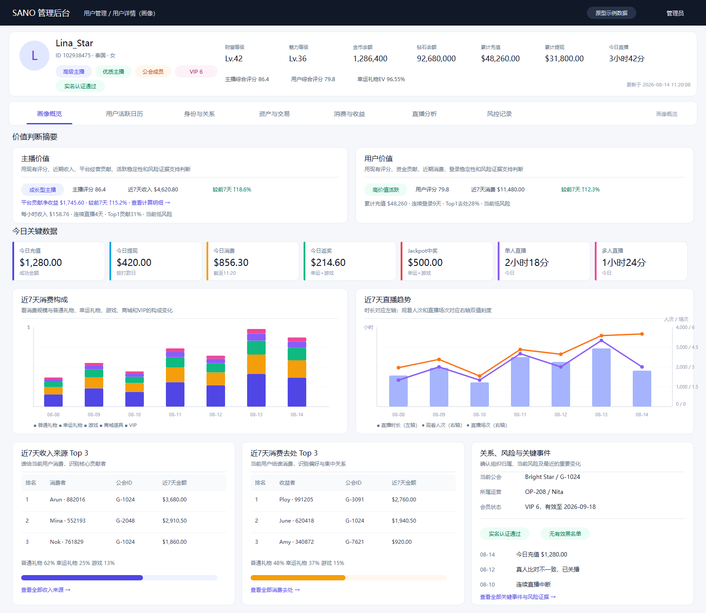
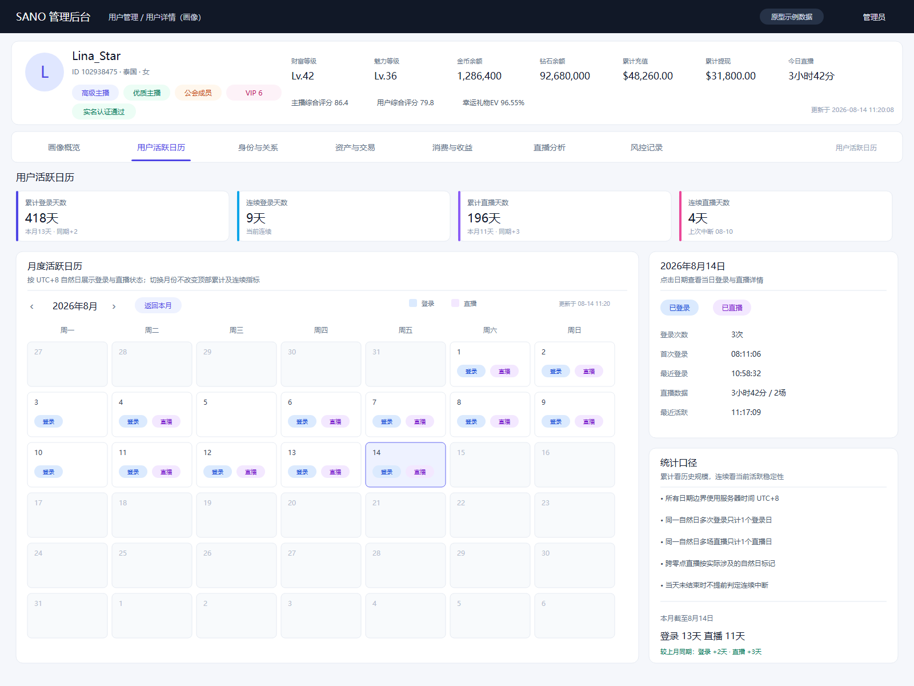
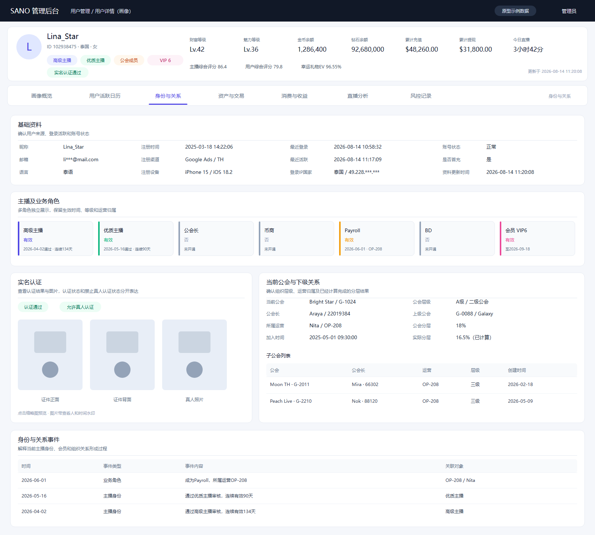
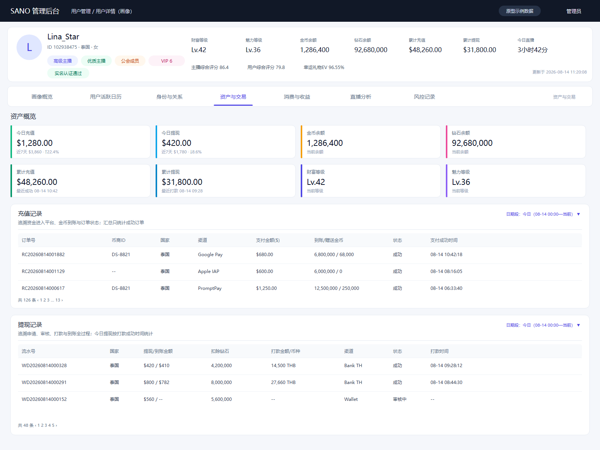
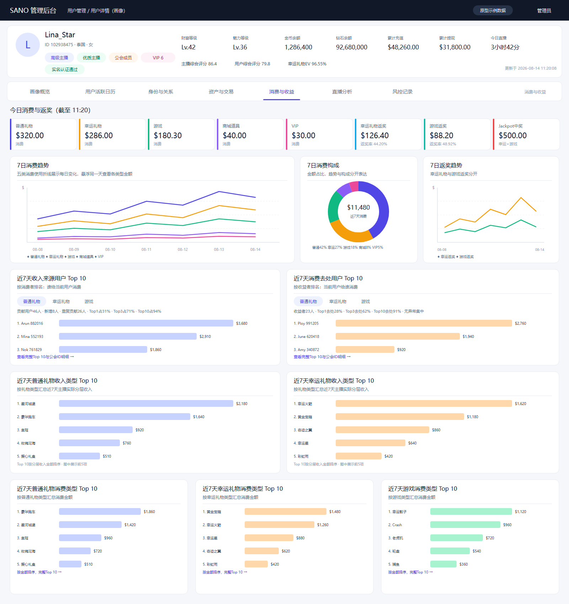
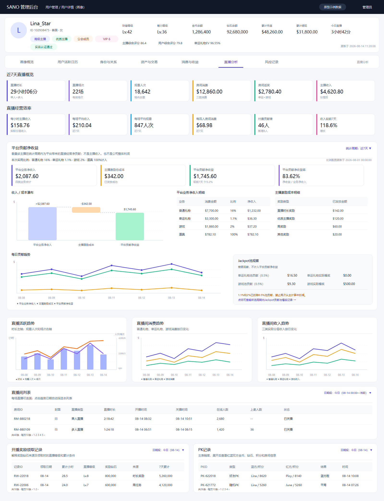
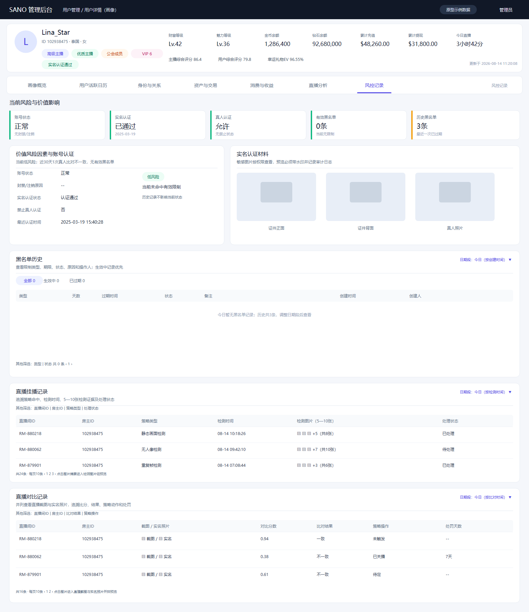

# 用户详情（画像）页面原型

## 原型说明

- 原型规格：桌面管理后台；“用户活跃日历”和“资产与交易”为1600×1200，“画像概览”为1600×1390，“身份与关系”为1600×1440，“直播分析”为1600×2085，“消费与收益”为1600×1700，“风控记录”为1600×1850。
- 页面结构：固定用户摘要 + 一级标签页 + 当前标签内容。
- 页面数量：7张。
- 数据说明：页面内均为原型示例数据，不代表真实线上用户。
- `原型图` 中的PNG文件用于评审和分享，`源文件` 中的SVG文件作为可编辑源文件保留。
- `生成工具` 中保留与本设计配套的SVG生成和PNG导出脚本。

## 页面列表

1. [画像概览](原型图/01-画像概览.png)
2. [用户活跃日历](原型图/02-用户活跃日历.png)
3. [身份与关系](原型图/03-身份与关系.png)
4. [资产与交易](原型图/04-资产与交易.png)
5. [消费与收益](原型图/05-消费与收益.png)
6. [直播分析](原型图/06-直播分析.png)
7. [风控记录](原型图/07-风控记录.png)

## 页面预览

### 画像概览

### 用户活跃日历

### 身份与关系

### 资产与交易

### 消费与收益

### 直播分析

### 风控记录

