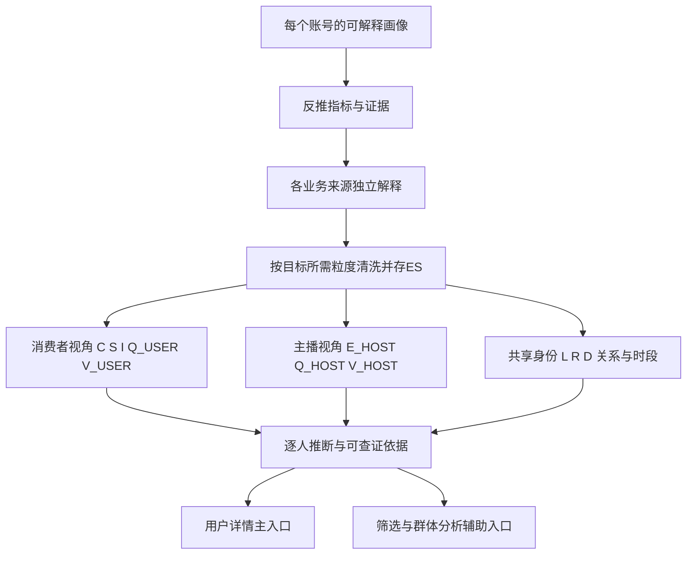

# SANO用户标签与价值识别体系

## 1. 文档信息

| 项目 | 内容 |
| --- | --- |
| 文档名称 | SANO用户标签与价值识别体系 |
| 文档版本 | V1.3 |
| 文档日期 | 2026年10月28日 |
| 适用范围 | 用户画像、大R识别、优质用户识别、奖励依赖、疑似薅利及提现关联特征分析 |
| 使用对象 | 产品、数据、后端、运营、风控、财务等分析结果查看人员 |
| 文档目标 | 明确需要保存的数据、快照、指标、独立等级、综合等级、组合标签及分析结果，使开发人员能够据此完成标签与用户分析系统建设 |

V1.1根据SANO实际钱包口径完成以下调整：明确`10000金币 = 10000钻石 = 1美元`及数据库钻石放大1000倍；取消标签层二次业务去重；将资金属性调整为金币来源和钻石去向；将窗口快照改为可选缓存；细化用户日指标结构、清洗流程及独立等级计算。

V1.2补充提现主记录、收款渠道关联字段及多账号共用收款目标的分析口径；同时明确本期仅生成分析指标、关系、等级、标签和解释证据，不将分析结果直接应用于提现拦截、账号处罚、权益调整、运营任务或其他业务执行。

V1.3以“每个账号一份可解释画像”为最终目标：所有账号并行生成消费者和主播视角，其他业务身份叠加；补充消费/开播活跃时段、邀请关系和互动证据；确认充值订单`status=2`及成功时间、金币消费时间和关联字段、普通钻石与Lucky明细的使用边界；正式评级只使用截至昨日的完整自然日，今日数据单独展示。数据清洗和ES保存细节参见《SANO用户画像数据清洗与ES结果设计》。

## 2. 建设背景

SANO已经具备普通用户、主播、优质主播、高级主播、公会长、公会成员、币商、Payroll、BD、会员、测试账号、系统账号和机器人账号等身份数据，也具备充值、消费、返奖、Jackpot、提现、直播、奖励、设备和IP等业务记录。

当前缺少的是将这些分散数据统一转换为每个账号持续更新、可解释、可查证的指标、等级与推断。消费者和主播不是互斥身份：每个账号都具备两种行为视角；公会长、公会成员、优质主播、高级主播、币商、Payroll、BD等业务身份可以同时叠加。“超级主播”与现有“高级主播”按同一业务身份处理。系统须稳定回答以下问题：

1. 这个用户是谁，当前拥有哪些身份？
2. 用户在现金充值、消费、平台内循环、生态贡献、持续质量等方面分别达到什么程度？
3. 用户是否具有较高价值或明显变化，分析依据是什么？
4. 用户是否依赖奖励或返奖获利，是否存在疑似薅利行为？
5. 用户的提现、收款账户及关联账号呈现出哪些客观特征？
6. 平台应当如何从价值、质量、利益依赖、资产流转和账号关联等方面认识该用户？
7. 该用户通常何时消费、何时开播，时间段是否稳定，直播间互动和消费来源如何？
8. 邀请关系、设备/IP、收款目标及其他账号关联对个人和群体分析提供了哪些可核实证据？

本体系不使用一个不可解释的总分覆盖全部事实，而是采用“身份事实＋消费者/主播行为特征＋指标结果＋独立等级＋综合价值＋组合标签＋逐人推断＋解释证据”的分层结构。名单和筛选只是查询这些逐人画像的辅助入口，并非最终产物。

## 3. 建设目标与边界

### 3.1 建设目标

1. 统一用户价值、质量、利益依赖、账号关联和异常特征指标口径。
2. 形成可按历史日期还原的日快照、等级快照和标签快照。
3. 独立计算现金价值、消费价值、内循环、生态价值、用户质量、利益依赖及关联与异常特征。
4. 形成现金大R、消费大R、内循环大R、生态核心用户、优质用户、奖励依赖用户、疑似薅利用户、共用收款目标用户等组合标签。
5. 为**每一个账号**生成消费者与主播两条视角的事实、程度、推断、依据及数据可信度；未消费或未开播也输出相应“未发生”状态。
6. 为逐人画像提供时段、邀请、互动、资产流转和关联关系的下钻证据；名单、筛选、排序及群体视图是辅助分析能力。

### 3.2 非目标

1. 首期不使用不可解释的黑盒模型直接决定用户等级，也不根据分析等级执行处罚。
2. 不使用单一充值金额、单一消费金额、单一设备、单一IP、单次高返奖或单次提现直接作出用户异常或违规认定。
3. 不将测试、系统、机器人等身份从原始流水和用户详情统计中删除；身份事实继续保留，分析筛选可按身份区分。
4. 不在前端页面计算分数、等级或标签，所有结论均由服务端或数据服务生成。
5. 综合价值等级不替代现金、消费、生态等独立等级，关联与异常特征等级也不覆盖用户真实价值。
6. 本期不由本系统自动触发提现拦截、账号处罚、奖励限制、权益调整、运营触达、工单或其他业务动作；有权限人员可据可查证的事实作独立业务判断，画像推断本身不是处置指令。
7. 本期不把“同收款账户”“同设备”“同IP”等关联事实直接认定为同一自然人、作弊、团伙或违规，只展示关系和组合特征。

## 4. 总体识别结构



最终标签结构如下：

```text
现有身份标签
＋生命周期标签
＋行为偏好标签
＋资产流转标签
＋消费者/主播各自的活跃时间段与行为特征
＋C/S/I/E/Q/L/R独立等级
＋V_USER/V_HOST及其他经营轨道等级
＋组合用户类型标签
＋分析关注级别与关注原因
＋逐人推断、数据置信度与解释证据
```

## 5. 全局统计口径

### 5.1 时间口径

- 所有权威时间使用服务器时间，统一按UTC+8统计。
- 今日实时展示为当日`00:00:00`至当前时刻，只作观察和明细查证，不进入正式等级与标签。
- T日生成`analysis_date=T-1`的正式画像；正式近7天、30天、90天分别为T-1及其之前连续6、29、89个完整自然日，上一周期取紧邻的等长完整窗口。
- 用户详情页既有“近7天=今天及前6天”属于页面展示口径，必须与本体系“截至昨日的正式近7天”明确标注、分别查询。
- 正式累计指标从有完整来源覆盖的最早有效业务记录统计至T-1日末；来源覆盖不足时注明起点，不把未知历史当作0。
- 消费者时段以实际消费时间分小时；主播时段以直播区间实际覆盖分钟分小时，跨日直播按自然日拆分。统一保存UTC+8口径；当地时段须有可信时区依据，不能仅凭注册国家或单次IP推断。

### 5.2 金额口径

- 充值、提现等订单已有的美元金额直接使用，不进行汇率二次换算；钱包只有`tokens`的指标按固定金币/钻石比例生成美元等值，页面不自行换算。
- 业务价值比例为`10000金币 = 10000钻石 = 1美元`。
- 数据库中的钻石数量为了存储精度放大1000倍，因此`数据库钻石值 ÷ 1000 = 业务钻石数量`，`数据库钻石值 ÷ 10000000 = 美元价值`。该放大只是存储口径，不表示钻石业务价值低于金币。
- 金币钱包`tokens ÷ 10000`、数据库钻石钱包`tokens ÷ 10000000`为美元等值；`amount`为具体商品数量而非金额。已有订单美元金额优先使用订单值，钱包金额用于其自身业务指标及对账。
- 充值只统计支付成功记录；本版本不考虑退款、撤销、拒付、冲正和补单对已成功充值汇总的影响。
- 提现只统计最终打款成功金额，日期按照实际打款时间归属。
- 主播礼物和游戏收入使用完成分层计算后主播实际获得的收入。
- 充值、消费、返奖、Jackpot、主播收入、系统奖励和提现属于不同业务含义，必须分别保存和统计。

### 5.3 业务记录唯一性与统计边界

- 充值、消费、返奖、Jackpot、奖励、提现及金币、钻石钱包记录在业务层已经完成幂等和唯一性控制，标签系统不再实施第二套业务去重逻辑。
- 日指标按照业务记录的有效状态和统计时间直接聚合，不使用猜测规则合并合法业务记录。
- 同一业务记录只能在同一个指标编码中累计一次；它可以同时作为消费事实、关系证据或标签解释证据，但平台总金额不得在同一口径内重复相加。
- 账号之间的金币或钻石转移属于资产移动，不产生新的充值、消费、收益或内循环价值；这是业务分类规则，不是重复数据删除。
- App初始化记录允许出现少量重复请求。设备和IP关系汇总按用户、安装实例、IP和合理时间窗口聚合，重复上报次数不得提高关联置信度。

### 5.4 用户与自然人层级

- `user_id`为账号级主体，用于用户画像和单账号行为分析。
- `person_id`为确认或推测的同一自然人或实际控制人，用于多账号去重和关联分析。
- `account_group_id`为一组强关联或人工确认账号的治理单元。
- 没有可靠关联结果时，`person_id`不得由相同IP、相同品牌型号等弱证据自动生成。
- 独立等级首先在`user_id`层为所有账号计算；重复奖励和整体关联特征在有可靠关系时可以补充`person_id`或账号群层分析。群体结论不得覆盖成员各自画像。
- 一个账号组内的资产转移不产生新的现金价值或平台内循环价值。

### 5.5 身份口径

每个账号均有消费者和主播两种分析视角，它们表示可观察的行为能力，不是“二选一”的业务资格。无消费、无开播须与数据缺失区分。SANO现有业务身份直接作为可叠加的事实标签使用：

1. 普通用户。
2. 普通主播、优质主播、高级主播（“超级主播”为高级主播的同义业务称呼）。
3. 公会长、公会成员。
4. 币商。
5. Payroll。
6. BD。
7. 会员。
8. 测试账号、系统账号、机器人账号。

身份允许同时存在，必须保存生效时间、失效时间和当前状态。身份不直接决定用户价值，也不能用单一身份覆盖其他身份。所有账号并行计算`V_USER`和主播视角结果；没有开播或尚不满足主播评价样本时显示“尚无开播行为/样本不足”，不解释为“不是主播”。

### 5.6 同类阈值与页面展示

- 金额、天数、人数等规模指标可以使用历史数据分布计算内部评级阈值。
- 首版优先按注册国家计算阈值；生态等级按照注册国家和具体经营身份计算阈值。
- 样本不足时依次回退到区域和全平台。
- 同类排名和分位数只作为后台评级和阈值校准依据，本期用户画像页面不展示“超过同类多少”的结论。
- 每个阈值必须保存计算日期、样本范围、样本数量和阈值版本。

## 6. 标签体系

### 6.1 标签分层

| 层级 | 标签性质 | 典型内容 | 产生方式 |
| --- | --- | --- | --- |
| 身份标签 | 已有业务事实 | 主播、公会长、币商、Payroll、BD、会员 | 读取现有业务数据 |
| 生命周期标签 | 派生状态 | 新用户、成长、稳定、下降、沉默、流失、回流 | 活跃、充值、消费趋势计算 |
| 行为偏好标签 | 派生事实 | 普通礼物偏好、幸运礼物偏好、游戏偏好 | 消费构成计算 |
| 资产流转标签 | 派生事实 | 充值金币型、钻石回投型、币商交易型、提现型、余额沉淀型 | 金币和钻石钱包流转计算 |
| 独立等级 | 分维度评级 | C、S、I、E、Q、L、R、D | 指标和规则计算 |
| 综合价值等级 | 正向价值总结 | V0至V4 | 独立正向等级加权计算 |
| 组合类型标签 | 分析结论 | 现金大R、优质用户、疑似薅利、共用收款目标 | 多等级及证据组合 |
| 分析关注标签 | 分析排序 | 高价值、快速成长、明显下降、多账号关联、数据不足 | 组合类型、趋势及数据质量规则 |

### 6.2 生命周期标签

| 标签 | 首版规则 |
| --- | --- |
| 新用户 | 注册不超过7个自然日 |
| 成长用户 | 近30天充值、消费或平台贡献净收益较前30天增长大于等于30%，且不是由单日异常事件完全造成 |
| 稳定用户 | 连续两个30天周期保持相同或相邻价值等级，且下降幅度低于30% |
| 下降用户 | 近30天充值、消费或平台贡献净收益较前30天下降大于等于50% |
| 沉默用户 | 连续3天无登录或无有效业务行为 |
| 流失预警 | 连续7天无登录或无有效业务行为 |
| 已流失 | 连续14天无登录或无有效业务行为 |
| 回流用户 | 流失后重新登录，并重新产生充值、消费或有效直播行为 |

生命周期天数和变化阈值均为首版配置，必须支持版本化调整。

### 6.3 行为偏好标签

在满足最低消费金额和最低消费天数配置后计算：

| 标签 | 首版规则 |
| --- | --- |
| 普通礼物偏好 | 近30天普通礼物消费占总消费大于等于50% |
| 幸运礼物偏好 | 近30天幸运礼物消费占总消费大于等于50% |
| 游戏偏好 | 近30天游戏消费占总消费大于等于50% |
| 道具偏好 | 近30天道具消费占总消费大于等于50% |
| VIP偏好 | 近30天VIP消费占总消费大于等于50% |
| 多产品用户 | 至少3类产品消费占比均大于等于10%，且没有单一类型超过50% |

### 6.4 资产流转标签

SANO用于消费的资产只有金币，用户收入资产只有钻石。普通用户可以将钻石兑换为消费金币，币商可以将钻石兑换为交易金币。因此首版不使用含义模糊的“资金属性”，而是分别描述金币从哪里进入、钻石向哪里流出。

#### 金币来源标签

| 标签 | 首版规则 |
| --- | --- |
| 充值金币型 | 近30天金币入账中，充值产生的金币金额占比大于等于70% |
| 钻石回投型 | 近30天金币入账中，钻石兑换消费金币金额占比大于等于50% |
| 币商交易型 | 用户具有币商身份，近30天金币入账中，钻石兑换交易金币金额占比大于等于50% |
| 平台发放金币型 | 近30天金币入账中，系统赠送或活动直接发放金币占比大于等于50% |
| 混合金币来源 | 没有单一金币来源达到50%，且至少两类来源占比大于等于20% |
| 金币来源未知 | 钱包记录缺少业务类型，无法说明金币入账来源 |

#### 钻石去向标签

| 标签 | 首版规则 |
| --- | --- |
| 钻石回投消费 | 近30天钻石支出中，兑换消费金币占比大于等于50% |
| 钻石转交易金币 | 具有币商身份，近30天钻石支出中，兑换交易金币占比大于等于50% |
| 钻石提现型 | 近30天钻石支出中，最终打款成功提现对应钻石占比大于等于50% |
| 钻石余额沉淀 | 钻石余额大于等于配置阈值，连续7天没有兑换消费金币或成功提现 |
| 混合钻石去向 | 兑换消费金币、兑换交易金币和提现中没有单一去向达到50% |

金币来源标签可以直接根据金币钱包入账业务类型计算；钻石去向标签可以直接根据钻石钱包扣减业务类型、兑换记录和提现记录计算。只有需要回答“某次消费具体由哪一种历史金币来源支持”时，才需要额外的混合余额归因算法。

## 7. 原始数据结构

本节定义标签系统依赖的逻辑数据结构。现有业务表可以继续使用，不要求为了本需求全部合并成一张新表，但必须能够按以下业务主键、用户、时间和金额查询。

### 7.1 用户身份关系

最少需要：

- 用户ID。
- 身份类型和身份等级。
- 生效时间、失效时间和当前状态。
- 审核状态和最近审核通过时间。
- 公会、上级公会、运营、BD等关系。
- 测试、系统、机器人等内部身份。

用途：身份展示、同身份阈值、生态等级和经营资金识别。

### 7.2 充值事件

权威来源为MySQL`sano_wallet_recharge`。已确认口径：`order_no`为订单ID，`user_id`为订单用户，`status=2`为成功、`status=3`为退款；成功美元金额取`money`；成功时间取`notify_time`，为空回退到`create_time`并标记回退。`day_int`由**下单时间**`create_time`生成，不能用于成功充值日归属。首期成功金额仅查询当前成功订单，不另建退款、冲正等调整指标。

`producer_type`区分谷歌、苹果、三方、Payroll和币商；`ta_user_id`为代充值用户ID。订单事实以`user_id`归属到账账号，同时保留渠道及代充关系。**C“本人现金充值”是否计入Payroll/币商代充值仍须按实际付款人与到账人关系明确规则；未确认前不得把这类订单无条件归为本人现金支付。**钱包充值金币入账只作资金流入和对账，不与成功订单金额重复计入C。

用途：现金价值、复充、充值趋势、代充值关系和支付来源分析。

### 7.3 消费事件

本人消费权威来源为金币钱包`sano_wallet_coin_record`及对应ES记录。`id`为记录ID、`user_id`为消费用户、`ta_user_id`为接收者、`room_id`为发生消费的房间、`prop_id`为礼物或商品ID、`business_type`对应`EBusinessType.code`、`tokens`为金币数量、`amount`为商品数量。`status`表示钱包增减，不能按提现订单状态解释。实际消费时间为`create_time`；MySQL的`dt`是由`create_time`生成的日期，仅用于自然日归属；小时/星期时段必须取`create_time`。金币消费业务类型至少区分普通礼物`1`、幸运礼物`11`、游戏`21`、道具`41`、VIP`42/106`，并核对钱包扣减方向。

同一礼物在消费者视角按`user_id`记本人消费，在主播视角按`room_id`关联房主记直播间消费；`ta_user_id`用于消费去处和实际接收者关系，不能无条件等于房主。三个口径可引用同一笔交易作为不同事实，但不得把消费额与分层后主播收入相加成平台总额。礼物/游戏Top和接收者Top在原始90天可用范围内按记录字段查询；超过90天只有保存了相应粒度的结果才提供精确Top。

用途：消费等级、偏好、消费时段、消费去处、关系集中度、房间贡献和关联交易分析。

### 7.4 返奖与Jackpot事件

最少需要：

- 返奖事件ID。
- 用户ID。
- 返奖类型：幸运礼物返奖、游戏返奖、幸运礼物Jackpot、游戏Jackpot。
- 发生时间。
- 返奖美元金额。
- 关联消费事件、游戏局或幸运礼物事件。
- 返奖资产类型：按现有`EBusinessType`，幸运礼物返奖`16`、幸运Jackpot`17`、游戏返奖`22`、游戏Jackpot`26`均为**金币入账**，不得列为钻石入账或现金充值。

用途：返奖率、内循环、利益依赖和异常返奖分析。

### 7.5 兑换与资产流转事件

最少需要：

- 兑换或流转事件ID。
- 用户ID。
- 流入资产和流出资产，至少区分消费金币、交易金币和钻石。
- 业务类型，至少区分钻石兑换消费金币、币商钻石兑换交易金币、金币或钻石转入转出。
- 美元价值。
- 发生时间。
- 来源类型和来源事件ID。
- 转入或转出对手方用户ID。
- 兑换前后余额。

用途：钻石回投消费、币商交易金币、用户间转账、内部资产流转和提现来源分析。

### 7.6 提现事件

提现数据由提现主记录、用户信息和收款渠道信息组成。现有查询以`sano_wallet_withdraw`为主表，关联`sano_user`和`sano_user_withdraw_channel`。

#### 7.6.1 提现主记录字段

| 字段 | Java类型 | 含义及分析口径 |
| --- | --- | --- |
| `order_no` / `orderNo` | Long | SANO提现流水号，提现事实的主标识 |
| `trade_no` / `tradeNo` | String | 上游订单号，用于追踪渠道打款记录 |
| `producer_type` / `producerType` | Integer | 渠道类型：1官方、2第三方、3 Payroll |
| `producer_code` / `producerCode` | String | 提现渠道编码 |
| `channel_code` / `channelCode` | String | 提现方式编码，是判断收款目标类型的重要字段 |
| `user_id` / `userId` | Long | 提现用户ID |
| `user_code` / `userCode` | String | 关联`sano_user`取得的用户编码，不属于提现主表 |
| `diamond` / `diamond` | Long | 本次扣除钻石的数据库存储值，已放大1000倍 |
| `diamond_old` / `diamondOld` | Long | 扣除前钻石的数据库存储值 |
| `diamond_new` / `diamondNew` | Long | 扣除后钻石的数据库存储值 |
| `money_dollar` / `moneyDollar` | BigDecimal | 提现金额，美元 |
| `reality_money` / `realityMoney` | BigDecimal | 实际到账金额，美元 |
| `service_fixed_money` / `serviceFixedMoney` | BigDecimal | 固定手续费，美元 |
| `service_float_rate` / `serviceFloatRate` | BigDecimal | 浮动手续费率 |
| `service_float_money` / `serviceFloatMoney` | BigDecimal | 浮动手续费金额，美元 |
| `user_withdraw_channel_id` / `userWithdrawChannelId` | Long | 关联用户收款渠道记录的ID；只表示内部渠道记录，不能直接视为跨账号统一收款账户标识 |
| `currency_icon` / `currencyIcon` | String | 打款货币图标，仅用于展示 |
| `currency_code` / `currencyCode` | String | 实际打款货币代码 |
| `rate` / `rate` | BigDecimal | 该笔提现记录保存的打款汇率 |
| `money` / `money` | BigDecimal | 对应打款货币的实际打款金额 |
| `status` / `status` | Integer | 1待审核、2驳回且已退款、3打款中、4打款成功、5打款失败、6已退款 |
| `country_code` / `countryCode` | String | 提现记录中已有的国家代码 |
| `country_flag_square` / `countryFlagSquare` | String | 方形国旗资源，仅用于展示 |
| `country_flag_round` / `countryFlagRound` | String | 圆形国旗资源，仅用于展示 |
| `create_time` / `createTime` | Date | 提现申请时间；若Java实体未直接声明，应确认是否继承自基础实体 |
| `pay_time` / `payTime` | Date | 实际打款时间；成功提现金额按该时间归属自然日 |
| `reject_reason` / `rejectReason` | String | 驳回原因 |
| `audit_user` / `auditUser` | Long | 审核人ID |
| `audit_time` / `auditTime` | Date | 审核时间 |
| `remarks` / `remarks` | String | 备注 |

金额统计只将`status = 4`的记录视为最终打款成功，并按照`pay_time`归属日期。其他状态仍可用于统计申请次数、状态分布、失败或驳回情况，但不得进入成功提现金额。

#### 7.6.2 关联收款渠道字段

以下字段来自`sano_user_withdraw_channel`关联查询，不属于提现主表：

| 字段 | Java类型 | 分析用途 |
| --- | --- | --- |
| `account_no` / `accountNo` | String | 银行、电子钱包或其他渠道的收款账号 |
| `account_type` / `accountType` | String | 账户类型 |
| `check_digit` / `checkDigit` | String | 账户验证数字 |
| `bank_code` / `bankCode` | String | 银行代码 |
| `bank_name` / `bankName` | String | 银行名称，展示和辅助校验使用 |
| `bank_branch` / `bankBranch` | String | 银行网点号 |
| `bank_city` / `bankCity` | String | 银行城市 |
| `cor_account_no` / `corAccountNo` | String | 银行代理账号 |
| `first_name` / `firstName` | String | 收款人名 |
| `middle_name` / `middleName` | String | 收款人中间名 |
| `last_name` / `lastName` | String | 收款人姓 |
| `full_name` / `fullName` | String | 收款人全名，只作为辅助关联信息 |
| `document_type` / `documentType` | String | 收款人证明类型 |
| `document_id` / `documentId` | String | 个人识别号码，属于高敏感强关联信息 |
| `document_issue_date` / `documentIssueDate` | String | 识别号码生效日期 |
| `document_expire_date` / `documentExpireDate` | String | 识别号码失效日期 |
| `address` / `address` | String | 地址，只作为辅助信息 |
| `city` / `city` | String | 城市 |
| `state` / `state` | String | 州或省 |
| `zip_code` / `zipCode` | String | 邮编 |
| `payee_phone` / `payeePhone` | String | 收款电话，可用于标准化后的账号关联 |
| `birth_date` / `birthDate` | String | 出生日期，只作为辅助信息 |
| `usdt_address` / `usdtAddress` | String | USDT地址，按链和地址共同识别；不可不区分链，也不可一律转为小写 |
| `binance_id` / `binanceId` | String | 币安ID |
| `email` / `email` | String | 收款邮箱，可用于标准化后的账号关联 |

#### 7.6.3 历史快照有效性

当前SQL是通过`user_withdraw_channel_id`关联渠道表读取收款字段，因此必须确认渠道记录的维护方式：

- 如果用户修改收款资料时新增一条渠道记录，旧记录不可变，则关联结果可以代表该笔提现申请时的收款信息。
- 如果用户可以原地修改同一条渠道记录，则当前查询只能得到渠道记录的当前值，不能证明该值就是历史提现时的真实收款信息。
- 在第二种情况下，若要准确分析历史共用收款账户，需要提现主表保存申请时的收款字段快照，或建立不可变的收款渠道历史版本。

在该问题未确认前，分析页面应标记“收款信息是否为历史快照”，避免把当前渠道信息误当作订单时点事实。

#### 7.6.4 收款目标标准化与受控指纹

不同渠道不能共用一个简单的`accountNo`比较规则。建议根据`channelCode`配置收款目标类型和标准化字段组合：

| 收款目标类型 | 建议标准化组合 |
| --- | --- |
| 银行账户 | 国家＋银行代码＋账户类型＋收款账号＋验证数字 |
| 银行代理账户 | 国家＋银行代码＋代理账号 |
| USDT | 链或网络＋USDT地址 |
| 币安 | 渠道＋币安ID |
| 手机钱包 | 国家＋渠道＋规范化电话号码 |
| 邮箱钱包 | 国家＋渠道＋规范化邮箱 |

生成标准化字符串后，通过服务端密钥计算HMAC等不可逆受控指纹，建议保存：

- `withdraw_target_type`：收款目标类型。
- `withdraw_target_fingerprint`：统一收款目标指纹。
- `fingerprint_rule_version`：标准化和指纹规则版本。
- `snapshot_valid_flag`：是否确认来自订单时点快照。

分析表默认保存指纹和脱敏展示值，不复制完整银行卡号、证件号、电话号码、邮箱或链上地址。原始敏感信息继续保留在业务来源中，并按权限查询。

#### 7.6.5 提现及收款账户分析用途

本期只形成以下客观分析结果：

- 用户的申请、成功、失败、驳回和退款次数及金额。
- 用户使用过的收款目标数量、首次和最近使用时间。
- 同一收款目标关联的SANO账号数量、账号列表、成功提现次数和金额。
- 同一收款目标在近7天、30天、90天和累计窗口的活跃情况。
- 共用收款目标的账号是否还存在相同安装实例、设备标识或IP等其他关系。
- 账号之间的奖励、消费、转账、兑换、收礼和提现路径，仅作为可解释的关系链展示。

共用收款目标属于较强的账号关联事实，但不能单独证明这些账号属于同一自然人，也不能单独证明作弊、套利、团伙或违规。本期不根据这些结果触发提现拦截、拒绝、处罚、权益调整、工单或其他业务动作。

### 7.7 平台奖励与成本事件

最少需要：

- 奖励记录ID。
- 获奖用户ID。
- 奖励类型：开播时长、优质主播、周奖励、新人、榜单、任务、补偿和其他奖励。
- 发放成功时间。
- 奖励美元金额。
- 关联活动、任务、直播、榜单或业务事件。
- 发放状态。

用途：平台成本、奖励依赖、重复领奖、奖励回收和平台贡献净收益。

### 7.8 直播与房间事件

最少需要：

- 主播用户ID和房间ID。
- 开关播时间、直播类型和直播时长。
- 观看人次和上麦人数。
- 房间内普通礼物、幸运礼物、游戏及道具消费。
- 主播普通礼物、幸运礼物和游戏实际分层收入。
- 房间返奖和Jackpot数据。

`sano_room`已提供`user_id`房主、`room_type`、`create_time`、`close_time`、`live_second`和累计在线/上麦计数。直播类型由已有标识判定，PK期间归属沿用现有业务逻辑。开播时段按每场直播实际覆盖的小时分配时长，另记开播场次和开播时间分布，不能只用开播时刻代表整场活跃。观看人次须核实`online_count`是否满足“每场每人计一次”；不满足时须从观看事件取得，不能用累计在线数字冒充去重人数。

`sano_room_mai`可支持上麦用户、房间、起止时间和时长，但现有结构未直接给出“房主邀请/用户自行上麦”的来源标识；未接入邀请/申请事件前这两类只显示合计，不推断来源。公频聊天、私聊互动和直播内容分类需各自明确事件来源与可用范围；首期可展示可核实的互动次数、独立参与者、双向互动和时段，不把聊天量或内容分类未经验证地计入E/Q分。

用途：主播活跃、主要开播时段、房间经营、主播收入、生态价值和平台贡献净收益。

### 7.9 登录与活跃日事实

最少需要：

- 用户ID。
- 活跃日期。
- 是否登录、是否消费、是否充值、是否直播。
- 最近登录和最近活跃时间。
- 当日有效互动、观看、房间复访等行为。

用途：连续登录、生命周期、沉默、流失、回流和用户质量。

登录及留存必须使用正式登录或活跃数据。App初始化设备上报属于设备环境证据，不能作为唯一登录事实。

已知存在登录/在线会话或心跳日志，但字段与会话结束规则尚未提供。有效在线时长必须根据可核实的会话区间或心跳窗口计算，不能由“最近登录时间”或设备初始化次数推断。消费者活跃时段以**实际消费事件**为核心，可另列登录活跃时段；二者不得混称。正式时段结果至少保存近30/90天每小时消费金额、笔数、发生消费的天数，以及主播每小时实际直播分钟、开播场次和直播天数。单次大额消费不构成稳定时段习惯，时段结论必须显示样本天数和稳定性。

#### 7.9.1 邀请与社交互动关系

已知存在邀请人与被邀请人的关系日志；接入时须核定邀请关系双方、建立时间、有效/取消状态及历史变更。逐人画像分别展示邀请人概况与被邀请人概览，后者可分析人数、活跃、充值转化和留存。被邀请人的全部后续价值不能无条件归给邀请人；与BD、公会等归属贡献分别计量，避免重复认领。

公频、私聊、房间访问和上麦互动仅在对应事件可查且口径确认后形成分析特征。私聊优先使用时间、次数、双向互动及参与关系等元数据；不因画像需求默认采集或分析聊天正文，也不以私聊频繁直接推断交易关系或违规。

### 7.10 设备、IP与账号关联证据

使用《用户设备与账号关联分析》中定义的数据，至少包括：

- App初始化记录ID、用户ID和服务端接收时间。
- 安装实例ID和有效设备标识。
- 设备品牌、型号、系统和客户端类型。
- 服务端取得的公网IP及国家、地区和城市。
- 是否模拟器、VPN或代理。
- 同安装实例、同有效设备标识和同IP关联账号结果。

注册国家与每次设备/登录记录的IP国家、地区、城市分别展示；IP归属是网络出口位置，不等于用户实际物理位置。国家可能有多个时区，不能只凭注册国家或单次IP将UTC+8时段标为用户当地时段；若有可靠时区依据，结果须保存其来源与可信度，无法确定则仅展示UTC+8。

用途：账号关联、关系证据、地域行为差异、提现特征和多账号奖励分析。

#### 7.10.1 普通钻石ES与Lucky明细ES的边界

普通钻石ES是钻石入账/支出等业务的**汇总来源**，用于主播实际分层收入、奖励、兑换等画像和等级金额计算。Lucky钻石ES是幸运礼物在较短时间段（例如1分钟）的明细，通常不参加本体系日指标和等级汇总。只有普通钻石记录不能回答且产品确有明确的幸运礼物明细下钻需求时，才单独查询Lucky明细；两者金额绝不相加，也不要求通过两个索引合并才能得到主播收入。需要按礼物类型分析幸运礼物收入时，先核实普通钻石记录是否已有可靠`prop_id`粒度；若没有，Lucky明细仅承担该专项细分分析。

### 7.11 用户关联及人工治理

最少需要：

- `person_id`、`account_group_id`和`user_id`。
- 识别置信度。
- 最强关联证据。
- 首次识别和最近更新时间。
- 规则或算法版本。
- 自动、人工确认、人工拆分等状态。
- 合并、拆分、回滚的操作人、时间和原因。

用途：人级去重、多账号价值合并、重复领奖和闭环资金路径分析。

## 8. 第一步 建立快照与结果存储

本期采用“逐人结果→必要指标→各来源独立解释→按结果需要清洗→ES保存→评级与推断”的顺序。充值、提现等业务记录以MySQL为长期权威来源；金币、钻石钱包ES原始记录计划保留90天，并非永久保存。清洗结果统一存ES，使用`sano_user_profile_`前缀与独立保存策略。不是每个来源复制一张清洗表，也不是把全部关系、时段和原始明细强塞进一张用户日表。90天以上只展示已保存且粒度足够的清洗结果，不再承诺追溯过期钱包明细。

### 8.1 必需与可选结构总览

| 逻辑结构 | 是否必需 | 粒度 | 作用 |
| --- | --- | --- | --- |
| 用户日指标结果`sano_user_profile_metric_daily` | 必需 | 日期＋用户ID | 保存正式评级需要的可加金额、次数、日标记和余额状态，消费者/主播字段分开 |
| 活跃时段结果`sano_user_profile_activity_hourly` | 必需（时段画像上线时） | 日期＋小时＋用户ID | 保存每小时本人消费金额/笔数、直播覆盖分钟/开播场次及样本日，支持30/90天习惯分析；不复制事件 |
| 自然人日指标结果 | person体系上线后按需 | 日期＋person ID | 有可靠账号归属时合并价值并去除群内资产转移重复贡献 |
| 窗口指标结果 | 可选缓存 | 分析日期＋主体＋窗口＋指标 | 仅在批量计算或查询性能需要时保存；精确跨日去重和Top不能仅凭日人数/总额生成 |
| 钱包来源池状态 | 二期可选 | 日期＋用户＋资产桶＋来源桶 | 在混合余额中估算具体消费由哪种历史来源支持 |
| 逐人评估结果`sano_user_profile_assessment_daily` | 必需 | 分析日期＋用户ID＋规则版本 | 保存消费者/主播及其他身份的等级、标签、逐人推断、解释和不可评估原因；不要求每个等级单独建索引 |
| 阈值配置版本 | 必需 | 版本＋指标＋适用人群 | 保存评级阈值和权重，不要求每天复制相同配置 |
| 设备关系结果`sano_user_profile_device_relation` | 关联分析必需 | 关系类型＋受控指纹＋用户ID | 保存安装实例、有效设备标识、IP等关系摘要，区分证据强弱 |
| 收款目标关系结果`sano_user_profile_withdraw_relation` | 提现关联分析必需 | 收款目标类型＋受控指纹＋用户ID | 支持同一收款目标关联账号、次数、金额及首次和最近使用时间分析 |
| 分析备注记录 | 可选 | 分析记录ID | 保存有权限人员的分析备注，不改变自动指标、等级和标签历史 |

### 8.2 用户日指标快照的数据结构

ES逻辑索引：`sano_user_profile_metric_daily`。

主键粒度：`stat_date＋user_id`，每个用户每天一条。金额指标统一保存美元金额；钱包资产数量可以按需要另外保留业务金币数和业务钻石数。

| 字段组 | 建议保存的数据 | 原始来源及清洗方式 |
| --- | --- | --- |
| 主键与版本 | 统计日期、用户ID、时区、数据版本、生成时间、来源覆盖及正式状态 | 统计日期按UTC+8生成；正式日结果只处理完整自然日，今日观察数据独立查询 |
| 身份上下文 | 注册国家、当日有效身份集合、公会、运营归属 | 取当日结束时有效的身份关系；历史身份不使用今天状态覆盖 |
| 充值 | 成功充值美元金额、成功订单数、是否充值、最后成功时间、代充/渠道分类 | `sano_wallet_recharge.status=2`，金额`money`，时间`notify_time`为空回退`create_time`并标记；不使用`day_int`归属成功日 |
| 金币入账 | 充值金币、钻石兑换消费金币、钻石兑换交易金币、平台发放金币、转入金币、其他金币 | 按金币钱包入账业务类型汇总；消费金币和交易金币必须按业务类型分开 |
| 金币支出 | 普通礼物、幸运礼物、游戏、道具、VIP、转出和其他金币支出 | 按金币钱包扣减记录及消费业务类型汇总 |
| 金币余额 | 日初金币余额、日末金币余额 | 取钱包日初和日末余额；校验日初＋入账－支出是否等于日末 |
| 钻石入账 | 普通礼物收入、幸运礼物收入、游戏收入、主播奖励、其他奖励、转入钻石和其他钻石 | 取普通钻石ES汇总口径，数据库钻石值除以1000得到业务钻石数量；返奖`16/22`和Jackpot`17/26`是金币入账，不在此列 |
| 钻石支出 | 兑换消费金币、兑换交易金币、成功提现对应钻石、转出钻石和其他钻石支出 | 按钻石钱包扣减业务类型、兑换记录和成功提现记录汇总 |
| 钻石余额 | 日初钻石余额、日末钻石余额 | 同时可以保存数据库原值和业务钻石值；统计判断使用统一后的业务值或美元值 |
| 消费分析 | 各类消费美元金额、消费次数、消费对象数、房间数、Top 1对象金额 | 从消费业务记录或钱包消费记录按产品类型汇总 |
| 奖励与返奖 | 幸运返奖、游戏返奖、幸运Jackpot、游戏Jackpot、各类平台奖励金额和次数 | 返奖/Jackpot取金币钱包入账；主播奖励取普通钻石ES或权威发放记录，不与幸运明细ES相加 |
| 提现 | 成功提现美元金额、成功次数、申请次数、失败次数、退款次数、使用收款目标数、最后成功打款时间 | 成功金额按照实际打款时间归属；其他状态只用于行为和状态分布分析，不进入成功金额 |
| 活跃 | 是否登录、是否活跃、最近登录/活跃时间、可核实的在线时长、观看和互动指标 | 使用正式登录/会话/心跳及互动数据；字段未明确前在线时长为不可评估，不用App初始化记录代替 |
| 直播 | 是否直播、按类型拆分的时长与场次、可验证观看人次、房间各类消费、主播各类实际收入 | 按房主用户ID和自然日汇总；房间消费与接收者收入分列，不因用户兼有消费者/主播视角重复相加 |
| 平台贡献 | 普通礼物平台收入、幸运礼物平台收入、游戏平台收入、道具平台收入、激励成本、平台贡献净收益 | 保存原始消费和奖励成本，同时保存计算时使用的平台比例配置版本 |
| 设备与关系 | 当日安装实例数、IP数、账号切换信号、设备或IP关联信号数量 | 从设备关联分析结果汇总；重复初始化请求不得提高置信度 |
| 数据质量 | 各数据域是否完整、源数据最大更新时间、异常编码、校验结果 | 用于D等级和重算判断；缺失值保存NULL，不写0 |

### 8.2.1 消费与开播活跃时段结果

ES逻辑索引：`sano_user_profile_activity_hourly`，粒度为`user_id＋stat_date＋hour_utc8`。同一文档可有并列的本人消费、主播直播、登录活跃字段，但每个字段保留自己的事件定义，不混作一个“在线小时”。本人消费按金币记录`create_time`的小时汇总金额、笔数及普通礼物/幸运礼物/游戏等分类；主播直播按`sano_room`开关播区间与每个小时交集计算覆盖分钟，另记录该小时开始的场次、单人/多人类型。跨午夜切分到两天。登录在线分钟只有会话/心跳结束规则核实后才启用。

近30/90天从小时结果汇总为24小时×星期热力图、主要消费时段和主要开播时段，同时保存样本天数、覆盖日数、单日最大占比及结论稳定性。消费时段不得只按一笔大额交易确定；开播时段不得只取开播时刻。地区运营对比可使用有可信依据的当地时区转换结果；无法判定当地时区时只展示UTC+8，不伪称“当地夜间”。

### 8.3 用户日指标的清洗过程

每个自然日按照以下顺序生成：

1. 根据UTC+8确定`stat_date`和查询时间范围。
2. 各来源先独立解释：充值订单取`status=2`、`money`及`notify_time`回退时间；金币钱包取`business_type/status/tokens/create_time`；普通钻石ES取分层收入、奖励和兑换；提现订单取`status=4/pay_time`；直播、身份、邀请和设备分别按自身有效时间解释。
3. 按`EBusinessType`把金币消费、金币返奖/Jackpot、钻石分层收入、奖励及兑换分开；普通钻石ES是汇总来源，Lucky钻石分钟明细默认不参与金额汇总。
4. 金币`tokens ÷ 10000`、数据库钻石`tokens ÷ 10000000`生成美元等值；订单已有美元金额直接使用，`amount`只表示商品数量。
5. 各来源在本来源内按用户、日期与必要指标先聚合，再将同一用户/日的不同语义结果汇入用户日指标；没有必要把每个来源的原始事件复制成统一明细表。
6. 本人消费、房间消费、接收者实际分层收入和平台贡献分别保存；消费对象数、房间数及跨日去重人数不能从每日去重数简单相加。
7. 消费按`create_time`、直播按覆盖区间写入小时结果；邀请、互动和身份关系只在来源字段和有效期已核实后参与评价。
8. 执行源计数、钱包方向、金额对账、余额平衡和覆盖率校验；缺失来源记`NULL/不可评估`，不自行修改原始业务记录。
9. 保存源数据时间水位、统计覆盖起点和规则版本，支持90天内迟到数据重算及历史结论解释。

清洗示例：某用户当日成功充值10美元，普通礼物消费4美元，游戏消费1美元，获得0.5美元游戏返奖金币，另从其钻石余额兑换0.3美元消费金币，并成功提现0.1美元。用户日指标分别写入：

```text
recharge_success_usd = 10
gold_in_recharge_usd = 10
consume_normal_gift_usd = 4
consume_game_usd = 1
gold_in_game_return_usd = 0.5
diamond_out_exchange_consume_coin_usd = 0.3
gold_in_diamond_exchange_consume_usd = 0.3
withdraw_success_usd = 0.1
```

这些值来自不同业务记录，只在日指标中按业务含义汇总，不复制原始订单和钱包流水。

### 8.4 自然人日指标（可靠关系形成后按需）

建议逻辑名称：`person_metric_daily`。

主键粒度：`stat_date＋person_id`。只有person和account group体系有可靠关系、且确有群体统计需求时才建设；不得由单IP或同型号自动推断同一自然人。

生成过程：

1. 读取统计日期当天有效的`person_id—user_id`版本关系。
2. 汇总这些账号的用户日指标。
3. 账号之间的金币或钻石转移只保留为内部转移，不增加充值、消费、收益或内循环金额。
4. 关联账号之间的礼物或消费保留原始消费事实，同时单独累计“本人关联消费”，不计为外部生态贡献。
5. 保存组成该person的账号集合版本、汇总规则版本和数据完整状态。

### 8.5 窗口指标结果不是必需快照

近7天、30天、90天、前7天和前30天的**可加金额、次数、日标记及趋势**可从完整的用户日结果按日期求和或逐日计算；余额取期初/期末状态，比例由窗口分子分母重算。跨日唯一人数、Top对象/礼物及任意资金路径不能靠每天的去重人数或总额相加，原始钱包90天内按必要明细查询；超过90天若未保存足够粒度的专项结果，须标记“不支持精确追溯”。小时习惯读取小时结果，不从单个日总额推断。

只有以下场景才建议建立`user_window_metric_cache`：

- 大R、优质及关联异常特征名单需要一次查询大量用户，实时滚动汇总性能不足。
- 每天批量计算全部用户等级且查询性能不足。
- 希望直接保存当次评级使用的窗口结果，便于快速解释。

可选缓存的最小结构为：

| 字段 | 说明 |
| --- | --- |
| 快照日期 | 本次窗口计算截至日期 |
| 主体类型和主体ID | user或person |
| 窗口编码 | 7D、30D、90D、LIFETIME、PREV_7D、PREV_30D |
| 指标编码 | 例如充值金额、消费天数、钻石兑换消费金币金额 |
| 指标值 | 从日指标计算得到的结果 |
| 起止日期 | 实际使用的日期范围 |
| 计算版本 | 聚合规则版本 |

窗口缓存可以删除后从日指标重新生成，不是事实源。

### 8.6 金币和钻石钱包记录是否满足来源分析

如果钱包记录包含资产类型、收支方向、业务类型、金额、发生时间、余额前后和关联业务ID，则已经满足以下计算：

- 各类金币从哪里进入。
- 金币消费到什么业务。
- 各类钻石从哪里获得。
- 钻石用于兑换消费金币、交易金币、提现还是余额保留。
- 充值、消费、返奖、奖励、兑换和提现的每日及窗口汇总。

钱包记录本身不能自动回答“混合在余额中的某一笔消费具体用了哪一种历史金币来源”。只有业务需要精确计算“充值支持消费占比”“奖励支持消费占比”或“返奖再次消费金额”时，才需要以下两种方案之一：

1. 钱包账本直接保存来源批次和关联事件，按照真实批次追踪。
2. 建立可选的`wallet_source_pool_daily`，使用约定的加权资金池或先进先出方法估算。

`wallet_source_pool_daily`的最小结构：

| 字段 | 说明 |
| --- | --- |
| 统计日期、用户ID | 状态归属 |
| 资产桶 | 消费金币、交易金币或钻石 |
| 来源桶 | 充值、主播收入、返奖、Jackpot、奖励、转账、其他或未知 |
| 日初来源余额 | 当日开始时该来源剩余金额 |
| 当日来源流入 | 当日进入该来源桶的金额 |
| 分配到消费 | 按归因方法分配给消费的金额 |
| 分配到兑换或提现 | 按归因方法分配给兑换、交易或提现的金额 |
| 日末来源余额 | 日初＋流入－各类分配 |
| 归因方法和版本 | 加权资金池、先进先出或真实批次 |

该结构属于二期精细归因能力。首期可以先根据钱包直接业务类型计算资产流转标签，不强制建设。

### 8.7 独立等级结果项

逻辑结果项为`grades[]`，保存在`sano_user_profile_assessment_daily`逐人文档中；不要求为每个等级另建一个ES索引。person级有可靠关系后可使用相同结构并通过主体类型区分。

| 字段组 | 保存内容 |
| --- | --- |
| 主键 | 快照日期、主体类型、主体ID、等级类型、价值身份轨道 |
| 结果 | 原始分数、最终等级、是否可评估、数据置信度 |
| 输入窗口 | 30天、90天、累计等实际起止日期 |
| 核心输入 | 本等级使用的关键指标编码和值，建议使用结构化明细而不是解释文本 |
| 计算依据 | 权重版本、阈值版本、规则版本、数据版本 |
| 解释结果 | 命中原因编码、限制条件、未升级原因 |
| 时间 | 生成时间、生效时间、失效时间 |

### 8.8 综合价值结果项

逻辑结果项为`value_tracks[]`，保存在逐人评估文档中。

粒度：`快照日期＋主体类型＋主体ID＋价值轨道`。价值轨道包括终端用户、主播、公会、币商、Payroll和BD。

保存综合分、V等级、组成的C/S/I/E/Q分数、实际采用权重、主价值轨道、规则版本和数据置信度。多身份用户保存多个价值轨道，不只保存一个最终值。

### 8.9 组合标签结果项

逻辑结果项为`labels[]`，保存在逐人评估文档中；人工分析备注仍独立保存，不覆盖自动标签。

| 字段组 | 保存内容 |
| --- | --- |
| 主键 | 快照日期、主体类型、主体ID、标签编码 |
| 标签状态 | 新产生、持续、解除、人工确认、人工取消 |
| 有效期 | 首次命中时间、最近命中时间、生效时间、失效时间 |
| 计算来源 | 来源等级快照、综合价值快照和证据编码 |
| 解释 | 原因编码、关键指标、证据查询入口 |
| 版本 | 组合规则版本、数据版本 |

### 8.10 阈值、关系证据和分析备注

阈值使用配置版本保存，不要求每天生成相同快照。至少保存指标编码、适用国家或身份、样本数量、P50/P70/P90/P97/P99、最终阈值、生效时间和版本。

关系及分析证据采用事件或关系记录保存，至少包括主体、证据类型、关联强度、关联对象、首次和最近命中时间、次数、原始记录入口、数据完整状态和规则版本。证据没有变化时不需要每天复制。

有权限人员需要补充判断时，可以单独保存分析备注ID、关联主体、证据、记录人、分析结论和时间。分析备注只用于解释，不覆盖自动指标、等级及标签历史，也不在本期触发业务处置。

### 8.11 收款目标关联索引

ES逻辑索引：`sano_user_profile_withdraw_relation`。该结构是从永久保存的提现记录和收款渠道信息生成的可重建分析索引，不替代提现业务表。

建议粒度：`withdraw_target_fingerprint＋user_id`，并按需要保存分窗口汇总或从明细实时计算。

| 字段组 | 建议保存内容 |
| --- | --- |
| 收款目标 | 收款目标类型、受控指纹、脱敏展示值、渠道编码、国家代码、指纹规则版本 |
| 关联用户 | 用户ID、用户编码、首次使用时间、最近使用时间 |
| 提现统计 | 申请次数、成功次数、失败次数、驳回次数、退款次数、成功提现美元金额 |
| 时间窗口 | 累计结果必须保存；近7天、30天、90天可由提现明细计算或建立可重建缓存 |
| 数据质量 | 收款信息是否为订单时点快照、关键字段完整状态、来源记录最大更新时间 |
| 来源定位 | 首次及最近提现流水号，或支持下钻到全部提现明细的查询条件 |

关系指标同时支持两个方向查询：

1. 从用户查询其使用过的全部收款目标，以及每个目标关联的其他SANO账号。
2. 从收款目标查询全部关联用户、各用户使用时间、状态分布、成功次数和金额。

同一用户多次使用同一收款目标只增加使用次数，不增加关联账号数。同一收款目标关联多个用户时，按去重`user_id`计算账号数。

## 9. 第二步 统计指标并写入快照

### 9.1 日指标处理顺序

1. 查询各来源业务层已保证唯一的有效记录，不因金额或时间相同再合并合法记录。
2. 充值只取`sano_wallet_recharge.status=2`，按`notify_time`为空回退`create_time`归日、金额取`money`；提现成功金额只取提现订单`status=4`并按`pay_time`归日。两种订单的`status`不能互用。
3. 金币消费以钱包`create_time`为实际发生时间，`dt`只是由它生成的日期；钱包`status`表示加减，结合`business_type`解释事件，不作订单成功状态。
4. 普通钻石ES提供钻石汇总；Lucky钻石ES仅在明确的幸运礼物分钟明细问题中单独查询，不与普通钻石ES汇总相加。
5. 订单已有美元金额直接使用；金币`tokens ÷ 10000`、数据库钻石`tokens ÷ 10000000`生成各自钱包指标的美元等值，`amount`不参与金额换算。
6. 先按来源分别生成必要的业务指标，再按用户、日期汇入日结果；按用户、日期、小时生成消费与开播时段结果。
7. 如person体系已上线且关系可信，再根据当天有效账号关系生成群体汇总；群内转移不增加外部价值。
8. 校验业务码、钱包方向、源覆盖、余额和迟到数据，保存数据质量状态与重算版本。

### 9.2 窗口指标生成

正式分析只使用截至昨日的完整自然日。1天、7天、30天、90天、累计及上一等长周期的可加指标由日结果计算，时段习惯由小时结果计算；今日实时观察独立展示，不混入正式等级。跨日精确去重、Top和资金链在原始记录可用范围内按明细查询，不能从日总额推断。窗口结果仅在性能需要时作为可重建缓存。

#### 充值指标

- 成功充值金额和订单数。
- 充值天数。
- 最近充值时间。
- 连续付费月份。
- 本周期较上一周期变化率。
- 充值金币占全部金币入账的比例。
- 如二期资金池归因已上线，再计算本人充值支持的消费金额和占比。

#### 消费指标

- 普通礼物、幸运礼物、游戏、道具和VIP消费。
- 总消费、消费天数和最近消费时间。
- 各产品消费占比。
- 收益用户数、房间数和公会数。
- Top 1、Top 3、Top 10消费去处占比。
- 关联账号消费金额和占比。
- 消费周覆盖率和单日最大消费占比。
- 消费发生小时分布、近30/90天主要消费时段、样本消费日数与时段稳定性；单日大额交易不能单独定义长期习惯。

#### 金币、钻石及内循环指标

- 幸运礼物返奖、游戏返奖和Jackpot金额。
- 充值金币、钻石兑换消费金币、钻石兑换交易金币、平台发放金币和其他金币入账。
- 主播普通/幸运礼物及游戏实际分层收入、平台奖励和其他钻石入账；返奖与Jackpot为金币入账，另列不并入钻石。
- 钻石兑换消费金币、兑换交易金币、成功提现和其他钻石支出。
- 钻石回投率、钻石提现率和钻石余额变化。
- 二期资金池归因上线后，再计算来源于返奖、收入或奖励的实际再次消费金额。
- 余额沉淀天数。
- 从返奖到兑换、消费和提现的时间间隔。

#### 生态指标

- 带来的成功充值金额。
- 带来的有效付费用户数。
- 关联用户复充和留存。
- 房间消费和主播实际收入。
- 有效直播时长、场次、观看和互动。
- 奖励发放后产生的平台收入及净收益。
- 关系集中度和关联账号内部贡献占比。
- 近30/90天主播每小时直播覆盖分钟、开播场次、主要开播时段及样本直播日数；按单人/多人类型拆分。
- 邀请人概况、被邀请用户活跃/付费/留存；与公会、BD归属贡献分开，不无条件认领被邀请人的全部价值。
- 房间上麦与公频互动在来源可验证时展示人数、次数和时段；邀请上麦/自行上麦无来源标识时只显示合计。

#### 活跃与质量指标

- 登录天数、连续登录天数。
- 直播天数、连续直播天数。
- 消费周覆盖率和充值月覆盖率。
- 最近登录、最近活跃、最近消费和最近充值。
- 当前周期与上一周期变化。
- 奖励停止后的持续活跃、充值和消费情况。
- 正式会话/心跳可核实时的在线分钟及活跃小时；设备初始化与最近登录时间均不能单独推导在线时长。

#### 奖励与利益依赖指标

- 各类平台奖励金额。
- 奖励钻石占全部钻石入账的比例。
- 平台直接发放金币占全部金币入账的比例。
- 奖励到账后24小时、72小时和7天内提现金额。
- 奖励到账后24小时、72小时和7天内兑换消费金币或交易金币的金额。
- 奖励到账后产生的平台收入和净收益。
- 同自然人或关联账号重复领取次数。
- 奖励停止后的活跃下降比例。

#### 账号关联及提现分析指标

- 同安装实例、设备标识和IP关联账号数。
- 共享实名、支付工具或收款目标指纹的账号数。
- 当前用户使用过的收款目标数，以及每个收款目标关联的去重账号数。
- 共用收款目标账号的成功提现次数、金额、首次和最近使用时间。
- 账号之间送礼、转账、兑换和提现闭环。
- 提现来源中现金、收益、返奖、奖励和未知来源占比。
- 短周期提现次数和金额。
- 异常跨国家、代理、模拟器和设备切换信号。
- 当前黑名单和已有历史状态，仅作为客观背景字段展示。

### 9.3 比例和分母为零

- 分母为0时，比例保存为`NULL`并标记不可计算，不保存为0。
- 原始业务事实为0时保存0。
- 数据源未接入、查询失败或字段缺失时保存`NULL`并记录缺失原因。
- 未知不能按正常、无关联异常特征或无奖励依赖处理。

## 10. 第三步 计算独立等级

### 10.1 公共评分函数

规模类指标使用内部百分位标准化：

```text
P(x) = 指标x在当前适用人群中的百分位分数，范围0至100
```

实现时可以按照排序位置计算：

```text
P(x) =（当前排序位置 - 1）÷（有效样本数 - 1）× 100
```

有效样本数为1时不计算百分位，使用上一级人群阈值或返回不可评估。金额和次数相同时使用相同百分位。百分位用于后台评级，不要求在用户画像展示。

V1必须先为每个上线指标冻结来源、时间、分母、子项转分函数、阈值、硬性条件和缺失规则，形成可执行规则版本；不得由开发者在运行时自行补齐“真实互动”“有效贡献”等文字判断。阈值初版可用完整历史样本分布与业务底线计算并固化，运营后续以跟踪的优质用户/主播和普通样本校准新版本，而不是让人工经验填补V1规则空白。尚未确认来源或转分函数的子项标记`PENDING`，依赖它的正式等级返回X或按明确的缺项规则处理；仍为每个账号生成已有事实和可计算维度的画像。

趋势类指标使用当前周期与上一等长周期比较：

```text
变化率 =（当前周期值 - 上一周期值）÷ 上一周期值
```

上一周期为0时：

- 当前周期也为0，变化率记为0。
- 当前周期大于0，标记为“从无到有”，趋势得分按照配置上限处理，不直接显示无限增长。

连续性类指标按有效天数、有效周数或有效月数转换为0至100分。所有分数保留2位小数，最终等级按照以下顺序计算：

1. 检查所需数据是否完整，不完整时输出X等级或降低D等级。
2. 从用户日指标计算30天、90天及上一周期指标。
3. 将规模、连续性、最近时间和趋势转换为0至100分。
4. 按权重计算原始分数。
5. 根据分数得到候选等级。
6. 检查最低金额、最低天数、身份或证据数量等硬性条件。
7. 硬性条件不满足时向下调整等级，并保存未升级原因。
8. 将输入指标、分数、等级、阈值版本和规则版本写入等级快照。

### 10.2 现金价值等级 C

现金价值只使用本人成功充值，不包含币商转入、Payroll资产、主播收入、奖励、返奖和用户转账。

计算使用的数据：

| 数据 | 如何从日指标统计 |
| --- | --- |
| 近30天成功充值金额 | 汇总最近30个自然日的成功充值美元金额 |
| 近90天成功充值金额 | 汇总最近90个自然日的成功充值美元金额 |
| 近30天充值天数 | 最近30天中成功充值金额大于0的日期数 |
| 最近充值时间 | 最近一个成功充值日期距快照日期的天数 |
| 连续付费月份 | 从当前月向前检查，每个月是否至少存在1个成功充值日，连续计算，最多按配置月数封顶 |
| 充值变化 | 当前30天成功充值金额与前30天比较 |

```text
C分
= P(近30天成功充值金额) × 35%
+ P(近90天成功充值金额) × 15%
+ P(近30天充值天数) × 15%
+ 最近充值时间得分 × 10%
+ 连续付费月份得分 × 15%
+ P(近30天较前30天充值变化) × 10%
```

最近充值时间得分：

| 最近充值 | 得分 |
| --- | ---: |
| 分析截止日当日 | 100 |
| 1至3天 | 80 |
| 4至7天 | 60 |
| 8至15天 | 40 |
| 16至30天 | 20 |
| 超过30天 | 0 |

连续付费月份首版按6个月封顶：

```text
连续付费月份得分 = min(连续付费月份 ÷ 6, 1) × 100
```

如果当前30天有充值但前30天为0，充值趋势标记为“从无到有”，趋势得分使用配置值，不计算无限增长。

评级规则：

| 等级 | 规则 |
| --- | --- |
| C0 | 近90天没有成功充值 |
| C1 | 有成功充值，C分低于50 |
| C2 | C分50至64 |
| C3 | C分65至79，且近30天至少2个充值日 |
| C4 | C分大于等于80，近30天充值达到同注册国家P99阈值，且至少3个充值日；样本不足时按照阈值回退规则处理 |
| CX | 充值数据不完整，无法评估 |

如果C分达到C4但充值天数少于3天，最高评为C3；如果C分达到C3但充值天数少于2天，最高评为C2。等级快照保存30天和90天金额、充值天数、最近充值日期、连续月份、趋势、各组件得分及未升级原因。

实现时按`CX → C0 → C4 → C3 → C2 → C1`顺序判断：先检查来源缺失和90天零充值，再从高到低检查所有分数与硬性条件；C4的P99或3天条件不满足时继续检查C3，C3的2天条件不满足时继续检查C2，不能因“高分但硬条件失败”落入等级空档。

C等级输入必须使用`sano_wallet_recharge.status=2`的`money`，按`notify_time`为空回退`create_time`归日，不使用`day_int`。`producer_type=3/4`及`ta_user_id`代充关系保留原事实；在“到账账号收到充值”和“本人现金支付”归属规则确认前，代充订单不得无条件提高本人现金C等级。渠道归属缺失时可显示到账金额，但C返回CX或标记相应口径不可评估。

### 10.3 消费价值等级 S

消费价值统计普通礼物、幸运礼物、游戏、道具和VIP消费，不因金币来自充值、钻石兑换或平台发放而排除，但金币来源和钻石去向必须通过资产流转标签另外说明。

计算使用的数据：

| 数据 | 如何从日指标统计 |
| --- | --- |
| 近30天和90天消费 | 汇总普通礼物、幸运礼物、游戏、道具和VIP消费美元金额 |
| 消费天数 | 窗口内总消费金额大于0的日期数 |
| 最近消费时间 | 最近一个消费日期距快照日期的天数 |
| 消费周覆盖率 | 最近12周中存在有效消费的周数除以12 |
| 产品广度 | 近30天达到最低消费金额的产品类型数量 |
| 真实互动消费 | 根据消费对象数、房间复访、有效互动和关联账号消费占比计算 |

```text
S分
= P(近30天消费金额) × 35%
+ P(近90天消费金额) × 15%
+ P(近30天消费天数) × 15%
+ 最近消费时间得分 × 10%
+ 消费周覆盖率 × 10%
+ 真实互动消费得分 × 10%
+ 产品广度得分 × 5%
```

其中：

- 消费周覆盖率为近12周中发生有效消费的周数除以12。
- 真实互动消费综合消费对象数、房间复访、互动行为和关联账号消费占比。
- 产品广度按照发生有效消费的产品类型数量评分。

产品广度首版可以按照以下规则转换：1类20分、2类50分、3类75分、4类及以上100分。真实互动消费的子项必须单独保存，不能只保存最终10%的组件得分。

评级规则：

| 等级 | 规则 |
| --- | --- |
| S0 | 近90天没有消费 |
| S1 | 有消费，S分低于50 |
| S2 | S分50至64 |
| S3 | S分65至79，且近30天至少2个消费日 |
| S4 | S分大于等于80，近30天消费达到同注册国家P99阈值，且至少3个消费日；样本不足时按照阈值回退规则处理 |
| SX | 消费数据不完整，无法评估 |

如果S分达到S4但消费天数少于3天，最高评为S3；如果S分达到S3但消费天数少于2天，最高评为S2。单日消费占近30天消费比例过高时不直接降级，但生成“单日消费集中”标签供运营判断。

实现时按`SX → S0 → S4 → S3 → S2 → S1`顺序判断；S4的P99或3天条件不满足时继续检查S3，S3的2天条件不满足时继续检查S2，所有高分失败原因需记录。

### 10.4 平台内循环等级 I

```text
可支配钻石金额
= 期初可用钻石美元价值 + 窗口内钻石入账美元金额
```

```text
钻石回投金额
= 钻石兑换消费金币的美元金额
```

```text
钻石回投率
= 钻石回投金额 ÷ 可支配钻石金额
```

```text
钻石提现率
= 最终打款成功提现金额 ÷ 可支配钻石金额
```

币商钻石兑换交易金币属于经营行为，不计入普通用户平台内循环金额，进入币商生态价值和资产流转标签。钻石兑换消费金币后是否已经实际消费，可以通过窗口内金币消费确认；如需准确区分该笔消费使用了充值金币还是钻石兑换金币，则使用二期钱包来源池。

评级规则：

| 等级 | 规则 |
| --- | --- |
| I0 | 窗口内没有钻石入账且期初没有可用钻石 |
| I1 | 钻石回投率小于30% |
| I2 | 钻石回投率大于等于30%且小于50% |
| I3 | 钻石回投率大于等于50%且小于70% |
| I4 | 钻石回投率大于等于70%，钻石提现率小于等于10%，且近30天有钻石兑换消费金币及实际金币消费 |
| IX | 钻石钱包、兑换或提现数据不完整，无法计算 |

用户没有提现资格、提现失败或账号受限时，不授予I4，只保留钻石回投率、提现率和原因说明。I等级快照保存期初钻石、钻石入账、兑换消费金币、兑换交易金币、成功提现、期末钻石、回投率和提现率。

回投率已达到70%但I4的提现率、实际消费或资格条件失败时，回退I3并保存限制原因；分母缺失或来源不完整返回IX，不把不可计算比例当作0。

### 10.5 生态价值等级 E

生态价值按身份轨道分别计算，不生成一个混合的生态总分。所有账号均有主播视角；E_HOST是否为0取决于完整观察窗口内是否确实无有效开播/经营，不取决于账号是否被称为“普通用户”。其他经营E轨道仍以有效业务身份和关系为适用条件：

- `E_HOST`：主播生态价值。
- `E_GUILD`：公会长生态价值。
- `E_COIN_DEALER`：币商生态价值。
- `E_PAYROLL`：Payroll生态价值。
- `E_BD`：BD生态价值。

每一种E等级使用相同的评分框架，但关联关系必须分别定义：

| 等级轨道 | 关系范围 | 主要业务数据 |
| --- | --- | --- |
| E_HOST | 当前账号作为房主及其直播间 | 直播、房间消费、付费贡献者、主播奖励、平台贡献净收益、主要开播时段和互动证据 |
| E_GUILD | 当前公会及有效成员 | 成员充值、复充、留存、直播供给、房间消费和公会关系有效期 |
| E_COIN_DEALER | 币商及其有效业务关联用户 | 交易金币流转、关联用户后续充值和消费、经营稳定性 |
| E_PAYROLL | Payroll及其有效代理关系 | 关联主播或用户、资产流转、后续消费和留存 |
| E_BD | BD及其有效归属用户或经营主体 | 带来用户、付费、留存和生态贡献 |

无法明确关系范围或关系有效期时，对应E等级返回EX，不使用今天的关系反推历史贡献。

```text
E分
= P(带来的平台成功充值) × 25%
+ P(带来的有效付费用户数) × 15%
+ 关联用户30天复充得分 × 15%
+ 关联用户D7和D30留存得分 × 10%
+ P(有效房间或业务消费) × 10%
+ 内容和供给活跃得分 × 10%
+ 奖励后贡献得分 × 10%
+ 运营稳定性得分 × 5%
```

评级规则：

| 等级 | 规则 |
| --- | --- |
| E0 | 对应轨道的数据覆盖完整，但观察窗口内没有有效生态贡献；非主播经营轨道无适用身份时记“不适用”，不伪装成低分 |
| E1 | E分低于50 |
| E2 | E分50至64 |
| E3 | E分65至79 |
| E4 | E分大于等于80，且达到同注册国家、同经营身份P97阈值；样本不足时按照阈值回退规则处理 |
| EX | 身份关系、归属关系或贡献数据不足 |

Payroll转币、币商转币和其他经营资产不计入终端用户现金充值，但可以进入对应身份的生态贡献。

E等级快照必须保存身份轨道、关系范围版本、带来充值、有效付费人数、复充、留存、业务消费、供给活跃、奖励后贡献、各组件得分和最终等级。

E分达到80但P97规模门槛未达到时回退E3；其他高分但硬性条件失败也按从高到低逐级检查，不允许出现等级空档。E中“内容和供给活跃”“奖励后贡献”等组件的精确转分函数必须先配置并验收，否则该轨道为EX，不由开发者自行估计。

开播/消费时段、邀请关系、公频和私聊是画像的重要解释特征，但只有明确事件来源、样本量、方向性和子项评分函数后才能进入E/Q计分。没有上麦来源标识时不编造“邀请上麦率”；没有在线会话结束规则时不编造“在线时长”。

### 10.6 用户质量等级 Q

用户质量用于衡量持续性和未来可运营价值，不等于当前充值或消费规模。

```text
Q分
= 登录和活跃连续性得分 × 20%
+ 主价值行为连续性得分 × 35%
+ 平台贡献净收益稳定性得分 × 25%
+ 当前30天价值趋势得分 × 10%
+ 奖励停止后的持续贡献得分 × 10%
```

主价值行为连续性按照价值轨道计算，避免要求优质主播必须持续本人充值：

| 价值轨道 | 主价值行为连续性 |
| --- | --- |
| 终端用户 | 充值连续性占50%，消费连续性占50% |
| 主播 | 有效直播周覆盖占60%，有付费贡献者或房间消费的周覆盖占40% |
| 公会 | 有效成员活跃周覆盖占50%，公会付费或直播供给周覆盖占50% |
| 币商、Payroll、BD | 有效经营行为周覆盖占50%，关联用户持续活跃和付费占50% |

各组件首版计算方式：

| 组件 | 计算方法 |
| --- | --- |
| 登录和活跃连续性 | 近30天活跃天数比例占50%，近12周活跃周覆盖率占50% |
| 充值连续性 | 近6个月存在成功充值的月份数除以6 |
| 消费连续性 | 近12周存在消费的周数除以12 |
| 直播连续性 | 近12周存在有效直播的周数除以12 |
| 平台贡献净收益稳定性 | 近12周中平台贡献净收益为正的周数除以12，并结合30天和90天净收益是否为正 |
| 当前价值趋势 | 当前30天核心价值较前30天的变化转换为0至100分 |
| 奖励停止后的持续贡献 | 无奖励周的平均有效行为或贡献除以全部周平均值，最高按100分计算 |

平台贡献净收益分别保存不同归因轨道：

1. 用户直接贡献：用户本人消费产生的平台业务净收入，减去直接向该用户发放的运营奖励成本。用户本人普通礼物、幸运礼物、游戏和道具消费分别按照16%、1.1%、2%和100%计算平台业务净收入；VIP消费在没有确认平台净收入比例前单独保存，不进入本项。
2. 主播经营贡献：该主播直播间产生的平台业务净收入，减去主播激励成本。
3. 其他生态贡献：公会、币商、Payroll或BD关系带来的平台贡献。

主播经营贡献计算沿用用户画像已确认口径：

```text
平台业务净收入
= 普通礼物消费 × 16%
+ 幸运礼物消费 × 1.1%
+ 游戏消费 × 2%
+ 道具消费
```

```text
主播激励总成本
= 直播时长奖励
+ 优质主播奖励
+ 周奖励
+ 其他已发放成功奖励
```

```text
平台贡献净收益
= 平台业务净收入 - 主播激励总成本
```

幸运礼物1.1%和游戏2%已经扣除各自0.5%的Jackpot池贡献，Jackpot池贡献和实际爆奖不再次扣减。

平台比例不写入每笔消费记录，也不要求逐笔保存比例快照。日指标应保存各类原始消费金额、奖励成本和本次计算使用的比例配置版本；比例调整后可以按新版本重算标签，同时保留旧版本结果。

评级规则：

| 等级 | 规则 |
| --- | --- |
| Q0 | 长期无活跃，且没有持续贡献 |
| Q1 | Q分低于40 |
| Q2 | Q分40至59 |
| Q3 | Q分60至79，且近30天平台贡献净收益为正 |
| Q4 | Q分大于等于80，且近30天和近90天平台贡献净收益均为正 |
| QX | 活跃、成本或平台贡献数据不足 |

Q等级不直接扣除R关联异常特征分或L利益依赖分。Q只描述持续质量，不替代其他分析维度。

Q等级按价值轨道分别计算并保存，例如`Q_USER`和`Q_HOST`可以同时存在；用户摘要可以展示主价值轨道对应的Q等级。

Q等级按`QX → Q0 → Q4 → Q3 → Q2 → Q1`逐级判断；Q分达到80但90天净收益不满足Q4、而30天净收益满足Q3时回退Q3；30天条件也不满足时最高Q2。各组件的0—100转分函数与奖励成本来源未确认前，不发布正式Q分。

### 10.7 利益依赖等级 L

利益依赖用于识别用户对奖励、返奖兑现和短期利益的依赖程度，不等同于违规。

```text
奖励钻石依赖率
= 平台奖励钻石入账 ÷ 全部钻石入账
```

```text
奖励金币依赖率
= 平台直接发放金币 ÷ 全部金币入账
```

首版奖励依赖程度取上述两个比例中较高者。钻石奖励兑换消费金币、交易金币或进入提现，是不同的后续行为，必须分别统计。

只有钱包来源批次或二期钱包来源池上线后，才计算精确奖励兑现率：

```text
奖励兑现率
= 可归因到奖励来源的成功提现及期末可提现余额
÷ 平台奖励资产流入
```

```text
奖励回收率
= 奖励发放后产生的平台业务净收入
÷ 奖励成本
```

```text
L分
= P(奖励依赖程度) × 25%
+ P(奖励兑现率) × 20%
+ P(奖励到账后短期提现比例) × 15%
+ 奖励停止后的活跃下降得分 × 15%
+ 多账号重复领取得分 × 15%
+ 奖励投入产出为负得分 × 10%
```

各组件计算说明：

| 组件 | 使用数据和统计方法 |
| --- | --- |
| 奖励依赖程度 | 奖励钻石占钻石入账比例、直接奖励金币占金币入账比例，取较高者 |
| 奖励兑现率 | 使用真实来源批次或钱包来源池归因；未建设时保存NULL |
| 短期提现比例 | 奖励到账后72小时内成功提现金额除以该批次或观察窗口奖励金额 |
| 奖励停止后下降 | 有奖励周与无奖励周的登录、直播、消费和平台贡献下降程度 |
| 多账号重复领取 | 同一person或account group领取相同奖励的账号数、次数和金额 |
| 奖励投入产出为负 | 奖励成本减去奖励后产生的平台业务净收入，按金额和持续周期评分 |

奖励兑现率无法计算时，L分对其余可用组件重新归一化，但自动等级最高为L3；在没有真实来源链路和人工确认的情况下不得自动评为L4。

评级规则：

| 等级 | 规则 |
| --- | --- |
| L0 | L分低于20，未发现明显利益依赖 |
| L1 | L分20至39，轻度利益敏感 |
| L2 | L分40至59，中度奖励或利益依赖 |
| L3 | L分60至79，且至少命中两类独立证据 |
| L4 | L分大于等于80，且至少命中三类独立证据，并且奖励来源到提现或交易金币的链路可追溯 |
| LX | 奖励来源、消费或提现链路无法追踪 |

主播、公会长、币商、Payroll和BD必须与相同身份的正常经营行为区分。正常领取经营奖励和正常提现不能单独提高到L3或L4。

L等级从高到低检查分数、独立证据域数量与来源链要求；L分很高但缺少完整来源链时最高L3，缺少至少两类独立证据时最高L2，并保存未升级原因。不能用奖励与提现时间先后代替奖励资产实际流入该笔提现的证明。

### 10.8 关联与异常特征等级 R

R等级用于归纳账号关联及异常行为组合强度，属于分析结果，不是违规认定、业务审批或处置指令。R等级使用可解释的证据组合规则，不使用单一金额或一个不可解释的总分。

证据等级：

| 证据等级 | 示例 |
| --- | --- |
| 强关联证据 | 相同实名认证、支付工具、标准化收款目标指纹、人工确认的账号控制关系 |
| 中等关联证据 | 长期相同安装实例、有效设备标识、连续账号切换、稳定资金来源关系 |
| 弱关联证据 | 相同IP、品牌型号、国家地区、公会、邀请人、代理或模拟器信号 |
| 异常行为证据 | 重复领奖、关联账号互转互送、奖励到账后短期提现、完整资金闭环、榜单叠加 |

评级规则：

| 等级 | 规则 |
| --- | --- |
| R0 | 没有明确异常证据 |
| R1 | 只有一个弱信号，或关键数据不完整 |
| R2 | 至少两项相互独立的中等或异常证据，或者一项中等证据与多项弱证据形成组合 |
| R3 | 强关联关系同时出现重复领奖、资金闭环、短周期提现等可解释行为链，或分析人员确认存在完整关系路径 |
| R4 | R3组合在多个统计周期重复出现，或者同时具备多类强关联关系和可复现的完整资金路径，且关键数据完整 |

相同实名、支付工具或标准化收款目标属于较强的账号关联信号，但关联本身不等于同一自然人或违规。只有同时出现独立的异常行为特征时才提高R等级。

R等级计算顺序：

1. 先建立账号关系，关系证据只回答账号之间是否有关联。
2. 再检查重复领奖、关联消费、资产转移、兑换和提现等异常行为。
3. 一项弱证据只能生成R1。
4. 两项来自不同证据域的中等或异常证据可以生成R2；同一规则重复命中多次仍视为同一证据域。
5. R3必须同时具有可靠关联关系和完整异常行为链，或者由有权限分析人员确认完整关系路径。
6. R4表示分析证据的组合强度、持续性和可复现性更高，不代表系统已经作出违规或业务处置结论。

R等级快照保存证据域数量、证据编码、首次和最近命中时间、关联主体、关系及资金路径摘要、规则版本和分析确认状态，不只保存R等级。

### 10.9 数据置信度 D

D用于说明当前结论是否可信，不属于用户价值或关联异常事实。

```text
数据完整率
= 已取得的必要指标数量 ÷ 当前等级要求的必要指标总数
```

| 等级 | 规则 |
| --- | --- |
| D0 | 完整率低于60%，只能展示已知原始事实，不能形成可靠的综合分析结论 |
| D1 | 完整率60%至79%，仅供参考 |
| D2 | 完整率80%至94%，可以用于运营筛选 |
| D3 | 完整率大于等于95%，且核心资产流转和证据链可追溯 |

必要指标按等级类型分别配置：

| 等级类型 | 必要数据域 |
| --- | --- |
| C | 成功充值金额、支付成功时间、充值日期 |
| S | 消费金额、消费时间、产品类型、消费用户和收益用户 |
| I | 钻石日初余额、钻石入账、兑换消费金币、兑换交易金币、成功提现和钻石日末余额 |
| E | 有效身份关系、关系生效时间、关联用户、直播或经营贡献数据 |
| Q | 正式活跃、主价值行为、平台贡献净收益和前后周期数据 |
| L | 奖励金币、奖励钻石、兑换、提现、多账号关系和奖励后行为 |
| R | 设备、账号、实名、支付、提现、奖励和交易关系中本规则实际使用的数据域 |

D等级按每一种独立等级分别计算。不能因为充值数据完整就认为提现及收款目标关联数据也完整。

## 11. 第四步 计算综合价值等级 V

### 11.1 综合价值原则

- V只总结正向价值，不扣除L利益依赖和R关联异常特征。
- 高价值且高关联异常特征用户同时保留V高等级和R高等级，不相互覆盖。
- 每个账号至少并行保留消费者`V_USER`和主播`V_HOST`视角；公会、币商、Payroll、BD等有效经营身份再叠加对应轨道。
- 页面必须能够展开查看构成V的独立等级。

### 11.2 终端用户价值

适用于所有账号的个人充值和消费行为，包括同时开播的账号：

```text
V_USER
= C分 × 35%
+ S分 × 30%
+ I分 × 10%
+ Q_USER分 × 25%
```

I等级转换为分数：I0为0、I1为25、I2为50、I3为75、I4为100。V_USER要求C、S和Q_USER均可评估；I为IX时不参与计算，剩余权重重新归一化，并降低该综合结果的数据置信度。

示例：C分82、S分76、I3转换为75分、Q_USER分84，则：

```text
V_USER = 82×35% + 76×30% + 75×10% + 84×25% = 80
```

最终评为V4，同时仍保留C4、S3、I3和Q4等独立结果。

### 11.3 主播和经营身份价值

主播轨道：

```text
V_HOST
= C分 × 15%
+ S分 × 10%
+ I分 × 10%
+ E_HOST分 × 40%
+ Q_HOST分 × 25%
```

公会、币商、Payroll和BD轨道分别使用对应E分：

```text
V_BUSINESS
= C分 × 15%
+ S分 × 10%
+ I分 × 10%
+ 对应身份E分 × 40%
+ 对应身份Q分 × 25%
```

主播轨道对所有账号计算或明确输出“尚无开播行为/样本不足”；其他经营身份轨道按有效身份适用。经营身份综合价值要求对应E和Q可评估。C、S或I为X时，可以在其余已评估维度之间重新归一化，但等级快照必须记录实际权重；E或对应Q为X时返回VX。消费者视角的充值/消费与主播视角的房间消费/实际收入是并列事实，不得在综合价值中把同一笔交易金额重复相加。

### 11.4 V等级

| 等级 | 分数范围 | 业务含义 |
| --- | ---: | --- |
| V0 | 0至19 | 当前没有明确价值贡献 |
| V1 | 20至39 | 低价值或价值尚未形成 |
| V2 | 40至59 | 中等价值，可观察和培养 |
| V3 | 60至79 | 高价值，应重点运营 |
| V4 | 80至100 | 核心价值，应进入核心维护或专项管理 |
| VX | 无法计算 | 正向维度数据不足，不能输出综合价值 |

### 11.5 主价值轨道

每个账号保存消费者、主播及适用经营身份的全部价值轨道；仅在多个轨道均可评估时选择最高分作为`primary_value_track`，例如：

```text
V_USER = 72
V_HOST = 86
V_GUILD = 63
primary_value_track = HOST
```

主价值轨道只用于列表排序和摘要，不能隐藏其他身份轨道。

## 12. 第五步 组合识别规则

### 12.1 大R标签

| 标签 | 组合规则 |
| --- | --- |
| 潜力现金大R | C2，近30天充值增长大于等于30%，Q大于等于Q2 |
| 现金大R | C3 |
| 核心现金大R | C4 |
| 消费大R | S4 |
| 内循环大R | C或S大于等于3级，同时I4 |
| 生态核心用户 | 任一经营身份E4 |
| 综合核心价值用户 | 任一价值轨道V4 |

R等级不能取消大R事实。例如C4且R3的用户应同时保留“核心现金大R”和“高价值且高关联特征”两个分析结论。

### 12.2 优质用户标签

| 标签 | 组合规则 |
| --- | --- |
| 潜力优质用户 | C或S为1至2级，Q大于等于Q3，近30天价值增长大于等于30%，R小于等于R1 |
| 稳定优质用户 | Q大于等于Q3，近30天平台贡献净收益为正，连续两个周期保持，L小于等于L2，R小于等于R1 |
| 核心优质用户 | Q4、V4、L小于等于L1、R小于等于R1、D大于等于D2 |
| 优质主播 | 主播身份有效，E_HOST大于等于E3，Q大于等于Q3，近30天主播平台贡献净收益为正 |
| 核心生态用户 | 任一E4、Q大于等于Q3、R小于等于R1 |

现有业务身份中的“优质主播”继续作为审核身份使用；本体系计算的“优质主播价值标签”应使用不同标签编码，避免与业务身份混淆。

### 12.3 奖励依赖与疑似薅利标签

| 标签 | 组合规则 |
| --- | --- |
| 利益敏感用户 | L1或L2，没有明显关联异常组合证据 |
| 奖励依赖用户 | L3以上，R0或R1 |
| 高利益依赖用户 | L4，但没有足够证据确认异常行为 |
| 疑似薅利用户 | L3以上、R2以上，并在重复领奖、短期提现、关联闭环、奖励停止后快速沉默中至少命中两类 |
| 疑似多账号套利 | 同一person或account_group内多个账号重复领取同类奖励，并存在共同强或中等关联证据 |
| 高疑似多账号利益获取 | 同一关联账号组持续重复领取奖励，并存在可复现的资产转移、消费或提现路径，且R达到R3或R4 |

L高表示用户依赖利益，不自动表示违规；“疑似薅利”“疑似多账号套利”和“高疑似多账号利益获取”均为分析标签，不是事实认定或处置结论。

### 12.4 提现关联与异常特征标签

提现分析标签用于概括提现状态、时间、来源和收款目标关系：

| 标签 | 组合规则 |
| --- | --- |
| 提现行为稳定 | 提现来源、频率和收款目标在观察窗口内稳定，未命中其他组合特征 |
| 单点提现观察特征 | 提现金额较高或只有一个弱关联信号，但没有形成完整关系或资金路径 |
| 短周期提现特征 | 奖励、返奖或钻石入账后24小时、72小时或7天内发生成功提现 |
| 共用收款目标 | 同一标准化收款目标指纹关联两个及以上SANO账号 |
| 关联资金集中提现 | 多个强关联账号共用收款目标，并出现奖励、转账或收礼资金向该目标集中提现 |
| 可复现提现资金路径 | 充值、关联消费、收礼、兑换和提现形成可重复观察的路径 |

以下情况只能作为客观事实展示，不能单独形成高等级关联或异常结论：

- 主播正常提现分层收入。
- Payroll或币商正常经营结算。
- 单次大额提现。
- 单次高返奖后的提现。
- 只有相同IP、设备或代理信号。

所有提现标签均只用于分析、筛选和下钻，不改变提现状态，也不触发拦截、拒绝、审批、处罚或工单。

### 12.5 趋势标签

| 标签 | 组合规则 |
| --- | --- |
| 快速成长用户 | C、S、E或V较上一周期上升至少一级，且Q大于等于Q3 |
| 下降大R | 历史达到C4、S4、E4或V4，当前30天核心价值较前30天下降大于等于50% |
| 沉默大R | 历史达到大R或V4，连续3天无登录或无消费 |
| 流失预警大R | 历史达到大R或V4，连续7天无登录或无消费 |
| 回流大R | 沉默或流失后重新登录并发生充值、消费或有效直播 |
| 高余额沉淀 | 余额达到配置阈值，连续7天没有消费，并且不是提现失败或账号受限造成 |

### 12.6 关系和集中度标签

| 标签 | 首版规则 |
| --- | --- |
| 单一消费去处集中 | 近30天Top 1消费去处占比大于等于70%，且消费达到最低样本金额 |
| 少数消费去处集中 | 近30天Top 3消费去处占比大于等于90% |
| 单一收入来源集中 | 近30天Top 1收入来源占比大于等于70% |
| 同公会集中 | 近30天向同一公会消费占比达到配置阈值 |
| 关联账号消费 | 向同一person或account_group内账号消费达到配置阈值 |

集中度标签只描述事实，必须结合互动、经营身份和资金链共同解释，不能单独形成异常认定。

## 13. 第六步 计算分析关注级别和主题视图

单一“是否值得关注”无法表达关注原因，因此最终同时输出分析关注级别、关注原因和主题视图。该结果只决定分析页面的排序、筛选和解释，不对应业务处理优先级。

### 13.1 分析关注级别

| 级别 | 规则示例 |
| --- | --- |
| A4 高关注分析 | V4、C4、S4、E4、R3、R4、L4、核心大R明显下降，或同时命中多个重要分析主题 |
| A3 重点分析 | V3、R2、L3、下降大R、快速成长且Q3以上，或存在共用收款目标并伴随其他独立关系 |
| A2 常规分析 | V2、Q3以上、潜力大R、潜力优质用户，或存在单一可解释观察特征 |
| A1 基础观察 | V0或V1，且没有明显增长、下降、关联或异常组合特征 |
| AX 无法判断 | D0或核心等级为X |

同一用户可以因为高价值、快速增长、明显下降、利益依赖或账号关联进入高关注分析。页面必须同时展示关注原因，不能只显示一个级别。

### 13.2 分析主题视图

| 主题视图 | 筛选规则 | 主要展示内容 |
| --- | --- | --- |
| 高价值用户 | 核心现金大R、消费大R、任一E4或V4 | 充值、消费、生态贡献、平台贡献净收益和趋势 |
| 潜力与成长用户 | 潜力大R、潜力优质用户或快速成长用户 | 增长来源、连续性、价值等级变化 |
| 主播价值 | E_HOST大于等于E3或优质主播价值标签 | 房间收入、成本、活跃和平台贡献净收益 |
| 生态角色价值 | 公会、币商、Payroll或BD的E大于等于E3 | 各身份带来的充值、付费用户、留存和关系网络 |
| 下降与沉默 | 下降大R、沉默大R或流失预警大R | 历史峰值、当前变化、最近登录、消费和直播 |
| 奖励依赖 | L3、L4或疑似薅利分析标签 | 奖励构成、奖励后消费、兑换、提现和活跃变化 |
| 账号关联 | R2以上或命中设备、安装实例、实名、支付、收款目标关联 | 关系图、关联账号、共同事实和时间线 |
| 提现关联 | 共用收款目标、关联资金集中提现或可复现提现资金路径 | 收款目标、关联用户、状态、次数、金额和资金路径 |
| 数据质量 | D0、D1或关键指标为X | 缺失数据域、不可计算原因、来源更新时间 |

主题视图是分析模块中的预设筛选条件，不创建任务、不分配负责人，也不改变任何业务状态。

## 14. 最终输出结构

本系统的最终产物是**每个账号在每个正式分析日都有一份可解释的画像**，不是只有命中名单的用户才有结果。画像同时展示消费者和主播视角；无消费/无开播为可确认的“未发生”，来源缺失为“不可评估”，两者不能混同。筛选和群体分析从这些逐人画像派生，不替代个人推断。

### 14.1 用户是谁

- 用户ID和可用的person、account group信息。
- 当前全部有效身份。
- 注册国家、注册时间、渠道和生命周期。
- 当前账号状态。
- 消费者/主播两条固有分析视角，以及可叠加的公会、币商、Payroll、BD等有效业务身份；“超级主播”按高级主播展示。
- 邀请人、被邀请人关系概况；注册国家与历史IP归属分别展示，IP归属不表述为实际物理位置。

### 14.2 用户在哪些方面达到什么程度

- C现金价值等级和分数。
- S消费价值等级和分数。
- I内循环等级和核心比例。
- 各身份E生态价值等级。
- Q用户质量等级。
- L利益依赖等级。
- R关联与异常特征等级及子类型。
- D数据置信度。
- 各价值轨道V综合价值等级。
- 消费者近30/90天主要消费时段、金额/笔数/样本日及稳定性；主播近30/90天主要开播时段、时长/场次/直播日及稳定性。时区无法可靠转换时仅显示UTC+8。
- 可核实的在线时长、房间互动与邀请转化；来源或算法未确认时显示“未接入/不可评估”，不伪造为0。

### 14.3 为什么值得分析关注

- 当前分析关注级别。
- 关注原因列表。
- 命中的分析主题视图。
- 最近等级变化和标签变化。
- 正向价值、持续质量、成长潜力与利益依赖/关联特征并列展示；高价值不抵消需核查特征，核查特征也不抹去真实价值。

### 14.4 提现及收款目标呈现什么特征

- 提现状态分布、申请次数和成功次数。
- 成功提现金额和提现率。
- 钻石入账构成，以及在钱包来源批次或来源池可用时计算的提现来源构成。
- 奖励或返奖到账至提现的时间。
- 使用过的收款目标数量、首次和最近使用时间。
- 共用收款目标、关联账号、成功提现金额和关系路径。
- 收款信息是否为订单时点快照及数据完整状态。

### 14.5 结构化逐人推断与详情

每个账号至少保存：`analysis_date`、消费者推断、主播推断、共享身份及关系推断、等级和标签、关键变化、证据指标、来源覆盖与不可评估原因、规则/阈值版本。推断以可验证事实为依据，可展开到相应日期、来源记录及关系路径；原始钱包明细过90天后只能展示已保存的清洗结果，并标明不能回溯原始明细。前端不自由拼接没有证据支持的结论。例如：

```text
用户身份：主播＋公会长＋会员
消费者视角：核心现金大R，近30天消费主要集中在可验证的晚间时段
主播视角：主播生态价值E4，综合主播价值V4；近30天主要在UTC+8的20:00—23:00开播
质量结论：Q4，近30天与90天平台贡献净收益均为正
资金特征：现金充值型，内循环I3
利益与关联：利益依赖L1，关联与异常特征R0，提现行为稳定
分析关注级别：A4
关注原因：现金价值、主播生态价值和持续平台贡献均达到最高等级
证据状态：展示消费日数、直播日数、来源覆盖与规则版本；时段仅为样例，不是默认平台结论
```

多账号关联特征用户示例：

```text
用户身份：普通用户＋会员
消费者视角：消费价值S4，综合用户价值V3
主播视角：观察窗口内未开播；保留主播分析视角，不视为身份缺失
质量结论：Q2
资金特征：奖励依赖特征，利益依赖L4
关联结论：R2，命中多账号重复领奖、共用收款目标及奖励到账后短期提现
提现特征：共用收款目标＋短周期提现特征
分析关注级别：A4
分析边界：以上为数据特征，不代表同一自然人、作弊、套利或违规认定；无真实来源链时不声称该笔提现来自奖励
```

## 15. 计算、更新和版本机制

### 15.1 实时处理

以下事件发生后可以增量更新临时指标、关系和分析证据：

- 大额成功充值。
- 大额消费、返奖或Jackpot。
- 平台奖励发放。
- 提现申请、成功、失败或拒绝。
- 新增强关联账号证据。
- 黑名单或其他已有客观状态变化。

关系和提现分析事实可以事件触发更新，不必等待日终批处理；这些属于“今日观察”，不得覆盖截至昨日的正式等级和推断。

### 15.2 日终处理

建议在UTC+8自然日结束且主要业务数据完成入库后执行：

1. 在原始钱包T+1数据就绪后生成上一完整自然日用户日指标和小时活跃结果，核验来源覆盖。
2. 有可靠person关系时按需生成自然人或账号群汇总。
3. 从日/小时结果计算正式7天、30天、90天、累计及上一周期指标；跨日精确去重、Top须有足够粒度来源，不能由每日去重数相加。
4. 根据金币、钻石钱包业务类型更新资产流转指标；二期启用钱包来源池时再更新精细归因状态。
5. 更新账号关系、收款目标关系和分析证据。
6. 计算独立等级。
7. 计算各价值轨道V等级。
8. 为每个账号同时生成消费者、主播及适用经营轨道的结构化推断、组合标签、分析关注级别和主题视图结果；无行为与缺失分开。
9. 保存全部规则、阈值、来源覆盖和数据版本。

### 15.3 重算机制

以下情况支持指定日期范围重算：

- 迟到或补录业务数据。
- 账号组合并、拆分或回滚。
- 金币、钻石业务类型映射或钱包来源池归因逻辑调整。
- 阈值或评分规则版本调整。
- IP、设备或关系规则升级。

重算生成新版本，不删除或覆盖旧版本。历史页面应默认显示当时生效版本，也可以由有权限人员切换查看最新规则重算结果。

## 16. 数据保存与治理要求

1. 原始业务事件只追加，不因标签变化修改原始金额和状态。
2. 日指标、等级和标签快照保留历史版本。
3. 每个等级必须能够下钻到窗口指标及仍在保留期内的原始事件；超过钱包ES90天保留期时只能下钻到已保存且粒度足够的清洗结果，并明确来源明细不可追溯。
4. 每个标签必须保存原因编码，不能只保存一段不可检索文本。
5. 阈值、权重、最低金额、最低天数和组合条件统一配置并版本化。
6. 分析备注和人工确认关系独立保存，不能覆盖自动结果。
7. 安装实例、设备标识、IP、支付工具和收款账户按权限脱敏。
8. 查询和导出关联账号、实名、支付及提现证据必须记录审计日志。
9. `NULL`、0、未发生、数据缺失、无权限和计算失败必须明确区分。
10. 测试、系统、机器人账号继续参与原始统计，分析查询可以按身份筛选，但不从原始指标中排除。
11. 清洗结果统一存ES并使用`sano_user_profile_`前缀；原始钱包ES保留90天，结果索引使用独立的保存与备份策略。历史缺口不得填0，规则升级需要已过期明细时注明不能按新规则完整回算。

## 17. 产品分析方式

### 17.1 用户画像

每个账号的画像是主入口。摘要无需展示全部计算过程，但必须有消费者、主播两条并行概览：

- 当前身份和生命周期。
- C、S、I、E、Q、L、R、D等级。
- 当前主价值轨道及V等级。
- 当前组合用户标签。
- 分析关注级别和关注原因。
- 最近一次等级或标签变化。
- 每个结论的证据入口。
- 消费与开播主要时段及样本量、邀请关系、房间互动与收入来源；未接入的来源明确标注。
- 最近今日观察事实与截至昨日正式推断的时间界线。

主播价值和用户价值继续分别展示，不使用V总等级覆盖两个摘要。点开后可查看事实→指标→规则→推断的证据链及数据缺失说明。

### 17.2 筛选与关联分析模块（辅助入口）

以下名单/主题由已生成的逐人画像查询得到，不另造一套与个人详情口径不同的评级：

- 大R名单。
- 优质用户池。
- 潜力用户池。
- 下降、沉默和流失用户池。
- 奖励依赖用户池。
- 疑似薅利用户池。
- 共用收款目标用户池。
- 提现关联及异常特征用户池。
- 高价值且高关联特征用户池。
- 按身份、国家、等级、标签、收款目标类型和时间筛选。
- 查看标签原因、原始事件和历史版本。
- 从用户下钻到收款目标，再从收款目标反查全部关联账号及提现明细。

### 17.3 规则配置与效果分析

支持有权限人员查看：

- 当前权重和阈值版本。
- 各等级用户数量和变化。
- 标签新增、持续、解除和分析备注情况。
- 各分析关注级别和主题视图的用户数量变化。
- 关联规则命中数量、数据完整率和抽样校验结果。
- 收款目标指纹规则版本、覆盖率和无法生成指纹的原因分布。

## 18. 实施顺序

### 第一期 数据和快照基础

1. 对接身份、充值、消费、返奖、Jackpot、提现、奖励、直播、活跃和设备关联数据。
2. 完成充值`status=2/notify_time`、金币`create_time/dt`、普通钻石汇总/Lucky分钟明细边界，以及提现状态和金额单位的来源映射。
3. 建立用户日指标与消费/开播小时结果；窗口指标按需计算，性能不足时再增加可重建缓存。
4. 建立规则、阈值和版本存储。
5. 建立D数据置信度。

交付结果：所有账号可按日期查看已接入的消费者/主播事实、时段与来源覆盖；未确认来源的指标明确不可评估，不急于发布未经验证的复杂等级。

### 第二期 独立等级

1. 上线C现金价值。
2. 上线S消费价值。
3. 上线Q用户质量。
4. 上线L利益依赖。
5. 上线R关联与异常特征等级及提现分析子类型。
6. 钻石入账、钻石兑换消费金币及成功提现数据具备后上线I平台内循环；精细消费来源归因可以二期增强。
7. 身份关系和生态归属稳定后上线各类E。

交付结果：每个用户两条视角均有可计算程度、未发生状态或明确不可评估原因；上线前冻结所有评分子项函数与阈值版本，不用人工临场判断填空。

### 第三期 综合价值和组合标签

1. 计算各价值轨道V等级。
2. 生成大R、优质、奖励依赖、疑似薅利、提现关联及异常特征等组合标签。
3. 生成分析关注级别和主题视图结果。
4. 为所有账号生成逐人推断与可查证详情，再接入画像主入口及筛选、关联分析辅助模块。

交付结果：逐人回答“这个账号是谁、消费者和主播两面分别怎样、为什么值得关注或核查、依据与缺口是什么”；名单由逐人结果派生。

### 第四期 校准与模型优化

1. 先以完整历史样本分布与业务底线冻结可执行的V1初始阈值；上线后再使用运营已跟踪的优质用户/主播及普通样本回测30天和90天阈值。
2. 通过历史数据和多类型抽样核对分析误报、漏报及数据缺失；不只用已知优质样本反推阈值。
3. 调整权重和组合规则。
4. 数据稳定后，可以训练成长、流失或关联异常预测模型。
5. 预测模型只作为新的分析证据，不能替代可解释规则，也不直接触发业务动作。

## 19. 验收标准

### 19.1 数据与快照

1. 对来源覆盖完整的任意抽样用户能够还原指定日期的1天、正式7天、30天、90天和已保存覆盖期内的累计指标；原始钱包过90天且无足够结果粒度时明确不可追溯。
2. 日指标按照业务层唯一记录聚合，同一记录在同一指标编码中只累计一次。
3. 用户级和自然人级结果可以相互下钻。
4. 账号组合并或拆分后能够重新计算且保留历史版本。
5. 0、NULL、不可计算和数据缺失能够正确区分。
6. 充值仅取`status=2`、`money`，按`notify_time`为空回退`create_time`归日，不能使用`day_int`或将`status=3`误当成功；代充归属按已确认规则处理。
7. 金币消费小时取`create_time`，`dt`仅为其日期；`ta_user_id`接收者、`room_id`房间分列；普通钻石ES用于金额汇总，Lucky分钟明细不与之相加；返奖和Jackpot正确归入金币。
8. 直播跨小时/跨日时长正确分配；单笔大额消费不会单独形成“稳定消费时段”；当地时段无可信时区来源时不展示推断结果。

### 19.2 独立等级

1. C、S、I、E、Q、L、R、D均能返回等级、分数、规则版本和关键原因。
2. 经营资产不会进入本人现金充值。
3. 高提现、高返奖、同设备、同IP或共用收款目标不会单独生成违规认定。
4. 数据不足时返回X或低置信度，不错误返回0级或正常。
5. 所有账号均保留消费者和主播视角；无消费/无开播与来源缺失可区分。全部计分子项、阈值、硬性条件和降级规则均有版本化测试样例；未确认子项不得作为已验收正式等级发布。

### 19.3 综合与组合标签

1. 多身份用户可以同时保存多个价值轨道。
2. 高价值且高关联特征用户同时保留价值标签和关联分析标签。
3. 疑似薅利必须同时具备利益依赖和组合分析证据。
4. 本系统不输出“已确认作弊、套利、团伙或违规”等事实认定标签。
5. 每个标签能够解释使用了哪些数据、窗口、阈值和规则。

### 19.4 产品结果

1. 每个账号均有逐人画像，能回答用户是谁、消费者/主播各方面程度与活跃时段、综合价值、正向或待核查推断、依据及数据缺口；无命中标签者也不缺席。
2. 辅助筛选模块能够从逐人画像得到大R、优质、潜力、奖励依赖、疑似薅利、共用收款目标和提现关联特征集合，筛选结果与用户详情口径一致。
3. 点击等级或标签能够进入指标和原始事件证据。
4. 运营、风控和财务权限相互隔离，敏感信息按权限脱敏。
5. 可以从任一成功提现用户查询其全部标准化收款目标，并反查同一目标关联的去重SANO账号、次数、金额和时间。
6. 当收款渠道不是历史快照时，页面能够明确显示数据限制，不把当前渠道值表述为订单时点事实。
7. 任何分析结果均不改变提现、账号、奖励、权益或其他业务状态。

## 20. 上线前需要确认的配置

1. C4、S4和各身份E4的最低规模阈值。
2. 各国家样本不足时的区域回退关系。
3. 有效付费用户、有效直播、消费对象和真实互动消费的现有业务定义；登录/会话/心跳的在线时长计算及结束规则。
4. 是否需要精确回答“某笔消费由哪种历史金币来源支持”；如需要，确认钱包真实来源批次、加权资金池或先进先出的归因方法。
5. 各类奖励（直播时长、优质主播、周奖励和其他主播成本）的权威来源、业务编码、发放成功状态与成本范围。
6. 提现资格、可提现收益及失败、拒绝、成功状态定义。
7. person和account group的强、中、弱证据及人工合并拆分权限。
8. 关联消费、重复领奖、短周期提现和资金闭环的初始规则阈值。
9. 用户画像使用现有主播综合评分、用户综合评分与本体系等级的并存展示方式。
10. `sano_user_withdraw_channel`记录是否不可变，是否能代表提现申请时的收款信息快照。
11. 各`channel_code`对应的收款目标类型、唯一字段组合、标准化规则和脱敏规则。
12. USDT提现记录能否取得链或网络字段；如果不能，不得只凭地址跨链合并。
13. 收款目标受控指纹所使用的HMAC密钥管理、规则版本和历史重算方案。
14. `producer_type=3/4`及`ta_user_id`代充值中，到账用户与实际付款人的归属规则；在确认前不把代充无条件计为“本人现金支付”。
15. 邀请关系日志的双方、建立/失效时间；上麦邀请/自行来源、公频/私聊互动及直播内容分类的可用记录。没有事件来源时仅保留可验证的合计，不进入对应评分子项。
16. 消费者/主播小时习惯的最低样本天数、稳定性判定和当地时区来源；无可靠时区时仅使用UTC+8。
