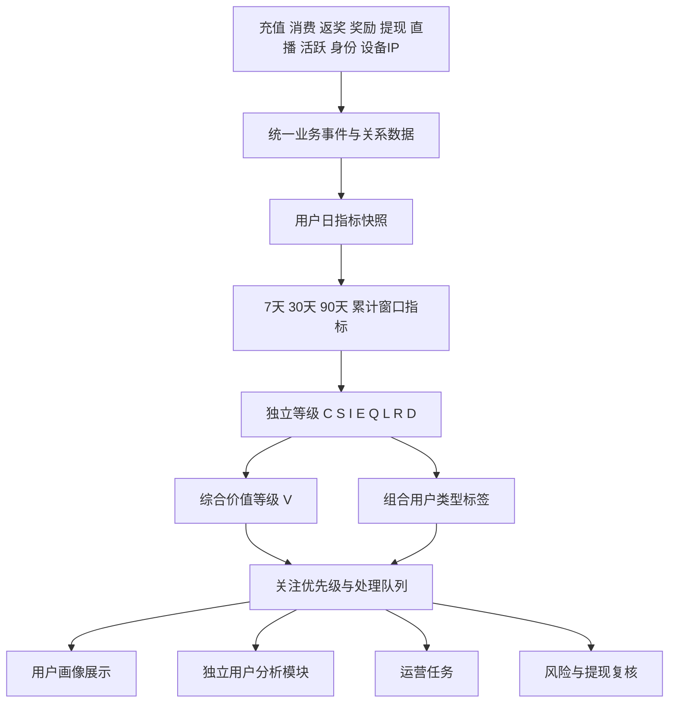

# SANO用户标签与价值识别体系

## 1. 文档信息

| 项目 | 内容 |
| --- | --- |
| 文档名称 | SANO用户标签与价值识别体系 |
| 文档版本 | V1.0 |
| 文档日期 | 2026年9月22日 |
| 适用范围 | 用户画像、大R识别、优质用户识别、奖励依赖及疑似薅利识别、运营分层、风险复核 |
| 使用对象 | 产品、数据、后端、运营、风控、财务 |
| 文档目标 | 明确需要保存的数据、快照、指标、独立等级、综合等级、组合标签及最终输出，使开发人员能够据此完成标签系统建设 |

## 2. 建设背景

SANO已经具备普通用户、主播、优质主播、高级主播、公会长、公会成员、币商、Payroll、BD、会员、测试账号、系统账号和机器人账号等身份数据，也具备充值、消费、返奖、Jackpot、提现、直播、奖励、设备和IP等业务记录。

当前缺少的是将这些分散数据统一转换为可解释的用户指标、独立等级和组合标签，从而稳定回答以下问题：

1. 这个用户是谁，当前拥有哪些身份？
2. 用户在现金充值、消费、平台内循环、生态贡献、持续质量等方面分别达到什么程度？
3. 用户是否值得运营重点关注，关注原因是什么？
4. 用户是否依赖奖励或返奖获利，是否存在疑似薅利行为？
5. 用户的提现是否需要风险复核？
6. 平台应当如何认识、维护、召回、限制奖励或复核该用户？

本体系不使用一个不可解释的总分覆盖全部事实，而是采用“身份事实＋指标快照＋独立等级＋综合价值＋组合标签＋运营动作”的分层结构。

## 3. 建设目标与边界

### 3.1 建设目标

1. 统一用户价值、质量、利益依赖和风险指标口径。
2. 形成可按历史日期还原的日快照、等级快照和标签快照。
3. 独立计算现金价值、消费价值、内循环、生态价值、用户质量、利益依赖和风险状态。
4. 形成现金大R、消费大R、内循环大R、生态核心用户、优质用户、奖励依赖用户、疑似薅利用户、提现风险用户等组合标签。
5. 为用户画像提供当前结论和下钻证据。
6. 为独立用户分析模块提供名单、筛选、排序、运营任务和人工复核能力。

### 3.2 非目标

1. 首期不使用不可解释的黑盒模型直接决定用户等级或处罚。
2. 不使用单一充值金额、单一消费金额、单一设备、单一IP、单次高返奖或单次提现直接认定用户风险。
3. 不将测试、系统、机器人等身份从原始流水和用户详情统计中删除；身份事实继续保留，是否进入具体运营名单由组合规则控制。
4. 不在前端页面计算分数、等级或标签，所有结论均由服务端或数据服务生成。
5. 综合价值等级不替代现金、消费、生态等独立等级，风险等级也不覆盖用户真实价值。

## 4. 总体识别结构



最终标签结构如下：

```text
现有身份标签
＋生命周期标签
＋行为偏好标签
＋资金属性标签
＋C/S/I/E/Q/L/R独立等级
＋V综合价值等级
＋组合用户类型标签
＋关注优先级
＋运营或风险处理建议
＋数据置信度与解释证据
```

## 5. 全局统计口径

### 5.1 时间口径

- 所有权威时间使用服务器时间，统一按UTC+8统计。
- 今日为当日`00:00:00`至当前时刻。
- 近7天为今天及前6个自然日。
- 近30天为今天及前29个自然日。
- 近90天为今天及前89个自然日。
- 前7天、前30天分别指当前窗口紧邻的上一个等长窗口。
- 累计指标从用户首条有效业务记录统计至当前时刻。
- 日终正式快照按完整自然日保存；当日数据作为临时快照，可以随事件增量更新。

### 5.2 金额口径

- 金额统一使用业务记录中已经换算完成的美元金额。
- 页面和标签计算不根据金币、钻石、原币或汇率再次换算。
- 金币与美元固定价值比例为`10000金币 = 1美元`，钻石与美元固定价值比例为`10000000钻石 = 1美元`，只用于校验缺失美元金额的异常记录，不覆盖记录中已有美元金额。
- 充值只统计支付成功记录；本版本不考虑退款、撤销、拒付、冲正和补单对已成功充值汇总的影响。
- 提现只统计最终打款成功金额，日期按照实际打款时间归属。
- 主播礼物和游戏收入使用完成分层计算后主播实际获得的收入。
- 充值、消费、返奖、Jackpot、主播收入、系统奖励和提现属于不同业务含义，必须分别保存和统计。

### 5.3 事件去重

- 充值按照充值订单号去重。
- 消费按照消费事件ID去重。
- 返奖和Jackpot按照返奖事件ID去重。
- 奖励按照奖励发放记录ID去重。
- 提现按照提现流水号去重。
- App初始化记录允许出现少量重复请求，但关系指标不得因重复请求提高关联置信度。
- 同一业务事件同时参与不同分析维度时可以分别归因，但平台最终总金额不得重复相加。

### 5.4 用户与自然人层级

- `user_id`为账号级主体，用于用户画像和单账号行为分析。
- `person_id`为确认或推测的同一自然人或实际控制人，用于多账号去重和风险调查。
- `account_group_id`为一组强关联或人工确认账号的治理单元。
- 没有可靠关联结果时，`person_id`不得由相同IP、相同品牌型号等弱证据自动生成。
- 独立等级默认先在`user_id`层计算；大R名单、重复奖励和整体风险同时生成`person_id`层结果。
- 一个账号组内的资产转移不产生新的现金价值或平台内循环价值。

### 5.5 身份口径

SANO现有身份直接作为事实标签使用：

1. 普通用户。
2. 主播、优质主播、高级主播。
3. 公会长、公会成员。
4. 币商。
5. Payroll。
6. BD。
7. 会员。
8. 测试账号、系统账号、机器人账号。

身份允许同时存在，必须保存生效时间、失效时间和当前状态。身份不直接决定用户价值，也不能用单一身份覆盖其他身份。

### 5.6 同类阈值与页面展示

- 金额、天数、人数等规模指标可以使用历史数据分布计算内部评级阈值。
- 首版优先按注册国家计算阈值；生态等级按照注册国家和具体经营身份计算阈值。
- 样本不足时依次回退到区域和全平台。
- 同类排名和分位数只作为后台评级和阈值校准依据，本期用户画像页面不展示“超过同类多少”的结论。
- 每个阈值必须保存计算日期、样本范围、样本数量和阈值版本。

## 6. 标签体系

### 6.1 标签分层

| 层级 | 标签性质 | 典型内容 | 产生方式 |
| --- | --- | --- | --- |
| 身份标签 | 已有业务事实 | 主播、公会长、币商、Payroll、BD、会员 | 读取现有业务数据 |
| 生命周期标签 | 派生状态 | 新用户、成长、稳定、下降、沉默、流失、回流 | 活跃、充值、消费趋势计算 |
| 行为偏好标签 | 派生事实 | 普通礼物偏好、幸运礼物偏好、游戏偏好 | 消费构成计算 |
| 资金属性标签 | 派生事实 | 现金充值型、收益消费型、返奖内循环型、奖励支持型 | 资产来源归因 |
| 独立等级 | 分维度评级 | C、S、I、E、Q、L、R、D | 指标和规则计算 |
| 综合价值等级 | 正向价值总结 | V0至V4 | 独立正向等级加权计算 |
| 组合类型标签 | 业务结论 | 现金大R、优质用户、疑似薅利、提现风险 | 多等级及证据组合 |
| 动作标签 | 处理建议 | VIP维护、培养、召回、控制奖励、人工复核 | 组合类型和优先级规则 |

### 6.2 生命周期标签

| 标签 | 首版规则 |
| --- | --- |
| 新用户 | 注册不超过7个自然日 |
| 成长用户 | 近30天充值、消费或平台贡献净收益较前30天增长不低于30%，且不是由单日异常事件完全造成 |
| 稳定用户 | 连续两个30天周期保持相同或相邻价值等级，且下降幅度低于30% |
| 下降用户 | 近30天充值、消费或平台贡献净收益较前30天下降不低于50% |
| 沉默用户 | 连续3天无登录或无有效业务行为 |
| 流失预警 | 连续7天无登录或无有效业务行为 |
| 已流失 | 连续14天无登录或无有效业务行为 |
| 回流用户 | 流失后重新登录，并重新产生充值、消费或有效直播行为 |

生命周期天数和变化阈值均为首版配置，必须支持版本化调整。

### 6.3 行为偏好标签

在满足最低消费金额和最低消费天数配置后计算：

| 标签 | 首版规则 |
| --- | --- |
| 普通礼物偏好 | 近30天普通礼物消费占总消费不低于50% |
| 幸运礼物偏好 | 近30天幸运礼物消费占总消费不低于50% |
| 游戏偏好 | 近30天游戏消费占总消费不低于50% |
| 道具偏好 | 近30天道具消费占总消费不低于50% |
| VIP偏好 | 近30天VIP消费占总消费不低于50% |
| 多产品用户 | 至少3类产品消费占比均不低于10%，且没有单一类型超过50% |

### 6.4 资金属性标签

| 标签 | 首版规则 |
| --- | --- |
| 现金充值型 | 近30天可消费资产流入中，本人成功充值来源占比不低于70% |
| 主播收益消费型 | 近30天消费中，主播收益兑换或分层收入支持的消费占比不低于50% |
| 返奖内循环型 | 近30天消费中，游戏、幸运礼物返奖或Jackpot支持的再次消费占比不低于50% |
| 奖励支持型 | 近30天可消费资产流入中，平台奖励占比不低于50% |
| 经营资金型 | 主要资金来自币商、Payroll或其他经营资产 |
| 混合资金型 | 没有单一已知来源达到50%，且至少两种来源均达到20% |
| 未知来源较高 | 近30天消费来源中无法归因金额占比超过20% |

## 7. 原始数据结构

本节定义标签系统依赖的逻辑数据结构。现有业务表可以继续使用，不要求为了本需求全部合并成一张新表，但必须能够按以下业务主键、用户、时间和金额查询。

### 7.1 用户身份关系

最少需要：

- 用户ID。
- 身份类型和身份等级。
- 生效时间、失效时间和当前状态。
- 审核状态和最近审核通过时间。
- 公会、上级公会、运营、BD等关系。
- 测试、系统、机器人等内部身份。

用途：身份展示、同身份阈值、生态等级和经营资金识别。

### 7.2 充值事件

最少需要：

- 充值订单号。
- 用户ID。
- 支付成功时间。
- 成功美元金额。
- 渠道、国家、币商ID和记录已有的业务属性。
- 订单状态。

用途：现金价值、复充、充值趋势和现金支持消费分析。

### 7.3 消费事件

最少需要：

- 消费事件ID。
- 消费用户ID和收益用户ID。
- 房间ID和公会ID。
- 消费时间。
- 产品类型：普通礼物、幸运礼物、游戏、道具、VIP。
- 礼物类型、游戏类型或道具类型。
- 消费美元金额。
- 关联活动、榜单、PK或其他业务场景。

用途：消费等级、偏好、消费去处、关系集中度、房间贡献和关联交易分析。

### 7.4 返奖与Jackpot事件

最少需要：

- 返奖事件ID。
- 用户ID。
- 返奖类型：幸运礼物返奖、游戏返奖、幸运礼物Jackpot、游戏Jackpot。
- 发生时间。
- 返奖美元金额。
- 关联消费事件、游戏局或幸运礼物事件。
- 是否形成钻石、金币或其他可兑换资产。

用途：返奖率、内循环、利益依赖和异常返奖分析。

### 7.5 兑换与资产流转事件

最少需要：

- 兑换或流转事件ID。
- 用户ID。
- 流入资产和流出资产。
- 美元价值。
- 发生时间。
- 来源类型和来源事件ID。
- 转入或转出对手方用户ID。
- 兑换前后余额。

用途：返奖或收益转金币后的再次消费、用户间转账、内部资金循环和提现来源分析。

### 7.6 提现事件

最少需要：

- 提现流水号。
- 用户ID。
- 申请时间和实际打款时间。
- 最终打款成功美元金额。
- 提现状态和失败、拒绝原因。
- 提现方式和提现账户的受控关联标识。
- 提现前后钻石及记录中已有的业务数据。

用途：提现率、提现行为、短周期兑现、共享提现账户和提现风险分析。

### 7.7 平台奖励与成本事件

最少需要：

- 奖励记录ID。
- 获奖用户ID。
- 奖励类型：开播时长、优质主播、周奖励、新人、榜单、任务、补偿和其他奖励。
- 发放成功时间。
- 奖励美元金额。
- 关联活动、任务、直播、榜单或业务事件。
- 发放状态。

用途：平台成本、奖励依赖、重复领奖、奖励回收和平台贡献净收益。

### 7.8 直播与房间事件

最少需要：

- 主播用户ID和房间ID。
- 开关播时间、直播类型和直播时长。
- 观看人次和上麦人数。
- 房间内普通礼物、幸运礼物、游戏及道具消费。
- 主播普通礼物、幸运礼物和游戏实际分层收入。
- 房间返奖和Jackpot数据。

用途：主播活跃、房间经营、主播收入、生态价值和平台贡献净收益。

### 7.9 登录与活跃日事实

最少需要：

- 用户ID。
- 活跃日期。
- 是否登录、是否消费、是否充值、是否直播。
- 最近登录和最近活跃时间。
- 当日有效互动、观看、房间复访等行为。

用途：连续登录、生命周期、沉默、流失、回流和用户质量。

登录及留存必须使用正式登录或活跃数据。App初始化设备上报属于设备环境证据，不能作为唯一登录事实。

### 7.10 设备、IP与账号关联证据

使用《用户设备与账号关联分析》中定义的数据，至少包括：

- App初始化记录ID、用户ID和服务端接收时间。
- 安装实例ID和有效设备标识。
- 设备品牌、型号、系统和客户端类型。
- 服务端取得的公网IP及国家、地区和城市。
- 是否模拟器、VPN或代理。
- 同安装实例、同有效设备标识和同IP关联账号结果。

用途：账号关联、风险证据、提现风险和多账号奖励分析。

### 7.11 用户关联及人工治理

最少需要：

- `person_id`、`account_group_id`和`user_id`。
- 识别置信度。
- 最强关联证据。
- 首次识别和最近更新时间。
- 规则或算法版本。
- 自动、人工确认、人工拆分等状态。
- 合并、拆分、回滚的操作人、时间和原因。

用途：人级去重、多账号价值合并、重复领奖和闭环资金复核。

## 8. 第一步 建立快照与结果存储

标签系统不能只在页面查询时临时聚合。首期应至少建立以下逻辑快照和结果结构。

### 8.1 用户日指标快照

粒度：`统计日期＋user_id`。

每日保存：

- 充值金额、充值订单数、是否充值。
- 各类消费金额、消费事件数、消费对象数、是否消费。
- 幸运礼物返奖、游戏返奖和两类Jackpot金额。
- 各类平台奖励金额。
- 成功提现金额和是否提现。
- 金币、钻石及美元价值余额快照。
- 登录、活跃、直播状态和直播时长。
- 房间消费、主播分层收入、平台业务净收入、平台奖励成本、平台贡献净收益。
- 当日使用设备数、IP数及关联账号信号。
- 数据完整状态和生成时间。

这是后续7天、30天、90天和累计统计的基础表。

### 8.2 自然人日指标快照

粒度：`统计日期＋person_id`。

从关联账号汇总用户日指标，并执行：

- 订单和事件去重。
- 账号之间资产转移不新增价值。
- 关联账号之间消费单独标记为本人关联消费。
- 同一奖励不得因多个账号关系重复计入。
- 保存组成该自然人的账号列表版本。

### 8.3 窗口指标快照

粒度：`快照日期＋主体类型＋主体ID＋窗口类型`。

窗口类型包括：

- 1天。
- 7天。
- 30天。
- 90天。
- 累计。
- 前7天和前30天，用于趋势比较。

窗口快照保存各等级计算需要的完整指标，不只保存最终分数。

### 8.4 资金来源归因快照

粒度：`快照日期＋主体ID＋窗口类型＋资金来源类型`。

保存：

- 各来源流入金额。
- 各来源支持的消费金额。
- 各来源形成的提现金额。
- 未知来源金额。
- 来源占比。
- 归因方法和版本。

首期推荐使用来源加权资金池。每次资产流入更新各来源余额权重，每次消费、兑换或提现按照当前来源权重分摊。该方法用于经营分析，不宣称为法律意义上的逐笔资金追踪。

### 8.5 关系与风险证据快照

粒度：`快照日期＋主体ID＋证据类型＋证据对象`。

保存：

- 证据类型和证据等级。
- 关联账号、设备、IP、支付或提现对象。
- 首次、最近命中时间和命中次数。
- 统计窗口。
- 原始事件ID列表或证据查询条件。
- 规则版本。
- 自动结论和人工结论。

### 8.6 阈值快照

粒度：`计算日期＋指标编码＋人群编码＋版本`。

保存：

- 样本范围和样本数量。
- P50、P70、P90、P97、P99等分位值。
- 最低业务金额和最低样本要求。
- 实际采用的等级阈值。
- 计算版本和生效时间。

阈值可以按月或按运营确认周期调整，不得静默覆盖历史阈值。

### 8.7 独立等级快照

粒度：`快照日期＋主体ID＋等级类型`。

保存：

- 等级类型：C、S、I、E、Q、L、R、D。
- 原始分数和最终等级。
- 使用的窗口。
- 关键指标值。
- 命中规则和原因编码。
- 阈值版本、规则版本和数据版本。
- 数据置信度。
- 生成时间。

### 8.8 综合价值快照

粒度：`快照日期＋主体ID＋价值轨道`。

价值轨道包括：

- 终端用户价值。
- 主播价值。
- 公会价值。
- 币商价值。
- Payroll价值。
- BD价值。

保存综合分、V等级、组成维度及其权重。多身份用户保存多个价值轨道，不只保存一个最终值。

### 8.9 组合标签快照

粒度：`快照日期＋主体ID＋标签编码`。

保存：

- 标签编码和名称。
- 标签状态：新产生、持续、解除、人工覆盖。
- 生效时间和失效时间。
- 来源独立等级和综合等级。
- 原因编码和证据入口。
- 规则版本。
- 自动生成或人工确认。

### 8.10 人工复核和处置记录

保存：

- 复核单ID。
- 用户或自然人主体。
- 触发标签和触发时间。
- 风险证据。
- 复核人、复核状态和结论。
- 处罚、解除、维持观察等处理结果。
- 对自动标签的确认或纠正。

人工结果不能覆盖算法历史快照，应以独立记录保存。

## 9. 第二步 统计指标并写入快照

### 9.1 日指标处理顺序

1. 按业务事件ID完成去重。
2. 只保留符合各业务成功状态的记录。
3. 按UTC+8自然日归属事件日期。
4. 使用记录中已有美元金额，不重复换算。
5. 按产品、资金来源、交易对手、房间和身份拆分。
6. 生成用户日指标。
7. 根据当天有效账号组版本生成自然人日指标。
8. 记录缺失、迟到和异常数据状态。

### 9.2 窗口指标生成

通过日指标滚动生成1天、7天、30天、90天和累计窗口。需要保存的核心指标包括：

#### 充值指标

- 成功充值金额和订单数。
- 充值天数。
- 最近充值时间。
- 连续付费月份。
- 本周期较上一周期变化率。
- 本人现金充值支持的消费金额和占比。

#### 消费指标

- 普通礼物、幸运礼物、游戏、道具和VIP消费。
- 总消费、消费天数和最近消费时间。
- 各产品消费占比。
- 收益用户数、房间数和公会数。
- Top 1、Top 3、Top 10消费去处占比。
- 关联账号消费金额和占比。
- 消费周覆盖率和单日最大消费占比。

#### 返奖及内循环指标

- 幸运礼物返奖、游戏返奖和Jackpot金额。
- 钻石转金币金额。
- 来源于返奖或收益的再次消费金额。
- 可循环返奖及收益流入。
- 内循环率。
- 提现率。
- 余额沉淀天数。
- 从返奖到兑换、消费和提现的时间间隔。

#### 生态指标

- 带来的成功充值金额。
- 带来的有效付费用户数。
- 关联用户复充和留存。
- 房间消费和主播实际收入。
- 有效直播时长、场次、观看和互动。
- 奖励发放后产生的平台收入及净收益。
- 关系集中度和关联账号内部贡献占比。

#### 活跃与质量指标

- 登录天数、连续登录天数。
- 直播天数、连续直播天数。
- 消费周覆盖率和充值月覆盖率。
- 最近登录、最近活跃、最近消费和最近充值。
- 当前周期与上一周期变化。
- 奖励停止后的持续活跃、充值和消费情况。

#### 奖励与利益依赖指标

- 各类平台奖励金额。
- 奖励占全部可消费资产流入的比例。
- 奖励到账后24小时、72小时和7天内提现金额。
- 奖励到账后产生的平台收入和净收益。
- 同自然人或关联账号重复领取次数。
- 奖励停止后的活跃下降比例。

#### 风险及提现指标

- 同安装实例、设备标识和IP关联账号数。
- 共享实名、支付工具或提现账户的账号数。
- 账号之间送礼、转账、兑换和提现闭环。
- 提现来源中现金、收益、返奖、奖励和未知来源占比。
- 短周期提现次数和金额。
- 异常跨国家、代理、模拟器和设备切换信号。
- 当前黑名单、处罚和人工复核状态。

### 9.3 比例和分母为零

- 分母为0时，比例保存为`NULL`并标记不可计算，不保存为0。
- 原始业务事实为0时保存0。
- 数据源未接入、查询失败或字段缺失时保存`NULL`并记录缺失原因。
- 未知不能按正常、无风险或无奖励依赖处理。

## 10. 第三步 计算独立等级

### 10.1 公共评分函数

规模类指标使用内部百分位标准化：

```text
P(x) = 指标x在当前适用人群中的百分位分数，范围0至100
```

趋势类指标使用当前周期与上一等长周期比较：

```text
变化率 =（当前周期值 - 上一周期值）÷ 上一周期值
```

上一周期为0时：

- 当前周期也为0，变化率记为0。
- 当前周期大于0，标记为“从无到有”，趋势得分按照配置上限处理，不直接显示无限增长。

连续性类指标按有效天数、有效周数或有效月数转换为0至100分。

### 10.2 现金价值等级 C

现金价值只使用本人成功充值，不包含币商转入、Payroll资产、主播收入、奖励、返奖和用户转账。

```text
C分
= P(近30天成功充值金额) × 35%
+ P(近90天成功充值金额) × 15%
+ P(近30天充值天数) × 15%
+ 最近充值时间得分 × 10%
+ 连续付费月份得分 × 15%
+ P(近30天较前30天充值变化) × 10%
```

最近充值时间得分：

| 最近充值 | 得分 |
| --- | ---: |
| 今日 | 100 |
| 1至3天 | 80 |
| 4至7天 | 60 |
| 8至15天 | 40 |
| 16至30天 | 20 |
| 超过30天 | 0 |

评级规则：

| 等级 | 规则 |
| --- | --- |
| C0 | 近90天没有成功充值 |
| C1 | 有成功充值，C分低于50 |
| C2 | C分50至64 |
| C3 | C分65至79，且近30天至少2个充值日 |
| C4 | C分不低于80，近30天充值达到同注册国家P99阈值，且至少3个充值日；样本不足时按照阈值回退规则处理 |
| CX | 充值数据不完整，无法评估 |

### 10.3 消费价值等级 S

消费价值统计普通礼物、幸运礼物、游戏、道具和VIP消费，不因资金来自充值、返奖或收益而排除，但资金来源必须另外标记。

```text
S分
= P(近30天消费金额) × 35%
+ P(近90天消费金额) × 15%
+ P(近30天消费天数) × 15%
+ 最近消费时间得分 × 10%
+ 消费周覆盖率 × 10%
+ 真实互动消费得分 × 10%
+ 产品广度得分 × 5%
```

其中：

- 消费周覆盖率为近12周中发生有效消费的周数除以12。
- 真实互动消费综合消费对象数、房间复访、互动行为和关联账号消费占比。
- 产品广度按照发生有效消费的产品类型数量评分。

评级规则：

| 等级 | 规则 |
| --- | --- |
| S0 | 近90天没有消费 |
| S1 | 有消费，S分低于50 |
| S2 | S分50至64 |
| S3 | S分65至79，且近30天至少2个消费日 |
| S4 | S分不低于80，近30天消费达到同注册国家P99阈值，且至少3个消费日；样本不足时按照阈值回退规则处理 |
| SX | 消费数据不完整，无法评估 |

### 10.4 平台内循环等级 I

```text
内循环金额
= 来源于返奖或主播收益并兑换、转化后再次消费的金额
```

```text
内循环率
= 内循环金额 ÷ 可循环返奖及收益流入
```

```text
提现率
= 成功提现金额 ÷ 可提现收益金额
```

评级规则：

| 等级 | 规则 |
| --- | --- |
| I0 | 没有可循环返奖或收益流入 |
| I1 | 内循环率低于30% |
| I2 | 内循环率30%至49.99% |
| I3 | 内循环率50%至69.99% |
| I4 | 内循环率不低于70%，提现率不高于10%，且近30天仍有消费 |
| IX | 无法追踪返奖、收益、兑换和再次消费链路 |

用户没有提现资格、提现失败或账号受限时，不授予I4，只保留实际内循环率和原因说明。

### 10.5 生态价值等级 E

生态价值按身份分别计算，不生成一个混合的生态总分：

- `E_HOST`：主播生态价值。
- `E_GUILD`：公会长生态价值。
- `E_COIN_DEALER`：币商生态价值。
- `E_PAYROLL`：Payroll生态价值。
- `E_BD`：BD生态价值。

```text
E分
= P(带来的平台成功充值) × 25%
+ P(带来的有效付费用户数) × 15%
+ 关联用户30天复充得分 × 15%
+ 关联用户D7和D30留存得分 × 10%
+ P(有效房间或业务消费) × 10%
+ 内容和供给活跃得分 × 10%
+ 奖励后贡献得分 × 10%
+ 运营稳定性得分 × 5%
```

评级规则：

| 等级 | 规则 |
| --- | --- |
| E0 | 没有适用经营身份，或适用身份没有有效生态贡献 |
| E1 | E分低于50 |
| E2 | E分50至64 |
| E3 | E分65至79 |
| E4 | E分不低于80，且达到同注册国家、同经营身份P97阈值；样本不足时按照阈值回退规则处理 |
| EX | 身份关系、归属关系或贡献数据不足 |

Payroll转币、币商转币和其他经营资产不计入终端用户现金充值，但可以进入对应身份的生态贡献。

### 10.6 用户质量等级 Q

用户质量用于衡量持续性和未来可运营价值，不等于当前充值或消费规模。

```text
Q分
= 登录和活跃连续性得分 × 20%
+ 充值连续性得分 × 20%
+ 消费连续性得分 × 15%
+ 平台贡献净收益稳定性得分 × 25%
+ 当前30天价值趋势得分 × 10%
+ 奖励停止后的持续贡献得分 × 10%
```

平台贡献净收益分别保存不同归因轨道：

1. 用户直接贡献：用户本人消费产生的平台业务净收入，减去直接向该用户发放的运营奖励成本。用户本人普通礼物、幸运礼物、游戏和道具消费分别按照16%、1.1%、2%和100%计算平台业务净收入；VIP消费在没有确认平台净收入比例前单独保存，不进入本项。
2. 主播经营贡献：该主播直播间产生的平台业务净收入，减去主播激励成本。
3. 其他生态贡献：公会、币商、Payroll或BD关系带来的平台贡献。

主播经营贡献计算沿用用户画像已确认口径：

```text
平台业务净收入
= 普通礼物消费 × 16%
+ 幸运礼物消费 × 1.1%
+ 游戏消费 × 2%
+ 道具消费
```

```text
主播激励总成本
= 直播时长奖励
+ 优质主播奖励
+ 周奖励
+ 其他已发放成功奖励
```

```text
平台贡献净收益
= 平台业务净收入 - 主播激励总成本
```

幸运礼物1.1%和游戏2%已经扣除各自0.5%的Jackpot池贡献，Jackpot池贡献和实际爆奖不再次扣减。

平台比例不写入每笔消费记录，也不要求逐笔保存比例快照。日指标应保存各类原始消费金额、奖励成本和本次计算使用的比例配置版本；比例调整后可以按新版本重算标签，同时保留旧版本结果。

评级规则：

| 等级 | 规则 |
| --- | --- |
| Q0 | 长期无活跃，且没有持续贡献 |
| Q1 | Q分低于40 |
| Q2 | Q分40至59 |
| Q3 | Q分60至79，且近30天平台贡献净收益为正 |
| Q4 | Q分不低于80，且近30天和近90天平台贡献净收益均为正 |
| QX | 活跃、成本或平台贡献数据不足 |

Q等级不直接扣除风险分或利益依赖分。是否适合VIP运营由后续组合规则判断。

### 10.7 利益依赖等级 L

利益依赖用于识别用户对奖励、返奖兑现和短期利益的依赖程度，不等同于违规。

```text
奖励依赖率
= 平台奖励资产流入 ÷ 全部可消费资产流入
```

```text
奖励兑现率
= 可归因至奖励的成功提现及期末可提现余额
÷ 平台奖励资产流入
```

```text
奖励回收率
= 奖励发放后产生的平台业务净收入
÷ 奖励成本
```

```text
L分
= P(奖励依赖率) × 25%
+ P(奖励兑现率) × 20%
+ P(奖励到账后短期提现比例) × 15%
+ 奖励停止后的活跃下降得分 × 15%
+ 多账号重复领取得分 × 15%
+ 奖励投入产出为负得分 × 10%
```

评级规则：

| 等级 | 规则 |
| --- | --- |
| L0 | L分低于20，未发现明显利益依赖 |
| L1 | L分20至39，轻度利益敏感 |
| L2 | L分40至59，中度奖励或利益依赖 |
| L3 | L分60至79，且至少命中两类独立证据 |
| L4 | L分不低于80，且至少命中三类独立证据 |
| LX | 奖励来源、消费或提现链路无法追踪 |

主播、公会长、币商、Payroll和BD必须与相同身份的正常经营行为区分。正常领取经营奖励和正常提现不能单独提高到L3或L4。

### 10.8 风险等级 R

风险等级使用证据组合规则，不使用单一金额或一个不可解释的风险总分。

证据等级：

| 证据等级 | 示例 |
| --- | --- |
| 强关联证据 | 相同实名认证、支付工具、提现账户、人工确认的实际控制人 |
| 中等关联证据 | 长期相同安装实例、有效设备标识、连续账号切换、稳定资金来源关系 |
| 弱关联证据 | 相同IP、品牌型号、国家地区、公会、邀请人、代理或模拟器信号 |
| 异常行为证据 | 重复领奖、关联账号互转互送、奖励到账后短期提现、完整资金闭环、榜单叠加 |

评级规则：

| 等级 | 规则 |
| --- | --- |
| R0 | 没有明确异常证据 |
| R1 | 只有一个弱信号，或关键数据不完整 |
| R2 | 至少两项相互独立的中等或异常证据，或者一项中等证据与多项弱证据形成组合，需要人工复核 |
| R3 | 强关联关系同时出现重复领奖、资金闭环、异常提现等完整行为链，或人工确认重大异常 |
| R4 | 已完成处罚、限制、解除或其他正式处置，保留结论和历史 |

相同实名、支付工具或提现账户可以证明账号关联，但关联本身不等于风险。只有同时出现异常业务行为时才提高风险等级。

### 10.9 数据置信度 D

D用于说明当前结论是否可信，不属于用户价值或风险事实。

```text
数据完整率
= 已取得的必要指标数量 ÷ 当前等级要求的必要指标总数
```

| 等级 | 规则 |
| --- | --- |
| D0 | 完整率低于60%，结论不可用于自动运营或风险处理 |
| D1 | 完整率60%至79%，仅供参考 |
| D2 | 完整率80%至94%，可以用于运营筛选 |
| D3 | 完整率不低于95%，且核心资金来源和证据链可追溯 |

## 11. 第四步 计算综合价值等级 V

### 11.1 综合价值原则

- V只总结正向价值，不扣除L利益依赖和R风险。
- 高价值高风险用户同时保留V高等级和R高等级，不相互覆盖。
- 多身份用户分别计算多个价值轨道。
- 页面必须能够展开查看构成V的独立等级。

### 11.2 终端用户价值

适用于普通用户、会员及所有身份用户的个人充值和消费行为：

```text
V_USER
= C分 × 35%
+ S分 × 30%
+ I分 × 10%
+ Q分 × 25%
```

I等级转换为分数：I0为0、I1为25、I2为50、I3为75、I4为100。IX不参与直接计算，并降低D等级；权重按照已评估正向维度重新归一化。

### 11.3 主播和经营身份价值

主播轨道：

```text
V_HOST
= C分 × 15%
+ S分 × 10%
+ I分 × 10%
+ E_HOST分 × 40%
+ Q分 × 25%
```

公会、币商、Payroll和BD轨道分别使用对应E分：

```text
V_BUSINESS
= C分 × 15%
+ S分 × 10%
+ I分 × 10%
+ 对应身份E分 × 40%
+ Q分 × 25%
```

### 11.4 V等级

| 等级 | 分数范围 | 业务含义 |
| --- | ---: | --- |
| V0 | 0至19 | 当前没有明确价值贡献 |
| V1 | 20至39 | 低价值或价值尚未形成 |
| V2 | 40至59 | 中等价值，可观察和培养 |
| V3 | 60至79 | 高价值，应重点运营 |
| V4 | 80至100 | 核心价值，应进入核心维护或专项管理 |
| VX | 无法计算 | 正向维度数据不足，不能输出综合价值 |

### 11.5 主价值轨道

多身份用户保存全部价值轨道，同时选择当前分数最高的轨道作为`primary_value_track`，例如：

```text
V_USER = 72
V_HOST = 86
V_GUILD = 63
primary_value_track = HOST
```

主价值轨道只用于列表排序和摘要，不能隐藏其他身份轨道。

## 12. 第五步 组合识别规则

### 12.1 大R标签

| 标签 | 组合规则 |
| --- | --- |
| 潜力现金大R | C2，近30天充值增长不低于30%，Q不低于Q2 |
| 现金大R | C3 |
| 核心现金大R | C4 |
| 消费大R | S4 |
| 内循环大R | C或S不低于3级，同时I4 |
| 生态核心用户 | 任一经营身份E4 |
| 综合核心价值用户 | 任一价值轨道V4 |

风险等级不能取消大R事实。例如C4且R3的用户同时具有“核心现金大R”和“高价值风险用户”标签。

### 12.2 优质用户标签

| 标签 | 组合规则 |
| --- | --- |
| 潜力优质用户 | C或S为1至2级，Q不低于Q3，近30天价值增长不低于30%，R不高于R1 |
| 稳定优质用户 | Q3以上，近30天平台贡献净收益为正，连续两个周期保持，L不高于L2，R不高于R1 |
| 核心优质用户 | Q4、V4、L不高于L1、R不高于R1、D不低于D2 |
| 优质主播 | 主播身份有效，E_HOST不低于E3，Q不低于Q3，近30天主播平台贡献净收益为正 |
| 核心生态用户 | 任一E4、Q不低于Q3、R不高于R1 |

现有业务身份中的“优质主播”继续作为审核身份使用；本体系计算的“优质主播价值标签”应使用不同标签编码，避免与业务身份混淆。

### 12.3 奖励依赖与疑似薅利标签

| 标签 | 组合规则 |
| --- | --- |
| 利益敏感用户 | L1或L2，没有明显风险证据 |
| 奖励依赖用户 | L3以上，R0或R1 |
| 高利益依赖用户 | L4，但没有足够证据确认异常行为 |
| 疑似薅利用户 | L3以上、R2以上，并在重复领奖、短期提现、关联闭环、奖励停止后快速沉默中至少命中两类 |
| 疑似多账号套利 | 同一person或account_group内多个账号重复领取同类奖励，并存在共同强或中等关联证据 |
| 已确认薅利或套利 | 人工复核确认，风险状态达到R3或R4 |

L高表示用户依赖利益，不自动表示违规；“已确认薅利或套利”只能由人工复核或现有正式风控规则产生。

### 12.4 提现风险标签

提现风险作为R风险的子类型输出：

| 标签 | 组合规则 |
| --- | --- |
| 正常提现 | 提现来源可解释，没有短周期异常或关联闭环 |
| 提现观察 | 提现金额较高，或只有一个弱信号，没有完整异常链路 |
| 提现待复核 | 奖励或返奖到账后72小时内多次提现，或者提现来源中未知占比超过20%，同时存在另一项中等证据 |
| 关联提现风险 | 多个强关联账号共用提现账户，并出现奖励、转账或收礼资金集中提现 |
| 闭环提现风险 | 充值、关联消费、收礼、兑换和提现形成可复现闭环路径 |
| 已处置提现风险 | 人工复核后完成限制、拒绝、解除或其他处理 |

以下情况不能单独认定提现风险：

- 主播正常提现分层收入。
- Payroll或币商正常经营结算。
- 单次大额提现。
- 单次高返奖后的提现。
- 只有相同IP、设备或代理信号。

### 12.5 趋势和召回标签

| 标签 | 组合规则 |
| --- | --- |
| 快速成长用户 | C、S、E或V较上一周期上升至少一级，且Q不低于Q3 |
| 下降大R | 历史达到C4、S4、E4或V4，当前30天核心价值较前30天下降不低于50% |
| 沉默大R | 历史达到大R或V4，连续3天无登录或无消费 |
| 流失预警大R | 历史达到大R或V4，连续7天无登录或无消费 |
| 回流大R | 沉默或流失后重新登录并发生充值、消费或有效直播 |
| 高余额沉淀 | 余额达到配置阈值，连续7天没有消费，并且不是提现失败或账号受限造成 |

### 12.6 关系和集中度标签

| 标签 | 首版规则 |
| --- | --- |
| 单一消费去处集中 | 近30天Top 1消费去处占比不低于70%，且消费达到最低样本金额 |
| 少数消费去处集中 | 近30天Top 3消费去处占比不低于90% |
| 单一收入来源集中 | 近30天Top 1收入来源占比不低于70% |
| 同公会集中 | 近30天向同一公会消费占比达到配置阈值 |
| 关联账号消费 | 向同一person或account_group内账号消费达到配置阈值 |

集中度标签只描述事实，必须结合互动、经营身份和资金链判断风险。

## 13. 第六步 计算关注优先级和处理队列

单一“是否值得关注”无法表达关注原因，因此最终同时输出关注优先级、关注原因和处理队列。

### 13.1 关注优先级

| 优先级 | 规则示例 |
| --- | --- |
| P0 立即处理 | R3或R4；闭环提现风险；疑似薅利且存在待处理提现；核心大R突然流失或重大异常 |
| P1 重点关注 | V4；C4、S4或E4；R2；L4；下降大R；快速成长且Q3以上 |
| P2 常规关注 | V2或V3；Q3以上；L3；潜力大R或潜力优质用户 |
| P3 常规观察 | V0或V1且无明显增长、风险或流失信号 |
| PX 无法判断 | D0或核心等级为X |

P0不等于处罚。P0表示需要立即由对应团队处理，可能是VIP维护，也可能是风控复核。

### 13.2 处理队列

| 队列 | 进入规则 | 建议动作 |
| --- | --- | --- |
| VIP维护队列 | 核心现金大R、消费大R或V4，且R不高于R1 | 分配运营、记录偏好、维护关系和权益 |
| 潜力培养队列 | 潜力大R或潜力优质用户 | 观察增长来源，提供适度引导，不直接高额补贴 |
| 主播运营队列 | E_HOST不低于E3或优质主播价值标签 | 分析房间收入、成本、活跃和平台贡献净收益 |
| 生态运营队列 | 公会、币商、Payroll或BD的E不低于E3 | 按身份查看带来充值、付费用户和留存 |
| 大R召回队列 | 下降大R、沉默大R或流失预警大R | 检查支付、余额、体验、主播关系和近期风险 |
| 奖励策略队列 | L3或L4且R不高于R1 | 降低无效补贴，观察奖励停止后的真实贡献 |
| 人工风险复核队列 | R2以上或疑似薅利 | 查看设备、账号、资金、奖励和提现证据 |
| 提现复核队列 | 提现待复核、关联提现风险或闭环提现风险 | 在现有提现规则允许范围内进行人工调查 |
| 数据治理队列 | D0、D1或关键指标为X | 补齐来源、修复数据，不直接做运营或处罚结论 |

## 14. 最终输出结构

标签服务对每个用户至少输出以下内容：

### 14.1 用户是谁

- 用户ID和可用的person、account group信息。
- 当前全部有效身份。
- 注册国家、注册时间、渠道和生命周期。
- 当前账号状态。

### 14.2 用户在哪些方面达到什么程度

- C现金价值等级和分数。
- S消费价值等级和分数。
- I内循环等级和核心比例。
- 各身份E生态价值等级。
- Q用户质量等级。
- L利益依赖等级。
- R风险等级和风险子类型。
- D数据置信度。
- 各价值轨道V综合价值等级。

### 14.3 是否值得关注

- 当前关注优先级。
- 关注原因列表。
- 当前进入的运营或风险队列。
- 最近等级变化和标签变化。

### 14.4 是否存在提现风险

- 提现风险状态。
- 成功提现金额和提现率。
- 提现资金来源构成。
- 奖励或返奖到账至提现的时间。
- 共享提现账户、关联账号和闭环证据。
- 当前人工复核状态。

### 14.5 平台如何认识和运营

输出一条结构化结论，不由前端自由拼接。例如：

```text
用户身份：主播＋公会长＋会员
价值结论：核心现金大R，主播生态价值E4，综合主播价值V4
质量结论：Q4，近30天与90天平台贡献净收益均为正
资金特征：现金充值型，内循环I3
利益与风险：利益依赖L1，风险R0，提现正常
关注优先级：P1
建议动作：进入VIP维护和主播运营队列，持续观察充值与房间净贡献
```

高价值风险用户示例：

```text
用户身份：普通用户＋会员
价值结论：消费大RS4，综合用户价值V3
质量结论：Q2
资金特征：奖励支持型，利益依赖L4
风险结论：R2，命中多账号重复领奖及奖励到账后短期提现
提现状态：提现待复核
关注优先级：P0
建议动作：保留其消费价值标签，暂停自动升级奖励权益并进入人工复核
```

## 15. 计算、更新和版本机制

### 15.1 实时处理

以下事件发生后可以增量更新临时指标和风险证据：

- 大额成功充值。
- 大额消费、返奖或Jackpot。
- 平台奖励发放。
- 提现申请、成功、失败或拒绝。
- 新增强关联账号证据。
- 黑名单、处罚或人工复核结论变化。

风险和提现复核可以事件触发，不必等待日终批处理。

### 15.2 日终处理

建议在UTC+8自然日结束且主要业务数据完成入库后执行：

1. 生成上一自然日用户日指标。
2. 生成自然人日指标。
3. 更新7天、30天、90天和累计窗口。
4. 更新资金来源归因。
5. 更新关系和风险证据。
6. 计算独立等级。
7. 计算各价值轨道V等级。
8. 生成组合标签、关注优先级和处理队列。
9. 保存全部规则和数据版本。

### 15.3 重算机制

以下情况支持指定日期范围重算：

- 迟到或补录业务数据。
- 账号组合并、拆分或回滚。
- 资金来源归因逻辑调整。
- 阈值或评分规则版本调整。
- IP、设备或关系规则升级。

重算生成新版本，不删除或覆盖旧版本。历史页面应默认显示当时生效版本，也可以由有权限人员切换查看最新规则重算结果。

## 16. 数据保存与治理要求

1. 原始业务事件只追加，不因标签变化修改原始金额和状态。
2. 日指标、等级和标签快照保留历史版本。
3. 每个等级必须能够下钻到窗口指标和原始事件。
4. 每个标签必须保存原因编码，不能只保存一段不可检索文本。
5. 阈值、权重、最低金额、最低天数和组合条件统一配置并版本化。
6. 人工复核和人工覆盖独立保存，不能覆盖自动结果。
7. 安装实例、设备标识、IP、支付工具和提现账户按权限脱敏。
8. 查询和导出关联账号、实名、支付及提现证据必须记录审计日志。
9. `NULL`、0、未发生、数据缺失、无权限和计算失败必须明确区分。
10. 测试、系统、机器人账号继续参与原始统计，但名单筛选和运营动作可以根据身份单独配置。

## 17. 产品使用方式

### 17.1 用户画像

用户画像不需要展示全部计算过程，建议展示：

- 当前身份和生命周期。
- C、S、I、E、Q、L、R、D等级。
- 当前主价值轨道及V等级。
- 当前组合用户标签。
- 关注优先级和建议动作。
- 最近一次等级或标签变化。
- 每个结论的证据入口。

主播价值和用户价值继续分别展示，不使用V总等级覆盖两个摘要。

### 17.2 独立用户分析模块

支持：

- 大R名单。
- 优质用户池。
- 潜力用户池。
- 下降、沉默和流失用户池。
- 奖励依赖用户池。
- 疑似薅利用户池。
- 提现风险复核池。
- 高价值风险用户池。
- 按身份、国家、等级、标签、负责人和时间筛选。
- 查看标签原因、原始事件和历史版本。

### 17.3 规则配置与效果分析

支持有权限人员查看：

- 当前权重和阈值版本。
- 各等级用户数量和变化。
- 标签新增、解除和人工纠正情况。
- 运营触达后的充值、消费、留存和平台贡献变化。
- 奖励调整后的真实贡献变化。
- 风险规则命中率、复核通过率和误判情况。

## 18. 实施顺序

### 第一期 数据和快照基础

1. 对接身份、充值、消费、返奖、Jackpot、提现、奖励、直播、活跃和设备关联数据。
2. 完成事件ID和成功状态口径。
3. 建立用户日指标和窗口指标快照。
4. 建立规则、阈值和版本存储。
5. 建立D数据置信度。

交付结果：可以按任意用户和日期查询完整指标，不急于自动打复杂标签。

### 第二期 独立等级

1. 上线C现金价值。
2. 上线S消费价值。
3. 上线Q用户质量。
4. 上线L利益依赖。
5. 上线R风险及提现风险子类型。
6. 资产来源链路具备后上线I平台内循环。
7. 身份关系和生态归属稳定后上线各类E。

交付结果：每个用户能够回答“在哪些方面达到什么程度”。

### 第三期 综合价值和组合标签

1. 计算各价值轨道V等级。
2. 生成大R、优质、奖励依赖、疑似薅利、提现风险等组合标签。
3. 生成关注优先级和处理队列。
4. 接入用户画像和独立分析模块。

交付结果：能够回答“是否值得关注、为什么关注、由谁处理”。

### 第四期 校准与模型优化

1. 使用至少30天和90天历史数据回测阈值。
2. 分析人工复核的误判和漏判。
3. 调整权重和组合规则。
4. 数据稳定后，可以训练成长、流失或风险预测模型。
5. 预测模型只作为新证据，首期不替代可解释规则和人工复核。

## 19. 验收标准

### 19.1 数据与快照

1. 任意抽样用户能够还原指定日期的1天、7天、30天、90天和累计指标。
2. 同一订单和业务事件不会重复统计。
3. 用户级和自然人级结果可以相互下钻。
4. 账号组合并或拆分后能够重新计算且保留历史版本。
5. 0、NULL、不可计算和数据缺失能够正确区分。

### 19.2 独立等级

1. C、S、I、E、Q、L、R、D均能返回等级、分数、规则版本和关键原因。
2. 经营资产不会进入本人现金充值。
3. 高提现、高返奖、同设备或同IP不会单独生成高风险结论。
4. 数据不足时返回X或低置信度，不错误返回0级或正常。

### 19.3 综合与组合标签

1. 多身份用户可以同时保存多个价值轨道。
2. 高价值高风险用户同时保留价值标签和风险标签。
3. 疑似薅利必须同时具备利益依赖和组合风险证据。
4. 已确认套利只能由人工复核或正式风控规则产生。
5. 每个标签能够解释使用了哪些数据、窗口、阈值和规则。

### 19.4 产品结果

1. 用户画像能够回答用户是谁、各维度等级、综合价值、关注原因和建议动作。
2. 独立分析模块能够形成大R、优质、潜力、奖励依赖、疑似薅利和提现风险名单。
3. 点击等级或标签能够进入指标和原始事件证据。
4. 运营、风控和财务权限相互隔离，敏感信息按权限脱敏。

## 20. 上线前需要确认的配置

1. C4、S4和各身份E4的最低规模阈值。
2. 各国家样本不足时的区域回退关系。
3. 有效付费用户、有效直播和真实互动消费的现有业务定义。
4. 资产来源能否追踪到消费和提现；无法逐笔追踪时采用的加权资金池规则。
5. 各类奖励的业务编码和成本范围。
6. 提现资格、可提现收益及失败、拒绝、成功状态定义。
7. person和account group的强、中、弱证据及人工合并拆分权限。
8. 关联消费、重复领奖、短周期提现和资金闭环的初始规则阈值。
9. 用户画像使用现有主播综合评分、用户综合评分与本体系等级的并存展示方式。
10. 各运营及风险处理队列的负责人、响应时间和完成条件。
