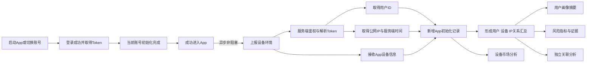
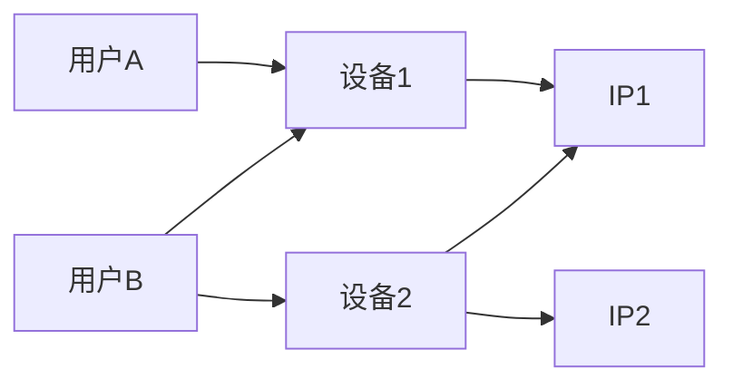

# 用户设备与账号关联分析

## 1. 需求概述

### 1.1 核心描述

建设一套“App初始化记录—用户、设备与IP关系—风险与市场分析”能力。

SANO App每次完成用户登录及应用初始化、成功进入App后，在正常初始化路径中异步调用设备环境上报接口。服务端以追加记录的方式保存每次收到的有效请求，不使用一条当前记录覆盖历史。系统基于初始化记录形成用户、设备和IP之间的关联关系，用于用户画像、设备关联调查、风险评分辅助及设备市场分析。

本文只定义数据采集、服务端处理、分析功能和产品使用方式，不包含页面原型设计。

### 1.2 核心原则

1. 每次登录并初始化成功后，App按照正常初始化逻辑发起上报；服务端收到有效请求后新增记录，不覆盖、不复用历史记录。
2. App异步上报，不等待接口结果，不因接口成功、失败或超时影响用户进入App及正常业务。
3. **用户ID不由App在请求正文中传入，服务端通过登录成功后的Token自动解析并绑定。**
4. **公网IP不以客户端上报值作为可信来源，由服务端根据本次请求连接及可信代理链自动取得。**
5. 服务端接收时间作为初始化记录的权威发生时间，本期不要求App上报客户端时间。
6. 设备MAC不是唯一设备依据。在平台允许且实际可取得时作为可空的辅助信息；无法取得、被随机化或返回占位值时不得影响上报。
7. 同设备、同IP只作为关联和风险信号，不能单独作为封禁、冻结、取消奖励或其他处罚依据。
8. 品牌、型号和设备性能信息主要用于市场结构、兼容性和体验分析，不得仅根据低端设备判断用户低价值或高风险。

## 2. 建设目标

1. 记录用户每次成功进入App时的设备和网络环境。
2. 查询一个用户在哪些设备、哪些IP上出现过。
3. 查询一个安装实例或有效MAC关联过哪些账号。
4. 查询一个IP关联过哪些账号和设备。
5. 识别多账号设备、IP聚集、频繁切换设备、跨国家跳变等异常信号。
6. 为用户画像提供设备与网络摘要及风险证据。
7. 建设独立的设备与账号关联分析模块，支持跨用户调查。
8. 分析不同国家、渠道和用户群体的主要设备品牌、型号、系统版本及使用质量。

## 3. 设计边界

### 3.1 本期包含

- App登录并初始化成功后的异步设备环境上报。
- 服务端通过Token解析用户ID。
- 服务端取得公网IP、接收时间，并完成IP归属及网络类型补充。
- App初始化记录的追加保存和查询。
- 用户—安装实例、用户—IP、安装实例/MAC—账号、IP—账号关系汇总。
- 用户画像中的设备与网络摘要。
- 独立设备与账号关联分析模块。
- 设备品牌、型号、系统版本及国家市场分析。
- 设备与IP风险指标输出，供风险评分或人工调查使用。

### 3.2 本期不包含

- 根据同设备或同IP直接自动处罚用户。
- 在前端页面直接计算风险分。
- 绕过Android、iOS平台限制获取永久硬件标识。
- 通过设备品牌、型号、IP等属性秘密拼接不可重置的设备指纹。
- 采集通讯录、短信、已安装App列表、Wi-Fi账号密码等与本需求无关的敏感数据。
- 页面原型、视觉稿和交互高保真设计。
- 数据库表结构、字段类型、索引及具体接口代码。

## 4. 核心概念

### 4.1 初始化成功

本文所称“初始化成功”必须同时满足：

1. 用户已经登录成功。
2. App已经取得有效登录Token。
3. 当前账号及进入App所需的必要业务数据已经初始化完成。
4. 用户已经或即将进入App主界面。

因此，每条初始化记录均应能够通过Token绑定到明确用户，不需要额外增加一条独立的“登录成功记录”。

### 4.2 App初始化记录

服务端每收到一次通过鉴权的上报请求，产生一条独立初始化记录。正常情况下，一次登录并初始化成功对应一次上报；因页面生命周期或重复回调偶发产生少量重复请求时，允许形成多条记录。

初始化记录表示：

> 某用户在某个服务端时间，通过某个App安装实例和设备环境，从某个公网IP成功进入SANO App。

初始化记录只追加，不因为同一用户、同一设备或同一IP重复出现而覆盖。

### 4.3 安装实例

安装实例表示当前App的一次安装，用于区别同一设备上的不同安装周期。用户首次安装并启动SANO App时，由App生成一个随机UUID并保存在App自己的本地私有存储中；此后每次登录并初始化成功时，App读取并上报同一个安装实例ID。

安装实例ID不与用户账号绑定。用户退出登录或切换账号时不得重新生成，否则无法判断多个账号是否出现在同一次App安装中。

#### 4.3.1 生命周期

| 场景 | 安装实例ID是否变化 | 说明 |
| --- | --- | --- |
| App关闭后重新打开 | 不变 | 继续读取本地已经保存的安装实例ID |
| 用户退出登录 | 不变 | 安装实例属于App安装，不属于用户账号 |
| 用户切换账号 | 不变 | 用于识别同一安装实例中的多账号关系 |
| App正常升级版本 | 不变 | App升级不得重新生成 |
| 手机重启 | 不变 | 继续读取App本地私有存储 |
| 用户主动清除App数据 | 变化 | 本地数据被清除，下次启动重新生成 |
| App卸载后重新安装 | 变化 | 新安装视为新的安装实例 |

因此，安装实例ID标识的是“一次App安装”，不是永久物理设备ID，也不能直接作为物理设备数量统计依据。

#### 4.3.2 编码格式

推荐使用平台前缀加UUID的格式：

```text
Android：android-550e8400-e29b-41d4-a716-446655440000
iOS：ios-550e8400-e29b-41d4-a716-446655440000
```

格式规则：

- 平台前缀固定使用小写`android-`或`ios-`。
- 唯一性由随机UUID保证。
- 不在安装实例ID中拼接用户ID、MAC、IP、设备品牌、型号或其他用户信息。
- UUID建议统一使用小写字符串，避免同一值因大小写不同被错误识别为两个安装实例。

如果技术团队为了排查需要采用“日期时间+UUID”，可以使用：

```text
android-20260920103045-550e8400-e29b-41d4-a716-446655440000
ios-20260920103045-550e8400-e29b-41d4-a716-446655440000
```

日期时间仅用于辅助阅读，不参与唯一性判断，也不能替代服务端接收时间。由于UUID本身已经具备足够的唯一性，本期优先推荐更简单的“平台前缀+UUID”。

#### 4.3.3 本地存储要求

- Android可保存在App私有的SharedPreferences、DataStore或等效私有存储中。
- Android应避免安装实例ID被系统自动备份并在重装后恢复；如启用Auto Backup，应将该值排除在备份恢复范围之外。
- iOS可保存在App沙盒内的UserDefaults或等效私有存储中。
- iOS不应将安装实例ID仅保存在Keychain或iCloud同步存储中，避免卸载重装后仍恢复旧值。
- 本地无值时才生成新ID；正常启动、账号切换、登录退出、版本升级和手机重启均不得重新生成。
- 生成或读取失败时，不阻塞用户进入App；该次上报可不携带安装实例ID，同时记录客户端异常供后续排查。

### 4.4 本期设备关联依据

本期不设计统一的“设备标识”和“设备标识类型”。设备与账号关联只使用以下已经明确的数据：

- 安装实例ID：用于确认多个账号是否出现在同一次App安装中。
- 有效MAC：平台允许且实际取得时，作为跨安装实例的辅助关联信号。

设备品牌、型号、IP和语言等普通属性不得单独或组合生成秘密永久指纹。

### 4.5 同设备

本期“同设备”是面向产品展示的概括表达，实际判断必须注明具体依据：

- 安装实例ID相同：可以确认属于同一次App安装实例。
- 有效MAC相同：作为可能属于同一物理设备的辅助关联。
- 品牌和型号相同：只表示同一类设备，不属于同设备证据。
- IP相同：只表示网络关联，不属于同设备证据。

如果用户卸载重装，并且无法取得有效MAC，本期不能可靠判断重装前后是否属于同一物理设备。

### 4.6 同IP

“同IP”表示初始化记录的服务端公网IP相同。分析时必须同时考虑时间窗口、ASN、IP类型和账号行为，避免将运营商共享IP、家庭网络、公司网络、学校或公共网络直接判定为异常。

## 5. 总体流程



## 6. App触发规则

### 6.1 必须触发

以下场景在当前用户登录并初始化成功后，按照正常初始化逻辑调用上报接口：

- App冷启动，登录及初始化成功。
- App进程被回收后重新启动，登录及初始化成功。
- 用户退出当前账号，登录另一个账号并初始化成功。
- 用户在App内切换账号，目标账号初始化成功。
- 其他确实重新执行完整登录和账号初始化流程的场景。

### 6.2 不触发

以下场景不新增App初始化记录：

- App仅从后台恢复到前台，未重新执行完整初始化。
- 用户停留在登录页，尚未登录成功。
- 登录失败、Token无效或Token刷新失败，未成功进入App。
- 初始化中断或初始化失败，未成功进入App。

### 6.3 保持正常、低频调用

App不生成初始化事件ID，不承担初始化记录的幂等判断，也不需要为了绝对只调用一次而增加锁、持久化状态位或专门防重流程。

App只需将上报放在正常的登录初始化成功路径中，避免明显的循环调用、高频定时调用和无业务原因的主动重复调用。页面生命周期或重复回调偶发导致少量重复请求时可以接受，服务端对每个通过鉴权的请求生成唯一记录ID并新增一条记录。

本期上报失败后不进行业务重试；下一次登录并初始化成功时，按照新的初始化事实再次调用。

### 6.4 App不判断触发类型

App不需要判断或上报本次初始化属于“正常启动”还是“账号切换”。对本需求而言，两者的业务事实相同：当前Token对应的用户已经登录并初始化成功。

如需识别账号切换，服务端可根据同一安装实例在相邻时间内连续绑定不同用户的初始化记录进行派生分析，并将结果标记为“疑似账号切换”。该派生结果不写回App原始上报内容，也不单独作为处罚依据。

## 7. 数据来源职责

### 7.1 来源总表

| code | 信息 | 数据类型 | 来源 | 是否必须 | 核心说明 |
| --- | --- | --- | --- | --- | --- |
| `id` | 记录ID | `bigint` | **服务端数据库生成** | 是 | 自增主键，每个保存成功的请求生成唯一记录ID |
| `user_id` | 用户ID | `int` | **服务端通过Token解析** | 原则上是 | App请求正文不传用户ID；数据库允许为空，异常值不得由客户端指定或覆盖 |
| `create_time` | 服务端接收时间 | `datetime(3)` | **服务端生成** | 是 | 权威记录时间和日期归属依据，精确到毫秒 |
| `app_install_id` | 安装实例ID | `varchar(128)` | App上报 | 原则上是 | 生成或读取失败允许为空，失败不得阻塞用户进入App |
| `brand_code` | 设备品牌/制造商 | `varchar(64)` | App上报 | 原则上是 | 保存App取得的品牌或制造商原值 |
| `device_model` | 设备型号 | `varchar(128)` | App上报 | 原则上是 | 保存系统取得的原始设备型号代码 |
| `device_time` | 设备系统当前时间 | `bigint` | App上报 | 否 | Unix毫秒时间戳，仅用于辅助判断设备时间异常 |
| `mac` | 请求设备标识 | `varchar(64)` | App上报 | 否 | 取`HttpRequestVO.mac`，沿用现有`adId/deviceId`设备标识口径；允许为空 |
| `os_version` | 操作系统及版本 | `varchar(128)` | App上报 | 原则上是 | 保存原值，例如`Android 15`、`iOS 18.0` |
| `app_issue_version` | App发布版本 | `varchar(64)` | App上报或请求头 | 原则上是 | 面向用户发布的版本号 |
| `app_build_version` | App构建版本 | `varchar(64)` | App上报或请求头 | 原则上是 | 内部构建号，按字符串保留原值 |
| `network_type` | 网络连接类型 | `varchar(16)` | App上报 | 否 | 保存客户端上报原值，非标准值也保留 |
| `rs` | 是否模拟器 | `tinyint` | App上报 | 否 | `1`是、`0`否、`NULL`表示未检测或无法确定 |
| `ra` | 是否开启VPN/代理 | `tinyint` | App上报 | 否 | `1`是、`0`否、`NULL`表示未检测或无法确定 |
| `ip` | 公网IP | `varchar(45)` | **服务端取得** | 原则上是 | 取`HttpRequestVO.ip`，沿用现有拦截器取值，兼容IPv4和IPv6 |
| `ip_country_code` | IP国家编码 | `varchar(16)` | 服务端解析 | 否 | 根据公网IP解析，解析失败为空 |
| `ip_region` | IP地区/省州 | `varchar(128)` | 服务端解析 | 否 | IP库不支持或解析失败时为空 |
| `ip_city` | IP城市 | `varchar(128)` | 服务端解析 | 否 | IP库不支持或解析失败时为空，精度仅供辅助分析 |
| `register_country_code` | 用户注册国家编码 | `varchar(16)` | **服务端用户信息** | 否 | 通过用户ID取得，服务端查询失败或原数据缺失时为空 |
| `register_channel_code` | 注册渠道 | `varchar(255)` | 服务端业务数据 | 否 | 取`sano_user_register.ad_channel`，缺失时为空 |
| `guild_owner_flag` | 是否公会长 | `tinyint` | 服务端业务数据 | 否 | 审核通过且未删除为`1`，否则为`0`，查询失败为`NULL` |
| `payroll_flag` | 是否Payroll代理 | `tinyint` | 服务端业务数据 | 否 | `level > 0`且未删除为`1`，否则为`0`，查询失败为`NULL` |
| `bd_flag` | 是否BD | `tinyint` | 服务端业务数据 | 否 | 存在`sys_user.bd_user_id`关联为`1`，不存在为`0`，查询失败为`NULL` |
| `client_type` | 客户端类型 | `varchar(20)` | App上报或请求上下文 | 否 | 保存`EClientType`对应值 |

本表与数据库表`sano_log_device`保持一致。除`id`和`create_time`外，数据库字段均允许`NULL`；“原则上是”表示正常请求应提供或能够取得，但异常缺失不阻塞记录保存。

`rs`、`ra`及三个`*_flag`身份字段统一使用`1/0/NULL`：`1`表示是，`0`表示否，`NULL`表示未检测、无法确定或服务端查询失败；`NULL`不得按`0`处理。

### 7.2 用户ID取得规则

用户ID的唯一可信来源是登录后的Token：

1. App调用上报接口时携带当前登录Token。
2. 服务端完成Token签名、有效期、用户状态等鉴权。
3. 服务端从Token或鉴权上下文取得用户ID。
4. 服务端将该用户ID写入App初始化记录。
5. App请求正文即使出现用户ID，也不得覆盖Token解析结果；建议请求正文不设计用户ID参数。

### 7.3 公网IP取得规则

公网IP由服务端取得：

1. 直连服务时使用服务端看到的远端连接IP。
2. 经过CDN、负载均衡或网关时，只从平台配置的可信代理链解析真实来源IP。
3. 不信任来自任意客户端的`X-Forwarded-For`或相似请求头。
4. 客户端如因排障需要上报“客户端报告IP”，必须与服务端公网IP分开保存，风险分析以服务端值为准。

### 7.4 时间取得规则

- 服务端接收时间为权威记录时间，采用服务器时间并统一按UTC+8展示和统计自然日。
- App可以上报设备系统当前时间`device_time`，但该值只用于辅助判断设备时间异常。
- `device_time`缺失或与服务端时间不一致时，不得覆盖服务端接收时间，也不得改变记录的日期归属。

### 7.5 用户注册国家取得规则

- 服务端通过Token解析出用户ID后，从用户服务或可信缓存取得用户注册国家。
- App不上传用户注册国家，也不允许客户端值覆盖服务端用户信息。
- 用户注册国家用于设备市场分组；本次IP国家用于登录网络位置和风险辅助分析。
- 注册国家与IP国家不一致只作为辅助信号，不单独形成风险处罚。

## 8. App上报内容

### 8.1 必要内容

- 安装实例ID。
- 设备品牌或制造商。
- 设备型号。
- 操作系统及版本。
- App版本和构建版本。

### 8.2 建议内容

- 网络连接类型。
- 是否模拟器`rs`。
- 是否开启VPN/代理`ra`。
- 设备系统当前时间`device_time`。

### 8.3 可空内容

- 安装实例ID生成或读取异常时的空值。
- MAC。
- 因权限、系统版本或设备能力无法取得的信息。

可空信息缺失时，App仍应完成上报，服务端不得因为MAC或其他可选信息为空拒绝整条记录。

### 8.4 后续高风险节点能力

以下能力不纳入本期初始化上报。后续开展高风险节点控制时，再在对应业务动作中按需接入：

- 同步调用Play Integrity或App Attest并等待校验结果。
- 完整Root、越狱或模拟器深度扫描。
- 主动查询公网IP。
- 接入多个第三方设备识别SDK。
- 请求位置、电话状态或附近Wi-Fi等额外权限。
- 为等待设备或完整性信息而延迟进入App。

建议优先应用于：

- 领取奖励。
- 实名认证。
- 充值、提现。
- 主播认证。
- 其他后续确认的高风险操作。

高风险节点能力应形成独立调用和独立结果，不要求每次App初始化都执行，也不得反向阻塞本期轻量初始化记录。

## 9. 接口与异常处理原则

### 9.1 App侧

- 接口异步调用，不阻塞主线程和进入App流程。
- App业务层不处理接口业务返回值，不展示成功或失败提示。
- 接口超时、失败或服务端异常不得中断登录后的正常使用。
- 设备字段采集异常时，使用已取得字段继续上报，不因单个可选字段失败放弃整条请求。
- 本期失败后不进行业务重试，App不保存待补传任务，也不处理服务端业务返回值。

### 9.2 服务端

- Token无效或无法解析用户ID时不保存为有效App初始化记录。
- 每个通过鉴权的请求由服务端生成唯一记录ID并追加保存。
- 服务端补充接收时间、公网IP及IP解析信息。
- 单个IP解析服务暂时失败时，可先保存原始记录，后续异步补充，不阻塞接口响应。
- 服务端应监控请求量、成功保存率、Token失败率、字段缺失率和客户端版本分布。

## 10. 初始化记录与分析数据分层

### 10.1 原始App初始化记录

原始初始化记录用于：

- 还原用户启动和账号切换时间线。
- 重新计算设备、IP和风险关系。
- 查看风险命中的原始证据。
- 排查客户端版本、字段缺失和数据质量问题。

原始初始化记录只追加。除IP归属补充、风险服务异步补充等明确的派生信息外，不修改App原始上报内容。

### 10.2 用户—安装实例关系汇总

按用户与安装实例ID汇总：

- 首次出现时间。
- 最后出现时间。
- 历史上报记录数，仅用于辅助观察，不代表严格启动次数。
- 近7天、近30天上报记录数。
- 最近使用的品牌、型号、系统和App版本。
- 使用过的IP数量和国家数量。

### 10.3 安装实例/MAC—账号关系汇总

分别按安装实例ID和有效MAC汇总。两种结果必须标明关联依据，不合并成未经证明的永久物理设备：

- 历史关联账号数。
- 近1天、近7天、近30天关联账号数。
- 账号首次、最后出现时间。
- 账号切换次数及切换时间线。
- 关联账号的风险等级和账号状态分布。
- 关联账号的注册、奖励、充值、提现和主播身份情况。

### 10.4 用户—IP关系汇总

按用户和公网IP汇总：

- 首次、最后出现时间。
- 出现次数。
- 近7天、近30天使用次数。
- IP国家、地区、ASN及网络类型。
- 是否代理、机房或高风险网络。

### 10.5 IP—账号关系汇总

按公网IP及时间窗口汇总：

- 近1小时、1天、7天、30天关联账号数。
- 关联设备数。
- 新注册账号数。
- 奖励领取、充值、提现或主播认证账号数。
- 高风险账号占比。
- IP类型及运营商信息。

## 11. 用户画像功能

### 11.1 页面位置

用户画像中增加设备与网络信息，但不新增一级标签页：

- “身份与关系”增加“设备与网络关联”模块。
- “风控记录”展示设备和IP相关风险结论及证据。
- 提供“查看完整关联分析”入口，进入独立分析模块并自动带入当前用户。

### 11.2 设备与网络关联摘要

建议展示：

- 最近一次初始化时间。
- 最近设备品牌、型号、系统版本和App版本。
- 历史设备数、近30天设备数。
- 历史IP数、近30天IP数。
- 最近公网IP、国家和网络类型。
- 当前设备历史关联账号数、近30天关联账号数。
- 当前IP近1天、近7天关联账号数。
- 是否存在频繁换设备、频繁换IP、跨国家跳变、代理或机房IP。
- 当前设备与IP风险结论。
- 数据更新时间。

### 11.3 设备登录历史

支持查看当前用户的App初始化记录，至少展示：

- 初始化时间。
- 设备品牌和型号。
- 操作系统及版本。
- App版本。
- 安装实例ID脱敏值。
- MAC脱敏值或“未取得”。
- 公网IP、国家、地区和网络类型。
- 本期已有的设备或网络风险结果。

安装实例ID、MAC和IP必须按权限脱敏展示。

### 11.4 风控记录关联

当设备或IP信号进入用户风险评分或人工调查时，风控记录应能够下钻到对应App初始化记录，并说明：

- 命中的指标。
- 使用的统计时间窗口。
- 关联账号数或设备数。
- 规则阈值和规则版本。
- 证据记录时间。
- 当前处理状态和人工结论。

## 12. 独立设备与账号关联分析模块

### 12.1 模块定位

独立模块用于跨账号、跨设备和跨IP调查，是用户画像的完整分析入口，不局限于当前用户。

### 12.2 查询入口

支持按照以下条件查询：

- 用户ID。
- 安装实例ID。
- MAC脱敏值或哈希值，仅在存在有效数据时。
- 公网IP。
- 设备品牌和型号。
- 国家、地区、ASN、运营商。
- 时间范围。
- 风险等级或风险标签。

### 12.3 用户视角

展示：

- 用户使用过的全部设备。
- 用户使用过的全部IP。
- 每个安装实例和IP的首次、最后出现时间及上报记录数。
- 设备与IP变化时间线。
- 同设备、同IP关联的其他账号。
- 相关风险信号和业务证据。

### 12.4 设备视角

展示：

- 本次使用的关联依据：安装实例ID或有效MAC。
- 安装实例ID或MAC脱敏值。
- 最近品牌、型号、系统和App版本。
- 首次、最后出现时间。
- 历史及近1天、7天、30天关联账号数。
- 关联账号列表、账号状态、国家、角色和风险等级。
- 账号切换时间线。
- 关联账号的奖励、充值、提现和主播身份摘要。

### 12.5 IP视角

展示：

- IP、国家、地区、城市、ASN和运营商。
- IP网络类型和代理风险。
- 首次、最后出现时间。
- 不同时间窗口内的关联账号数和设备数。
- 关联账号和设备列表。
- 注册、奖励领取、充值、提现和认证聚集情况。

### 12.6 关系分析

支持表达以下关系：



关系图只用于辅助调查，必须同时提供表格、时间范围、首次和最后出现时间，避免只根据关系线数量作出结论。

## 13. 风险指标建议

### 13.1 账号维度

- 近7天、近30天使用设备数。
- 近7天、近30天使用IP数。
- 设备更换次数。
- IP国家、地区或ASN跳变次数。
- 短时间跨国家或远距离环境切换。
- 模拟器、Root、越狱或App完整性异常次数。
- 当前设备和IP关联的高风险账号数量。

### 13.2 设备维度

- 同设备历史关联账号数。
- 同设备近1天、7天、30天关联账号数。
- 短时间账号切换次数。
- 同设备新注册、奖励领取、主播认证账号数。
- 同设备账号之间是否存在邀请、充值、提现、礼物或公会关系。
- 同设备高风险账号占比。

### 13.3 IP维度

- 同IP近1小时、1天、7天、30天关联账号数。
- 同IP关联设备数。
- 同IP新注册、领取奖励、认证和提现聚集数量。
- 同IP高风险账号占比。
- 是否机房、公开代理、VPN或其他高风险网络。

### 13.4 风险使用边界

- 单一指标不得直接形成最终处罚。
- 家庭共用设备、办公室、学校、宿舍、公共网络和运营商共享IP可能形成正常聚集。
- 风险分应组合设备、IP、时间密度、邀请关系、支付提现关系、奖励行为和App完整性等多个信号。
- 建议输出“正常、弱关联、可疑聚集、高风险关联、人工已确认”等分层结论。
- 高风险结论必须能够查看证据记录、规则版本和人工处理记录。

## 14. 设备市场分析

### 14.1 分析维度

- 国家、地区。
- 注册渠道。
- 用户角色。
- 设备品牌、制造商、型号、产品代码。
- Android/iOS及系统版本。
- App版本。
- 设备性能档位。
- 网络连接类型和运营商。

### 14.2 核心指标

- 去重用户数。
- 去重安装实例数。
- 新增用户数和活跃用户数。
- 品牌、型号、系统版本占比。
- D1、D7留存。
- 充值人数、充值率和付费金额。
- 主播人数、开播率和直播质量。
- 启动失败率、崩溃率、卡顿率和版本覆盖率。
- 不同设备档位的网络质量和业务体验。

### 14.3 统计规则

- 市场规模不得直接使用App初始化记录数，避免高频启动用户被重复放大。
- 用户结构使用去重用户数；安装覆盖和设备结构使用去重安装实例数。本期不输出“去重物理设备数”，避免将安装实例误认为永久物理设备。
- 品牌和型号应组合分析，不能只按型号名称合并不同制造商设备。
- 设备性能档位用于兼容性、质量和市场运营分析，不直接作为用户价值或风险结论。

## 15. 数据更新与计算

### 15.1 实时处理

App初始化记录保存后，可实时更新：

- 用户最近设备和最近IP。
- 用户—设备、用户—IP的首次和最后出现时间。
- 设备关联账号数。
- IP短时间关联账号数。
- 明确的完整性或高风险网络信号。

### 15.2 日汇总

按UTC+8自然日汇总：

- 用户日安装实例数、日IP数和上报记录数。
- 设备日关联账号数。
- IP日关联账号数和设备数。
- 品牌、型号、系统和App版本日分布。
- 国家和渠道设备结构。

### 15.3 重新计算

- 原始初始化记录应支持按指定日期范围重新计算关系和风险指标。
- IP归属库、代理识别库或风险规则升级后，应记录使用版本。
- 重新计算不得修改原始上报值，只更新派生关系、标签和指标。

## 16. 权限、隐私与安全

### 16.1 权限拆分

建议至少区分：

- 用户设备摘要查看权限。
- 完整设备历史查看权限。
- IP明文查看权限。
- 安装实例ID或MAC脱敏值查看权限。
- 跨账号关联分析权限。
- 风险证据查看权限。
- 市场统计查看权限。
- 数据导出权限。

### 16.2 数据保护

- 安装实例ID、MAC和IP属于敏感数据，传输必须使用HTTPS。
- 原始标识应加密或不可逆处理，业务页面默认展示脱敏值。
- 无权限用户不得通过前端隐藏方式取得原始数据。
- 查看和导出设备、IP及关联账号信息必须记录审计日志。
- 明确数据收集目的、使用范围、保留期限和删除机制，并与App隐私政策及应用商店披露保持一致。
- 不得将广告标识、永久硬件标识和用户敏感信息进行违反平台规则的关联。

### 16.3 平台限制

- Android普通第三方App不能将真实MAC作为稳定、普遍可用的设备标识。
- iOS不得通过设备属性和网络信息拼接永久设备指纹。
- 本期只使用安装实例ID和能够合法取得的MAC，不设计App Set ID、IDFV等统一设备标识字段。
- Play Integrity、DeviceCheck和App Attest留待后续高风险节点接入。

## 17. 验收标准

### 17.1 触发与上报

1. 用户登录并初始化成功后，App在正常初始化路径中调用上报接口。
2. 账号切换并初始化成功后为新账号产生新的上报。
3. 普通后台恢复且未重新初始化时不主动调用上报接口。
4. 接口失败、超时或返回异常不影响用户进入App及正常业务。
5. 本期上报失败后不进行业务重试，下一次初始化成功时正常新增记录。
6. App不需要判断或上报正常启动、账号切换等触发类型。
7. 不要求App实现严格防重；偶发重复请求可以正常保存，但不得出现循环或高频无效调用。

### 17.2 数据来源

1. 用户ID由服务端通过Token解析，请求正文不依赖用户ID。
2. 服务端接收时间为权威记录时间。
3. 公网IP由服务端连接或可信代理链取得。
4. 品牌、型号、系统、App版本和安装实例由App上报。
5. MAC缺失、随机化或不可用时不影响记录保存。
6. IP国家、ASN和网络风险由服务端补充。
7. 用户注册国家由服务端根据Token解析出的用户ID取得，App不重复上报。

### 17.3 初始化记录与关系

1. 服务端每次收到有效请求均新增记录，不覆盖旧数据；偶发重复记录不影响关系去重结果。
2. 可按用户查询其全部设备和IP历史。
3. 可分别按安装实例ID和有效MAC查询全部关联账号，并标明关联依据。
4. 可按IP查询指定时间范围内的关联账号和设备。
5. 关系汇总的首次、最后出现时间及次数可以下钻到原始初始化记录复核。

### 17.4 产品使用

1. 用户画像能够展示设备与网络摘要。
2. 风控记录能够展示设备/IP风险命中原因和证据入口。
3. 独立分析模块能够从用户、设备和IP三个视角调查。
4. 设备市场分析使用去重用户或去重安装实例，不直接以上报记录数代替用户规模。
5. 同设备、同IP不得作为单独自动处罚条件。

## 18. 待确认事项

1. Android和iOS各系统版本能够取得有效MAC的实际覆盖范围。
2. 后续高风险节点接入Android Play Integrity和iOS App Attest/DeviceCheck的具体阶段。
3. 原始App初始化记录、原始IP、安装实例ID和MAC的保留期限。
4. 同安装实例多账号、同MAC多账号、同IP账号聚集和频繁切换的初始风险阈值。
5. 独立分析模块允许哪些角色查看明文IP、关联账号及业务证据。

## 19. 官方平台参考

- Android唯一标识符最佳实践：<https://developer.android.com/identity/user-data-ids>
- Android 10隐私变化：<https://developer.android.com/about/versions/10/privacy/changes>
- Android Play Integrity：<https://developer.android.com/google/play/integrity/overview>
- Apple用户隐私和数据使用：<https://developer.apple.com/app-store/user-privacy-and-data-use/>
- Apple DeviceCheck与App Attest：<https://developer.apple.com/documentation/devicecheck>
