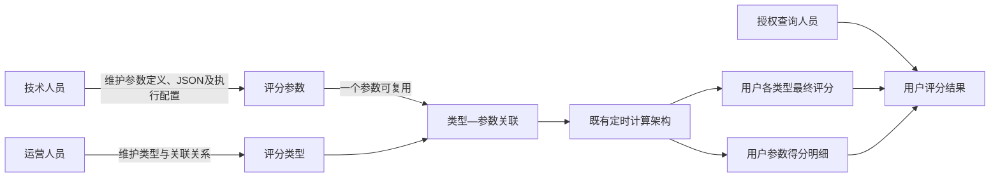

# 用户评分体系产品需求文档

## 1. 文档信息

| 项目 | 内容 |
| --- | --- |
| 需求名称 | 用户评分体系管理端 |
| 文档状态 | 已确认设计稿，待需求评审 |
| 涉及端 | 管理后台 |
| 一级功能 | 用户评分体系 |
| 二级页面 | 评分类型、评分参数、用户评分结果 |
| 目标使用者 | 运营人员、技术人员及其他授权查询人员 |
| 文档范围 | 评分类型配置、类型关联参数、评分参数配置、删除确认、权限控制、用户评分结果及参数明细查询 |
| 非本文范围 | 计算模型、参数代码实现、默认分使用规则、失败处理、定时调度、数据库结构调整、结果导出 |
| 数据结构基线 | `../资源/需求输入/analyse_score.sql`，保持既有计算架构和数据结构不变 |
| 原型基线 | `../设计/原型图`中的8张管理端原型；可编辑源文件位于`../设计/源文件` |

## 2. 需求背景

现有系统已经具备用户评分的数据结构、参数执行代码、定时计算、默认分及异常处理能力，但缺少供运营和技术分别维护配置的统一管理端，也缺少按用户查看各类型最终评分及参数明细的查询入口。

本次建设“用户评分体系”一级功能，通过评分类型、评分参数和用户评分结果三个二级页面形成配置与查询闭环。评分参数继续由技术人员维护，一个评分参数对应一个具体执行代码实现；评分类型及其参数组合由运营人员维护；系统仍使用既有架构完成定时计算并保存结果。

## 3. 需求目标

1. 为运营提供评分类型的新增、编辑、启停、删除和参数关联能力。
2. 为技术提供评分参数的新增、编辑、启停和删除能力，并清晰维护参数标识及JSON配置。
3. 允许评分参数被多个评分类型复用，同时阻止同一评分类型重复关联同一参数。
4. 提供用户评分结果查询，支持查看用户在某一评分类型下的最终评分及参数明细。
5. 通过角色与按钮级权限隔离运营配置和技术配置职责。
6. 对类型和参数删除提供明确的影响提示和二次确认，防止误操作。

## 4. 产品边界

### 4.1 本期范围

- 评分类型管理。
- 评分类型关联评分参数。
- 评分参数管理。
- 用户评分结果列表与详情。
- 运营、技术及查询权限控制。
- 删除二次确认及关联关系清理说明。

### 4.2 非本期范围

- 不定义最终评分的计算公式；具体模型由对应技术实现决定。
- 不定义默认分的使用方式，沿用既有实现。
- 不定义参数执行失败处理，沿用既有实现。
- 不设计定时任务周期、立即执行或调度配置，沿用既有实现。
- 不重新解释“注册计算”“新人计算”的内部执行逻辑。
- 不修改已有数据表、主键、索引或计算架构。
- 不提供用户评分结果导出。
- 不展示用户昵称、国家、手机号等资料，只展示用户ID。

## 5. 角色与权限

| 功能 | 运营人员 | 技术人员 | 只读查询人员 |
| --- | --- | --- | --- |
| 查看评分类型 | 允许 | 允许 | 允许 |
| 新增、编辑、启停、删除评分类型 | 允许 | 无权限 | 无权限 |
| 添加、移除类型关联参数 | 允许 | 无权限 | 无权限 |
| 查看评分参数 | 允许 | 允许 | 允许 |
| 新增、编辑、启停、删除评分参数 | 无权限 | 允许 | 无权限 |
| 查看用户评分结果及详情 | 允许 | 允许 | 允许 |

无操作权限时，页面保留查看能力，隐藏或禁用对应新增、保存、删除和关联按钮。后端接口必须同步校验权限，不能只依赖前端按钮控制。

## 6. 核心对象与业务规则

### 6.1 评分类型

评分类型是用户最终评分的业务分类，对应`analyse_score_type`。运营人员通过评分类型组合一个或多个技术评分参数。

页面维护字段如下：

| 字段 | 页面名称 | 规则 |
| --- | --- | --- |
| `id` | 类型标识 | 必填、唯一；创建成功后不可修改 |
| `name` | 类型名称 | 必填，供运营识别和结果展示 |
| `default_score` | 默认分数 | 按既有实现维护，本需求不重新定义其计算含义 |
| `last_login_day` | 最近登录天数 | 数字配置，具体扫描逻辑沿用既有实现 |
| `status` | 状态 | 启用或停用 |
| `last_exec_time` | 最近执行时间 | 系统回写，只读 |
| `exec_ms` | 最近执行耗时 | 系统回写，只读，单位毫秒 |

### 6.2 评分参数

评分参数是最小评分执行单元，对应`analyse_score_param`。每个参数标识对应一个具体代码实现，参数协议和执行代码由技术人员负责。

| 字段 | 页面名称 | 规则 |
| --- | --- | --- |
| `id` | 参数标识 | 必填、唯一，对应具体执行代码；创建成功后不可修改 |
| `name` | 参数名称 | 必填 |
| `json_value` | 参数配置JSON | 允许为空；非空时保存前校验JSON格式 |
| `default_score` | 默认分数 | 按既有实现维护 |
| `order_index` | 计算优先级 | 整数，数值越大越优先 |
| `status` | 状态 | 启用或停用 |
| `last_exec_time` | 最近执行时间 | 系统回写，只读 |
| `exec_interval_hour` | 最小执行间隔 | 非负整数，单位小时；执行逻辑沿用既有实现 |
| `init_param` | 注册计算 | 开关，内部含义沿用既有实现 |
| `new_user_exec` | 新人执行 | 开关，内部含义沿用既有实现 |

### 6.3 类型与参数关联

- 一个评分类型可以关联多个评分参数。
- 一个评分参数可以被多个评分类型复用。
- 同一评分类型不得重复关联同一评分参数。
- 关联操作只选择参数，不复制或修改参数内容。
- 运营可以查看参数名称、标识、优先级、默认分数和状态。
- 已关联参数可以由运营移除；移除前进行二次确认。
- 停用参数仍可在已关联列表中展示并标记“已停用”，但不会在可关联参数列表中作为正常候选项重复出现。
- 参数执行顺序和计算行为沿用既有架构，本需求不增加类型级权重或独立参数覆盖配置。

### 6.4 删除规则

评分类型和评分参数均允许删除。

删除评分类型时：

1. 展示二次确认弹窗，说明类型名称及已关联参数数量。
2. 确认后删除评分类型，并同步删除该类型对应的全部参数关联关系。
3. 历史评分等其他数据的处理按既有后端实现，本需求不额外定义。

删除评分参数时：

1. 展示二次确认弹窗，说明参数名称及正在使用该参数的评分类型数量。
2. 确认后删除评分参数，并同步删除该参数对应的全部类型关联关系。
3. 历史参数得分明细等其他数据的处理按既有后端实现，本需求不额外定义。

删除按钮使用危险色；弹窗默认焦点不得落在“确认删除”上。删除成功后刷新左侧列表，并自动选中下一条可用记录；无记录时展示空状态。

### 6.5 用户评分结果

用户评分结果列表对应用户各评分类型的最终评分。页面只展示用户ID，不关联展示其他用户资料。

- 支持按用户ID精确查询。
- 支持按评分类型筛选。
- 支持按最终评分区间筛选。
- 支持按评分更新时间范围筛选。
- 默认按评分更新时间倒序展示。
- 不提供导出、编辑或删除操作。
- 点击“查看详情”后打开右侧详情抽屉。

详情展示：

- 用户ID。
- 评分类型名称及类型标识。
- 最终评分。
- 评分更新时间。
- 参与该类型的参数得分明细，包括参数名称、参数标识、结果数据、所得分数和计算时间。

详情只读，不允许从结果页修改参数配置或最终评分。

## 7. 信息架构与业务流程

## 8. 页面需求

### 8.1 评分类型

页面采用左右结构。

左侧类型列表：

- 搜索类型名称或类型标识。
- 展示类型名称、类型标识和状态。
- 支持新增类型。
- 点击列表项后在右侧加载详情。
- 新增后右侧进入空白表单状态。

右侧类型内容：

- 顶部展示类型名称、状态、保存和删除操作。
- “基础配置”区域维护类型标识、类型名称、默认分数、最近登录天数和状态。
- “执行信息”区域只读展示最近执行时间及执行耗时。
- “关联评分参数”区域展示已关联参数，并支持添加或移除。

关联参数弹窗：

- 支持按参数名称或参数标识搜索。
- 只展示未关联的可选参数；已关联项显示“已关联”并禁止再次选择亦可，但不得重复保存。
- 支持多选参数并一次确认关联。
- 保存前再次校验重复关联，避免并发操作产生重复数据。

### 8.2 评分参数

页面采用左右结构。

左侧参数列表：

- 搜索参数名称或参数标识。
- 展示参数名称、标识和状态。
- 技术人员可新增参数。
- 点击参数后在右侧加载详情。

右侧参数内容：

- “基础信息”维护参数标识、参数名称、默认分数、计算优先级和状态。
- “执行配置”维护最小执行间隔、注册计算、新人执行和参数配置JSON。
- JSON区域使用等宽字体编辑器，提供格式校验和格式化能力。
- “运行信息”只读展示最近执行时间。
- 编辑已有参数时参数标识不可修改。

### 8.3 用户评分结果

顶部查询区域包含用户ID、评分类型、最低分、最高分、更新时间和查询/重置按钮。

结果表格字段：

| 字段 | 说明 |
| --- | --- |
| 用户ID | 只显示ID |
| 评分类型 | 类型名称和类型标识 |
| 最终评分 | 保留两位小数 |
| 评分更新时间 | 最终评分最近更新时间 |
| 操作 | 查看详情 |

表格分页显示总条数、页码和每页条数，不提供导出按钮。

详情采用右侧抽屉，宽度应足以展示参数明细表。抽屉关闭后保留当前查询条件和分页位置。

## 9. 页面状态与反馈

- 首次进入：默认选择左侧第一条记录；没有数据时展示空状态和有权限用户的新增入口。
- 加载中：列表和内容区分别展示骨架屏，避免整个页面阻塞。
- 保存成功：提示成功并刷新当前详情；不改变左侧搜索条件。
- 保存失败：保留已填写内容，展示后端返回的可理解错误信息。
- 重复关联：提示“该评分参数已关联当前评分类型”，不得新增重复关系。
- JSON错误：定位到JSON编辑区并提示格式错误，不提交保存。
- 删除成功：关闭弹窗、刷新列表并自动选择下一条记录。
- 查询无结果：展示空结果，不清除用户已输入的查询条件。

## 10. 原型页面对应

| 编号 | 页面 | 说明 |
| --- | --- | --- |
| 01 | 评分类型 | 左侧类型列表与右侧基础配置、关联参数 |
| 02 | 评分类型—关联参数 | 多选关联参数弹窗及重复关联状态 |
| 03 | 评分类型—删除确认 | 删除影响范围二次确认 |
| 04 | 评分参数 | 左侧参数列表与右侧详细配置 |
| 05 | 评分参数—新增参数 | 新增表单及参数标识说明 |
| 06 | 评分参数—删除确认 | 删除影响范围二次确认 |
| 07 | 用户评分结果 | 查询条件、结果列表与分页 |
| 08 | 用户评分结果详情 | 右侧抽屉展示最终评分及参数明细 |

## 11. 验收标准

1. 一级菜单“用户评分体系”下可进入评分类型、评分参数和用户评分结果三个二级页面。
2. 运营可以完成评分类型的新增、编辑、启停、删除和参数关联，不能编辑评分参数内容。
3. 技术可以完成评分参数的新增、编辑、启停和删除，参数标识创建后不可修改。
4. 同一参数可以关联多个评分类型；同一类型无法重复关联同一参数。
5. 删除类型或参数前必须二次确认，确认后同步解除对应关联关系。
6. 用户评分结果支持按用户ID、类型、分数区间和更新时间查询。
7. 结果列表只展示用户ID，不展示昵称等资料，不提供导出。
8. 点击结果详情可查看该类型最终评分及参数得分明细，所有内容只读。
9. 权限不足时隐藏或禁用操作按钮，接口同时拒绝越权操作。
10. 需求文档、SVG原型和PNG原型的页面、字段、角色及交互规则保持一致。

## 12. 待确认事项

当前没有阻塞管理端开发和评审的待确认事项。历史评分及参数明细在删除后的处理完全沿用既有后端实现，不在本需求中扩展。

