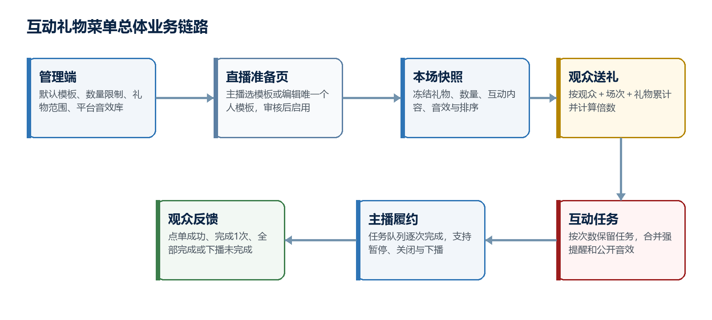
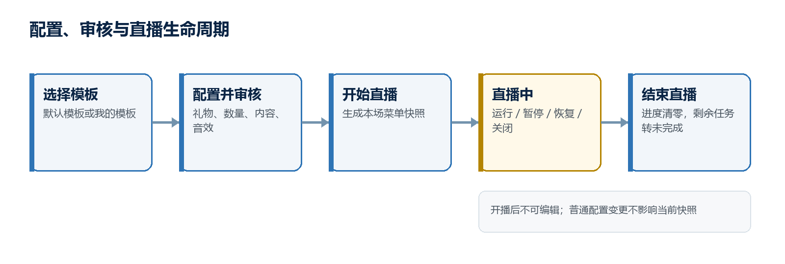

# 直播间互动礼物菜单产品需求文档

## 1. 文档信息

| 项目 | 内容 |
| --- | --- |
| 需求名称 | 直播间互动礼物菜单 |
| 文档状态 | 需求讨论稿，待需求评审 |
| 涉及端 | 管理后台、App主播直播准备页、App主播开播页、App观众直播间 |
| 目标使用者 | 主播、观众、运营、内容审核人员及其他授权人员 |
| 文档范围 | 平台默认模板、主播个人模板、活动项配置、礼物计数、合并强提醒、公开音效、任务履约、暂停/关闭/下播异常和数据闭环 |
| 非本文范围 | 数据库表结构、字段类型、接口协议、礼物结算规则改造、自动退款、主播自传音效、直播中编辑模板及详细测试用例 |
| 参考基线 | `sano用户任务体系/需求文档/优质主播体系迭代产品需求文档.md`的文档组织方式 |

## 2. 需求背景

现有直播间送礼主要提供礼物展示、动画和主播答谢，观众知道“送了什么”，但不一定知道“送出后可以获得什么公开互动”；主播收到大量礼物消息时，也容易漏掉需要完成的互动内容。运营目前缺少一套可配置、可审核、可控制数量并可追踪履约结果的互动菜单能力。

本次新增“互动礼物菜单”。平台可预设多个默认模板，主播在直播准备界面选择模板并按自身节目调整礼物、数量、互动内容和平台音效。一名主播最多保存一个个人模板，一场直播只能启用一个菜单。观众送出满足条件的礼物后，系统生成互动任务、向主播合并发送强提醒、在直播间公开播放关联音效；主播完成动作后逐次确认，触发观众收到完成反馈。

该能力不是单纯的礼物配置，而是“菜单展示—送礼累计—触发任务—主播履约—观众反馈”的实时闭环。产品设计需同时解决任务堆积、重复消息、音效冲突、直播中配置变更、内容审核、异常下播和理性消费等问题。

## 3. 竞品观察与设计结论

### 3.1 竞品观察

- 抖音公开的礼物菜单演示支持礼物与节目名称、特效关联，并提供模板复用、菜单项数量限制及启用审核，说明“礼物—节目”的直连表达已被用户理解。
- 快手心愿单支持配置不同礼物及目标数量，适合借鉴数量目标、进度展示和直播工具入口。
- 虎牙互动玩法限制可选择的互动礼物数量，并在直播间礼物面板置顶关联礼物，适合借鉴礼物可发现性和平台级数量控制。
- Twitch自定义奖励提供任务队列、完成/拒绝、暂停、单场/单用户限制和冷却机制，适合借鉴主播履约管理，避免触发后无人处理。

### 3.2 设计结论

1. 菜单必须直接显示“礼物×数量→互动内容”，避免观众自行换算。
2. 数量累计以同一观众、本场直播、同一礼物为边界，不做多人共同凑单。
3. 达到门槛后按倍数生成任务，但相同批次合并强提醒和公开音效，避免提醒轰炸。
4. 主播侧必须有待完成任务队列，并按次确认完成；仅有一条即时消息不足以保障履约。
5. 平台默认模板与主播个人模板分离；开播时生成本场快照，配置变更不得影响正在进行的直播。
6. 自定义文本必须审核，音效只允许使用平台音效库，首期不开放主播上传。

## 4. 需求目标

1. 为主播提供低门槛、可复用的互动礼物菜单配置能力，配置入口位于直播准备界面。
2. 支持管理端配置多个平台默认模板，并对主播可配置菜单项数量、礼物范围、触发数量和内容进行统一控制。
3. 每名主播最多保存一个个人模板，可基于平台默认模板修改；每场直播最多启用一个互动菜单。
4. 建立准确且可解释的礼物累计规则，支持按门槛倍数生成互动任务。
5. 通过合并强提醒、任务队列和逐次完成，降低主播漏做、重复提醒和任务混乱。
6. 支持每个活动项关联一个平台音效，触发后在直播间公开播放，并处理合并、排队、下架和静音场景。
7. 观众能够查看个人累计进度、触发结果和主播完成反馈，形成清晰的互动预期。
8. 建立内容审核、异常打赏识别、未成年人保护、操作日志和紧急停用能力。

## 5. 核心概念与产品边界

### 5.1 平台默认模板

平台默认模板由管理端创建和维护，可以配置多个，例如“舞蹈互动”“唱歌互动”“轻量趣味互动”。默认模板包含模板名称、适用场景、菜单项、排序和状态。平台模板属于预审核内容，启用状态下主播可以直接选择使用。

平台模板修改只影响后续选择或重新套用，不自动覆盖主播已经保存的个人模板，也不改变正在直播的菜单快照。平台出于安全或合规原因执行紧急下架时除外。

### 5.2 主播个人模板

每名主播最多保存一个个人模板。主播可以从空白创建，也可以选择某个平台默认模板后修改。个人模板保存主播最终确认的菜单项、顺序和音效配置。

主播已经存在个人模板时，再选择其他平台默认模板进行修改，应明确提示将覆盖现有个人模板，并在主播二次确认后执行。仅直接使用平台默认模板开播时，不要求覆盖个人模板。

### 5.3 本场直播菜单快照

主播在直播准备界面启用互动菜单并开始直播时，系统以当时审核通过的模板生成本场直播菜单快照。快照冻结菜单项、礼物ID、触发数量、互动内容、音效和展示顺序，作为本场累计、触发和履约的唯一依据。

开播后主播不能编辑礼物、数量、互动内容或音效，只能查看、暂停、恢复、关闭菜单，以及处理已触发任务。普通模板更新不得改变当前快照。

### 5.4 互动菜单项

互动菜单项是菜单中的最小配置单元，表示一条明确的“礼物条件→主播互动”。每项至少包括：

- 关联礼物。
- 触发数量。
- 互动名称，例如“跳1分钟舞蹈”。
- 互动说明，可选。
- 平台音效，可选且最多一个。
- 启用状态和展示顺序。

同一模板内，同一种礼物只能关联一个菜单项，避免观众从普通礼物面板送礼时无法确定触发内容。

### 5.5 观众累计进度

累计进度表示某一观众在本场直播中针对某个关联礼物，距离下一次触发门槛还差多少数量。累计维度固定为“观众ID＋直播场次ID＋礼物ID”。不同观众之间不合并，不跨直播场次保留。

### 5.6 互动任务

观众累计数量达到门槛时生成互动任务。任务记录触发观众、菜单项、触发次数、生成时间和履约状态。主播每完成一次，点击“完成1次”；系统减少待完成次数并向对应观众发送完成反馈。

### 5.7 公开互动音效与主播强提醒音

两类声音必须区分：

- 公开互动音效：由菜单项关联，从平台音效库选择，触发后在直播间公开播放。
- 主播强提醒音：平台固定的主播侧提示音，只用于提醒主播有新任务，不被菜单项音效替换。

公开音效遵循观众设备的直播静音和系统音量；主播强提醒仍需同时提供视觉和振动反馈，避免只依赖声音。

### 5.8 产品边界

- 首期不支持多人共同累计同一个活动目标。
- 首期不支持一个礼物在同一模板内关联多个互动内容。
- 首期不支持主播上传音效、音乐或视频。
- 首期不支持直播中编辑模板。
- 互动礼物仍属于现有礼物打赏，不因主播无法完成而自动退款。
- 礼物支付、分成、背包和退款流程沿用现有系统，本需求只消费“送礼成功”事件。

## 6. 全局业务口径

### 6.1 模板数量与启用口径

- 平台可配置多个默认模板，数量由管理端业务需要决定。
- 每名主播最多拥有一个个人模板。
- 每场直播最多启用一个互动礼物菜单。
- 每个模板的最大菜单项数量由管理端配置，首期建议默认6项。
- 模板项达到上限后不能继续新增，但可以删除或替换已有项。
- 一场直播未启用互动菜单时，所有礼物均按普通礼物处理，不产生累计进度或互动任务。

### 6.2 配置、审核与生效口径

- 平台默认模板发布前由平台审核，主播直接使用时可立即启用。
- 主播修改互动名称或说明后，提交机器审核；命中风险规则时进入人工审核。
- 主播个人模板审核中或审核不通过时，不阻塞正常开播，但未审核通过版本不能启用。
- 存在上一审核通过版本时，直播准备页允许主播继续使用上一版本；不存在可用版本时，提示改用平台默认模板或关闭互动菜单。
- 审核通过后保存为主播唯一的当前有效个人模板。
- 直播开始时生成快照，直播中不读取后续普通配置变更。

### 6.3 礼物累计口径

- 统计维度：同一观众＋本场直播＋同一礼物。
- 统计起点：本场互动菜单成功启用后。
- 统计终点：本场直播结束，或菜单被关闭且清除未达门槛进度。
- 礼物从互动菜单入口或普通礼物面板送出均可累计，只要礼物ID与快照配置一致。
- 以礼物系统返回“送礼成功”的事件为准；支付失败、发送失败或被系统撤销的事件不计入。
- 系统必须按送礼事件唯一标识去重，重复消息不得重复累计或重复生成任务。
- 观众离开直播间后再次进入，同一场直播的个人进度继续保留。

### 6.4 倍数触发与余数口径

计算规则如下：

```text
触发次数 = floor((原剩余数量 + 本次成功礼物数量) / 触发门槛)
新剩余数量 = (原剩余数量 + 本次成功礼物数量) % 触发门槛
```

示例：棒棒糖×2触发“跳1分钟舞蹈”。

| 原进度 | 本次送礼 | 触发结果 | 新进度 |
| ---: | ---: | --- | ---: |
| 0/2 | 1个 | 不触发 | 1/2 |
| 1/2 | 1个 | 触发1次 | 0/2 |
| 0/2 | 4个 | 触发2次 | 0/2 |
| 1/2 | 4个 | 触发2次 | 1/2 |

触发次数大于1时，业务任务按次数保留，但主播只收到一次合并强提醒，例如“用户A触发《跳1分钟舞蹈》×2”。

### 6.5 强提醒合并口径

- 同一个成功送礼事件产生多次触发时，合并为一条强提醒。
- 同一观众、同一活动在短时间合并窗口内连续触发时，可以继续合并次数；建议默认窗口为3秒，由管理端配置。
- 不同观众的任务不得合并，确保履约与完成反馈准确归属。
- 不同活动不得合并为一个任务，仅按触发顺序进入待完成队列。
- 合并只影响提醒展示和音效播放次数，不减少实际待完成次数。

### 6.6 公开音效口径

- 每个菜单项最多关联一个平台音效，也允许不关联。
- 主播只能从平台音效库选择、试听、替换或清除音效。
- 同一合并提醒无论触发几次，公开音效只播放一次。
- 不同活动同时触发时，音效按触发顺序排队播放，不得重叠。
- 单个音效建议不超过5秒，并由平台统一处理响度，避免明显盖住主播声音。
- 主播开播后不能更换音效，但可以临时关闭或恢复全部公开互动音效。
- 音效被平台紧急下架时立即停止使用；活动任务仍可触发，但不再播放该音效，并在下一次直播准备时提示主播重新选择。

### 6.7 暂停、关闭和下播口径

暂停互动菜单：

- 保留已有个人累计进度和待完成任务。
- 暂停期间观众端显示“互动菜单已暂停”。
- 暂停期间送出的礼物按普通礼物处理，不计入互动累计，不补记。
- 恢复后从暂停前进度继续累计。

关闭互动菜单：

- 关闭前二次确认，并提示未达门槛进度将清零。
- 已生成的待完成任务继续保留，主播仍需处理。
- 所有未达到门槛的个人进度清零。
- 本场直播不再产生新的互动累计和任务。

结束直播：

- 存在待完成任务时，弹出“还有N次互动未完成”的下播提示。
- 主播仍可确认下播，不强制完成任务才能结束直播。
- 下播后所有未达到门槛的进度清零。
- 剩余任务标记为“直播结束未完成”，通知对应观众，不自动退款。

### 6.8 任务履约与观众反馈口径

- 触发后任务初始状态为“待完成”。
- 同一观众、同一活动合并展示总待完成次数。
- 主播每完成一次点击“完成1次”，待完成次数减1。
- 每次完成都向对应观众发送“主播已完成本次互动”的反馈。
- 待完成次数归零后，任务组状态更新为“已完成”。
- 主播暂停或关闭菜单不影响已经生成任务的完成操作。
- 网络重试时完成操作必须幂等，重复点击不得多扣次数或多发完成通知。

### 6.9 理性消费和内容安全口径

- 禁止配置色情擦边、侮辱、危险动作、自残、暴力、饮酒吸烟、吞食异常物品等内容。
- 禁止配置返现、抽奖、线下见面、联系方式、私下交易、承诺特殊关系等诱导性内容。
- 禁止以未成年人为目标设计礼物互动，未成年人打赏限制沿用平台现有能力。
- 对高频、高金额、异常设备或疑似未成年打赏继续使用平台现有风控识别和确认机制。
- 运营可以紧急停用模板、菜单项、礼物或音效；安全停用优先级高于直播快照冻结规则。

## 7. 功能整体结构

### 7.1 总体业务链路



总体链路分为三部分：管理端负责平台模板、限制和音效资源；主播端负责直播前选择和配置、直播中任务履约；观众端负责菜单浏览、送礼累计、触发确认和完成反馈。系统在三端之间维护本场快照、个人累计进度和互动任务。

### 7.2 功能结构

```text
互动礼物菜单
├─ 管理端
│  ├─ 平台默认模板
│  ├─ 模板菜单项
│  ├─ 全局数量与内容限制
│  ├─ 平台音效库关联
│  ├─ 主播模板审核
│  └─ 触发、履约与异常数据
├─ App主播端
│  ├─ 直播准备页入口
│  ├─ 选择默认模板/编辑个人模板
│  ├─ 本场启用开关
│  ├─ 开播后暂停/恢复/关闭/静音
│  ├─ 合并强提醒
│  └─ 待完成任务队列
└─ App观众端
   ├─ 互动菜单入口
   ├─ 礼物×数量→互动内容
   ├─ 个人累计进度
   ├─ 触发成功反馈
   ├─ 公开互动音效
   └─ 主播完成反馈
```

### 7.3 角色职责

| 角色 | 主要职责 |
| --- | --- |
| 主播 | 直播前选择或配置模板、启用菜单；直播中处理任务、暂停/关闭菜单或临时静音 |
| 观众 | 查看菜单、成功送礼、查看个人进度、接收触发与完成反馈 |
| 运营 | 配置平台模板、数量限制、礼物范围、模板排序及紧急上下架 |
| 内容审核 | 审核主播自定义活动文本及命中风险的模板版本 |
| 系统 | 生成直播快照、累计礼物、生成任务、合并提醒、调度音效、记录履约状态 |

## 8. 管理后台详细设计

### 8.1 菜单结构

建议在直播运营配置下新增“互动礼物菜单”，包含：

```text
互动礼物菜单
├─ 平台模板
├─ 主播模板审核
├─ 规则配置
└─ 互动数据
```

音效资源沿用现有平台音效库；本功能只选择可用于“互动礼物菜单”的音效，不重复建设音频上传和版权审核能力。

### 8.2 平台模板列表

列表至少展示：

- 模板名称和模板编码。
- 适用直播类型或地区，可选。
- 菜单项数量。
- 当前状态：草稿、已启用、已停用。
- 排序。
- 创建人、更新时间和最后操作人。
- 操作：查看、编辑、复制、启用、停用。

管理端允许配置多个已启用的默认模板。模板停用后，主播不能再选择；主播已保存的个人模板不自动删除，但其中存在停用礼物、音效或违规内容时应按资源停用规则处理。

### 8.3 平台模板编辑

模板基础信息：

- 模板名称、模板编码、模板简介。
- 适用场景、适用地区或用户范围，可选。
- App展示封面或图标，可选。
- 启用状态和排序。

菜单项配置：

- 选择礼物。
- 触发数量。
- 互动名称和说明。
- 从平台音效库选择一个音效并试听。
- 启用状态和排序。

保存时校验：菜单项数量不得超过后台上限；同一礼物不得重复；礼物、音效必须为可用状态；触发数量必须在允许范围内；名称和说明必须通过内容审核。

### 8.4 规则配置

| 配置项 | 说明 | 首期建议值 |
| --- | --- | --- |
| 单模板最大菜单项数量 | 控制主播和平台模板最多可配置的活动数 | 6项，可配置 |
| 单项触发数量范围 | 防止数量为0或异常大值 | 1至99，可配置 |
| 互动名称长度 | 用于菜单卡片和强提醒主标题 | 最多20个字符 |
| 互动说明长度 | 用于补充动作、时长等信息 | 最多60个字符 |
| 强提醒合并窗口 | 同一观众、同一活动连续触发的合并时间 | 3秒，可配置 |
| 单个公开音效时长 | 控制直播间声音干扰 | 不超过5秒 |
| 待完成任务预警阈值 | 提醒主播暂停菜单，避免任务堆积 | 20次，可配置 |

礼物选择范围建议支持白名单和黑名单两种管理方式。已下架礼物不能新增关联；紧急下架礼物应立即停止累计和触发。

### 8.5 主播模板审核

列表展示主播ID、昵称、提交版本、来源模板、菜单项数量、审核状态、提交时间、风险命中和操作。

审核状态包括：

- 机器审核中。
- 人工待审核。
- 审核通过。
- 审核不通过。

审核不通过必须填写主播可见原因。审核过程中保留主播上一审核通过版本，不能用未审核版本覆盖当前可用版本。

### 8.6 紧急停用

管理端可以对以下对象执行紧急停用：

- 整个平台模板。
- 某个主播个人模板。
- 某个菜单项。
- 某个关联礼物。
- 某个平台音效。

紧急停用立即作用于正在直播的快照。已生成任务仍保留履约记录，但停用后不再累计、不再生成新任务、不再播放对应音效。所有操作记录操作人、时间、原因和影响场次。

### 8.7 互动数据

管理端至少支持按时间、模板、主播和活动查看：

- 菜单启用场次和启用时长。
- 菜单曝光、打开和送礼人数。
- 触发人数、触发次数和合并提醒次数。
- 待完成、已完成、下播未完成次数。
- 平均完成时长和完成率。
- 菜单暂停、关闭和音效静音次数。
- 音效播放成功率。
- 相关投诉、举报和异常打赏标识。

## 9. App主播端详细设计

### 9.1 直播准备页入口

功能入口固定放在直播准备界面，名称为“互动礼物菜单”。入口展示当前状态摘要：

```text
互动礼物菜单：已开启｜舞蹈互动｜共4项
审核状态：已通过
```

未配置时展示“未设置”；存在草稿、审核中或审核不通过版本时展示对应状态，但不阻塞主播开始普通直播。

### 9.2 进入后的页面结构

页面包括：

1. 本场启用开关。
2. 平台默认模板列表。
3. “我的模板”区域。
4. 当前模板菜单项列表。
5. 新增、编辑、排序和删除菜单项。
6. 审核状态和审核原因。
7. 预览观众端菜单。

主播可以直接选择一个平台默认模板用于本场，也可以“基于此模板编辑”并保存为个人模板。每名主播只有一个“我的模板”。

### 9.3 菜单项编辑

编辑表单包括：

- 关联礼物：从后台允许的礼物列表选择。
- 触发数量：在后台范围内输入。
- 互动名称：必填。
- 互动说明：选填。
- 关联音效：从平台音效库选择，支持试听和清除。

保存前实时校验同礼物重复、项目上限、内容长度和资源状态。保存后提交审核；审核通过前不替换主播上一有效版本。

### 9.4 开播前校验

主播开启“本场启用互动菜单”并点击开始直播时，系统校验：

- 当前选择的模板存在且可用。
- 模板或个人版本已经审核通过。
- 至少存在一个有效菜单项。
- 关联礼物处于可发送状态。
- 关联音效处于可播放状态；音效异常只影响音效，不阻塞活动项启用。

校验通过后生成本场直播菜单快照。校验不通过时，明确提示问题并允许主播关闭互动菜单后继续开播。

### 9.5 开播后操作

主播开播后不能修改模板，只能：

- 查看当前菜单。
- 暂停或恢复互动菜单。
- 关闭互动菜单。
- 临时关闭或恢复公开互动音效。
- 查看待完成任务队列。
- 对任务执行“完成1次”。

### 9.6 合并强提醒

新任务到达时，主播端同时提供：

- 顶部高亮横幅。
- 平台固定强提醒音。
- 设备振动。
- 常驻待完成数量角标。

提醒内容示例：

```text
用户A送出棒棒糖×4
触发：跳1分钟舞蹈 ×2
当前待完成：5次
```

强提醒不遮挡结束直播、举报、静音等安全操作。主播未立即处理时，任务仍保留在队列中，不反复全屏弹出。

### 9.7 任务队列

任务队列按触发时间排序，同一观众、同一活动可以合并展示：

```text
用户A｜跳1分钟舞蹈
棒棒糖×2/次｜待完成2次
[完成1次]
```

点击“完成1次”后立即更新剩余次数，并向该观众发送完成反馈。完成次数为0后移入已完成记录。达到后台配置的待完成预警阈值时，提示主播暂停菜单；平台可根据风控策略自动暂停，但不得清除已生成任务。

### 9.8 下播处理

主播点击结束直播时：

- 无待完成任务：正常确认下播。
- 有待完成任务：显示剩余总次数及主要活动，并提示下播后将标记为未完成。
- 主播确认后正常下播；系统将剩余任务标记为“直播结束未完成”，并向对应观众通知。

## 10. App观众端详细设计

### 10.1 菜单入口和展示

直播间在菜单启用时展示“互动菜单”入口。点击后按主播配置顺序展示活动卡片：

```text
棒棒糖 ×2
跳1分钟舞蹈
当前进度：1/2
[送2个并点单]
```

菜单卡片至少展示礼物图标、礼物名称、触发数量、互动名称、个人进度和快捷送礼按钮。关联音效名称可以作为次要信息展示。

### 10.2 送礼和累计反馈

- 观众可以从互动菜单快捷送出目标数量，也可以从普通礼物面板送出关联礼物。
- 未达到门槛时，仅该观众看到“当前1/2，还差1个”的个人进度。
- 达到门槛时，观众收到“点单成功，已通知主播”。
- 一次触发多次时，显示“成功点单2次”。
- 不向其他观众展示某人的未达门槛进度，避免形成公开催促消费。

### 10.3 公开触发反馈和音效

任务触发后，直播间可以展示轻量公屏反馈，并播放关联公开音效。合并任务只播放一次音效；不同活动的音效按队列播放。观众主动静音直播、系统静音或客户端不支持播放时，不影响任务生成。

### 10.4 主播完成反馈

主播每点击一次“完成1次”，对应观众收到：

```text
主播已完成你点的《跳1分钟舞蹈》
本次剩余待完成：1次
```

全部完成时显示“本次互动已全部完成”。观众离开直播间后，反馈可以进入站内通知；是否推送系统通知沿用现有通知权限。

### 10.5 暂停、关闭和结束状态

- 暂停：入口保留并显示“互动菜单已暂停”，不能通过菜单快捷送礼；普通送礼不累计。
- 关闭：入口隐藏或显示“本场互动已结束”，个人未达门槛进度清零。
- 下播：未达门槛进度清零；未完成任务向对应观众展示“直播结束，本次互动未完成”。

## 11. 状态设计

### 11.1 模板状态

| 对象 | 状态 | 说明 |
| --- | --- | --- |
| 平台默认模板 | 草稿 | 仅管理端可见，不可被主播选择 |
| 平台默认模板 | 已启用 | 主播可选择并用于开播 |
| 平台默认模板 | 已停用 | 不可新选，保留历史使用记录 |
| 主播个人模板 | 草稿 | 主播正在编辑，不能启用 |
| 主播个人模板 | 审核中 | 新版本待审核，上一通过版本仍可用 |
| 主播个人模板 | 审核通过 | 可在直播准备页启用 |
| 主播个人模板 | 审核不通过 | 展示原因，可修改后重新提交 |

### 11.2 本场菜单状态

| 状态 | 可累计新礼物 | 保留未达门槛进度 | 可处理已有任务 |
| --- | :---: | :---: | :---: |
| 未启用 | 否 | 否 | 否 |
| 运行中 | 是 | 是 | 是 |
| 已暂停 | 否 | 是 | 是 |
| 已关闭 | 否 | 否 | 是 |
| 已结束 | 否 | 否 | 否，剩余任务转未完成 |

### 11.3 互动任务状态

| 状态 | 说明 | 观众反馈 |
| --- | --- | --- |
| 待完成 | 已达到门槛，主播尚未完成 | 点单成功，已通知主播 |
| 部分完成 | 合并任务已完成部分次数 | 已完成1次，仍有剩余 |
| 已完成 | 所有触发次数均已履约 | 本次互动已全部完成 |
| 直播结束未完成 | 下播时仍有剩余次数 | 直播结束，本次互动未完成 |
| 风控终止 | 礼物、模板或直播被平台安全终止 | 按平台统一风险文案展示 |

## 12. 端到端业务流程

### 12.1 配置与开播流程



1. 运营配置并发布平台默认模板、礼物范围、数量限制和可选音效。
2. 主播进入直播准备页，直接选择默认模板，或基于默认模板编辑个人模板。
3. 主播自定义版本通过审核后成为当前有效个人模板。
4. 主播开启“本场启用互动菜单”并开始直播，系统生成本场快照。
5. 开播后模板不可编辑，只允许暂停、恢复、关闭和静音。

### 12.2 触发与履约流程

1. 观众打开互动菜单或普通礼物面板，成功发送关联礼物。
2. 系统按观众、直播场次和礼物读取原累计进度，并按门槛计算触发次数和余数。
3. 未触发时只更新该观众个人进度；触发时生成对应次数的互动任务。
4. 同批次任务合并主播强提醒，公开音效播放一次。
5. 主播在任务队列每完成一次点击“完成1次”。
6. 系统幂等更新任务次数，并向对应观众反馈。
7. 全部次数完成后任务组结束；下播仍未完成则转为“直播结束未完成”。

## 13. 异常与边界处理

### 13.1 礼物或音效资源变化

- 礼物普通下架：后续模板不可新增关联，下一次直播准备时提示替换。
- 礼物紧急下架：正在直播立即停止累计和新触发，已有任务保留。
- 音效普通下架：下一次直播准备时提示替换；当前场是否继续播放由下架级别决定。
- 音效紧急下架：当前场立即停止播放，活动任务仍可生成。

### 13.2 网络重复和乱序

- 送礼事件按唯一事件标识去重。
- 完成操作按任务和完成序号保证幂等。
- 事件短时乱序时，以服务端接收和礼物成功时间共同确定队列顺序；不得产生负数进度。
- 客户端重连后从服务端恢复菜单状态、个人进度和主播待完成任务，不使用本地缓存作为最终结果。

### 13.3 高并发触发

- 同一观众、同一活动按合并窗口聚合。
- 不同观众分别生成任务，避免归属混乱。
- 公开音效串行播放，不允许多个音效叠加。
- 待完成量达到预警阈值时提醒主播暂停；达到安全上限时平台可以自动暂停新触发。
- 自动暂停只停止后续累计，不删除个人已有进度和任务。

### 13.4 投诉和退款

- 菜单明确展示互动内容和所需礼物数量，减少预期争议。
- 主播未完成任务时向观众如实反馈状态，但不自动退款。
- 退款、未成年人打赏和异常消费投诉进入平台现有客服及风控流程。
- 管理端保留送礼事件、触发计算、提醒、音效、完成操作和下播状态，支持争议追溯。

## 14. 数据与审计要求

### 14.1 核心事件

- 直播准备页互动菜单曝光、进入和启用。
- 默认模板选择、个人模板保存和审核结果。
- 菜单曝光、打开、快捷送礼和普通面板关联送礼。
- 个人进度变化、任务触发、合并提醒和公开音效播放。
- 主播暂停、恢复、关闭、静音和完成1次。
- 任务全部完成、下播未完成和风控终止。

### 14.2 核心指标

- 菜单启用率和模板使用分布。
- 菜单打开率、菜单送礼转化率和关联礼物消费人数。
- 人均触发次数、倍数触发占比和平均剩余进度。
- 任务完成率、平均完成时长和下播未完成率。
- 暂停率、关闭率、自动暂停率和任务堆积峰值。
- 音效播放成功率、静音率和资源异常率。
- 投诉率、未成年人退款率和异常打赏命中率。

### 14.3 审计日志

需记录平台模板和规则配置变更、主播模板版本及审核、直播快照、资源紧急停用、送礼去重结果、触发计算、强提醒、音效调度、完成操作和下播未完成结果。历史直播必须读取当场快照和事件记录，不使用当前模板反向解释。

## 15. 权限与合规要求

### 15.1 权限

- 主播只能编辑自己的个人模板和处理自己的直播任务。
- 运营按权限管理平台模板、规则和紧急停用。
- 内容审核人员只能查看审核所需内容并提交审核结果。
- 数据查看按现有主播运营和隐私权限控制。

### 15.2 合规

平台需要依据网络主播行为、直播打赏和未成年人保护规则建立打赏互动负面清单、异常识别和投诉处理机制。自定义活动文本、模板默认内容和平台音效均不得包含违法、不良、危险、低俗或诱导性信息。

主播直播中的实际动作仍属于直播内容，需沿用现有内容巡检和处罚体系。模板审核通过不代表主播可以在履约时实施与文案不一致的违规动作。

## 16. 首期范围与后续扩展

### 16.1 首期范围

- 多个平台默认模板。
- 每名主播一个个人模板。
- 直播准备页配置和启用。
- 礼物、数量、互动名称、说明和一个平台音效。
- 同一观众、本场直播、同一礼物累计。
- 倍数触发、余数保留和合并强提醒。
- 公开音效、主播强提醒和待完成任务队列。
- 主播逐次完成和观众完成反馈。
- 暂停、关闭、静音和下播异常处理。
- 内容审核、紧急停用、数据统计和审计日志。

### 16.2 后续扩展

- 多人共同凑单或全场目标。
- 自动特效、视频、灯光或直播设备联动。
- 场控或管理员代处理任务。
- 模板市场、模板推荐和按直播类型智能推荐。
- 更精细的单用户、单场、活动冷却和限次策略。
- 互动任务满意度或观众确认机制。

## 17. 已确认规则汇总

1. 功能入口位于主播直播准备界面。
2. 开播后只能暂停、恢复、关闭、静音和处理任务，不能编辑模板。
3. 平台可设置多个默认模板，每名主播最多拥有一个个人模板。
4. 管理端可以限制模板菜单项数量。
5. 菜单项关联礼物、触发数量、互动内容和一个平台音效。
6. 音效只能从平台音效库选择，并在直播间公开播放。
7. 数量按同一观众、本场直播、同一礼物累计，下播清零。
8. 送礼数量达到多个门槛时生成多次任务，但合并强提醒，音效只播放一次。
9. 主播每完成一次点击“完成1次”，对应观众收到完成反馈。
10. 暂停保留进度和任务；关闭清除未达门槛进度但保留任务；下播未完成任务标记未完成且不自动退款。

## 18. 待确认事项

当前核心业务规则已完成沟通确认。以下仅为上线前运营参数，不影响功能主体开发，可通过管理端配置后在需求评审阶段定稿：

1. 单模板最大菜单项数量的首期正式值，当前建议6项。
2. 触发数量上限、强提醒合并窗口和待完成安全上限的正式值。
3. 首批平台默认模板、可选礼物白名单和平台音效清单。
4. 哪些直播类型、地区或主播等级首批开放，以及灰度节奏。
5. 高风险自定义内容进入人工审核的时效和责任团队。

## 19. 参考资料

1. 抖音礼物菜单公开演示：https://www.douyin.com/shipin/7293825604166928411
2. 快手直播伴侣与心愿单说明：https://live.kuaishou.cn/live-partner-tutorial/PCLive
3. 虎牙互动玩法礼物配置：https://dev.huya.com/docs/miniapp/danmugame/open/gift/
4. Twitch Channel Points Guide：https://help.twitch.tv/s/article/channel-points-guide?language=en_US
5. 《网络主播行为规范》：https://www.nrta.gov.cn/art/2022/6/22/art_113_60757.html
6. 《关于加强网络直播打赏规范管理的通知》：https://legalinfo.moj.gov.cn/zhfxfzzx/fzzxyw/202604/t20260414_533772.html
